# Day02. 项目环境-Docker

> 原文链接：https://my.feishu.cn/wiki/RPvlwJEwRi0nbbk8Fe0cOeJGnvc

在昨天的课程中，我们学习了Linux操作系统的常见命令，在Linux上安装软件，以及如何在Linux上部署一个单体项目。大家想一想自己最大的感受是什么？
我相信，除了个别天赋异禀的同学以外，大多数同学都会有相同的感受，那就是麻烦。核心体现在三点：
- 命令太多了，记不住
- 软件安装包名字复杂，不知道去哪里找
- 安装和部署步骤复杂，容易出错
其实上述问题不仅仅是新手，即便是运维在安装、部署的时候一样会觉得麻烦、容易出错 。
特别是我们即将进入项目阶段的学习，项目动辄就是十几台、几十台、甚至上百台服务需要部署，有些大型项目甚至达到成千上万台服务。而**由于每台服务器的运行环境不同，你写好的安装流程、部署脚本并不一定在每个服务器都能正常运行**，经常会出错。这就给系统的部署运维带来了很多困难 。
那么，有没有一种技术能够避免部署对服务器环境的依赖，减少复杂的部署流程呢？
答案是肯定的，这就是我们今天要学习的**Docker**技术。你会发现，有了Docker以后项目的部署如丝般顺滑，大大减少了运维工作量。
即便你对Linux不熟悉，你也能**轻松部署各种常见软件、项目**。
> 通过今天的学习，大家要能够达成下面的学习目标：
> - 能利用Docker部署常见软件
> - 能利用Docker打包并部署Python应用
> - 理解Docker数据卷的基本作用
> - 能看懂DockerCompose文件
注意，为了方便大家访问，Docker已经安好，但是需要大家先关闭防火墙，并重启Docker服务：

```python
systemctl stop firewalld
systemctl disable firewalld

# 重启
systemctl restart docker
```

# 1. 快速入门
要想让Docker帮我们安装和部署软件，肯定要保证你的机器上有Docker。由于大家的操作系统各不相同，安装方式也不同。为了便于大家学习，我们统一在之前提供给大家的CentOS的虚拟机中**已经安装了Docker**，统一学习环境。
如果大家需要自己在别的机器上安装Docker环境，可以参照最后的 [**附录中的：Docker安装文档**](https%3A%2F%2Fmy.feishu.cn%2Fdocx%2FT4tqdGHMXohO8Ox3yUUcwXTanHf%23doxcn63KjT2av3fpppXN7l3F8qe)

## 1.1 部署MySQL
首先，我们利用Docker来安装一个MySQL软件，大家可以对比一下之前传统的安装方式，看看哪个效率更高一些。
如果是利用传统方式部署MySQL，大概的步骤有：
- 搜索并下载MySQL安装包
- 上传至Linux环境
- 解压和配置环境
- 安装
- 初始化和配置
而使用Docker安装，仅仅需要一步即可，在命令行输入下面的命令（建议采用CV大法）：

```powershell
docker run -d \
  --name mysql \
  -p 3307:3306 \
  -e TZ=Asia/Shanghai \
  -e MYSQL_ROOT_PASSWORD=123 \
  mysql:8.0
```
运行效果如图（在给大家提供的资料中，已经下载好了mysql 8.0 版本的镜像）：

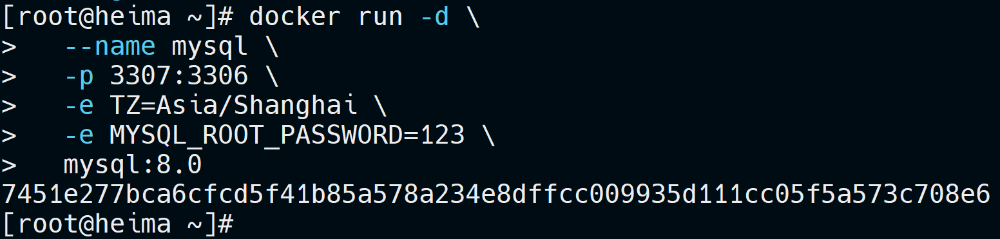
MySQL安装完毕！通过任意客户端工具即可连接到MySQL。
**说明：**
其实，当我们执行命令后，Docker做的第一件事情，是去自动搜索并下载了MySQL，然后会自动运行MySQL，我们完全不用插手，是非常方便的 。
而且，这种安装方式你完全不用考虑运行的操作系统环境，它不仅仅在CentOS系统是这样，在Ubuntu系统、macOS系统、甚至是装了WSL的Windows下，都可以使用这条命令来安装MySQL 。
要知道，不同操作系统下其安装包、运行环境是都不相同的！如果是手动安装，必须手动解决安装包不同、环境不同的、配置不同的问题！
而使用Docker，这些完全不用考虑。就是因为Docker会自动搜索并下载MySQL。
**注意：**
这里下载的不是安装包，而是**镜像(Image)。**镜像中不仅包含了MySQL本身，还包含了其运行所需要的环境、配置、系统级函数库。因此它在运行时就有自己独立的环境，就可以跨系统运行，也不需要手动再次配置环境了。这套独立运行的隔离环境我们称为**容器**。
说明：
- 镜像：英文是image
- 容器：英文是container
> 因此，Docker安装软件的过程，就是自动搜索下载镜像，然后创建并运行容器的过程。
Docker会根据命令中的镜像名称自动搜索并下载镜像，那么问题来了，它是去哪里搜索和下载镜像的呢？这些镜像又是谁制作的呢？
Docker官方提供了一个专门管理、存储镜像的网站，并对外开放了镜像上传、下载的权利。Docker官方提供了一些基础镜像，然后各大软件公司又在基础镜像基础上，制作了自家软件的镜像，全部都存放在这个网站。这个网站就成了Docker镜像交流的社区：https://hub.docker.com
基本上我们常用的各种软件都能在这个网站上找到，我们甚至可以自己制作镜像上传上去。【**但是该网站，目前国内上不去了**】
像这种提供存储、管理Docker镜像的服务器，被称为**DockerRegistry**，可以翻译为**镜像仓库**。DockerHub网站是官方仓库，阿里云、华为云会提供一些第三方仓库，我们也可以自己搭建私有的镜像仓库。
官方仓库在国外，下载速度较慢，一般我们都会使用第三方仓库提供的镜像加速功能，提高下载速度。而企业内部的机密项目，往往会采用私有镜像仓库。
总之，镜像的来源有两种：
- 基于官方基础镜像自己制作
- 直接去DockerRegistry下载
> **总结一下**：
> Docker本身包含一个后台服务，我们可以利用Docker命令告诉Docker服务，帮助我们快速部署指定的应用。Docker服务部署应用时，首先要去搜索并下载应用对应的镜像，然后根据镜像创建并允许容器，应用就部署完成了。
用一幅图表示如下：

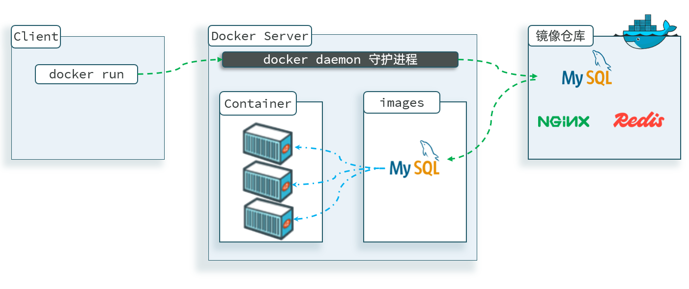

## 1.2 命令解读
利用Docker快速的安装了MySQL，非常的方便，不过我们执行的命令到底是什么意思呢？

```powershell
docker run -d \
  --name mysql \
  -p 3307:3306 \
  -e TZ=Asia/Shanghai \
  -e MYSQL_ROOT_PASSWORD=123 \
  mysql:8.0
```
> **解读：**
> - docker run -d ：创建并运行一个容器，-d则是让容器以后台进程运行
> - --name mysql  : 给容器起个名字叫mysql，你可以叫别的
> - -p 3307:3306 : 设置端口映射。
>   - **容器是隔离环境**，外界不可访问。但是可以**将宿主机端口映射容器内到端口**，当访问宿主机指定端口时，就是在访问容器内的端口了。
>   - 容器内端口往往是由容器内的进程决定，例如MySQL进程默认端口是3306，因此容器内端口一定是3306；而宿主机端口则可以任意指定，一般与容器内保持一致。
>   - 格式： -p 宿主机端口:容器内端口，示例中就是将宿主机的3307映射到容器内的3306端口
> - -e TZ=Asia/Shanghai : 配置容器内进程运行时的一些参数
>   - 格式：-e KEY=VALUE，KEY和VALUE都由容器内进程决定
>   - 案例中，TZ=Asia/Shanghai是设置时区；MYSQL_ROOT_PASSWORD=123是设置MySQL默认密码
> - mysql:8 : 设置**镜像**名称，Docker会根据这个名字搜索并下载镜像
>   - 格式：REPOSITORY:TAG，例如mysql:8.0，其中REPOSITORY可以理解为镜像名，TAG是版本号
>   - 在未指定TAG的情况下，默认是最新版本，也就是mysql:latest
镜像的名称不是随意的，而是要到DockerRegistry中寻找，镜像运行时的配置也不是随意的，要参考镜像的帮助文档，这些在DockerHub网站或者软件的官方网站中都能找到。
如果我们要安装其它软件，也可以到DockerRegistry中寻找对应的镜像名称和版本，阅读相关配置即可。

# 2. Docker基础
接下来，我们一起来学习Docker使用的一些基础知识，为将来部署项目打下基础。

## 2.1 常见命令

### 2.1.1 命令介绍
其中，比较常见的命令有：

| **命令** | **说明** | **文档地址** |
| --- | --- | --- |
| docker pull | 拉取镜像 | [docker pull](https%3A%2F%2Fdocs.docker.com%2Fengine%2Freference%2Fcommandline%2Fpull%2F) |
| docker push | 推送镜像到DockerRegistry | [docker push](https%3A%2F%2Fdocs.docker.com%2Fengine%2Freference%2Fcommandline%2Fpush%2F) |
| docker images | 查看本地镜像 | [docker images](https%3A%2F%2Fdocs.docker.com%2Fengine%2Freference%2Fcommandline%2Fimages%2F) |
| docker rmi | 删除本地镜像 | [docker rmi](https%3A%2F%2Fdocs.docker.com%2Fengine%2Freference%2Fcommandline%2Frmi%2F) |
| docker run | 创建并运行容器（不能重复创建） | [docker run](https%3A%2F%2Fdocs.docker.com%2Fengine%2Freference%2Fcommandline%2Frun%2F) |
| docker stop | 停止指定容器 | [docker stop](https%3A%2F%2Fdocs.docker.com%2Fengine%2Freference%2Fcommandline%2Fstop%2F) |
| docker start | 启动指定容器 | [docker start](https%3A%2F%2Fdocs.docker.com%2Fengine%2Freference%2Fcommandline%2Fstart%2F) |
| docker restart | 重新启动容器 | [docker restart](https%3A%2F%2Fdocs.docker.com%2Fengine%2Freference%2Fcommandline%2Frestart%2F) |
| docker rm | 删除指定容器 | [docs.docker.com](https%3A%2F%2Fdocs.docker.com%2Fengine%2Freference%2Fcommandline%2Frm%2F) |
| docker ps | 查看容器 | [docker ps](https%3A%2F%2Fdocs.docker.com%2Fengine%2Freference%2Fcommandline%2Fps%2F) |
| docker logs | 查看容器运行日志 | [docker logs](https%3A%2F%2Fdocs.docker.com%2Fengine%2Freference%2Fcommandline%2Flogs%2F) |
| docker exec | 进入容器 | [docker exec](https%3A%2F%2Fdocs.docker.com%2Fengine%2Freference%2Fcommandline%2Fexec%2F) |
| docker save | 保存镜像到本地压缩文件 | [docker save](https%3A%2F%2Fdocs.docker.com%2Fengine%2Freference%2Fcommandline%2Fsave%2F) |
| docker load | 加载本地压缩文件到镜像 | [docker load](https%3A%2F%2Fdocs.docker.com%2Fengine%2Freference%2Fcommandline%2Fload%2F) |
| docker inspect | 查看容器详细信息 | [docker inspect](https%3A%2F%2Fdocs.docker.com%2Fengine%2Freference%2Fcommandline%2Finspect%2F) |
用一副图来表示这些命令的关系：

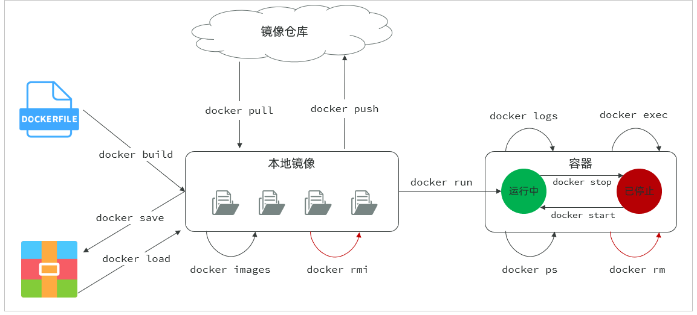
**补充：**
默认情况下，每次重启虚拟机我们都需要手动启动Docker和Docker中的容器。通过命令可以实现开机自启：

```powershell
# Docker开机自启
systemctl enable docker

# Docker容器开机自启
docker update --restart=always [容器名/容器id]
```

### 2.1.2 演示
我们以Nginx为例给大家演示上述命令。

```powershell
# 第1步，去DockerHub查看nginx镜像仓库及相关信息

# 第2步，拉取Nginx镜像 (本地已经有了，不要拉取了)
docker pull nginx:alpine

# 第3步，查看镜像
docker images

# 第4步，创建并允许Nginx容器
docker run -d --name nginx -p 80:80 nginx:alpine

# 第5步，查看运行中容器
docker ps

# 也可以加格式化方式访问，格式会更加清爽
docker ps --format "table {{.ID}}\t{{.Image}}\t{{.Ports}}\t{{.Status}}\t{{.Names}}"

# 第6步，访问网页，地址：http://虚拟机地址

# 第7步，停止容器
docker stop nginx

# 第8步，查看所有容器
docker ps -a

# 第9步，再次启动nginx容器
docker start nginx

# 第10步，再次查看容器
docker ps

# 第11步，查看容器详细信息，容器的一些配置信息
docker inspect nginx

# 第12步，进入容器,查看容器内目录
docker exec -it nginx sh

# 第13步，删除容器
docker rm nginx

# 发现无法删除，因为容器运行中，强制删除容器
docker rm -f nginx
```

## 2.2 数据卷
容器是隔离环境，容器内程序的文件、配置、运行时产生的数据都在容器内部，我们要读写容器内的文件非常不方便。大家思考几个问题：
- 如果要升级MySQL版本，需要销毁旧容器，那么数据岂不是跟着被销毁了？
- MySQL、Nginx容器运行后，如果我要修改其中的某些配置该怎么办？
- 我想要让Nginx代理我的静态资源怎么办？
因此，容器提供程序的运行环境，但是 **程序运行产生的数据、程序运行依赖的配置都应该与容器解耦**。

### 2.2.1 介绍
**数据卷（volume）**是一个虚拟目录，是**容器内目录**与**宿主机目录**之间映射的桥梁。
以Nginx为例，我们知道Nginx中有两个关键的目录：
- html：放置一些静态资源
- conf：放置配置文件
如果我们要让Nginx代理我们的静态资源，最好是放到html目录；如果我们要修改Nginx的配置，最好是找到conf下的nginx.conf文件。
但遗憾的是，容器运行的Nginx所有的文件都在容器内部。所以我们必须利用数据卷将两个目录与宿主机目录关联，方便我们操作。
**如图：**

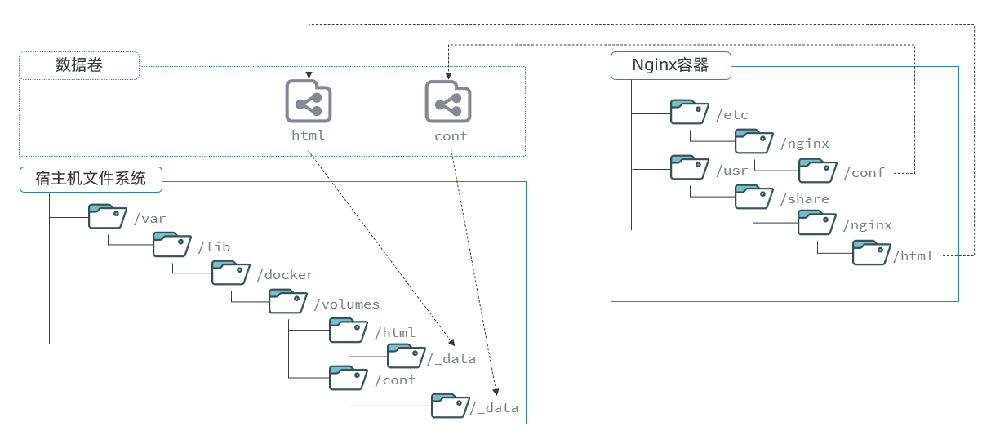
在上图中：
- 我们创建了两个数据卷：conf、html。
- Nginx容器内部的conf目录和html目录分别与两个数据卷关联。
- 而数据卷conf和html分别指向了宿主机的/var/lib/docker/volumes/conf/_data目录和/var/lib/docker/volumes/html/_data目录。
这样以来，容器内的conf和html目录就 与宿主机的conf和html目录关联起来，我们称为**挂载**。
此时，我们操作宿主机的/var/lib/docker/volumes/html/_data就是在操作容器内。的/usr/share/nginx/html/_data目录。只要我们将静态资源放入宿主机对应目录，就可以被Nginx代理了。
> **小提示**：
> /var/lib/docker/volumes这个目录就是默认的存放所有容器数据卷的目录，其下再根据数据卷名称创建新目录，格式为/数据卷名/_data。
> **为什么不让容器目录直接指向宿主机目录呢**？
> - 因为直接指向宿主机目录就与宿主机强耦合了，如果切换了环境，宿主机目录就可能发生改变了。由于容器一旦创建，目录挂载就无法修改，这样容器就无法正常工作了。
> - 但是容器指向数据卷，一个逻辑名称，而数据卷再指向宿主机目录，就不存在强耦合。如果宿主机目录发生改变，只要改变数据卷与宿主机目录之间的映射关系即可。
> 不过，我们通过由于数据卷目录比较深，不好寻找，通常我们也**允许让容器直接与宿主机目录挂载而不使用数据卷**，具体参考2.2.3小节。

### 2.2.2 命令
数据卷的相关命令有：

| **命令** | **说明** | **文档地址** |
| --- | --- | --- |
| docker volume create | 创建数据卷 | [docker volume create](https%3A%2F%2Fdocs.docker.com%2Fengine%2Freference%2Fcommandline%2Fvolume_create%2F) |
| docker volume ls | 查看所有数据卷 | [docs.docker.com](https%3A%2F%2Fdocs.docker.com%2Fengine%2Freference%2Fcommandline%2Fvolume_ls%2F) |
| docker volume rm | 删除指定数据卷 | [docs.docker.com](https%3A%2F%2Fdocs.docker.com%2Fengine%2Freference%2Fcommandline%2Fvolume_prune%2F) |
| docker volume inspect | 查看某个数据卷的详情 | [docs.docker.com](https%3A%2F%2Fdocs.docker.com%2Fengine%2Freference%2Fcommandline%2Fvolume_inspect%2F) |
| docker volume prune | 清除未使用的数据卷 | [docker volume prune](https%3A%2F%2Fdocs.docker.com%2Fengine%2Freference%2Fcommandline%2Fvolume_prune%2F) |
注意：容器与数据卷的挂载要在创建容器时配置，对于创建好的容器，是不能设置数据卷的。而且**创建容器的过程中，如果数据卷不存在，会自动创建**。
教学**演示环节**：演示一下nginx的html目录挂载

```powershell
# 1.首先创建容器并指定数据卷，注意通过 -v 参数来指定数据卷
docker run -d --name nginx -p 80:80 -v html:/usr/share/nginx/html nginx:alpine

# 2.然后查看数据卷
docker volume ls

# 3.查看数据卷详情
docker volume inspect html

# 4.查看/var/lib/docker/volumes/html/_data目录
ll /var/lib/docker/volumes/html/_data

# 5.进入该目录，并随意修改index.html内容
cd /var/lib/docker/volumes/html/_data
vi index.html

# 6.打开页面，查看效果

# 7.进入容器内部，查看/usr/share/nginx/html目录内的文件是否变化
docker exec -it nginx sh
```
教学**演示环节**：演示一下MySQL的匿名数据卷

```powershell
# 1.查看MySQL容器详细信息
docker inspect mysql

# 关注其中.Config.Volumes部分和.Mounts部分
```
我们关注两部分内容，第一是.Config.Volumes部分：

```powershell
{
  "Config": {
    // ... 略
    "Volumes": {
      "/var/lib/mysql": {}
    }
    // ... 略
  }
}
```
可以发现这个容器声明了一个本地目录，需要挂载数据卷，但是**数据卷未定义**。这就是匿名卷。
然后，我们再看结果中的.Mounts部分：

```powershell
{
  "Mounts": [
    {
      "Type": "volume",
      "Name": "29524ff09715d3688eae3f99803a2796558dbd00ca584a25a4bbc193ca82459f",
      "Source": "/var/lib/docker/volumes/29524ff09715d3688eae3f99803a2796558dbd00ca584a25a4bbc193ca82459f/_data",
      "Destination": "/var/lib/mysql",
      "Driver": "local",
    }
  ]
}
```
可以发现，其中有几个关键属性：
- Name：数据卷名称。由于定义容器未设置容器名，这里的就是匿名卷自动生成的名字，一串hash值。
- Source：宿主机目录
- Destination : 容器内的目录
上述配置是将容器内的/var/lib/mysql这个目录，与数据卷29524ff09715d3688eae3f99803a2796558dbd00ca584a25a4bbc193ca82459f挂载。于是在宿主机中就有了/var/lib/docker/volumes/29524ff09715d3688eae3f99803a2796558dbd00ca584a25a4bbc193ca82459f/_data这个目录。这就是匿名数据卷对应的目录，其使用方式与普通数据卷没有差别。
接下来，可以查看该目录下的MySQL的data文件：

```powershell
ls -l /var/lib/docker/volumes/29524ff09715d3688eae3f99803a2796558dbd00ca584a25a4bbc193ca82459f/_data
```
注意：每一个不同的镜像，将来创建容器后内部有哪些目录可以挂载，可以参考DockerHub对应的页面 。

### 2.2.3 挂载本地目录或文件
可以发现，数据卷的目录结构较深，如果我们去操作数据卷目录会不太方便。在很多情况下，我们会直接将容器目录与宿主机指定目录挂载。挂载语法与数据卷类似：

```powershell
# 挂载本地目录
-v 本地目录:容器内目录

# 挂载本地文件
-v 本地文件:容器内文件
```
**注意**：本地目录或文件必须以 / 或 ./开头，如果直接以名字开头，会被识别为数据卷名而非本地目录名。
**例如：**

```powershell
-v mysql:/var/lib/mysql # 会被识别为一个数据卷叫mysql，运行时会自动创建这个数据卷

-v ./mysql:/var/lib/mysql # 会被识别为当前目录下的mysql目录，运行时如果不存在会创建目录
```
**教学演示**，删除并重新创建mysql容器，并完成本地目录挂载：
- 挂载/root/mysql/data到容器内的/var/lib/mysql目录
- 挂载/root/mysql/init到容器内的/docker-entrypoint-initdb.d目录（初始化的SQL脚本目录）
- 挂载/root/mysql/conf到容器内的/etc/mysql/conf.d目录（这个是MySQL配置文件目录）
在课前资料中已经准备好了mysql 的init目录、conf目录、data目录:

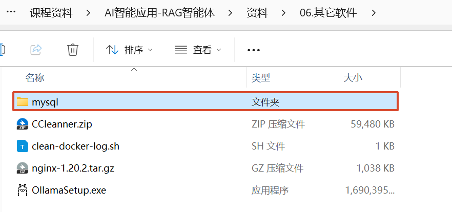
可以直接将其上传到Linux服务器中的 /root/mysql 目录下。

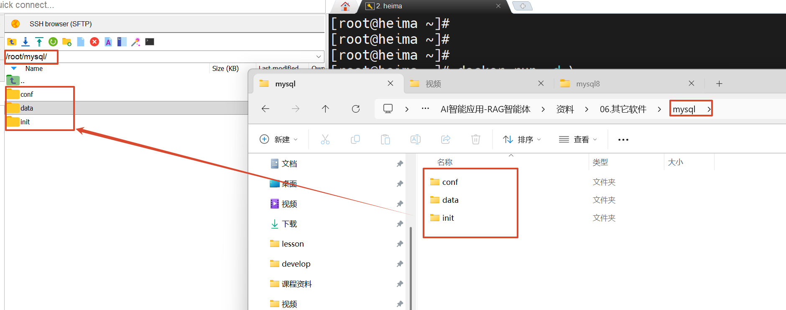
最终执行的指令如下：

```powershell
docker run -d \
--name mysql \
-p 3306:3306 \
-e MYSQL_ROOT_PASSWORD=123 \
-e TZ=Asia/Shanghai \
-v /root/mysql/data:/var/lib/mysql \
-v /root/mysql/init:/docker-entrypoint-initdb.d \
-v /root/mysql/conf:/etc/mysql/conf.d \
mysql:8.0
```

## 2.3 自定义镜像
前面我们一直在使用别人准备好的镜像，那如果我要部署一个Python项目，把它打包为一个镜像该怎么做呢？ 那接下来，我们就来介绍一下如何自定义镜像。

### 2.3.1 镜像结构
要想自己构建镜像，必须先了解镜像的结构。
之前我们说过，镜像之所以能让我们快速跨操作系统部署应用而忽略其运行环境、配置，就是因为镜像中包含了程序运行需要的系统函数库、环境、配置、依赖。
因此，自定义镜像本质就是依次准备好程序运行的基础环境、依赖、应用本身、运行配置等文件，并且打包而成。
举个例子，我们要从0部署一个Python应用，大概流程是这样：
- 准备一个linux服务（CentOS或者Ubuntu均可）
- 安装python
- 安装uv
- 上传python项目
- 运行
那因此，我们打包镜像也是分成这么几步：
- 准备Linux运行环境（并不需要完整的操作系统，仅仅是基础运行环境即可）
- 安装python
- 安装uv
- 上传Python源码
- 运行
上述步骤中的每一次操作其实都是在生产一些文件（系统运行环境、函数库、配置最终都是磁盘文件），所以**镜像就是一堆文件的集合**。
但需要注意的是，镜像文件不是随意堆放的，而是按照操作的步骤分层叠加而成，每一层形成的文件都会单独打包并标记一个唯一id，称为**Layer**（**层**）。这样，如果我们构建时用到的某些层其他人已经制作过，就可以直接拷贝使用这些层，而不用重复制作。
例如，第一步中需要的Linux运行环境，通用性就很强，所以Docker官方就制作了这样的只包含Linux运行环境的镜像。我们在制作项目镜像时，就无需重复制作，直接使用Docker官方提供的CentOS或Ubuntu镜像作为基础镜像。然后再搭建其它层即可，这样逐层搭建，最终整个项目的镜像结构如图所示：

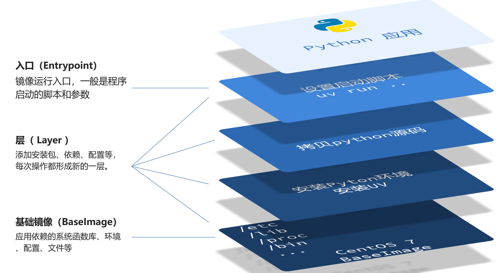
不过，我们并不一定要从基础的Linux系统作为基础镜像，理论上我们可以把任何其它镜像作为基础，在其之上进行开发。
例如：
- Python环境应用很多，就有官方提供了现成的Python基础镜像
- Java环境应用很多，就有官方提供了现成的Java基础镜像
- ...
其中，Python最常见的基础镜像：
- python官方镜像：python:3.12-slim
- dhi.io镜像：dhi.io/python

### 2.3.2 Dockerfile
由于制作镜像的过程中，需要逐层处理和打包，比较复杂，所以Docker就提供了自动打包镜像的功能。我们只需要将打包的过程，每一层要做的事情用固定的语法写下来，交给Docker去执行即可。而这种**记录镜像结构的文件**就称为**Dockerfile。**
其中的语法比较多，比较常用的有：

| **指令** | **说明** | **示例** |
| --- | --- | --- |
| **FROM** | **指定基础镜像** | **FROM   centos:7** |
| ENV | 设置环境变量，可在后面指令使用 | ENV key value |
| COPY | 拷贝本地文件到镜像的指定目录 | COPY ./hm.tar   /tmp |
| RUN | 执行Linux的shell命令，一般是安装过程的命令 | RUN tar -xvf   /tmp/hm.tar &&  pip install uv && uv sync |
| EXPOSE | 指定容器运行时监听的端口，是给镜像使用者看的 | EXPOSE 8000 |
| ENTRYPOINT | 镜像中应用的启动命令，容器运行时调用 | ENTRYPOINT uv  run xxx |
例如，要基于python:3.12-slim 镜像来构建一个Python应用，其Dockerfile内容如下：

```powershell
# 使用 python:3.12-slim 作为基础镜像
FROM python:3.12-slim

# 设定应用目录
WORKDIR /app

# 安装 uv
COPY --from=ghcr.io/astral-sh/uv:latest /uv /usr/local/bin/uv

# 拷贝依赖管理文件
COPY pyproject.toml ./

# 安装依赖
RUN uv sync --no-dev

# 拷贝源码
COPY src/ ./src/

# 暴露端口
EXPOSE 8000

# 运行命令
ENTRYPOINT ["uv", "run", "uvicorn", "src.main:app", "--host", "0.0.0.0", "--port", "8000"]

```
Dockerfile文件编写好了之后，就可以使用如下命令来构建镜像了。

```powershell
docker build -t 镜像名 .
```
- -t ：是给镜像起名，格式依然是repository:tag的格式，不指定tag时，默认为latest
- .  ：是指定Dockerfile所在目录，如果就在当前目录，则指定为"."
**演示:**
我们以昨天上传的backend项目为例，其中已经准备好了一个dockerfile文件，我们直接执行命令：

```shell
docker build -t backend .
```

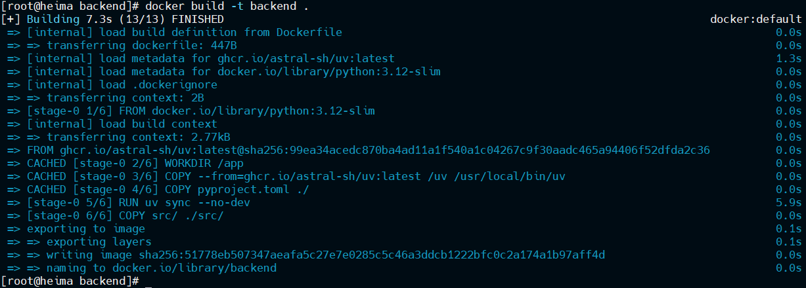
查看镜像列表，构建成功了：

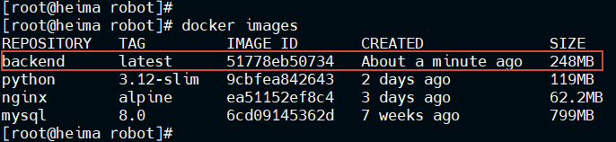
启动试试：

```shell
docker run --name rb -p 8000:8000 --env-file .env.prod  -d backend
```

## 2.4 网络互联
上节课我们创建了一个Python项目的容器，而Python项目往往需要访问其它各种中间件，例如MySQL、Redis等。现在，我们的容器之间能否互相访问呢？我们来测试一下
首先，我们查看下MySQL容器的详细信息，重点关注其中的网络IP地址：

```powershell
# 1.用基本命令，寻找Networks.bridge.IPAddress属性
docker inspect mysql

# 也可以使用format过滤结果
docker inspect --format='{{range .NetworkSettings.Networks}}{{println .IPAddress}}{{end}}' mysql

# 得到IP地址如下：
172.17.0.2

# 2.然后通过命令进入
docker exec -it nginx sh

# 3.在容器内，通过ping命令测试网络
ping 172.17.0.2

# 结果
PING 172.17.0.2 (172.17.0.2) 56(84) bytes of data.
64 bytes from 172.17.0.2: icmp_seq=1 ttl=64 time=0.053 ms
64 bytes from 172.17.0.2: icmp_seq=2 ttl=64 time=0.059 ms
64 bytes from 172.17.0.2: icmp_seq=3 ttl=64 time=0.058 ms
```
发现可以互联，没有问题。
但是，容器的网络IP其实是一个虚拟的IP，其值并不固定与某一个容器绑定，如果我们在开发时写死某个IP，而在部署时很可能MySQL容器的IP会发生变化，连接会失败。
因此，我们要学Docker网络知识，给我们容器设定网络参数。
常见命令有：

| **命令** | **说明** |
| --- | --- |
| docker network create | 创建一个网络 |
| docker network ls | 查看所有网络 |
| docker network rm | 删除指定网络 |
| docker network prune | 清除未使用的网络 |
| docker network connect | 使指定容器连接加入某网络 |
| docker network disconnect | 使指定容器连接离开某网络 |
| docker network inspect | 查看网络详细信息 |
在自定义网络中，**容器可以用容器名互联**
**教学演示：自定义网络**

```powershell
# 1.首先通过命令创建一个网络
docker network create itheima

# 2.然后查看网络
docker network ls

# 结果：
NETWORK ID     NAME      DRIVER    SCOPE
639bc44d0a87   bridge    bridge    local
403f16ec62a2   itheima     bridge    local
0dc0f72a0fbb   host      host      local
cd8d3e8df47b   none      null      local
# 其中，除了itheima以外，其它都是默认的网络

# 3.让 rb 和 mysql 都加入该网络
# 3.1.mysql容器，加入 itheima 网络
docker network connect itheima mysql

# 3.2.nginx容器, 加入 itheima 网络
docker network connect itheima nginx

# 4.进入dd容器，尝试利用别名访问db
# 4.1.进入容器
docker exec -it nginx sh

# 4.2.用容器名访问
ping mysql

# 结果：
PING mysql (172.18.0.2) 56(84) bytes of data.
64 bytes from mysql.itheima (172.18.0.2): icmp_seq=1 ttl=64 time=0.044 ms
64 bytes from mysql.itheima (172.18.0.2): icmp_seq=2 ttl=64 time=0.054 ms
```
OK，现在无需记住IP地址也可以实现容器互联了。
接下来，就可以让rb也加入网络了：

```python
# 先删除旧容器
docker rm rb

# 再重新创建rb，并且加入网络
docker run --name rb -p 8000:8000 --env-file .env.prod --network itheima -d backend
```

# 3. DockerCompose
一个大型项目往往需要数十个、上百个不同的服务，如果全部手动管理太复杂了。
Docker Compose就可以帮助我们实现**多个相互关联的Docker容器的快速部署**。它允许用户通过一个单独的 docker-compose.yml 模板文件（YAML 格式）来定义一组相关联的应用容器。

## 3.1 基本语法
docker-compose文件中可以定义多个相互关联的应用容器，每一个应用容器被称为一个服务（service）。由于service就是在定义某个应用的运行时参数，因此与docker run参数非常相似。
举例来说，用docker run部署Nginx的命令如下：

```shell
docker run -d \
 --name chatbot-frontend\
 -v /root/robot/frontend/public:/usr/share/nginx/html \
 -v /root/robot/frontend/nginx.conf:/etc/nginx/nginx.conf \
 --network itheima \
 -p 80:80 \
nginx:alpine
```
如果用docker-compose.yml文件来定义，就是这样：

```yaml
services:
  frontend:
    image: "nginx:alpine"
    container_name: chatbot-frontend
    ports:
      - "80:80"
    volumes:
      - "/root/robot/frontend/public:/usr/share/nginx/html"
      - "/root/robot/frontend/nginx.conf:/etc/nginx/nginx.conf"
    networks:
      - itheima
networks:
  itheima:
    name: itheima
```
对比如下：

| **docker run 参数** | **docker compose 指令** | **说明** |
| --- | --- | --- |
| --name | container_name | 容器名称 |
| -p | ports | 端口映射 |
| -e | environment | 环境变量 |
| -v | volumes | 数据卷配置 |
| --network | networks | 网络 |
明白了其中的对应关系，相信编写docker-compose文件应该难不倒大家。

```yaml
services:
  mysql:
    image: mysql:8.0
    container_name: chatbot-mysql
    environment:
      MYSQL_ROOT_PASSWORD: MySQL123
      MYSQL_DATABASE: robot
    ports:
      - "3306:3306"
    volumes:
      - mysql_data:/var/lib/mysql
    healthcheck:
      test: ["CMD", "mysqladmin", "ping", "-h", "localhost"]
      interval: 10s
      timeout: 5s
      retries: 5

  backend:
    build: ./backend
    container_name: chatbot-backend
    ports:
      - "8000:8000"
    env_file:
      - .env.prod
    depends_on:
      mysql:
        condition: service_healthy

  frontend:
    image: nginx:alpine
    container_name: chatbot-frontend
    ports:
      - "80:80"
    volumes:
      - ./frontend/nginx.conf:/etc/nginx/conf.d/default.conf:ro
      - ./frontend/public:/usr/share/nginx/html:ro
    depends_on:
      - backend

volumes:
  mysql_data:
```

## 3.2 基础命令
编写好docker-compose.yml文件，就可以部署项目了。语法如下：

```yaml
docker compose [OPTIONS] [COMMAND]
```
其中，OPTIONS和COMMAND都是可选参数，比较常见的有：

| **类型** | **参数或指令** | **说明** |
| --- | --- | --- |
| Options | -f | 指定compose文件的路径和名称 |
|  | -p | 指定project名称。project就是当前compose文件中设置的多个service的集合，是逻辑概念 |
| Commands | up | 创建并启动所有service容器 |
|  | down | 停止并移除所有容器、网络 |
|  | ps | 列出所有启动的容器 |
|  | logs | 查看指定容器的日志 |
|  | stop | 停止容器 |
|  | start | 启动容器 |
|  | restart | 重启容器 |
|  | top | 查看运行的进程 |
|  | exec | 在指定的运行中容器中执行命令 |

## 3.3 操作演示
1). 进入 Linux 服务器的 /usr/local 目录下

```shell
cd /usr/local
```
2). 上传资料中提供的 资料\04.课前代码 中的robot文件夹到 /usr/local/ 目录中，如下所示：

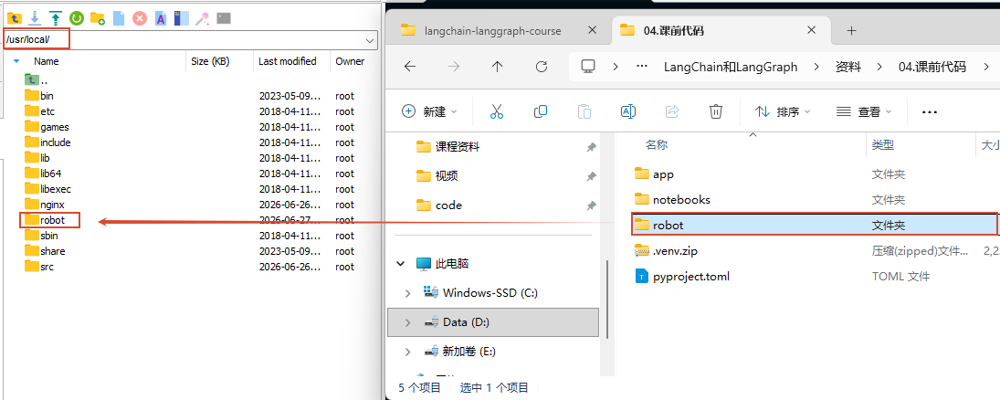
> **注意**，robot目录中提供的.env.prod文件中的DEEPSEEK_API_KEY需要替换成自己的。
3). 进入robot目录，执行如下指令，基于DockerCompose部署项目

```yaml
docker compose up -d
```
> **注意**，启动前一定要先停掉本机的MySQL、Nginx、robot-api服务，避免端口冲突
> systemctl stop mysqld
> systemctl stop robot-api
> /usr/local/nginx/sbin/nginx -s stop

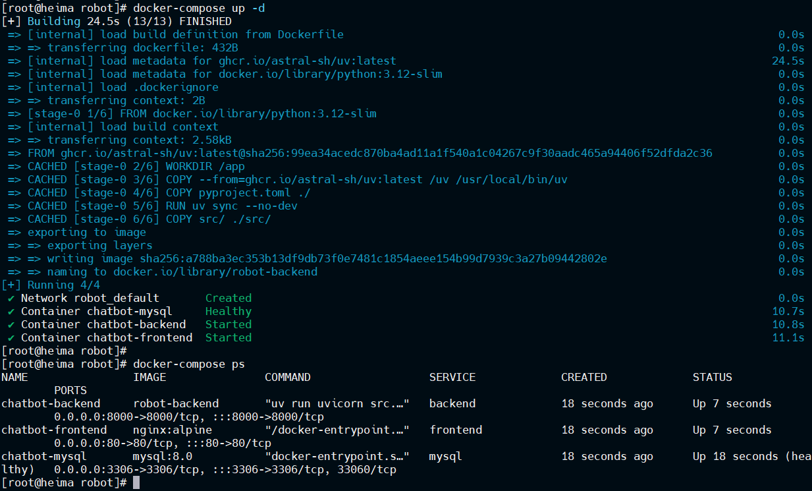
项目启动完毕之后，就可以启动服务器测试喽 。
