# Day03. 环境准备与项目搭建

> 原文链接：https://my.feishu.cn/wiki/CMlbw3XADimT41kHyGbc9Vbynl5

今日学习目标：
- 能说出项目背景和系统架构
- 会用 Docker Compose 启动基础设施
- 理解项目结构和 pydantic-settings 配置管理
- 能使用FastAPI的生命周期管理数据库连接
- 能使用SqlAlchemy实现保险查询功能

# 1. 认识项目
我们即将开发的**「安心保」**是一个在线保险商城，其中包含一个AI智能保险顾问，可以协助用户选购保险、理赔。

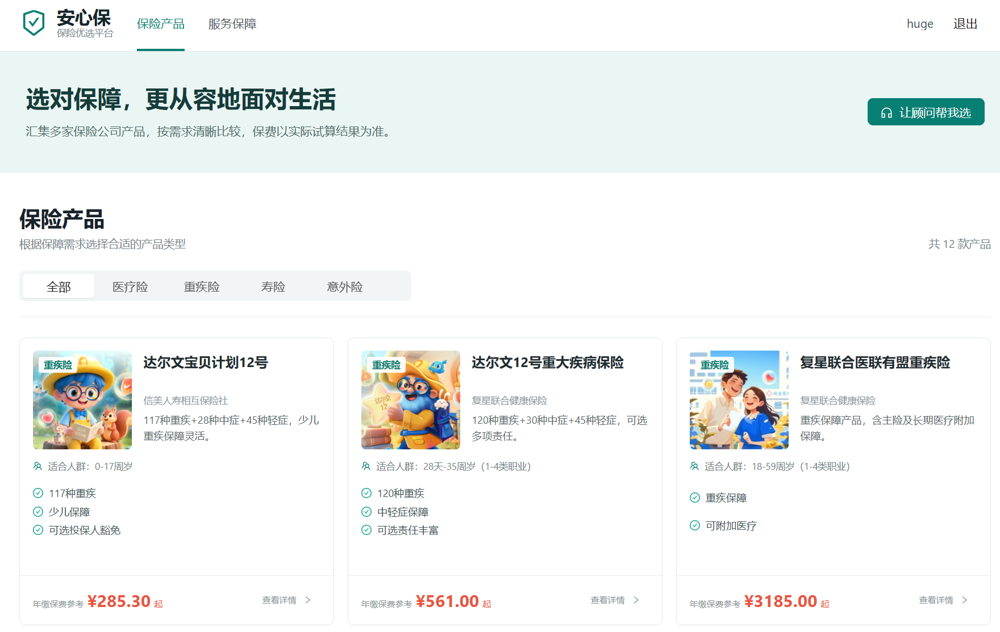
**《安心保》**是一个在线保险商城，集合了各大保险公司的保险产品，让用户可以一站式构筑自己的保险组合方案。在商城中会展示大量不同类型的保险产品，例如：
- **百万医疗险**（“报销型”主力）：解决大病医疗费，社保报完剩下一万以上的部分，凭发票报销，最高能报几百万。主要担心的是“看不起病”。
- **重疾险**（“给付型”主力）：确诊合同约定的大病，直接赔一笔现金（比如买50万赔50万），这笔钱可以自由支配，用于还房贷、康复营养费或弥补收入损失。主要担心的是“养病没收入”。
- **寿险**（“责任型”主力）：在保障期内身故或全残，赔一笔钱给家人。主要防止家庭经济支柱突然倒下，房贷、子女教育、老人赡养无法维系。主要担心的是“走得太早，责任未尽”。
- **意外险**（“伤残型”主力）：保外来的、突发的、非本意的、非疾病的意外事故。核心作用是赔付伤残等级（按比例赔保额），并报销意外导致的医疗费。主要担心的是“残而不死”带来的长期经济负担。
- ..
普通用户对保险产品了解有限，面对众多保险产品会有很多疑问：
- 自己应该买哪几类保险？
- 每类保险选哪个产品？
- 这些保险条款是什么意思？
- 条款里哪些内容影响理赔？
- ...
因此，《安心保》商城还提供了AI智能保险顾问，可以协助用户选购保险、产品答疑、解释条款、指引理赔。

## 1.1 整体架构
整个系统包含两个部分：
- **frontend**：前端，提供一个保险商城页面，用户可以浏览产品、登录注册、进入智能客服
- **agent-service**：后端，包含两部分内容
  - 传统保险业务：例如用户认证、产品查询、保费试算模板、保险方案、订单、保单、理赔记录。
  - 保险顾问业务：例如意图路由、保险组合推荐、条款问答、理赔咨询

> [画板内容，请在原文查看]
详细说明：
- **frontend（前端）**——已就绪，我们无需开发
React + Ant Design，提供保险商城界面和客服对话框。我们只需要关心它发给 **agent-service**的请求格式。
- **agent-service（后端）——**未完成，需要我们开发
基于Python FastAPI 编写，负责传统后端工作以及Agent和RAG开发。
  - 业务部分：
    - 用户注册登录
    - 产品查询
    - 保费计算
    - 保单管理
    - 理赔记录
    - ...
  - Agent部分：
    - 接收用户消息，理解意图（想买保险？想理赔？还是随便聊聊？）
    - 检索保险条款知识库（RAG，后续章节实现）
    - 调用工具（查产品、算保费、生成方案）
    - 用大模型生成自然语言回复，流式推送给前端

## 1.2 技术栈

| 层 | 技术 |
| --- | --- |
| Web 框架 | FastAPI |
| AI 编排 | LangGraph（状态图）+ LangChain（模型/工具/消息） |
| 大模型 | DeepSeek（通过 OpenAI 兼容接口） |
| 向量数据库 | Milvus 2.6 |
| 关系数据库 | PostgreSQL 16 |
| 前端 | React + Ant Design |
| 包管理 | uv |
| 部署 | Docker Compose |

# 2. 环境准备
项目中需要一些基础设施，包括：
- PostgreSql：数据库，类似MySQL、Sqlite、SqlServer、Oracle
- Milvus：向量数据库
  - Etcd：Milvus的依赖，集群管理
  - MinIO：Milvus依赖，对象存储
  - attu：Milvus的图形化界面工具，方便我们查看和管理Milvus数据
> etcd 和 MinIO 是 Milvus 的依赖组件——etcd 存集群元数据，MinIO 存原始数据文件。我们不需要单独操作它们。

## 2.1 部署说明
要部署的组件及其端口信息：

| 服务 | 端口 | 用途 |
| --- | --- | --- |
| PostgreSQL | 5432 | 存储业务数据和对话历史，默认DB：insurance，用户名：insurance/insurance123 |
| Milvus | 19530 | 向量存储与检索 |
| etcd | 2379 | Milvus 依赖的元数据存储 |
| MinIO | 9000/9001 | Milvus 依赖的对象存储 |
| attu | 3000 | Milvus 的图形界面工具 |
项目提供了部署的材料和docker-compose脚本，一个命令全部启动。

## 2.2 部署物料
在课前资料【资料\04.课前代码】中找到提供的部署文件和源码：

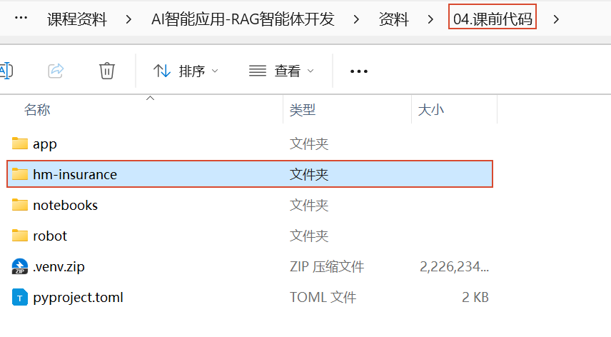
其中有两部分：

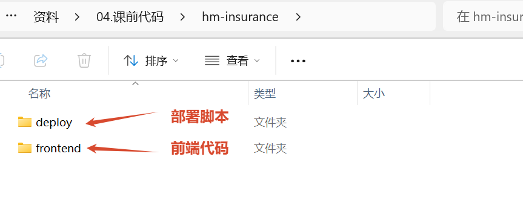
其中deploy目录中就是部署的脚本：

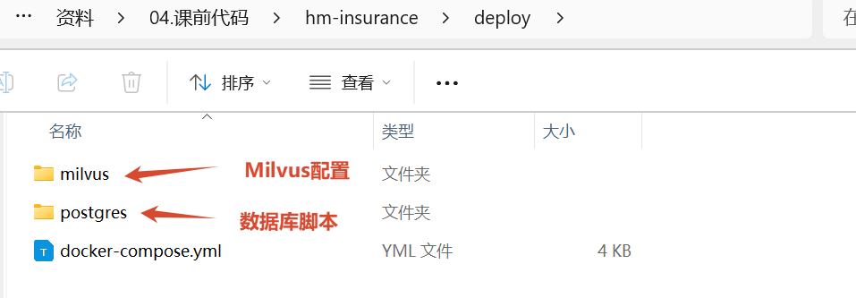

## 2.3 执行部署
部署前一定要确保防火墙关闭，如果忘了关闭请执行下面的命令：

```shell
# 停止防火墙
systemctl stop firewalld

# 永久关闭防火墙
systemctl disable firewalld

# 重启Docker
systemctl restart docker
```
1）首先，上传物料
我们把课前资料提供的部署物料【资料\04.课前代码\hm-insurance\deploy】上传到虚拟机的root目录：

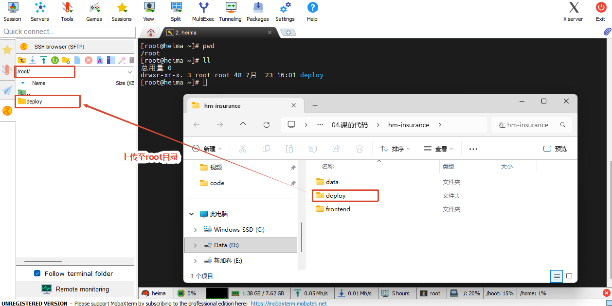
2）接着，执行脚本
我们进入/root/depoly目录，执行命令:

```shell
# 启动
docker compose up -d
```
结果：

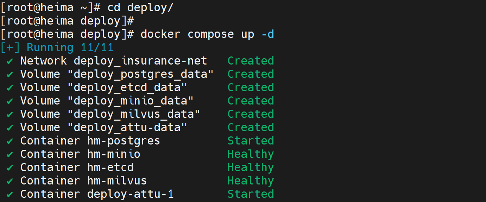

## 2.4 验证
当所有服务都显示为Healthy或者Started，证明启动成功。不过，这还不够，我们还要连接服务试试。

### 2.4.1 数据库连接
我们使用的数据库是PostgreSql，类似于MySQL，默认的连接信息如下：
- 数据库名：insurance
- 用户名：insurance
- 密码：insurance123
大家可以使用数据库连接客户端来测试连接。

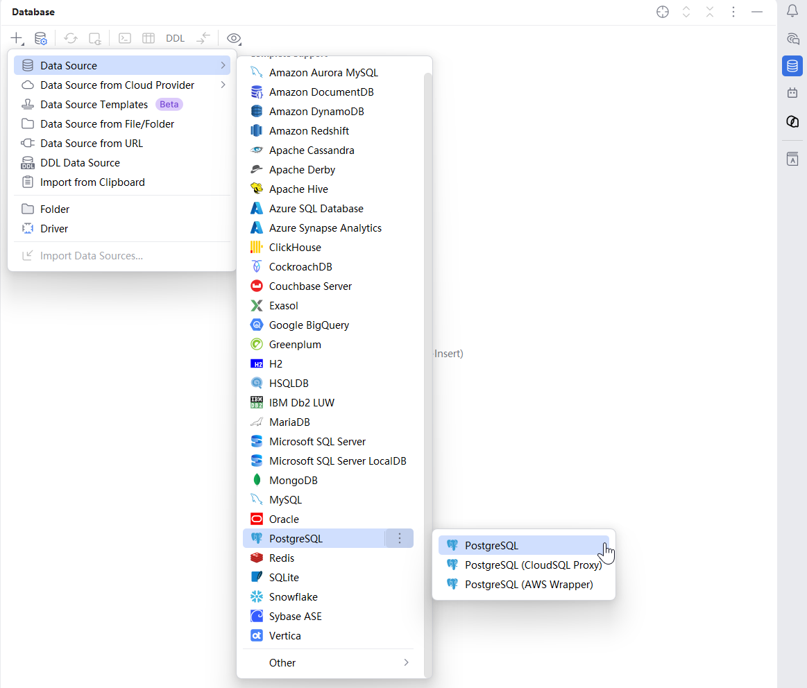
连接信息这样填：

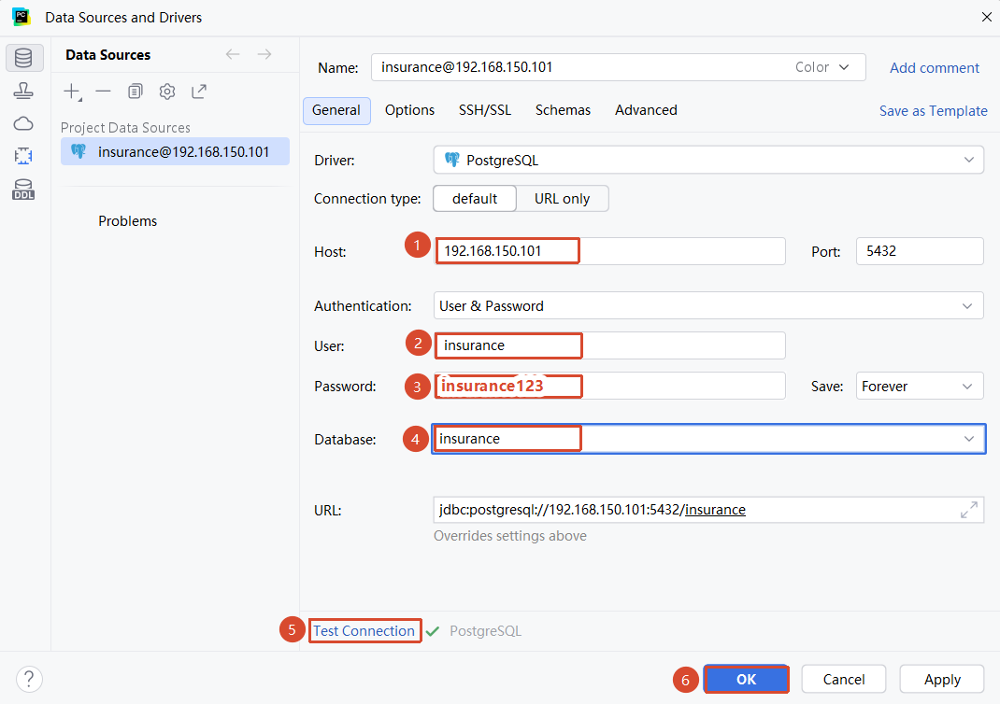
连接成功后，可以看到准备好的数据库表：

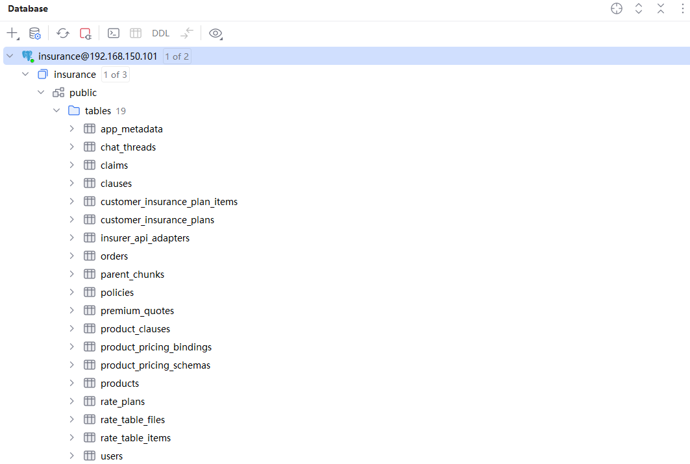

### 2.4.2 Milvus连接
Milvus有一个web控制台，端口是3000，在浏览器输入地址：http://192.168.150.101:3000即可访问：

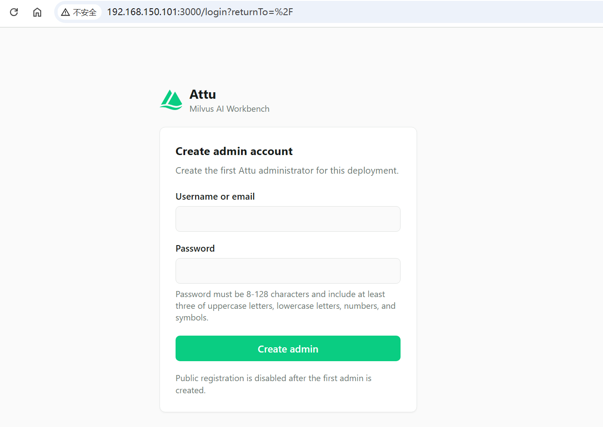
首次访问，需要注册一个管理员的用户名和密码，密码必须8位以上，且必须有大写、小写、数字、下划线中的3个类型。admin/admin_123
注册后即可登录：

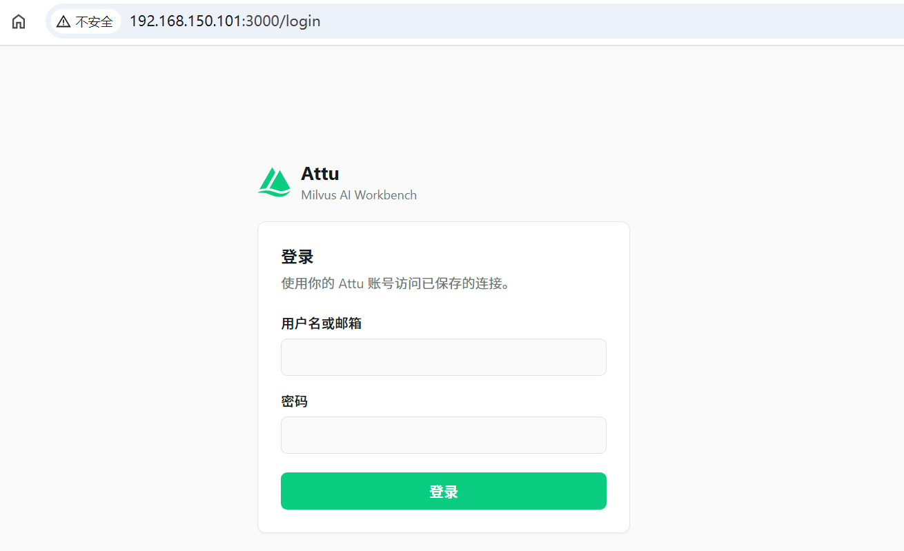
登录后，可以看到Milvus信息：

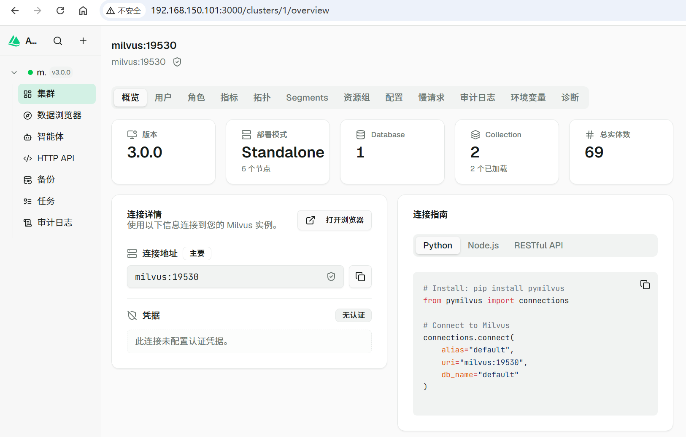

## 2.5 运行前端
我们给大家提供了前端源码，是基于nodejs开发，为了方便大家后续修改学习，提供的是源码，大家需要在本地基于nodejs部署。


### 2.5.1 拷贝源码
我们需要把【04.课前代码/hm-insurance】源码拷贝到一个**非中文、不包含特殊字符**的目录中，方便后续开发：

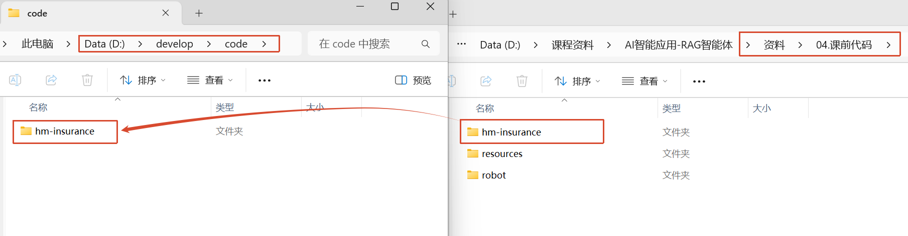

### 2.5.2 部署frontend
前端项目基于node，所以需要用npm来安装依赖，然后在本地启动。
进入frontend目录，执行命令，安装依赖：

```python
npm install
```
如图：

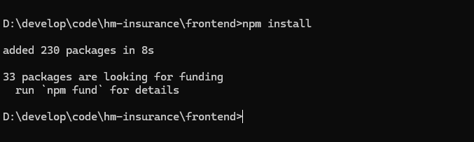
然后运行命令，启动项目：

```python
npm run dev
```

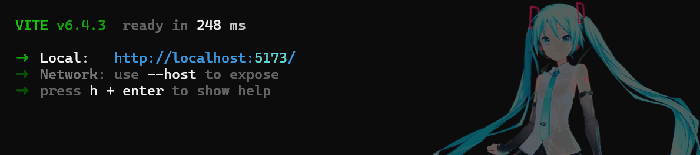
可以看到，前端端口是5173，我们要访问：http://localhost:5173


### 2.5.3 VibeCoding开发
如果你想要继续完善或拓展frontend的功能，可以使用Claude Code，基于VibeCoding开发。
注意，不要在frontend目录，而是在hm-insurance**目录启动Claude Code**，这样它才能同时兼顾到前后端代码。

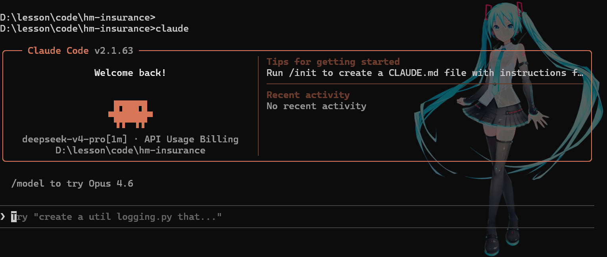

# 3. agent-service初始化
接下来，我们正式进入后端（agent-service）开发。本节我们会认识**项目结构**的组织方式、项目依赖、以及项目中的一些基础代码：
- **项目核心：**
  - config：全局配置
  - logging：全局日志
- **基础设施：**
  - database：数据库连接池配置
- **启动类**：
  - main.py：初始化FastAPI

## 3.1 项目初始化
我们使用PyCharm做为开发工具。
首先，在hm-insurance下创建一个新的项目，命名为agent-service：

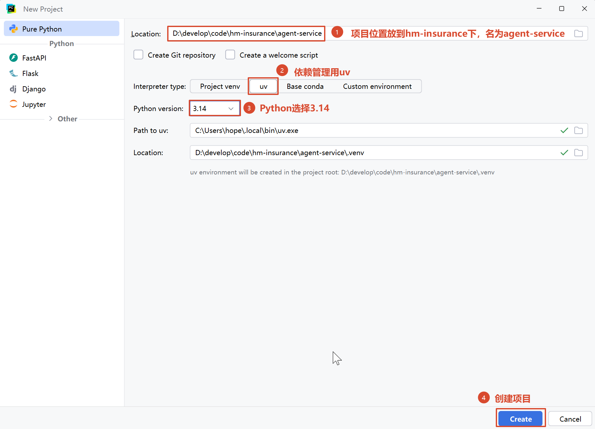
创建完成后，修改pyproject.toml文件，内容如下：

```toml
[project]
name = "agent-service"
version = "0.1.0"
description = "Insurance AI agent service"
requires-python = ">=3.14"
dependencies = [
    "aiostream>=0.7.1",
    "asyncpg>=0.31.0",
    "beautifulsoup4>=4.15.0",
    "dashscope>=1.26.4",
    "fastapi>=0.139.2",
    "ipykernel>=7.3.0",
    "langchain>=1.3.14",
    "langchain-community>=0.4.2",
    "langchain-deepseek>=1.1.0",
    "langchain-mcp-adapters>=0.3.0",
    "langchain-milvus>=0.4.0",
    "langchain-ollama>=1.1.0",
    "langchain-text-splitters>=1.1.2",
    "langgraph-checkpoint-postgres>=3.1.0",
    "mineru-open-sdk>=0.2.5",
    "openai>=2.48.0",
    "psycopg[binary,pool]>=3.3.4",
    "pwdlib[argon2]>=0.3.0",
    "pydantic>=2.13.4",
    "pydantic-settings>=2.14.2",
    "pyjwt>=2.13.0",
    "pymilvus>=3.0.0",
    "pypdf>=6.14.2",
    "sqlalchemy>=2.0.51",
    "structlog>=26.1.0",
    "uvicorn>=0.51.0",
]

[[tool.uv.index]]
url = "https://pypi.tuna.tsinghua.edu.cn/simple"
default = true
```
执行命令，下载依赖：

```toml
uv sync
```

## 3.2 项目结构
在实际项目开发中，业务会很复杂，业务领域也很多，为了方便管理，项目必须按照职责严格划分不同的包和模块。而项目的职责主要可以分为：
- **core**：核心模块
- **infra**：基础设施模块
- **common**：通用模块
- **modules**：业务模块，主要是实现数据库的CRUD以及与前端对接。
业务模块再按照处理前端请求的流程划分，通常流程如下图所示：

> [画板内容，请在原文查看]
所以，常见的项目结构有两种：


接下来，我们会按照**业务功能**来划分包结构。

## 3.3 环境变量与配置管理
在之前的开发中，很多配置信息都是直接写死在代码中的，例如：
- 项目端口
- 项目名称
- DeepSeek密钥
- DeepSeek地址
- 数据库地址
- 数据库端口
- 数据库用户名
- 数据集密码
- 日志级别
- ...
虽然DeepSeek的密钥可以配置在系统环境变量。但是项目的配置不仅仅是DeepSeek，还有很多其它配置，在系统环境变量中配置太麻烦，在代码中写死不方便管理，而且存在泄露风险。
所以，在开发过程中通常会在项目中用.env文件来配置项目关键参数，而在部署时才用系统环境变量、命令行参数来替换。
而企业开发时，系统环境变量、.env文件、命令参数等配置，通常都会使用pydantic-settins来管理，它可以同时兼容以上所有配置方式。
依赖(**已经安装**)：

```shell
uv add pydantic-settings
```

### 3.3.1 配置加载优先级
Pydantic Settings支持多种不同的配置方式，包括：
- 命令行参数
- Settings构造函数
- 系统环境变量（os.environ）
- .env文件
- ...
如果上述配置同时存在，其加载顺序和优先级如下图：

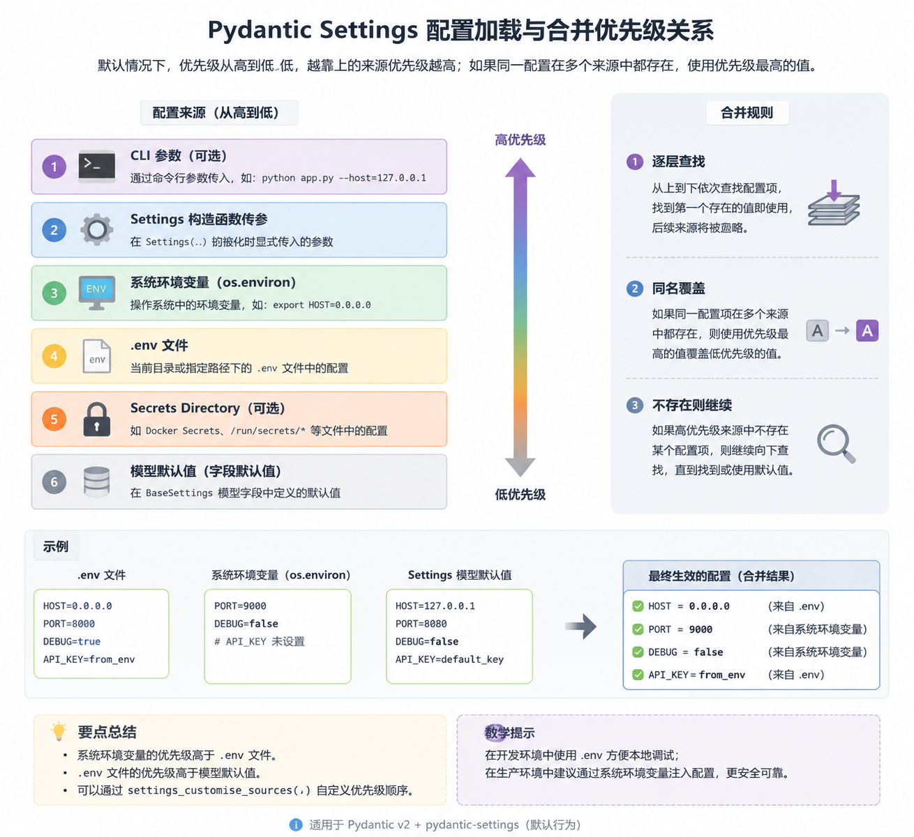
> **结论**：
> - 系统环境变量优先级高于.env文件
> - 开发中用.env配置，方便调试
> - 生产环境通过系统环境变量、命令行参数注入，覆盖.env文件中的密钥等关键配置，更安全可靠

### 3.3.2 配置.env
在项目根目录下新建一个普通文件，命名为.env:

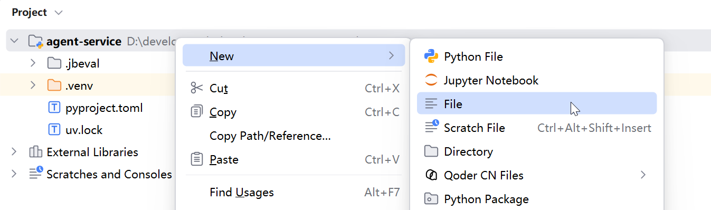
项目的环境变量统一定义到根目录下的.env中：

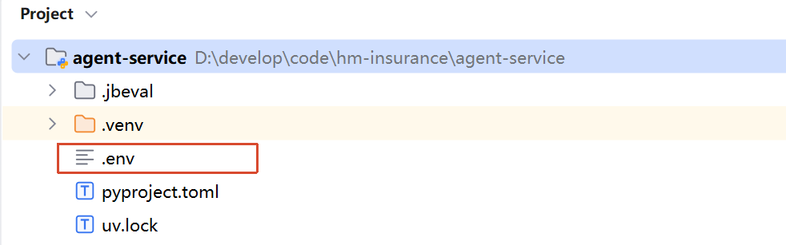
其中内容如下：

```properties
# 应用配置
APP_NAME=安心保
APP_DEBUG=true
APP_HOST=0.0.0.0
APP_PORT=8001

# 日志配置
LOGGING_LEVEL=INFO

# 数据库配置
DB_HOST=192.168.150.101
DB_PORT=5432
DB_NAME=insurance
DB_USER=insurance
DB_PASSWORD=insurance123

# 模型配置
DEEPSEEK_API_KEY=your_deepseek_api_key
CHAT_MODEL=deepseek-v4-flash
```
需要注意的几个地方：
- DEEPSEEK_API_KEY：设置成你自己的key

### 3.3.3 配置加载
配置好了.env文件，接下来就可以使用pydantic_settings做配置加载和管理。pydantic_settings基于BaseModel来保存配置信息，它不仅可以加载配置，更可以做配置**校验**和**加工**。
我们在app.core包新建一个config.py文件：

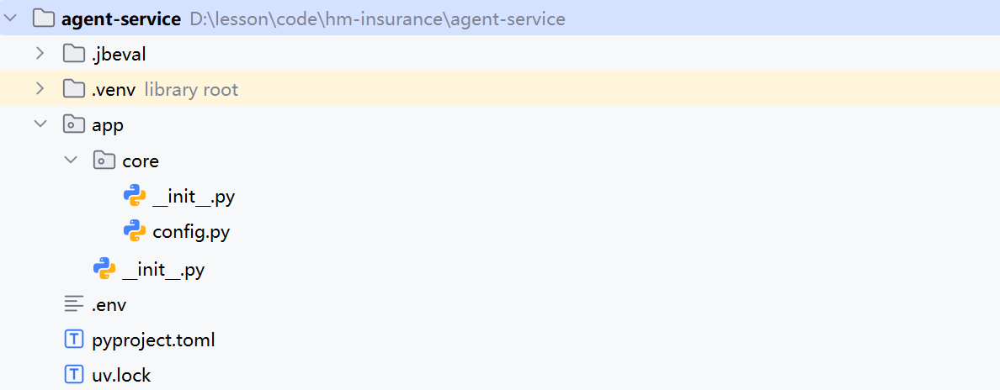
内容：

```python
from pathlib import Path

from pydantic import Field, computed_field, PostgresDsn
from pydantic_settings import BaseSettings, SettingsConfigDict

# 以当前文件为基准，找向上2级的父目录，也就是项目的根目录
APP_ROOT = Path(__file__).resolve().parents[2]

class EnvSettings(BaseSettings):
    """公共settings，配置.env文件位置"""
    model_config = SettingsConfigDict(
        env_file=(APP_ROOT / ".env",),
        env_file_encoding="utf-8",
        extra="ignore",  # settings中未定义的字段被忽略
    )

class AppSettings(EnvSettings):
    """应用相关设置"""
    name: str = Field(alias="APP_NAME")
    host: str = Field(alias="APP_HOST", default="127.0.0.1")
    port: int = Field(alias="APP_PORT", default=8001)
    debug: bool = Field(alias="APP_DEBUG", default=True, description="是否开启FastAPI的DEBUG模式")

class DatabaseSettings(EnvSettings):
    """数据库相关设置"""
    host: str = Field(alias="DB_HOST", default="localhost")
    port: int = Field(alias="DB_PORT", default=5432)
    name: str = Field(alias="DB_NAME", default="insurance")
    user: str = Field(alias="DB_USER", default="insurance")
    password: str = Field(alias="DB_PASSWORD", default="insurance123")

    @computed_field
    @property
    def url(self) -> str:
        # 自动拼接URL路径
        return PostgresDsn.build(
            scheme="postgresql+asyncpg",
            host=self.host,
            port=self.port,
            username=self.user,
            password=self.password
        ).encoded_string()

class LLMSettings(EnvSettings):
    """模型相关配置"""
    api_key: str = Field(alias="DEEPSEEK_API_KEY")
    chat_model: str = Field(alias="CHAT_MODEL", default="deepseek-v4-flash")

class LoggingSettings(EnvSettings):
    """日志相关配置"""
    level: str = Field(alias="LOGGING_LEVEL", default="INFO") # 可选值：DEBUG、INFO、WARNING、ERROR、CRITICAL

class Settings(BaseSettings):
    app: AppSettings = Field(default_factory=AppSettings)
    db: DatabaseSettings = Field(default_factory=DatabaseSettings)
    llm: LLMSettings = Field(default_factory=LLMSettings)
    logging: LoggingSettings = Field(default_factory=LoggingSettings)

# 项目启动直接初始化
settings = Settings()
```
测试，我们在项目中新建一个notebooks目录，用来存放测试的Notebook代码。然后再notebooks下新建一个day03，在day03新建一个01.测试settings.ipynb文件：

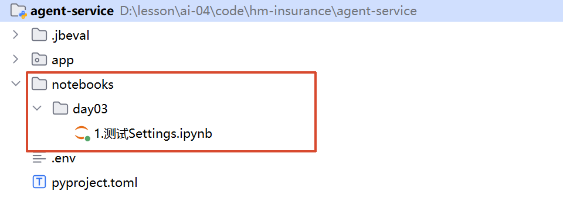
写一个测试，访问settings：

```python
from app.core.config import settings

print(settings.app.name)

print(settings.model_dump_json(indent=2))
```

## 3.4 日志
项目中日志需要统一配置，我们在app.core包下单独定义一个处理日志的文件logging.py：

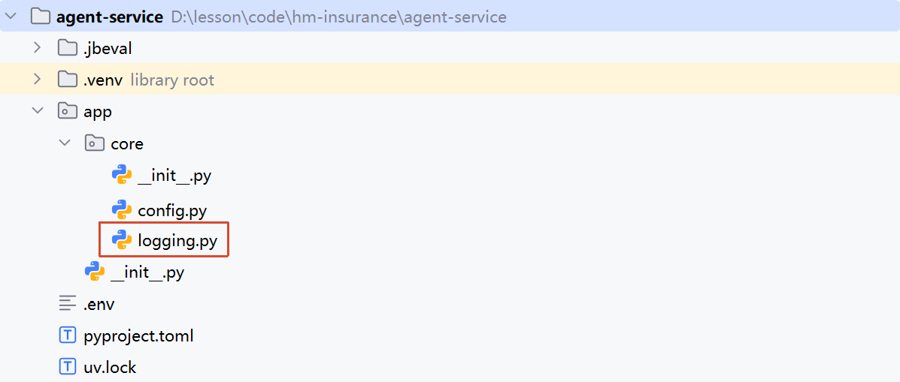
内容：

```python
from __future__ import annotations

import logging
import sys
from typing import Any

import structlog

def configure_logging(level: str = "INFO") -> None:
    """配置彩色控制台日志。"""

    log_level = _log_level(level)

    # 配置 Python 标准 logging
    root_logger = logging.getLogger()
    root_logger.setLevel(log_level)
    root_logger.handlers.clear()

    console_handler = logging.StreamHandler(sys.stdout)
    console_handler.setLevel(log_level)
    console_handler.setFormatter(
        logging.Formatter("%(message)s")
    )

    root_logger.addHandler(console_handler)

    # 配置 structlog
    processors: list[Any] = [
        # 合并 request_id、conversation_id 等上下文变量
        structlog.contextvars.merge_contextvars,
        # 添加 Logger 名称
        structlog.stdlib.add_logger_name,
        # 添加日志级别
        structlog.stdlib.add_log_level,
        # 添加时间
        structlog.processors.TimeStamper(fmt="%Y-%m-%d %H:%M:%S", utc=False),
        # 允许添加占位符参数
        structlog.stdlib.PositionalArgumentsFormatter(),
        # 渲染 stack_info=True
        structlog.processors.StackInfoRenderer(),
        # 渲染异常堆栈
        structlog.processors.format_exc_info,
        # 彩色控制台渲染
        structlog.dev.ConsoleRenderer(colors=True),
    ]

    structlog.configure(
        processors=processors,
        wrapper_class=structlog.stdlib.BoundLogger,
        logger_factory=structlog.stdlib.LoggerFactory(),
        cache_logger_on_first_use=True,
    )

    # 控制第三方库日志数量
    logging.getLogger("sqlalchemy.engine").setLevel(
        logging.INFO
        if log_level == logging.DEBUG
        else logging.WARNING
    )

    logging.getLogger("httpx").setLevel(logging.WARNING)
    logging.getLogger("httpcore").setLevel(logging.WARNING)

def get_logger(name: str) -> structlog.stdlib.BoundLogger:
    """获取 structlog 日志器。"""
    return structlog.get_logger(name)

def _log_level(level: str) -> int:
    """将字符串日志级别转换为 logging 常量。"""
    return getattr(logging, level.strip().upper(), logging.INFO)
```

## 3.5 启动类
接下来，我们在app包写一个启动类main.py:

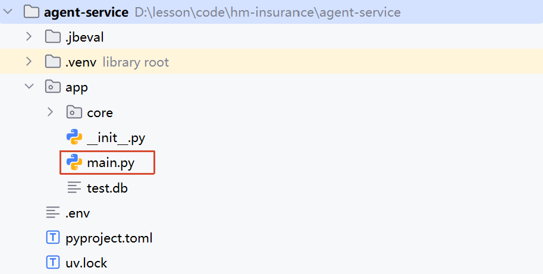
在其中编写，初始化FastAPI和项目启动的入口：

```python
from fastapi import FastAPI
from fastapi.middleware.cors import CORSMiddleware

from app.core.config import settings
from app.core.logging import configure_logging, get_logger
import uvicorn

# 初始化日志系统
configure_logging(settings.logging.level)
logger = get_logger(__name__)

app = FastAPI(
    title=settings.app.name,
    debug=settings.app.debug,
)

@app.get("/health", summary="健康检测接口")
async def health_check() -> dict[str, str]:
    logger.info("执行健康检查")
    return {"status": "ok"}

if __name__ == "__main__":
    uvicorn.run(
        "app.main:app",
        host=settings.app.host,
        port=settings.app.port,
        reload=False
    )
```

## 3.6 启动测试
启动项目，访问：http://127.0.0.1:8001/docs，可以看到FastAPI提供的文档：

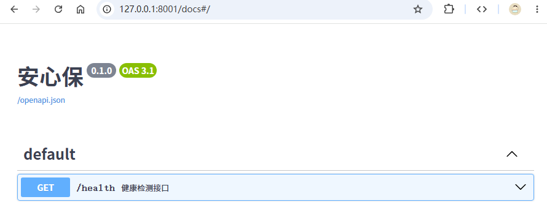

## 3.7 数据库连接池
数据库连接池属于是项目的基础设施，需要全局统一配置，并在FastAPI中用生命周期来管理。

### 3.7.1 补充连接池配置
首先，我们在app.core.config.py中添加数据库连接池相关参数：

```python
class DatabaseSettings(EnvSettings):
    """数据库相关设置"""
    host: str = Field(alias="DB_HOST", default="localhost")
    port: int = Field(alias="DB_PORT", default=5432)
    name: str = Field(alias="DB_NAME", default="insurance")
    user: str = Field(alias="DB_USER", default="insurance")
    password: str = Field(alias="DB_PASSWORD", default="insurance123")
    echo: bool = Field(alias="DB_ECHO", default=False)
    pool_size: int = Field(alias="DB_POOL_SIZE", default=5)
    max_overflow: int = Field(alias="DB_MAX_OVERFLOW", default=10)
    pool_recycle: int = Field(alias="DB_POOL_RECYCLE", default=1800)

    @computed_field
    @property
    def url(self) -> str:
        # 自动拼接URL路径
        return PostgresDsn.build(
            scheme="postgresql+asyncpg",
            host=self.host,
            port=self.port,
            username=self.user,
            password=self.password
        ).encoded_string()
```

### 3.7.2 统一管理连接池
在项目中，**数据库连接池**需要统一管理，然后通过依赖注入方式给每个用户请求分发连接，连接断开后自动释放连接。
我们新建一个app.infra包，然后新建一个database.py文件：

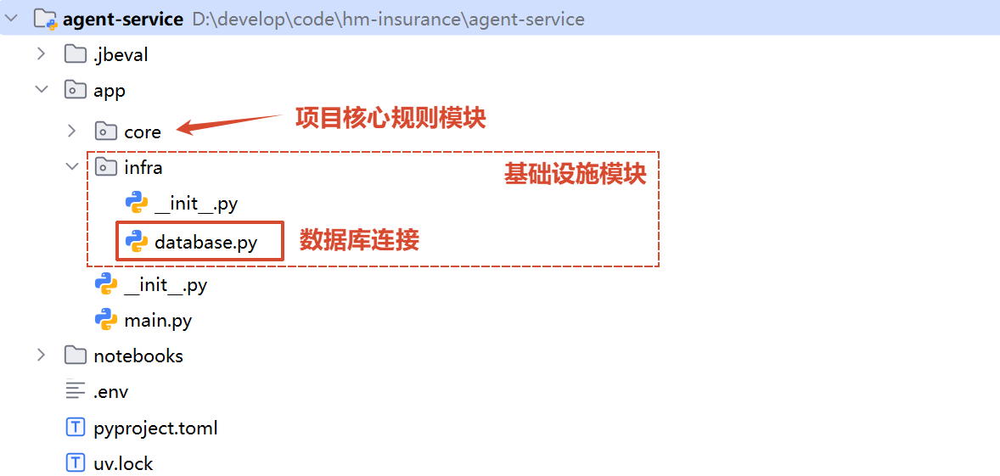
内容如下：

```python
from collections.abc import AsyncGenerator
from sqlalchemy import text
from sqlalchemy.ext.asyncio import (
    AsyncEngine,
    AsyncSession,
    async_sessionmaker,
    create_async_engine,
)

from app.core.config import settings
from app.core.logging import get_logger
logger = get_logger(__name__)

# 1. 数据库连接地址
if not settings.db or not settings.db.url:
    raise RuntimeError("db.url未配置，初始化数据库失败！")
DATABASE_URL = settings.db.url

# 2. 创建异步数据库引擎
engine: AsyncEngine = create_async_engine(
    DATABASE_URL,
    echo=settings.db.echo,                  # 是否打印SQL语句
    pool_size=settings.db.pool_size,        # 连接池中长期保留的连接数
    max_overflow=settings.db.max_overflow,  # 连接池满后，允许临时创建的额外连接数
    pool_recycle=settings.db.pool_recycle,  # 连接存活超过该时间后，在下次取出时重新创建
    pool_pre_ping=True,                     # 从连接池取出连接时，先检查连接是否有效
)

# 3. 创建异步 Session 工厂
AsyncSessionFactory = async_sessionmaker(
    bind=engine,
    autoflush=False,        # 执行查询前不自动 flush
    expire_on_commit=False, # commit 后保留 ORM 对象中的属性值
)

# 4. 获取session的工具
async def get_session() -> AsyncGenerator[AsyncSession, None]:
    """ 为每个 FastAPI 请求创建独立的 AsyncSession，适用于依赖注入。"""
    async with AsyncSessionFactory() as session:
        yield session

# 5. 释放数据库连接池
async def close_database() -> None:
    """ 关闭数据库引擎并释放连接池中的连接。应在应用关闭时调用。"""
    await engine.dispose()
    logger.info("数据库连接池已关闭~")

# 6. 数据库健康检查
async def check_database() -> None:
    async with engine.connect() as connection:
        await connection.execute(text("SELECT 1"))
    logger.info("数据库连接池初始化成功~✅️")
```

### 3.7.3 生命周期管理
我们需要在项目启动时初始化数据库连接池，在项目停止时关闭连接池。
由于连接池默认是懒加载，第一次访问时才会初始化。所以，我们需要在项目启动时调用check_database，测试并初始化连接，在项目停止时调用close_db，关闭数据库连接池。
而这些，都需要在main.py中，基于FastAPI的生命周期管理来实现。
修改app.main.py，添加下面的逻辑：

```python
from contextlib import asynccontextmanager

# 生命周期管理（预留）
@asynccontextmanager
async def lifespan(app: FastAPI):
    logger.info(f"【{settings.app.name}】应用启动中...")
    from app.infra.database import check_database, close_database
    try:
        await check_database()
        yield
    finally:
        logger.info("应用关闭中... ")
        await close_database()

app = FastAPI(
    title=settings.app.name,
    debug=settings.app.debug,
    lifespan=lifespan,
)
```
准备好数据库连接，接下来就可以正式开发业务功能了。

# 4. 业务开发
接下来我们就正式开发业务功能。

## 4.1 开发规范
在目前项目中，我们采用的是前后端分离的架构模式：

> [画板内容，请在原文查看]
> **什么是前后端分离**？
在前后端分离架构中，前端与后端各司其职：
- **前端**：负责渲染页面，展示数据
- **后端**：负责提供前端展示所需的数据，例如商品信息、用户信息等
也就是说：后端负责“生产原材料（数据）”，前端负责“把原材料做成成品（界面）”。

### 4.1.1 接口文档
> **什么是接口文档**？
既然前后端分开了，前端要拿数据，就得知道去哪拿、怎么拿、拿到的数据长什么样。接口文档就是一份说明书，这份说明书里就清清楚楚写着：
- 去哪拿（请求地址 URL）
- 怎么拿（请求方式，是 GET 还是 POST）
- 要带什么条件（请求参数，比如“查学号 001 的学生”）
- 拿到的是什么样（返回的数据格式，比如 {"name":"张三"}）
> **接口文档有什么用**？
- 接口文档是前后端交互的标准，前后端参考同一份标准，同时开发，效率翻倍。
- 只要前后端都遵循接口文档，前后端写好的代码一定可以正常交互。交互出错，也能快速定位是前端还是后端的责任
在咱们项目中，由于前端是基于接口文档提前写好的，因此我们在开发后端时也**必须严格遵循接口文档**，这样就可以直接与前端交互，实现功能。
在线笔记提供了两份接口文档：
- ：与保险相关的业务接口，如登录、注册、保险商品查询等
- ：与AI智能客服相关接口，如会话管理、对话聊天等
当然，完整的保险业务接口非常多，我们并不需要全都开发，目前只需要做下面几个与保险产品（Product）有关的接口：
- 6.1.查询产品列表：
- 6.2.查询推荐候选产品
后续可以继续完成其它接口。

### 4.1.2 开发流程
按照之前的项目结构说明，业务功能要放到app.modules包，并且给不同的业务创建子包，例如产品相关业务，就创建一个product包。如图：

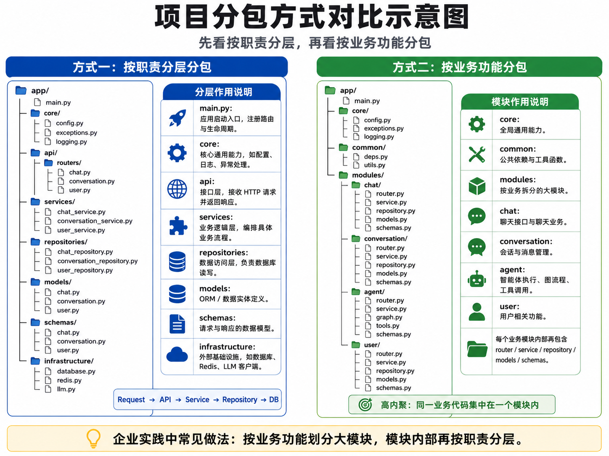
而在product下，又包含router、service、repository、schemas、models等模块，模块间关系如下：

> [画板内容，请在原文查看]
如图中所示：
- router、service、repository之间是依赖关系，router依赖于service，service依赖于repository。
- schemas是按照接口文档规范定义的请求和响应约束模型，models是数据库表映射类，这两类数据在各层间传递，需要先定义出来。
- 开发业务时从底层的repository开始，逐层向上开发。

## 4.2 查询产品列表
目前访问前端首页，可以看到页面虽然出来了，但数据是没有的：

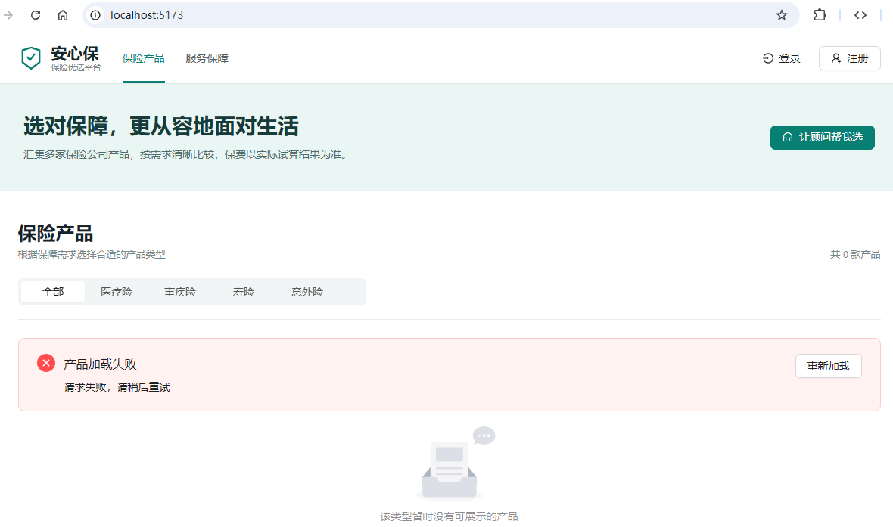
这就是缺少后端接口，查不到对应的数据，所以无法渲染。

### 4.2.1 接口信息
对应的接口信息如下：
查询有效的保险产品，可以按产品分类过滤，接口直接返回产品列表。

| 请求方式 | 请求路径 | 是否需要登录 |
| --- | --- | --- |
| GET | /api/v1/products | 否 |
**Query 参数**：

| 参数 | 类型 | 必填 | 默认值 | 说明 |
| --- | --- | --- | --- | --- |
| category | string | 否 | 无 | 产品分类；不传时查询全部有效产品 |
**请求示例**：

```bash
curl "http://127.0.0.1:8001/api/v1/products?category=medical"
```
**响应字段**：

| 字段 | 类型 | 说明 |
| --- | --- | --- |
| [] | array | 产品列表 |
| [].id | number | 产品 ID |
| [].name | string | 产品名称 |
| [].clause_name | string | 主条款文件名 |
| [].category | string | 产品分类 |
| [].insurer | string | 保险公司 |
| [].image_url | string | 产品图片地址 |
| [].description | string | 产品简介 |
| [].min_premium | string/null | 最低年缴保费参考 |
| [].max_premium | string/null | 最高年缴保费参考 |
| [].target_group | string/null | 适用人群 |
| [].highlights | array | 产品亮点 |
| [].status | string | 产品状态 |
**响应示例**：

```json
[
  {
    "id": 6,
    "name": "众安尊享e生百万医疗险2026版",
    "clause_name": "众安尊享e生百万医疗险2026版条款.pdf",
    "category": "medical",
    "insurer": "众安保险",
    "image_url": "https://files.huizecdn.com/file3/M00/B0/02/example.png",
    "description": "百万医疗险产品，覆盖住院、特殊门诊等医疗责任。",
    "min_premium": "255.00",
    "max_premium": "1420.00",
    "target_group": "30天-70周岁（1-6类职业）",
    "highlights": ["百万医疗", "医疗保障", "责任免除清晰"],
    "status": "active"
  }
]
```
接下来，我们就按照这个接口文档要求来开发【**查询产品列表**】这个接口。

### 4.2.2 Schemas
schemas就是接口的请求参数和响应结果约束，严格按照接口文档要求定义即可。根据接口文档，请求参数是?拼接的参数，无需定义schemas，只要定义响应结果schemas即可。
这个接口直接返回产品数组，因此不需要定义分页模型，只需要定义单个产品的响应模型 ProductResponse。
然后，新建一个app.modules.product包，在其中新建一个schemas.py文件：

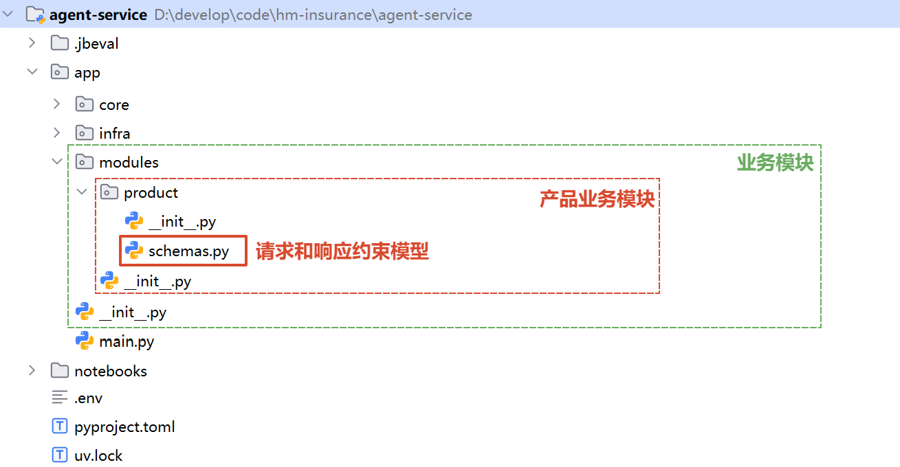
内容如下：

```python
from decimal import Decimal
from pydantic import BaseModel, field_validator

class ProductResponse(BaseModel):
    """保险产品响应结果"""

    id: int
    name: str
    clause_name: str
    category: str
    insurer: str
    image_url: str
    description: str
    min_premium: Decimal | None
    max_premium: Decimal | None
    target_group: str | None
    highlights: list[str]
    status: str
```

### 4.2.3 Models
Schema 负责约束接口数据，Model 则负责描述数据库表。products表结构如下：

```sql
CREATE TABLE "products" (
        "id" SERIALNOT NULL,
        "name" VARCHAR(200) NOT NULL,
        "clause_name" VARCHAR(300) NOT NULL,
        "category" VARCHAR(50) NOT NULL,
        "insurer" VARCHAR(120) NOT NULL,
        "image_url" TEXT NULL DEFAULT NULL,
        "description" TEXT NULL DEFAULT NULL,
        "min_premium" NUMERIC(14,2) NULL DEFAULT NULL,
        "max_premium" NUMERIC(14,2) NULL DEFAULT NULL,
        "target_group" VARCHAR(300) NULL DEFAULT NULL,
        "highlights" UNKNOWN NULL DEFAULT NULL,
        "status" VARCHAR(30) NOT NULL DEFAULT 'active',
        "created_at" TIMESTAMPTZ NOT NULL DEFAULT CURRENT_TIMESTAMP,
        "updated_at" TIMESTAMPTZ NOT NULL DEFAULT CURRENT_TIMESTAMP,
        PRIMARY KEY ("id")
)
```
我们只需要参考表结构定义model即可。

#### 4.2.3.1 统一基类和混入类
SqlAlchemy的数据库表映射类都需要继承共同的**基类**：Base，不仅仅是Product业务需要，以后的其它业务模型都需要，所以属于公共父类，应该放到app.common包。
我们先定义SqlAlchemy的统一**基类**和**混入类:**
- **基类**：也就是Base类，标记当前类是SqlAlchemy的表相关实体类
- **混入类**：就是提取一些表公共字段，其它表模型类继承了混入类，就省去了对应字段的编写，提高了复用性
我们新建一个app.common包，然后新建一个models.py文件：

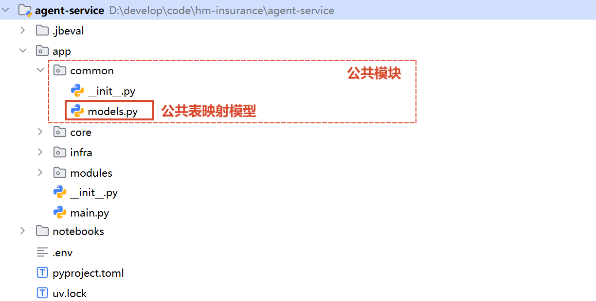
内容如下：

```python
from sqlalchemy.orm import DeclarativeBase, Mapped, mapped_column
from datetime import datetime
from sqlalchemy import DateTime, func

# SQLAlchemy的基类，所有数据库表模型都必须继承
class Base(DeclarativeBase):
    def __repr__(self) -> str:
        """通用的repr函数，用于控制台输出对象信息"""
        cls_name = self.__class__.__name__
        attrs = {}
        for key, val in vars(self).items():
            if key.startswith("_"):
                continue
            if isinstance(val, datetime):
                attrs[key] = val.strftime("%Y-%m-%d %H:%M:%S")
            else:
                attrs[key] = val
        return f"{cls_name}({attrs})"

# 通用的时间戳【混入类】，这样其它数据模型不用重复定义时间相关字段
class CreateAtMixin:
    # func.now() 会让数据库在插入时自动生成服务器时间（如 PostgreSQL 的 NOW()）
    created_at: Mapped[datetime] = mapped_column(
        DateTime(timezone=True),
        server_default=func.now()
    )

class UpdateAtMixin:
    # onupdate=func.now() 会在每次数据行被 UPDATE 时，由 SQLAlchemy 自动更新该字段
    updated_at: Mapped[datetime] = mapped_column(
        DateTime(timezone=True),
        server_default=func.now(),
        onupdate=func.now()
    )
```

#### 4.2.3.2 Product模型
然后就是Product模型了，在 app.modules.product 包中新建 models.py：

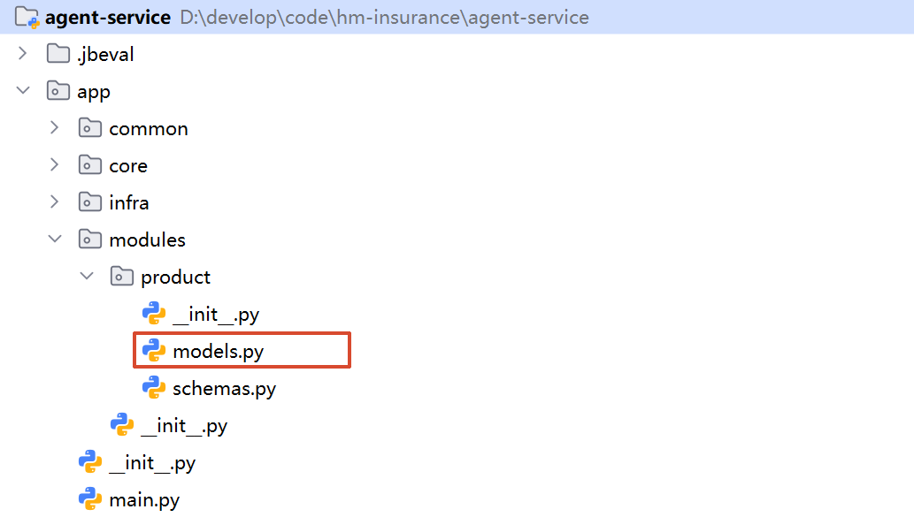
内容如下：

```python
from decimal import Decimal

from sqlalchemy import ARRAY, BigInteger, Numeric, String, Text
from sqlalchemy.orm import Mapped, mapped_column

from app.common.models import Base, CreateAtMixin, UpdateAtMixin

class Product(Base, CreateAtMixin, UpdateAtMixin):
    """保险产品"""

    __tablename__ = "products"

    id: Mapped[int] = mapped_column(BigInteger, primary_key=True)
    name: Mapped[str] = mapped_column(String(200))
    clause_name: Mapped[str] = mapped_column(String(300))
    category: Mapped[str] = mapped_column(String(50))
    insurer: Mapped[str] = mapped_column(String(120))
    image_url: Mapped[str | None] = mapped_column(Text)
    description: Mapped[str | None] = mapped_column(Text)
    min_premium: Mapped[Decimal | None] = mapped_column(Numeric(14, 2))
    max_premium: Mapped[Decimal | None] = mapped_column(Numeric(14, 2))
    target_group: Mapped[str | None] = mapped_column(String(300))
    highlights: Mapped[list[str] | None] = mapped_column(ARRAY(Text))
    status: Mapped[str] = mapped_column(
        String(30),
        default="active",
        server_default="active",
    )
```
需要注意以下几点：
- Product继承了CreateAtMixin 和 UpdateAtMixin，因此这里不需要重复声明 created_at 和 updated_at。
- 金额字段在数据库中是 NUMERIC(14, 2)，Model 使用 Decimal 可以避免浮点误差

### 4.2.4 Repository
Repository 只负责数据库访问，不处理接口参数，也不组装响应对象。在 app.modules.product 包中新建 repository.py：

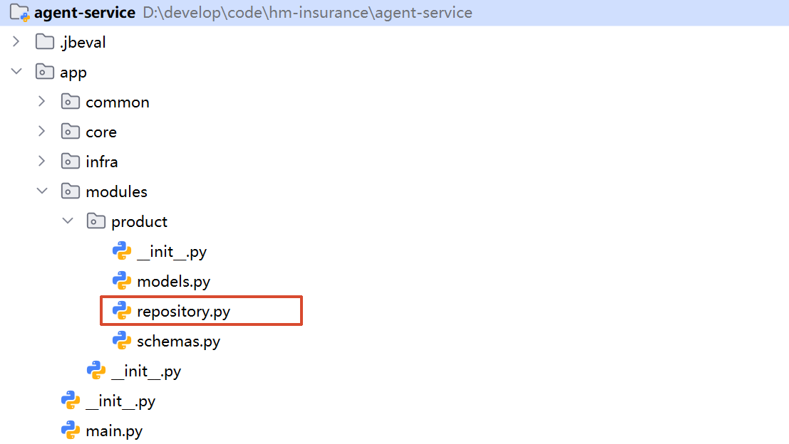
内容如下：

```python
from sqlalchemy import select
from sqlalchemy.ext.asyncio import AsyncSession

from app.modules.product.models import Product

class ProductRepository:
    def __init__(self, session: AsyncSession):
        self.session = session

    async def find_by_category(
        self,
        category: str | None = None,
    ) -> list[Product]:
        # 1.组装查询条件
        # 1.1.默认只查询active状态的产品
        conditions = [Product.status == "active"]
        # 1.2.如果有category，则添加category过滤
        if category:
            conditions.append(Product.category == category)

        # 2.查询产品列表
        products = await self.session.scalars(
            select(Product)
            .where(*conditions)
            .order_by(Product.id.asc())
        )
        return products.all()
```
查询只需要执行一条 SQL：根据可选的产品分类组装过滤条件，然后按产品 ID 升序返回全部符合条件的数据。
接口仅展示有效产品，因此默认增加 status == "active" 条件。

### 4.2.5 Service
Service 负责组织业务流程：开启事务（如果有必要的话）、调用 Repository，并把数据库 Model 转换为接口 Schema。在 app.modules.product 包中新建 service.py：

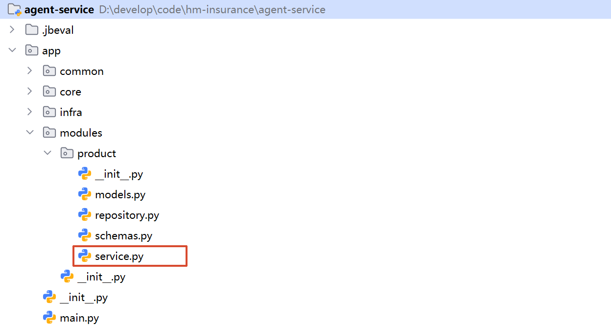
内容如下：

```python
from sqlalchemy.ext.asyncio import AsyncSession

from app.modules.product.repository import ProductRepository
from app.modules.product.schemas import ProductResponse

class ProductService:
    def __init__(self, session: AsyncSession):
        self.session = session
        self.repository = ProductRepository(session)

    async def list_products(
        self,
        category: str | None = None,
    ) -> list[Product]:
        return await self.repository.find_by_category(category)
```

### 4.2.6 Router
Router 只负责 HTTP 层：声明路径、接收并校验查询参数、注入数据库会话，然后把请求交给 Service。具体请求信息参考接口文档：
**基础信息：**

| 请求方式 | 请求路径 | 是否需要登录 |
| --- | --- | --- |
| GET | /api/v1/products | 否 |
**Query 参数**：

| 参数 | 类型 | 必填 | 默认值 | 说明 |
| --- | --- | --- | --- | --- |
| category | string | 否 | 无 | 产品分类；不传时查询全部有效产品 |
**响应格式**：list[ProductResponse]
在 app.modules.product 包中新建 router.py：

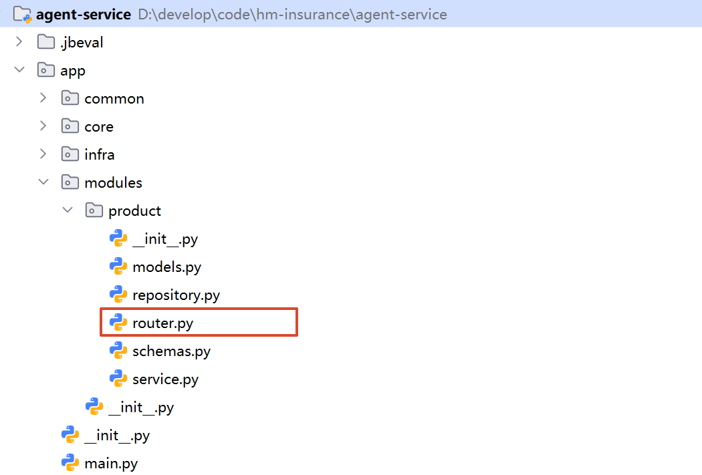
内容如下：

```python
from fastapi import APIRouter, Depends
from sqlalchemy.ext.asyncio import AsyncSession

from app.infra.database import get_session
from app.modules.product.schemas import ProductResponse
from app.modules.product.service import ProductService

router = APIRouter(prefix="/api/v1/products", tags=["products"])

@router.get("", response_model=list[ProductResponse])
async def list_products(
    category: str | None = None,
    session: AsyncSession = Depends(get_session),
) -> list[ProductResponse]:
    # 1.获取Service
    service = ProductService(session)
    # 2.查询并返回产品列表
    return await service.list_products(category)
```

### 4.2.7 注册路由与测试
最后在 app.main 中导入并注册产品 Router：

```python
from app.modules.product.router import router as product_router

# 创建 app 后注册路由
app.include_router(product_router)
```
启动服务后，访问 http://127.0.0.1:8001/docs 查看 FastAPI 自动生成的接口文档。

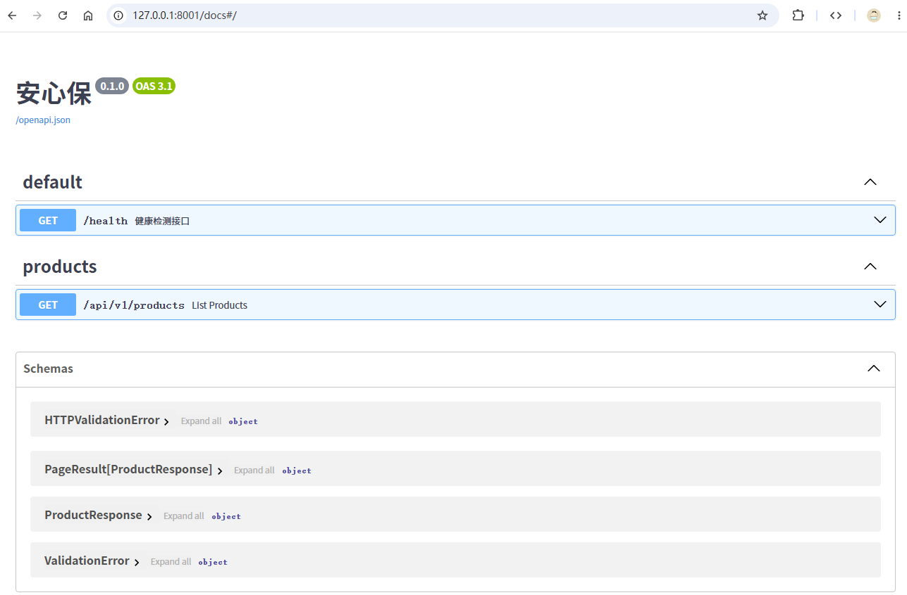

### 4.2.8 依赖注入
Router中获取service的代码是手动创建对象，如果接口较多，每个接口都手动创建比较麻烦，可以将获取service的代码抽取为函数，通过依赖注入来获取：

```python
async def get_product_service(
    session: AsyncSession = Depends(get_session),
) -> ProductService:
    return ProductService(session)

@router.get("", response_model=list[ProductResponse])
async def list_products(
    category: str | None = None,
    service: ProductService = Depends(get_product_service),
) -> list[ProductResponse]:
    return await service.list_products(category)
```
- Router 依赖 Service，Service 依赖 Session，这些对象都可以通过依赖注入获取：
  - 定义 get_product_service 函数，通过依赖注入获取 session，再创建 ProductService。
  - 在 list_products 的参数列表中，通过依赖注入获取 service。
依赖注入流程图：

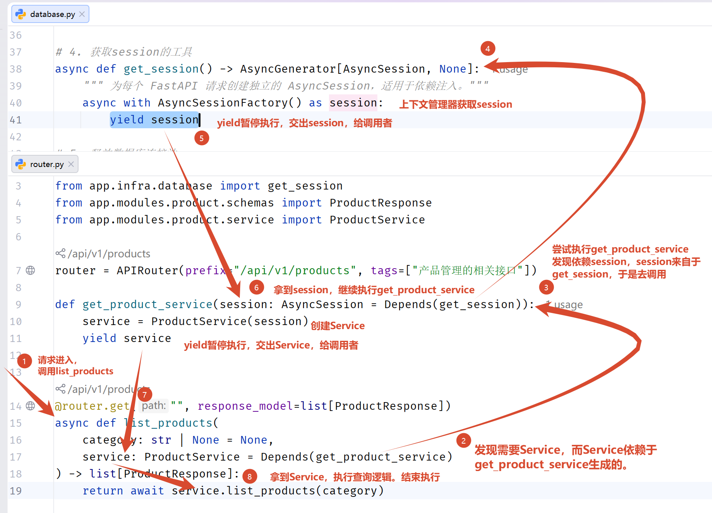

## 4.3 查询推荐候选产品（作业）
保险推荐真实流程非常复杂，需要抽取所有保险产品的特征点，然后基于用户画像比较特征点来寻找合适方案。不过本案例采用简化版本，直接从数据库查询一批符合用户需求的，然后由AI来推荐。
推荐方案不能直接从全部产品中任意选择，而是要先按照险种和预算筛出一批候选产品，再交给后续推荐流程进行比较。本接口按险种分别查询，每个险种最多返回指定数量的有效产品。
例如：查询要求的保险类型（categories）有life、medical，每个险种返回数量（limit_per_category）为5，则查询的时候就根据life查询5个，根据medical查询5个，汇总到一起。

### 4.3.1 接口信息
对应的接口信息如下：
按险种和保费条件查询可用于推荐的候选保险产品。

| 请求方式 | 请求路径 | 是否需要登录 |
| --- | --- | --- |
| GET | /api/v1/products/candidates | 否 |
**Query 参数**：

| 参数 | 类型 | 必填 | 默认值 | 说明 |
| --- | --- | --- | --- | --- |
| categories | string[] | 是 | 无 | 产品分类，可传多个 |
| premium_min | number | 否 | 无 | 只返回最低保费小于该值的产品 |
| limit_per_category | number | 否 | 5 | 每个险种最多返回数量 |
**请求示例**：

```bash
curl "http://127.0.0.1:8001/api/v1/products/candidates?categories=medical&categories=critical_illness&premium_min=2000&limit_per_category=5"
```
**响应格式**：list[ProductResponse]
响应是产品数组，数组元素字段与查询产品列表接口中的 items[] 完全一致，因此不需要再定义一套重复的 Schema。

```json
[
  {
    "id": 6,
    "name": "众安尊享e生百万医疗险2026版",
    "clause_name": "众安尊享e生百万医疗险2026版条款.pdf",
    "category": "medical",
    "insurer": "众安保险",
    "image_url": "https://files.huizecdn.com/file3/M00/B0/02/example.png",
    "description": "百万医疗险产品，覆盖住院、特殊门诊等医疗责任。",
    "min_premium": "255.00",
    "max_premium": "1420.00",
    "target_group": "30天-70周岁（1-6类职业）",
    "highlights": ["百万医疗", "医疗保障"],
    "status": "active"
  }
]
```

### 4.3.2 Schemas与Models
该接口返回的仍然是保险产品，只是查询条件和返回数量不同，因此直接复用现有的 ProductResponse 和 Product，不需要新增 Schema 或 Model。

### 4.3.3 Repository
修改 app.modules.product.repository.py，先导入 Decimal：

```python
from decimal import Decimal
```
然后在 ProductRepository 中添加产品查询方法，根据分类和保费查询，还可以限制查询数量：

```python
async def find_limited_by_category(
    self,
    category: str,
    premium_min: Decimal | None,
    limit: int,
) -> list[Product]:
    conditions = [
        Product.status == "active",
        Product.category == category,
    ]
    if premium_min is not None:
        conditions.append(Product.min_premium < premium_min)

    products = await self.session.scalars(
        select(Product)
        .where(*conditions)
        .order_by(
            Product.min_premium.asc().nullslast(),
            Product.id.asc(),
        )
        .limit(limit)
    )
    return products.all()
```
Repository 只负责数据库查询，不关心业务，所以只要接收 category、premium_min 和 limit，执行一条 SQL 并返回结果。
至于要查询哪些险种、每个险种查询一次并最终汇总，这是候选产品筛选的业务流程，放到 Service 中处理。

### 4.3.4 Service
修改 app.modules.product.service.py，先导入 Decimal，然后在 ProductService 中添加下面的方法：

```python
from decimal import Decimal

from app.modules.product.models import Product

async def list_candidates(
    self,
    categories: list[str],
    premium_min: Decimal | None,
    limit_per_category: int,
) -> list[Product]:
    candidate_products: list[Product] = []

    for category in dict.fromkeys(categories):
        products = await self.repository.find_limited_by_category(
            category=category,
            premium_min=premium_min,
            limit=limit_per_category,
        )
        candidate_products.extend(products)

    return candidate_products
```
Service 先利用 dict.fromkeys() 对险种去重，同时保留原有顺序；然后逐个险种调用 Repository，最后把每次查询得到的 Product 汇总到同一个列表中。这里直接返回 list[Product]，Router 声明的 response_model 会完成响应校验与序列化。

### 4.3.5 Router
修改 app.modules.product.router.py，补充下面的导入：

```python
from decimal import Decimal
from typing import Annotated
```
然后添加候选产品接口：

```python
@router.get("/candidates", response_model=list[ProductResponse])
async def list_candidates(
    categories: list[str] = Query(min_length=1),
    premium_min: Decimal | None = None,
    limit_per_category: int = 5,
    service: ProductService = Depends(get_product_service),
) -> list[ProductResponse]:
    return await service.list_candidates(
        categories=categories,
        premium_min=premium_min,
        limit_per_category=limit_per_category,
    )
```
说明：
- categories 没有默认值，因此至少要传一个险种；
- premium_min 必须大于 0，
- limit_per_category 限制在 1～10 之间，防止一次查询返回过多数据。
