# Day04.会话管理

> 原文链接：https://my.feishu.cn/wiki/MxkuwW2iji6HALkT96kcFjAjnrh

智能客服需要支持多轮对话。用户可以同时拥有多个会话：

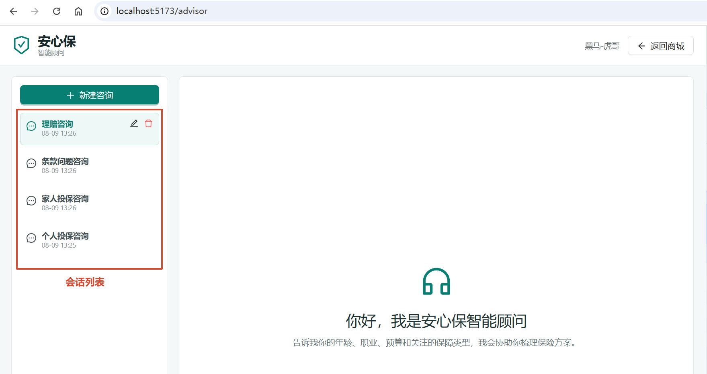
会话数据分成两部分：
- 会话标题、所属用户、创建时间等元数据保存在 chat_threads 表中；
- 会话历史消息属于消息数据，将来用LangChain来管理。
本章专注于会话管理功能。
需要注意的是，保险商城有用户的概念，不同用户查看到的会话列表是不一样的，所以会话是与用户绑定的。
不过，我们暂时不实现登录认证。前端在每次请求中固定携带 x-user-id 请求头，用它模拟当前登录用户，这里默认使用用户 ID 1，后续接入真实认证时再替换。
本章我们要实现的功能包括：

| 功能 | 请求方式 | 请求路径 |
| --- | --- | --- |
| 创建会话 | POST | /api/v1/chat-threads |
| 查询会话列表 | GET | /api/v1/chat-threads |
| 重命名会话 | PATCH | /api/v1/chat-threads/{thread_id} |
| 删除会话 | DELETE | /api/v1/chat-threads/{thread_id} |

# 1. 创建会话
首先实现创建会话接口。完成这一章后，项目会具备完整的会话模块骨架，后面三个接口都在这个模块中继续补充。

## 1.1 接口设计
为当前用户创建一个新的对话会话。

| 请求方式 | 请求路径 | 是否需要登录 |
| --- | --- | --- |
| POST | /api/v1/chat-threads | 是 |
**请求体字段**

| 字段 | 类型 | 必填 | 默认值 | 说明 |
| --- | --- | --- | --- | --- |
| title | string | 否 | 新会话 | 会话标题，长度 1 到 200，首尾空格会被去除 |
- **响应字段**：

| 字段 | 类型 | 说明 |
| --- | --- | --- |
| id | UUID | 会话 ID，也是 LangGraph 的 thread_id |
| title | string | 会话标题 |
| created_at | datetime | 创建时间 |
| updated_at | datetime | 更新时间 |
**请求示例**：

```bash
curl -X POST http://127.0.0.1:8002/api/v1/chat-threads \
  -H "Authorization: Bearer <access_token>" \
  -H "Content-Type: application/json" \
  -d '{"title":"保险咨询"}'
```
**响应示例**：

```json
{
  "id": "11111111-1111-1111-1111-111111111111",
  "title": "保险咨询",
  "created_at": "2026-06-28T10:00:00.000000+08:00",
  "updated_at": "2026-06-28T10:00:00.000000+08:00"
}
```
虽然请求参数只有一个title，但有一个隐含的参数，就是user_id。当前登录用户是谁，当前会话就必须属于谁，前端会通过请求头传递user_id给后端，我们必须通过请求头拿到user_id，组装会话数据，写入数据库。

## 1.2 创建会话模块
在 app/modules 下新建 chat_thread 包，并创建本章需要的文件：

```plain
app/modules/chat_thread/
├── __init__.py
├── models.py
├── repository.py
├── router.py
├── schemas.py
└── service.py
```
如图：

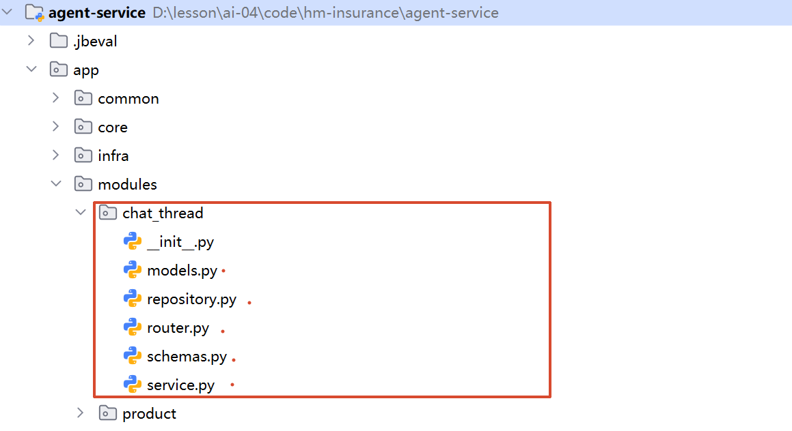

## 1.3 Models
数据库初始化脚本已经创建了 chat_threads 表，因此不需要修改数据库 Schema。打开 app.modules.chat_thread.models.py：

```python
from uuid import UUID, uuid4

from sqlalchemy import BigInteger, String
from sqlalchemy.dialects.postgresql import UUID as PG_UUID
from sqlalchemy.orm import Mapped, mapped_column

from app.common.models import Base, CreateAtMixin, UpdateAtMixin

class ChatThread(Base, CreateAtMixin, UpdateAtMixin):
    """客服会话"""

    __tablename__ = "chat_threads"

    id: Mapped[UUID] = mapped_column(
        PG_UUID(as_uuid=True),
        primary_key=True,
        default=uuid4,
    )
    user_id: Mapped[int] = mapped_column(BigInteger)
    title: Mapped[str] = mapped_column(
        String(200),
        default="新会话",
        server_default="新会话",
    )
```
id 既是会话表主键，也是后续传给 LangGraph 的 thread_id。user_id 标记会话属于哪个用户。created_at 和 updated_at 由已有的 Mixin 提供。

## 1.4 Schemas
打开 app.modules.chat_thread.schemas.py，先定义创建请求和会话响应：

```python
from datetime import datetime
from uuid import UUID

from pydantic import BaseModel, Field, field_validator

class ChatThreadCreate(BaseModel):
    """创建会话请求"""

    title: str = Field(default="新会话", min_length=1, max_length=200)

    @field_validator("title", mode="before")
    @classmethod
    def normalize_title(cls, value: str) -> str:
        return value.strip()

class ChatThreadResponse(BaseModel):
    """会话响应"""

    id: UUID
    title: str
    created_at: datetime
    updated_at: datetime
```
创建会话时可以不传 title，默认使用“新会话”。校验器会先去掉标题两端空格，再检查长度。

## 1.5 Repository
打开 app.modules.chat_thread.repository.py，先实现新增：

```python
from sqlalchemy.ext.asyncio import AsyncSession

from .models import ChatThread

class ChatThreadRepository:

    def __init__(self, session:AsyncSession):
        self.session = session

    async def add(self, chat_thread: ChatThread):
        self.session.add(chat_thread)
```
add() 只负责把对象加入当前 Session，事务由 Service 统一管理。

## 1.6 Service
打开 app.modules.chat_thread.service.py，实现创建业务：

```python
from sqlalchemy.ext.asyncio import AsyncSession

from .repository import ChatThreadRepository
from .models import ChatThread

class ChatThreadService:

    def __init__(self, session: AsyncSession):
        self.session = session
        self.repository = ChatThreadRepository(session)

    async def add(self, user_id: int , title: str):
        # 用上下文管理，开启事务，运行完成，自动commit，出现异常，自动rollback
        async with self.session.begin():
            # 创建对象，对象 映射 到数据库 一条数据
            chat_thread = ChatThread(user_id = user_id, title = title)
            # 新增对象，就是插入一条数据
            await self.repository.add(chat_thread)

            return chat_thread
```

## 1.7 Router
前端发起的创建会话请求只传递了title参数：

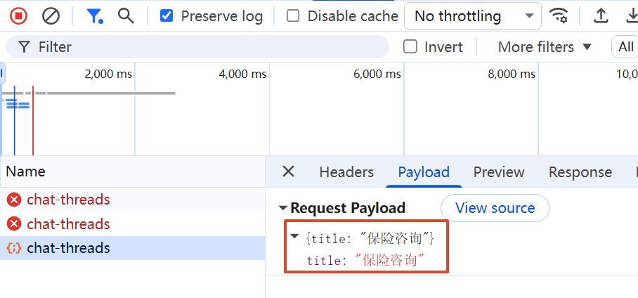
而写入数据库时还需要知道user_id，这个信息不是通过参数传递，而是在请求头中：

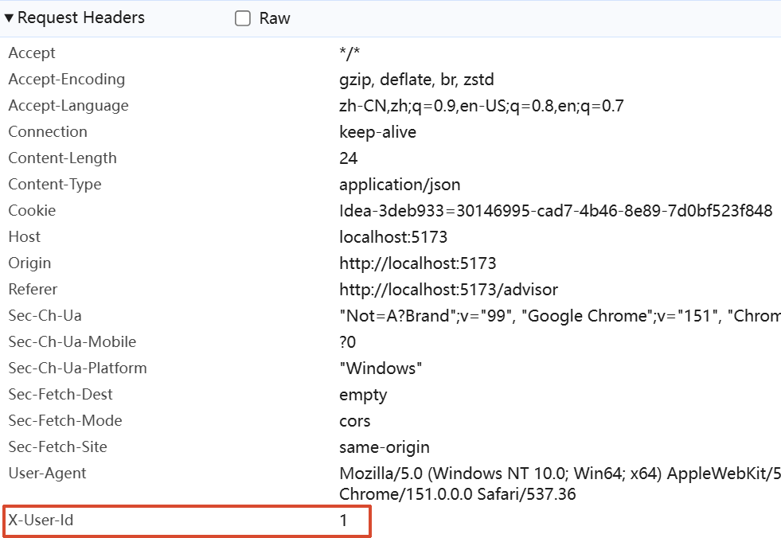
要想获取请求头中的user_id，必须使用FastAPI提供的Header函数：

```python
async def create_chat_thread(
    request: ChatThreadCreate,
    user_id: Annotated[int, Header(alias="x-user-id")],
    service:ChatThreadService = Depends(get_service),
)
```
打开 app.modules.chat_thread.router.py，添加创建会话的逻辑。

```python
from typing import Annotated

from fastapi import APIRouter, Depends, Header
from sqlalchemy.ext.asyncio import AsyncSession

from app.infra.database import get_session
from .schemas import *
from .service import ChatThreadService

router = APIRouter(prefix = "/api/v1/chat-threads", tags=["会话管理的接口"])

def get_service(session:AsyncSession = Depends(get_session)):
    return ChatThreadService(session)

@router.post("", response_model=ChatThreadResponse)
async def create_chat_thread(
    request: ChatThreadCreate,
    user_id: Annotated[int, Header(alias="x-user-id")],
    service:ChatThreadService = Depends(get_service),
):
    """创建会话"""

    return await service.add(user_id, request.title)
```

## 1.8 注册会话路由
打开 app.main.py，导入并注册会话路由：

```python
from app.modules.chat_thread.router import router as chat_thread_router

app.include_router(chat_thread_router)
```

## 1.9 测试
打开页面，访问http://localhost:5173，点击【让顾问帮我选】后，点击【登录】，即可看到咨询顾问页面

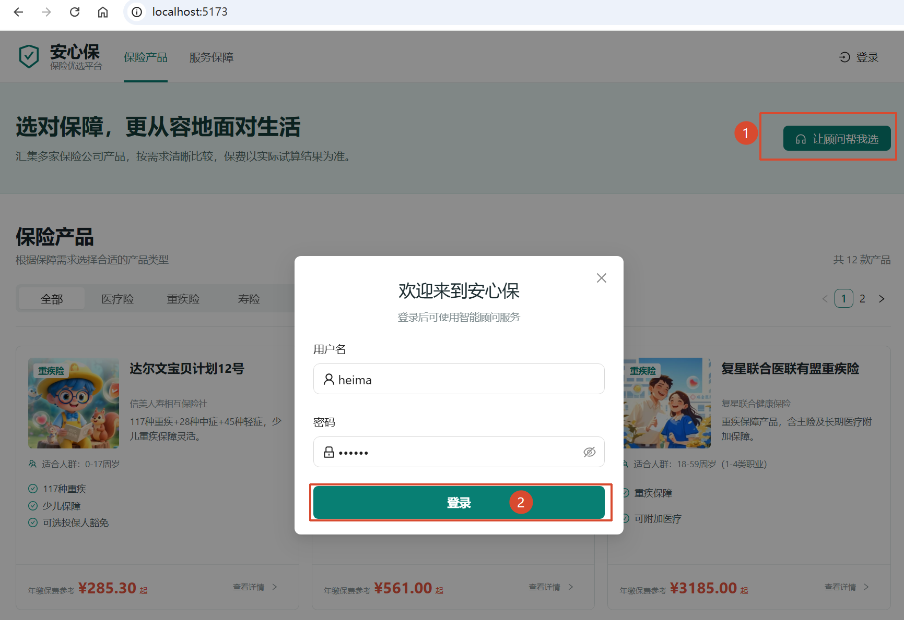
在咨询顾问页面，默认就会创建一个新会话，也可以点击【**新建咨询**】，创建更多会话：

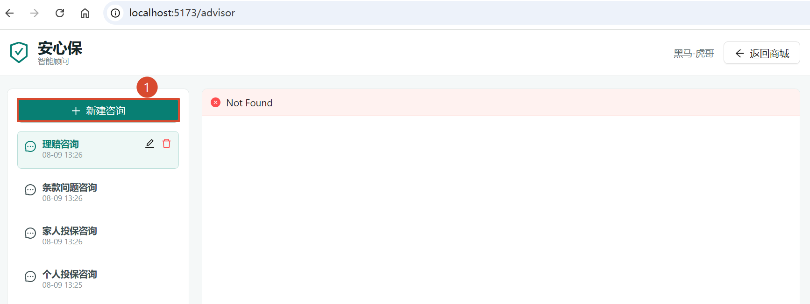

# 2. 查询会话列表
创建会话后，前端需要查询当前用户的全部会话，用于展示左侧会话列表。本章在现有模块中逐层补充查询能力。

## 2.1 接口设计
查询当前用户拥有的全部对话会话。

| 请求方式 | 请求路径 | 是否需要登录 |
| --- | --- | --- |
| GET | /api/v1/chat-threads | 是 |
**请求参数**：无。
**响应字段**：

| 字段 | 类型 | 说明 |
| --- | --- | --- |
| [] | array | 会话数组 |
| [].id | string | 会话 ID |
| [].title | string | 会话标题 |
| [].created_at | string | 创建时间 |
| [].updated_at | string | 更新时间 |
**响应示例**：

```json
[
  {
    "id": "11111111-1111-1111-1111-111111111111",
    "title": "保险咨询",
    "created_at": "2026-06-28T10:00:00.000000+08:00",
    "updated_at": "2026-06-28T10:10:00.000000+08:00"
  }
]
```

| **请求方式** | GET |
| --- | --- |
| **请求路径** | /api/v1/chat-threads |
| **请求头** | x-user-id: 1 |
| **请求参数** | 无 |
| **响应结果** | 当前用户的会话列表 |
这个接口虽然没有请求参数，但隐含的参数依然是user_id，我们要根据user_id来查询不同用户的会话列表。

## 2.2 Repository
打开 app.modules.chat_thread.repository.py，导入 select，并在 ChatThreadRepository 中添加查询方法：

```python
from sqlalchemy import select

async def list_by_user(self, user_id: int) -> list[ChatThread]:
    result = await self.session.scalars(
        select(ChatThread)
        .where(ChatThread.user_id == user_id)
        .order_by(
            ChatThread.updated_at.desc(),
            ChatThread.created_at.desc(),
        )
    )
    return list(result.all())
```
查询条件必须包含 user_id，不同用户只能看到自己的会话。结果按照更新时间和创建时间倒序排列，最近使用的会话排在最前面。

## 2.3 Service
打开 app.modules.chat_thread.service.py，在 ChatThreadService 中添加：

```python
async def list_by_user(self, user_id: int) -> list[ChatThread]:
    return await self.repository.list_by_user(user_id)
```
当前查询没有额外业务规则，因此 Service 直接调用 Repository。保留这一层可以让 Router 不直接依赖数据访问代码。

## 2.4 Router
打开 app.modules.chat_thread.router.py，添加查询接口：

```python
@router.get("", response_model=list[ChatThreadResponse])
async def list_chat_threads(
    user_id: Annotated[int, Header(alias="x-user-id")],
    service: ChatThreadService = Depends(get_service),
):
    """查询当前用户的会话列表"""

    return await service.list_by_user(user_id)
```
创建和查询接口路径相同，但请求方式不同，因此不会发生冲突。

## 2.5 测试
访问页面http://localhost:5173/advisor，如果能看到会话列表，说明查询功能成功：

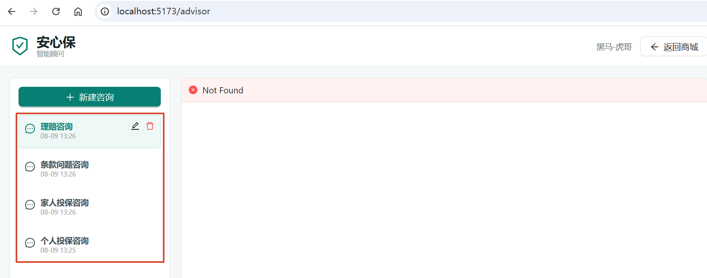

# 3. 重命名会话
用户需要根据对话内容修改会话标题。重命名时不仅要找到会话，还必须确认会话属于当前用户。

## 3.1 接口设计

| **请求方式** | PATCH |
| --- | --- |
| **请求路径** | /api/v1/chat-threads/{thread_id} |
| **请求头** | x-user-id: 1 |
| **请求体** | {"title": "医疗险咨询"} |
| **响应结果** | 重命名后的会话信息 |
> **注意**：重命名必须做校验，如果会话不存在，或者会话属于其他用户，都统一返回会话不存在，避免泄露其他用户的会话信息。

## 3.2 Schemas
重命名会话的参数格式与创建会话一样，这里就共享同一个Schemas，不再重复创建。

## 3.3 Repository
理论上，我们要写两个方法：
- 一个根据user_id和id查询会话，用来验证会话是否属于当前用户
- 一个根据id修改title的功能，用来重命名会话
不过，由于SqlAlchemy的ORM功能，我们只需要提供一个查询功能，然后修改查询出的对象的title值，SqlAlchemy会自动将其更新到数据库。
打开 app.modules.chat_thread.repository.py，导入 UUID，并在 Repository 中添加按归属查询的方法：

```python
from uuid import UUID

async def find_owned(
    self,
    thread_id: UUID,
    user_id: int,
) -> ChatThread | None:
    return await self.session.scalar(
        select(ChatThread).where(
            ChatThread.id == thread_id,
            ChatThread.user_id == user_id,
        )
    )
```
find_owned() 同时使用 thread_id 和 user_id 查询。越权数据从查询阶段就不会返回，Service 也不需要先取出其他用户的数据再判断归属。

## 3.4 Service
重命名时必须对用户身份做验证，确保当前thread_id属于当前user，否则我们应该抛出异常。

### 3.4.1 Exceptions
在 app.modules.chat_thread 包中新建 exceptions.py，定义会话不存在异常：

```python
class ChatThreadNotFoundError(Exception):
    """会话不存在或不属于当前用户"""
```

### 3.4.2 实现业务
打开 app.modules.chat_thread.service.py，补充导入并添加重命名业务：

```python
from uuid import UUID

from app.modules.chat_thread.exceptions import ChatThreadNotFoundError

async def rename(
    self,
    thread_id: UUID,
    user_id: int,
    title:str
) -> ChatThread:
    async with self.session.begin():
        # 1.根据thread_id和user_id查询，判断是否匹配
        thread = await self.repository.find_owned(thread_id, user_id)
        if thread is None:
            # 为None，说明不存在，或者不属于当前用户，抛出异常
            # raise: 就是指扔出去一个异常，代码会立刻终止，结束运行，把异常扔给调用者
            raise ChatThreadNotFoundError

        # 2.查询后直接修改字段，触发数据库更新
        thread.title = title

        # 3.刷新数据，重新从数据库中查出最新值
        await self.session.flush()
        await self.session.refresh(thread)

    return thread
```
> **注意**：updated_at 由数据库在 UPDATE 时更新。异步事务中要先调用 flush() 执行 SQL，再调用 refresh(thread) 重新加载时间字段。否则 FastAPI 序列化响应时才读取过期属性，可能触发 MissingGreenlet。

## 3.5 Router
打开 app.modules.chat_thread.router.py，导入 UUID 和 ChatThreadUpdate，然后添加接口：

```python
from uuid import UUID

@router.patch("/{thread_id}", response_model=ChatThreadResponse)
async def rename(
    thread_id: str,
    request: ChatThreadCreate,
    user_id: Annotated[int, Header(alias="x-user-id")],
    service: ChatThreadService = Depends(get_service),
):
    """重命名会话"""

    return await service.rename(thread_id, user_id, request.title)

```

## 3.6 测试
访问http://127.0.0.1:8001/docs，找到自己写的重命名接口做测试：

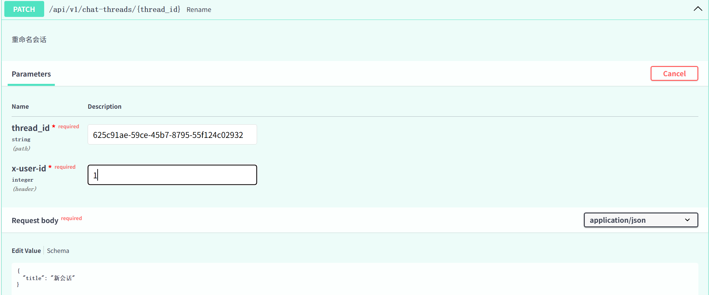
当传入正确的user_id、thread_id时，请求得到200：

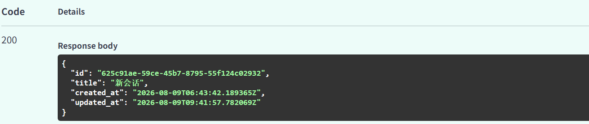
当传入错误的user_id和thread_id时，请求得到500：

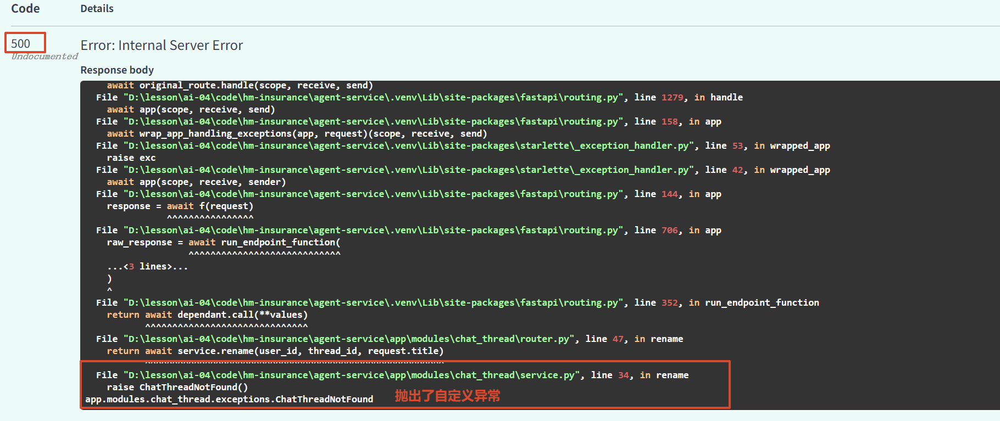

# 4. 统一异常处理
重命名接口在发现非法请求时会抛出异常，但这个异常没有被处理，所以返回了500，服务器内部错误。然而对于请求参数有误的场景，我们应该返回400状态码才对。
所以，我们应该在FastAPI中做统一异常处理，并根据不同业务返回不同的**状态码**和**错误消息**。

## 4.1 全局异常处理器
统一异常处理器就像一个横切在所有 Router 之外的“公共出口”：业务代码只负责抛出异常，FastAPI负责捕获异常，返回错误状态码和错误消息。

> [画板内容，请在原文查看]
我们修改app.main.py：

```python
# 统一处理异常信息，发现是ChatThreadNotFoundError，返回对应的错误状态码和错误信息
@app.exception_handler(ChatThreadNotFoundError)
def handle_exception(request: Request, exc: Exception):
    logger.error(f"处理异常, 请求路径: {request.url}, 异常信息: {exc}")
    return JSONResponse(
        status_code=400,
        content={
            "code": "CHAT_THREAD_NOT_FOUND",
            "message": "会话不存在或者不属于当前用户"
        }
    )
```
重启服务，再次测试，发现当传入了错误的user_id和thread_id时，会返回400状态码和错误信息：

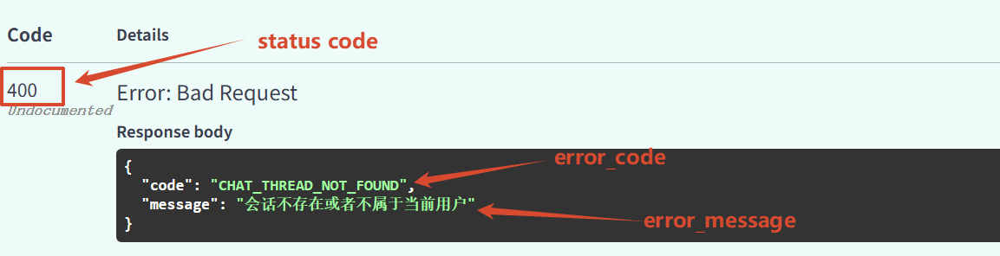
看起来似乎没有问题了。但是大家思考下，随着业务增多，自定义异常也越来越多。需要在main.py中写的统一异常处理函数也越多：

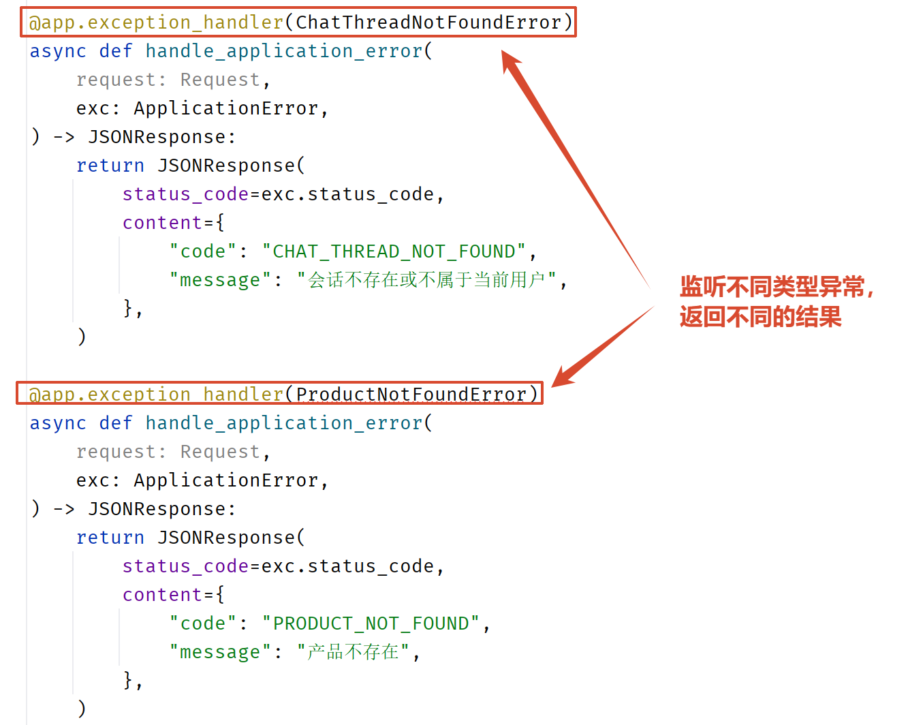
究其原因，是因为两点：
- 异常太多，且没有统一的父类
- 异常只有名称信息，缺少**状态码（status）**、**错误码（code）**和**提示信息（message）**
目前异常结构：

```python
class ChatThreadNotFoundError(Exception):
    """会话不存在或不属于当前用户"""
```
异常只表达了异常出现的原因，但**状态码（status）**、**错误码（code）**和**提示信息（message）**却无法表示。只能在通过捕获不同的异常类型来判断，返回不同异常对应的status、code、message。
而且**每新增一种异常，都要继续给main.py 添加新的异常处理函数**。
因此，我们需要做两件事情：
- 丰富自定义异常，使异常信息中自带stauts、code、message信息
- 统一异常处理，基于异常中自带的status、code、message返回结果

## 4.2 定义异常基类
所有业务异常都需要状态码（status）、错误码（code）和提示信息（message），可以先抽取一个共同的异常基类。异常基类属于项目级能力，应该放在 app.core 包中。
在 app.core 包中新建 exceptions.py 文件：

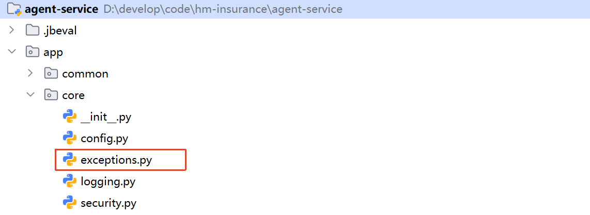
内容如下：

```python
class ApplicationError(Exception):
    """应用业务异常基类"""

    status_code: int = 500                # 默认状态码
    code: str = "APPLICATION_ERROR"       # 默认异常code
    message: str = "服务器内部错误"        # 默认异常提示
```
> 说明：
> - status_code 表示 HTTP 状态码
> - code 表示客户端识别的业务错误码
> - message 表示错误提示
> 这里提供默认值，具体业务异常会覆盖这些字段。

## 4.3 改造业务异常
修改 app.modules.auth.exceptions.py，让两个注册异常继承 ApplicationError，并把原来写在 Router 中的响应信息移到异常类中：

```python
from app.core.exceptions import ApplicationError

class ChatThreadNotFoundError(ApplicationError):
    """会话不存在或不属于当前用户"""

    status_code = 400
    code = "CHAT_THREAD_NOT_FOUND"
    message = "会话不存在或不属于当前用户"
```
现在，一个业务异常已经完整描述了“发生了什么错误”以及“应该返回什么响应”。Service 抛出异常的代码不需要修改。

## 4.4 全局异常处理器
无论异常来自哪个 Router，只要它继承自 ApplicationError，都会由同一个处理器转换成统一格式的 HTTP 响应。
修改 app.main.py，导入异常基类和 JSONResponse：

```python
from fastapi import FastAPI, Request
from fastapi.responses import JSONResponse

from app.core.exceptions import ApplicationError
```
然后在创建 FastAPI 实例之后注册全局异常处理器：

```python
@app.exception_handler(ApplicationError)
async def handle_application_error(
    request: Request,
    exc: ApplicationError, # 捕获到的异常（这里用自定义异常基类捕获，所有业务异常都会匹配到）
) -> JSONResponse:
    return JSONResponse(
        status_code=exc.status_code, # 异常中自带status
        content={
            "code": exc.code,        # 异常中自带code
            "message": exc.message,  # 异常中自带message
        },
    )
```
FastAPI 捕获到 ApplicationError 或它的任意子类后，都会进入这个处理器，再根据异常对象中的字段生成响应。以后新增业务异常时，不需要继续给 app.main.py 添加处理器。
> **说明：**
> 统一处理的是我们**主动定义的业务异常**。请求参数校验异常、程序 Bug 等其他异常仍然由 FastAPI 自身处理，不要把所有异常都转换成业务错误。

# 5. 删除会话
最后实现删除会话。删除操作同样只能作用于当前用户自己的会话，并且成功后不需要返回响应体。

## 5.1 接口设计

| **请求方式** | DELETE |
| --- | --- |
| **请求路径** | /api/v1/chat-threads/{thread_id} |
| **请求头** | x-user-id: 1 |
| **请求体** | 无 |
| **响应结果** | 204 No Content |

## 5.2 Repository
打开 app.modules.chat_thread.repository.py，添加删除方法：

```python
async def delete(self, thread: ChatThread) -> None:
    await self.session.delete(thread)
```
Repository 只负责标记对象待删除，事务仍由 Service 管理。

## 5.3 Service
打开 app.modules.chat_thread.service.py，在 ChatThreadService 中添加：

```python
async def delete(
    self,
    thread_id: UUID,
    user_id: int,
) -> None:
    async with self.session.begin():
        thread = await self.repository.find_owned(thread_id, user_id)
        if thread is None:
            raise ChatThreadNotFoundError

        await self.repository.delete(thread)
```
删除前继续复用 find_owned()。会话不存在或者属于其他用户时，统一抛出 ChatThreadNotFoundError。
当前只删除 chat_threads 表中的会话元数据。等后续接入 Agent 后，再补充删除 LangGraph Checkpointer 中对应运行状态的逻辑。

## 5.4 Router
打开 app.modules.chat_thread.router.py，补充 Response 和 status 导入，然后添加删除接口：

```python
from fastapi import Response, status

@router.delete(
    "/{thread_id}",
    status_code=status.HTTP_204_NO_CONTENT,
)
async def delete_chat_thread(
    thread_id: UUID,
    user_id: Annotated[int, Header(alias="x-user-id")],
    service: ChatThreadService = Depends(get_service),
) -> Response:
    """删除指定会话"""

    await service.delete(thread_id, user_id)
    return Response(status_code=status.HTTP_204_NO_CONTENT)
```

## 5.5 测试

```bash
curl -i -X DELETE "http://localhost:8001/api/v1/chat-threads/{thread_id}" -H "x-user-id: 1"
```
第一次删除应返回 204 No Content。再次删除相同会话，应返回 CHAT_THREAD_NOT_FOUND。最后重新查询会话列表，确认该会话已经消失。
