# Day05. LangChain

> 原文链接：https://my.feishu.cn/wiki/Kly1wTC2KiTOw2kxA35cisS2nnb

《安心保》的智能客服不仅仅是聊天机器人，还要对接业务能力，协助用户投保、理赔，这样的应用我们成为Agent，也就是智能体。而开发智能体最常用的框架就是LangChain，今天我们就来学习LangChain框架的使用。
学习目标：
- 知道ToolCalling原理
- 会使用LangChain创建Agent
- 会使用LangChain实现会话记忆
- 会使用MCP
- 会使用LangChain实现流式输出

# 1. 认识Agent
LangChain框架的核心就是便捷的开发、调试、评估、部署Agent。那么问题来了：
> 什么是Agent呢？

## 1.1 什么是Agent
什么是Agent，这其实没有一个标准的答案，每个人都有自己的理解。
对于这个问题，LangChain创始人[Harrison Chase](https%3A%2F%2Fwww.blog.langchain.com%2Ftag%2Fharrison-chase%2F)有一个偏向技术性的答案：
> An AI agent is a system that uses an LLM to decide the control flow of an application.
> Agent是一种使用大语言模型（LLM）来决定应用程序控制流的系统。
在人工智能领域，**Agent**（通常翻译为**智能体**或**代理**）是指**一种能够感知环境、进行推理、自主决策并采取行动以实现特定目标的智能系统。**

| **特性 ** | **传统聊天机器人/LLM** | **AI Agent** |
| --- | --- | --- |
| **交互模式** | 被动响应，问一句答一句 | 主动规划，以目标为导向 |
| **执行力** | 停留在文本生成层面 | 能操作软件、发送邮件、分析数据 |
| **自主性** | 需要人类给出详细步骤 | 只需给定最终目标，自主寻找路径 |

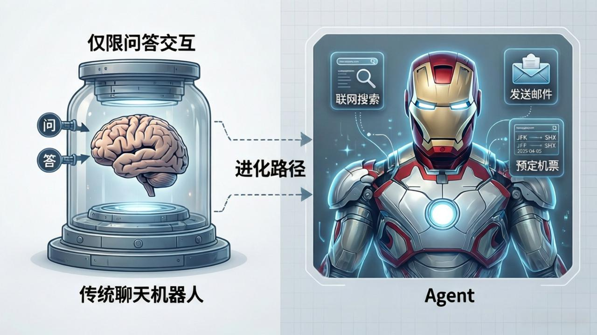
如果说大模型（LLM）是“大脑”，那么 Agent 就是**“拥有手脚和思维逻辑的独立个体”**。它不再只是被动地回答问题，而是能主动拆解任务并调用各种工具来完成工作。
例如：要开发一个《AI旅游助手》的应用。

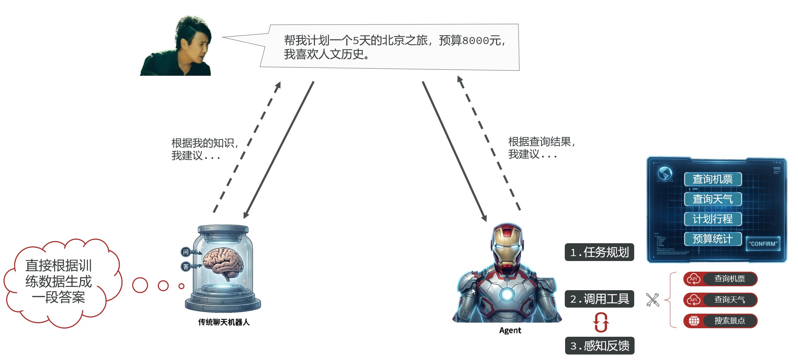
如果是**传统LLM应用**，程序流程是这样的：
> 1. 用户提出需求，例如：帮我计划一个5天的北京之旅，预算8000元，我喜欢历史。
> 1. 调用LLM，分析用户需求，直接由LLM生成一个简单旅游计划
这个计划基于它训练数据中的通用知识，可能没有考虑当前的天气、景点是否关闭、门票是否可预订等实时信息。
如果是**Agent应用**，Agent可以自主规划程序流程：
> 1. 用户提出需求，例如：帮我计划一个5天的北京之旅，预算8000元，我喜欢历史。
> 1. Agent分析用户需求，分步执行：
>    1. 规划： 将大目标分解为：查询机票酒店价格 -> 查询天气和景点信息 -> 设计每日行程 -> 计算总预算。
>    1. 调用工具：
>       - 调用机票/酒店API，查询用户指定日期范围内的价格和可选酒店。
>       - 调用天气预报API，查询未来5天北京的天气，建议携带的衣物。
>       - 调用搜索引擎/景点API，查询故宫、国博等热门景点的最新开放时间、预约政策和当前展览。
>    1. 感知与反馈： 综合感知所有查询到的实时信息，生成一个动态的、可执行的计划。例如：“根据预算和您对历史的兴趣，我推荐入住胡同里的XX酒店。第一天去故宫，但请注意下周一故宫闭馆，所以调整到第二天……总花费预计7500元，还在预算内。需要我现在帮您预订酒店和机票吗？”
Agent通过主动规划任务流程，主动使用工具，整合了实时信息，并进行了动态调整，最终产出的是一个真正可落地的方案。
总结如下：
- LLM = 聪明的大脑
- Agent = 聪明的大脑 + 工具（手脚）
那么问题来了：
> 工具该如何定义呢？
> LLM如何调用工具呢？

## 1.2 ToolCalling原理
工具的本质就是函数：
- 一个查询天气的函数，就是查天气工具
- 一个查询机票的函数，就是查机票工具
- ...
例如，我们来定义一个函数：

```python
def get_weather(location: str) -> str:
    """
    Get the weather in a given location.
    Args:
        location: city name or coordinates
    """
    return f"Current weather in {location} is sunny"
```
现在，这就是一个查询天气的工具。
但大家思考一下，**工具是在本地自己定义的，而模型则是在服务器上运行**的（比如DeepSeek）。
那么问题来了：
> - 模型如何知道我们有哪些工具？
> - 模型又该如何调用我们的工具呢？
其实调用函数只需要知道函数名和参数类型就可以了，模型在云端，无法调用我们，所以只能换一个思路：
- 让模型知道我们的工具(函数名称、参数名）
- 让模型把想调用的工具和参数（函数名、参数值）返回给我们
要解决这个问题，就需要用到ToolCalling技术了。原理如图：

> [画板内容，请在原文查看]
其实思路并不复杂，流程是这样的：
1. 我们在本地定义get_weather这样的工具函数（可以有多个）
1. 用户询问杭州天气
1. 我们把工具对应的函数名、函数参数格式、用户问题组织在一起作为请求参数，发送给模型
1. 模型根据用户问题判断：
   1. 是否需要调用工具
   1. 要调用哪个工具
1. 模型返回工具信息，包括：要调用的函数名、参数
1. 我们根据函数名找到函数，调用函数，传入参数，得到结果
1. 把工具执行结果结合用户问题发送给模型，由模型分析结果，是否足以回答
   1. 足够，直接生成答案
   1. 不足，回到4（继续调用其它工具）
其实，在大模型提供的API接口中，有一个tools参数，描述了工具的详细信息：

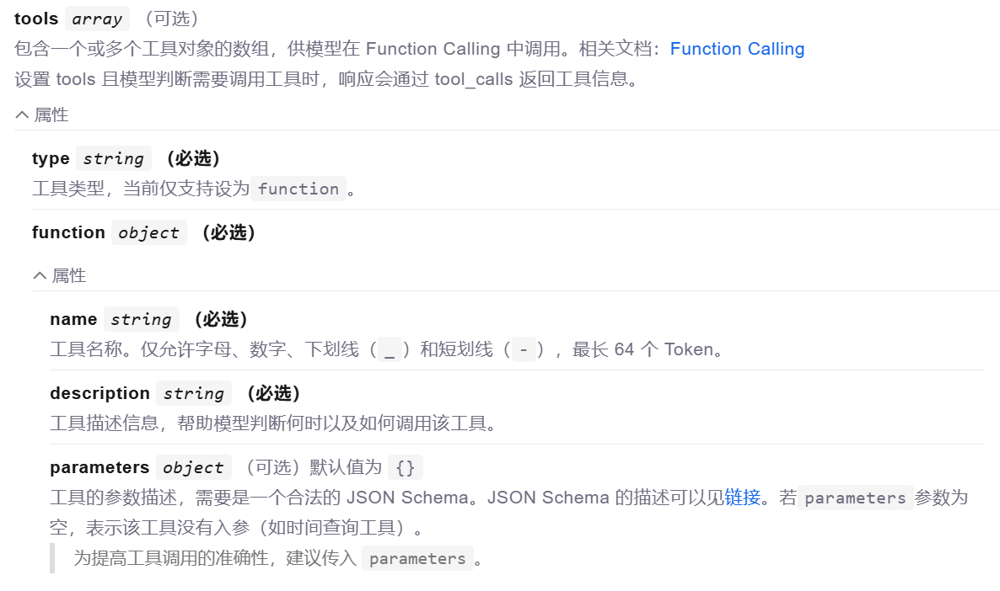
当模型判断需要调用工具时，在返回的结果中，就会有要调用的工具信息：

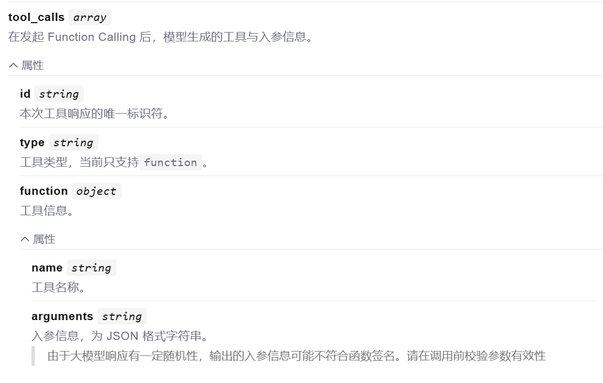
所以，我们只需要这么几件事情：
- 在调用LLM时传入toos参数，把工具信息发给LLM
- 在LLM返回结果中找到tool_calls，找到要调用的function的name和arguments，然后调用function
- 把function结果发给LLM，让LLM生成自然语言回答

## 1.3 ToolCalling代码演示
接下来，我们就基于ToolCalling的原理，来手搓一个Agent，不过首先我们需要安装一些依赖：

```python
uv add openai
```
然后，在notebooks目录下新建一个day05，再新建一个1.tool_calling.ipynb文件：

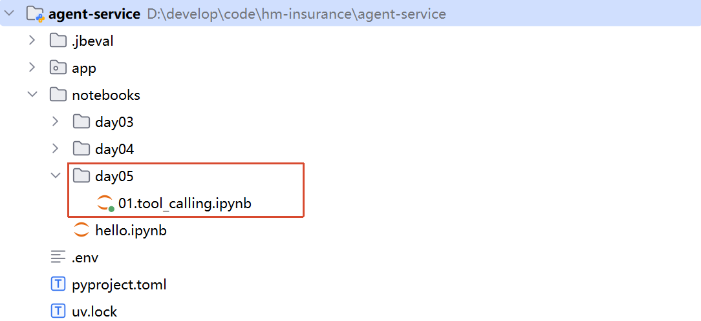
示例代码：

```python
import json
import os
from openai import OpenAI
from dotenv import load_dotenv
load_dotenv()

# ==================== 1. 定义工具 ====================
def get_weather(location: str) -> str:
    return f"Current weather in {location} is sunny"

def square_root(x: float) -> float:
    return x ** 0.5

# 把函数放到dict中，方便根据函数名查找
tools_by_name = {"get_weather": get_weather, "square_root": square_root}

# ==================== 2. 定义工具的LLM描述 ====================
tools = [
    {
        "type": "function",
        "function": {
            "name": "get_weather",
            "description": "Get weather of a location, the user should supply a location first.",
            "parameters": {
                "type": "object",
                "properties": {
                    "location": {
                        "type": "string",
                        "description": "The city and state, e.g. San Francisco, CA",
                    }
                },
                "required": ["location"]
            },
        }
    },
    {
        "type": "function",
        "function": {
            "name": "square_root",
            "description": "Calculate the square root of a given number.",
            "parameters": {
                "type": "object",
                "properties": {
                    "x": {
                        "type": "number",
                        "description": "The number to calculate square root for",
                    }
                },
                "required": ["x"]
            },
        }
    },
]

# ==================== 3. LLM客户端 ====================
client = OpenAI(
    api_key=os.getenv('DEEPSEEK_API_KEY'),
    base_url="https://api.deepseek.com"
)

# ==================== 4. 定义发送消息的方法 ====================
def send_messages(messages):
    response = client.chat.completions.create(
        model="deepseek-v4-flash",
        messages=messages,
        tools=tools,
        extra_body={"thinking": {"type": "disabled"}}
    )
    return response.choices[0].message

# ==================== 5. 定义执行Tool调用的方法 ====================
def execute_tool(message, messages):
    """解析Tool信息，执行对应的函数，并将结果追加到消息列表"""
    tool_call = message.tool_calls[0]
    tool_id = tool_call.id
    tool_name = tool_call.function.name
    tool_args = json.loads(tool_call.function.arguments)

    print(f"调用工具: {tool_name}, 参数: {tool_args}")

    # 根据函数名找到对应函数并执行
    result = tools_by_name[tool_name](**tool_args)
    print(f"工具结果: {result}")

    # 将AI消息和Tool结果追加到消息列表
    messages.append(message)
    messages.append({
        "role": "tool",
        "tool_call_id": tool_id,
        "content": result
    })
    return messages

# ==================== 6. 主流程 ====================
# 准备用户消息
messages = [{"role": "user", "content": "杭州天气怎么样?"}]
print(f"User> {messages[0]['content']}")

# 第一次调用LLM，获取ToolCall
message = send_messages(messages)
print(f"Tool> {message.tool_calls[0]}")

# 执行Tool并将结果传回LLM
messages = execute_tool(message, messages)

# 再次调用LLM，生成最终答案
message = send_messages(messages)
print(f"AI> {message.content}")
```

## 1.4 总结
传统的LLM应用都是一问一答的形式，模型只能根据自己的训练数据来回答，流程非常简单：

> [画板内容，请在原文查看]
有了ToolCalling技术，则可以让LLM调用工具与外界交互，获取实时信息，工作流程则要复杂很多，是这样的：

> [画板内容，请在原文查看]
流程如下：
1. 用户提问（Input）：杭州今天天气如何？
1. 模型分析（Reasoning）：用户询问杭州天气，我不知道，需要调用查询天气的工具get_weather
1. 调用工具（Action）：调用工具，get_weather，传入城市"杭州"
1. 分析结果（Observation）：工具返回结果，模型分析结果，判断是否足以回答用户问题
   1. 是：整理生成响应结果
   1. 否：重复前面步骤
1. 生成结果（Output）：根据工具的结果生成响应给用户
上图所说的这个工作模型，我们称为**ReAct**模型，即**R**easoning **Act**ion，而这也是最基础一种Agent工作模型。
恭喜你！已经完成了一个简单的Agent了
不过，可以发现自己手写Agent还是挺复杂的，如果程序工具多起来，代码会成倍增长！所以，为了提升Agent开发的效率，我们就必须学习工业级框架了。

# 2. 认识LangChain
LangChain 由 Harrison Chase 创建于2022年10月，是用于开发**智能体工程（Agent Engineering）**的平台**。**
官网地址：
🔗 [LangChain](https://www.langchain.com/)
官网文档：
🔗 [Home - Docs by LangChain](https://docs.langchain.com/)

## 2.1 架构体系
**LangChain**并不仅仅是一个框架，而是一整个智能体开发平台，包含很多不同的组件。
其中，包含一系列开源的**智能体（Agent）**开发框架，而且兼容Python和TypeScript两种语言：

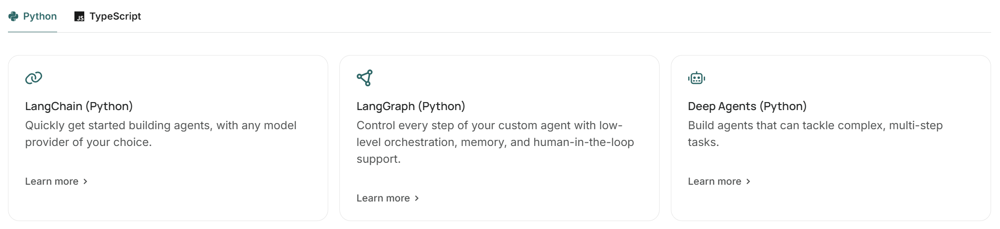
- LangChain：用于快速构建智能体，可兼容任何模型提供商。
- LangGraph：从底层一步步控制智能体的构建，包括记忆（Memory）、人机协同（HITL）等
- Deep Agents：用于构建复杂的、处理多步骤的任务的智能体
另外，LangChain还包含一套帮助人工智能团队利用实时生产数据进行**持续测试和改进**的平台，叫做LangSmith：

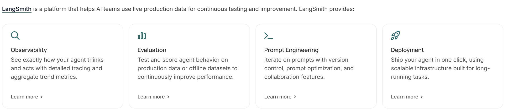
> 总结：
> LangChain是智能体开发平台，包含一套各种帮助开发、测试、评估智能体的框架。核心包括：
> - LangChain：用于快速构建智能体，可兼容任何模型提供商。
> - LangGraph：从底层一步步控制智能体的构建，包括记忆（Memory）、人机协同（HITL）等
> - Deep Agents：用于构建复杂的、处理多步骤的任务的智能体
> - LangSmith：用于测试、观察、评估、部署智能体

## 2.2 快速入门
下面，我们通过一个快速入门，了解Agent的定义和工作流程。

### 2.2.1 安装依赖
**首先**，要使用LangChain必须先安装LangChain依赖、以及LangChain对模型的支持依赖。

```bash
uv add langchain langchain-deepseek
```
**然后**，我们要确保在项目的**.env**环境中配置好**api_key**:

```python
DEEPSEEK_API_KEY=<YOUR_DEEPSEEK_API_KEY>
```
接下来，就可以正式开发了。

### 2.2.2 代码示例
接下来就可以开发Agent了，基本步骤如下：
1. 加载系统环境变量
1. 定义工具
1. 定义Agent，绑定模型和工具
1. 调用Agent
Langchain提供了**create_agent**方法用来快速创建Agent，我们只需要提供好Agent所需的**模型（Models）**、**工具（Tools）**即可。
我们在notebooks/day05新建一个02.LangChain入门.ipynb文件：

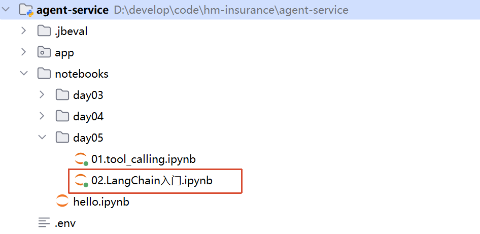
示例代码如下：

```python
from langchain.agents import create_agent
from langchain.tools import tool
from dotenv import load_dotenv

# 1.加载环境变量
load_dotenv() # 读取.env文件，加入系统环境变量中

# 2.定义工具，就是定义函数，给函数加装饰器 @tool
@tool
def get_weather(location: str):
    """查询指定location的天气"""
    return f"Current weather in {location} is sunny"

@tool
def square_root(x: float) -> float:
    """求x的平方根"""
    return x ** 0.5

# 3.定义Agent，绑定模型和工具，用函数create_agent
agent = create_agent(
    model="deepseek-v4-flash",
    tools=[get_weather, square_root]
)

# 4.调用Agent，用invoke函数，传入一个Dict，字典要有messages属性，里面是消息的列表
response = agent.invoke({
    "messages": [{"role": "user", "content": "杭州天气如何？"}]
})
print(response) #
```
> **说明**：
> - LangChain的Agent无需你指定api_key和base_url，而是会尝试自己去环境变量读取。
> - Pydantic Settings读取.env只会存入Settings对象，不会反向放入系统环境变量。在当前场景下需要读取系统环境变量就读取不到。
> - 为了保证代码通用性，我们用了另一个库：dotenv，它负责读取.env文件，把其中的变量作为环境变量的一部分，从而简化了LangChain调用。
运行结果如下：

```python
🚀 正在调用大模型...
{'messages': [HumanMessage(content='杭州今天天气如何?', additional_kwargs={}, response_metadata={}, id='c692ed96-916b-4e99-ac39-80106d21b27f'), AIMessage(content='', additional_kwargs={'refusal': None, 'reasoning_content': '用户想知道杭州今天的天气情况。我可以使用getWeather工具来获取杭州的天气信息。'}, response_metadata={'token_usage': {'completion_tokens': 63, 'prompt_tokens': 288, 'total_tokens': 351, 'completion_tokens_details': {'accepted_prediction_tokens': None, 'audio_tokens': None, 'reasoning_tokens': 19, 'rejected_prediction_tokens': None}, 'prompt_tokens_details': {'audio_tokens': None, 'cached_tokens': 0}, 'prompt_cache_hit_tokens': 0, 'prompt_cache_miss_tokens': 288}, 'model_provider': 'deepseek', 'model_name': 'deepseek-v4-flash', 'system_fingerprint': 'fp_8b330d02d0_prod0820_fp8_kvcache_20260402', 'id': '06041747-75ed-4c61-abee-a598feb08c5a', 'finish_reason': 'tool_calls', 'logprobs': None}, id='lc_run--019f22c6-3b84-7d22-afcd-5aee47623cd3-0', tool_calls=[{'name': 'getWeather', 'args': {'location': '杭州'}, 'id': 'call_00_cValv6t9HrvHNJ3WNCSD5096', 'type': 'tool_call'}], invalid_tool_calls=[], usage_metadata={'input_tokens': 288, 'output_tokens': 63, 'total_tokens': 351, 'input_token_details': {'cache_read': 0}, 'output_token_details': {'reasoning': 19}}), ToolMessage(content='Current weather in 杭州 is sunny', name='getWeather', id='32018b5d-00c8-46eb-bf6f-0e1e306b18e1', tool_call_id='call_00_cValv6t9HrvHNJ3WNCSD5096'), AIMessage(content='杭州今天天气晴朗 ☀️，阳光不错，适合外出活动哦！', additional_kwargs={'refusal': None, 'reasoning_content': '工具返回了杭州今天的天气是晴朗的。我可以直接告诉用户。'}, response_metadata={'token_usage': {'completion_tokens': 32, 'prompt_tokens': 370, 'total_tokens': 402, 'completion_tokens_details': {'accepted_prediction_tokens': None, 'audio_tokens': None, 'reasoning_tokens': 15, 'rejected_prediction_tokens': None}, 'prompt_tokens_details': {'audio_tokens': None, 'cached_tokens': 256}, 'prompt_cache_hit_tokens': 256, 'prompt_cache_miss_tokens': 114}, 'model_provider': 'deepseek', 'model_name': 'deepseek-v4-flash', 'system_fingerprint': 'fp_8b330d02d0_prod0820_fp8_kvcache_20260402', 'id': '4a6a34b6-2dae-45bf-bf54-5479f3fdf04d', 'finish_reason': 'stop', 'logprobs': None}, id='lc_run--019f22c6-41d2-7432-8ded-6121a3da3265-0', tool_calls=[], invalid_tool_calls=[], usage_metadata={'input_tokens': 370, 'output_tokens': 32, 'total_tokens': 402, 'input_token_details': {'cache_read': 256}, 'output_token_details': {'reasoning': 15}})]}
```

## 2.3 总结
可以看到，使用LangChain定义Agent代码会非常简单，步骤如下：
1. 使用@tool装饰器定义工具，通过文档注释描述工具作用
1. 基于create_agent定义Agent，指定model和tools
1. 调用Agent
很多之前需要自己写的代码都省略了：
- 定义工具时使用@tool装饰器，LangChain自动解析tool信息
- 调用LLM时，无需自己组织tools参数，LangChain自动封装
- LLM返回Tool结果时，无需自己解析Tool、调用Tool，LangChain自动处理
- 拿到Tool结果无需自己拼接消息，调用LLM，LangChain自动完成
可以说开发效率大大提高，这就是为什么要使用框架的原因！
当然，以上只是LangChain最基本的用法，接下来我们就详细学习LangChain中的各个组件。

# 3. 模型（Models）
在入门案例中我们通过create_agent创建Agent，直接指定模型名就可以了，非常方便。但模型的参数却都是默认参数，无法修改。
如果要自定义模型参数，就需要单独初始化模型了。
langchain提供了两种常见方法用来初始化模型：
- 使用init_chat_model函数，由langchain自动创建模型对象
- 使用不同模型对应的Model类，手动创建模型对象
但最常用的还是init_chat_model.

## 3.1 初始化模型
在LangChain中开始使用独立模型的最简单方法是使用init_chat_model函数。init_chat_model的常见参数如下：
> - model：模型名称，**必填**
> - model_provider：模型提供者，包括OpenAI、DeepSeek、Anthropic、Google等，默认会根据模型名推断：
>   - 模型名以deepseek为前缀：推断为DeepSeek
>   - 模型名以gpt为前缀：推断为OpenAI
>   - ...
> - api_key：模型的认证key，默认会从环境变量读取与模型提供者有关的key，例如
>   - OpenAI：读取OPENAI_API_KEY
>   - DeepSeek：读取DEEPSEEK_API_KEY
>   - ...
> - base_url：模型提供者的url地址，默认会根据模型提供者去推断，例如
>   - DeepSeek：默认为https://api.deepseek.com
>   - OpenAI：默认为https://api.openai.com
>   - ...
> - 其它模型参数，参考模型官方文档，例如temperature、max_tokens、extra_body等
虽然有这么多参数，但并不是都需要填写。分为两种情况：
- **默认初始化**：用于LangChain默认支持的模型，只用传入model参数
- **自定义初始化**：用于LangChain默认不支持的模型，需要传入全部参数
LangChain支持的模型列表可以参考官方文档：https://docs.langchain.com/oss/python/integrations/chat

### 3.1.1 默认认初始化
对于LangChain默认支持的模型，调用init_chat_model时最少需要一个参数model，LangChain会根据名称推断model_provider、base_url，并去环境变量加载对应的api_key。
例如，我们要使用Deepseek这个模型，LangChain默认就支持，所以就只需要model参数，但API_KEY还是要配置的：
- **首先**，我们需要安装模型依赖（如果已经安装可以跳过）：

```bash
uv add langchain-deepseek
```
- **然后**，我们要确保在项目的**.env**环境中配置好**api_key**:

```shell
DEEPSEEK_API_KEY=<YOUR_DEEPSEEK_API_KEY>
```
- **最后**，就可以直接使用init_chat_model初始化模型了：

```python
# ===================1.初始化模型=====================
# 导入Langchain的初始化模型的函数
from langchain.chat_models import init_chat_model
# 1. 加载环境变量
from dotenv import load_dotenv
load_dotenv()

# 2.调用init_chat_model初始化模型，LangChain自动推断base_url和api_key，我们配置其它参数即可
model = init_chat_model(
    model="deepseek-v4-flash",
    temperature=0.7,
    extra_body={"thinking": {"type": "disabled"}}
)

# =================2.测试====================
from langchain.agents import create_agent

# 3.初始化Agent，传入初始化好的model、tools，tools可以为空
agent = create_agent(model = model, tools=[])

# 4.调用Agent
response = agent.invoke({
    "messages": [{"role": "user", "content": "你是谁？"}]
})
print(response)
```
可见，采用init_chat_model自动初始化模型时，模型的类型由LangChain通过模型名称自动推断。
如果要切换其它模型，我们只需要安装其它模型依赖，然后配置API_KEY，改变模型名称即可，其它代码不用动。

### 3.1.2 自定义初始化
如果不是LangChain识别的模型，除了model以外，还需要自己配置model_provider、base_url、api_key了。
例如，我们要访问阿里云百炼的qwen模型，它就是不被langchain支持的模型，我们必须自定义模型参数来访问。
- 我们需要在环境变量中定义**api_key**和**base_url**
- 然后在init_chat_model中指定**model**、**model_provider**、**base_url**和**api_key**
具体步骤如下：
- **首先，**在.env中配置好api_key和base_url：

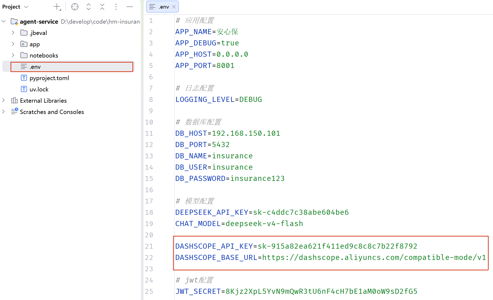
示例：

```bash
DASHSCOPE_API_KEY=<YOUR_DASHSCOPE_API_KEY>
DASHSCOPE_BASE_URL=https://dashscope.aliyuncs.com/compatible-mode/v1
```
- **然后，**手动读取环境变量中的api_key和base_url，再调用init_chat_model，手动传入api_key和base_url参数，初始化模型

```python
# 导入Langchain的初始化模型的函数
from langchain.chat_models import init_chat_model
# ===================Step 1.初始化模型=====================
# 1.加载环境变量
from dotenv import load_dotenv
load_dotenv()

import os
base_url = os.getenv("DASHSCOPE_BASE_URL")
api_key = os.getenv("DASHSCOPE_API_KEY")

# 2.初始化模型
model = init_chat_model(
    model="qwen3.7-plus", # 模型名称，这里可以自定义，我们用的是阿里的qwen-max
    model_provider="openai", # 如果是Langchain不支持的模型，用openai的规范
    base_url=base_url,
    api_key=api_key
)

# =================Step 2.测试====================
from langchain.agents import create_agent

# 3.初始化Agent，传入初始化好的model、tools，tools可以为空
agent = create_agent(model = model, tools=[])

# 4.调用Agent
response = agent.invoke({
    "messages": [{"role": "user", "content": "你是谁？"}]
})
print(response)
```
注意，由于qwen不被支持，但兼容OpenAI，所以model_provider用openai，但base_url和api_key就是阿里云自己的了。

### 3.1.3 Model初始化
某些模型提供商并不兼容OpenAI规范，也不被init_chat_model默认初始化支持，就必须使用专用的Model类来初始化了。
例如：Ollama
首先，需要安装Ollama依赖：

```plain
uv add langchain-ollama
```
然后，就可以利用它访问本地Ollama部署的任何模型了：

```python
from langchain_ollama import ChatOllama

# 初始化Ollama平台的模型
model = ChatOllama(
    model="qwen3.5:0.8b",
    temperature=1.0,
)

# =================测试====================
from langchain.agents import create_agent

# 初始化Agent，传入初始化好的model
agent = create_agent(model = model, tools=[])

response = agent.invoke({
    "messages": [{"role": "user", "content": "你是谁？"}]
})
print(response)
```

## 3.2 直接调用模型
对于简单的业务，没有必要创建Agent，直接调用模型也能达成目的。
LangChain提供了两个不同的方法来调用模型：
- invoke：阻塞式访问
- stream：流式访问
不过模型调用通常都是采用invoke阻塞调用，示例：

```python
from langchain.chat_models import init_chat_model
# 1.加载环境变量
from dotenv import load_dotenv
load_dotenv()

# 2.调用init_chat_model函数初始化模型
model = init_chat_model(
    model="deepseek-v4-flash",
    extra_body={"thinking": {"type": "disabled"}}
)

# 3.调用invoke方法，直接传字符串
response = model.invoke("你是谁？")
print(response)

print("="*50)

# 4.调用invoke，传消息数组
response = model.invoke([
    {"role": "system", "content": "你扮演小团团，用她的身份回答问题"},
    {"role": "user", "content": "你是谁？"}
])
# 查看响应结果
print(response)
```

## 3.3 消息（Messages）
在调用模型时，发送给LLM的消息、LLM返回的消息都包含以下几部分内容：
- role：消息所属角色，可以是system、user、assistant、tool
- content：消息的内容
- metadata（可选）：消息的元数据，例如：消息的ID、消耗的token等
之前我们都是自己用dict模拟消息：

```python
response = model.invoke(
    [{"role": "user", "content": "月亮的首都是哪里？"}]
)
```
这太麻烦了。在LangChain中发送给LLM的消息、LLM返回的消息都统一被封装为BaseMessage，它是中基本的上下文单元。

### 3.3.1 消息类型
在LangChain中，我们并不需要自己创建BaseMessage对象，LangChain已经把常见消息根据角色（Role）创建了对应的BaseMessage的子类：
- SystemMessage：role是system，代表系统消息，用于设定模型角色和交互背景
- HumanMessage：role是user，代表用户输入的消息
- AIMessage：role是assistant，代表LLM生成的响应，包含：文本、工具调用、元数据
- ToolMessage：role是tool，代表工具调用时产生的结果

### 3.3.2 定义Message消息
我们可以自定义LangChain的各种Message，像这样传递消息列表：

```python
# 模型消息
from langchain.messages import HumanMessage, SystemMessage
from langchain.chat_models import init_chat_model
# 1.加载环境变量
from dotenv import load_dotenv
load_dotenv()

# 2.初始化模型
model = init_chat_model(
    model="deepseek-v4-flash",
    extra_body={"thinking": {"type": "disabled"}}
)

# 3.调用模型，发送消息
response = model.invoke([
        SystemMessage(content="你扮演小团团，用她的身份回答问题"),
        HumanMessage(content="你是谁？")
    ])

print(response)
```

## 3.4 结构化输出
有时候我们需要让模型输出固定结构的数据，例如JSON，这样我们就能拿到JSON，转为对象。
而在LangChain中，只需要非常简单的配置即可让模型的输出按照我们的规定，直接转为对象。步骤为：
- 1.读取环境变量
- 2.初始化普通模型
- 3.定义Pydantic BaseModel类，约束输出结果
- 4.用模型绑定BaseModel
- 5.调用模型，完成结构化输出
示例：

```python
from dotenv import load_dotenv
from langchain.chat_models import init_chat_model
from langchain.messages import HumanMessage, SystemMessage, AIMessage
# 1.准备和加载环境变量
load_dotenv()

# 2.初始化模型 init_chat_model
model = init_chat_model(
    model="deepseek-v4-flash",
    extra_body={
        "thinking": {
            "type": "disabled"
        }
    }
)

# 3.定义 BaseModel 类，用来约束模型的输出，同时封装模型要输出的数据
from pydantic import BaseModel, Field

class CapitalInfo(BaseModel):
    name: str = Field(description="首都的名字")
    location: str = Field(description="The location of che capital")
    vibe: str = Field(description="The vibe of che capital")
    economy: str = Field(description="The economy source of che capital")

# 4.将BaseModel类与模型绑定，要求输出结构化结果
model_with_structured_output = model.with_structured_output(schema=CapitalInfo)

# 5.调用模型
response = model_with_structured_output.invoke([
    HumanMessage("你是科幻小说作家，帮我创造月球首都城市背景。"),
])

print(type(response)) # <class '__main__.CapitalInfo'>
print(response)
```
注意，在输出的结果中，有一个'structured_response'的字段，就是结构化输出的对象：

```python
<class '__main__.CapitalInfo'>
name='广寒城 (Guanghan City)' location='月球正面第谷环形山（Tycho Crater），位于南纬43度，西经11度，建于环形山内部穹顶之下' vibe='赛博朋克与东方古典美学的融合——全息投影的琉璃瓦屋顶、悬浮的霓虹灯笼、街道两旁延伸的透明穹顶外是永恒的星空。城市分为七层垂直结构，最底层是工业区与贫民窟，顶层是执政院与富商宅邸。空气中飘着合成茉莉花香，全息广告用古汉语、英语和月球通用语轮流播放。' economy='氦-3采矿（能源出口地球）、月球旅游业（零重力观光、地球升起观景台）、尖端量子计算芯片制造、月球地产与高空土地交易、地下农场粮食自给'
```

## 3.5 总结
尽管里面Model已经能完成与模型交互，但模型更擅长完成一次性对话任务，如果要调用工具，实现复杂逻辑，还是要用Agent，而且LangChain还给Agent添加了很多高级功能，接下来我们就继续深入学习Agent

# 4. Agent调用细节

## 4.1 调用Agent
创建Agent的基本流程是这样的：
- 1.准备并加载环境变量
- 2.初始化模型
- 3.利用@tool定义工具
- 4.定义Agent，绑定model和tools
- 5.调用Agent
而调用Agent也分为两种模式：
- invoke：阻塞式调用
- stream_events：流式调用

### 4.1.1 invoke
完整代码：

```python
# invoke调用Agent
from langchain.agents import create_agent
from langchain.messages import HumanMessage
from langchain.chat_models import init_chat_model
from dotenv import load_dotenv

# 1.加载环境变量
load_dotenv()

# 2.初始化模型
model = init_chat_model(
        "deepseek-v4-flash",
        extra_body={"thinking": {"type": "disabled"}}
    )

# 3.定义tool（可以没有，不过这个时候只能对话，不算完整的Agent）
tools=[]

# 4.创建智能体
agent = create_agent(
    model = model,
    tools=tools
)

# 5.调用Agent
response = agent.invoke({
    "messages": [HumanMessage("你是谁？")]
})
print(response['messages'][-1].content)
```
注意Agent同步调用与Model同步调用的差别：
- 传入参数不同
  - 调用模型：str | list，单个消息或消息的列表
  - 调用Agent：dict，key为messages，value为消息列表
- 返回值不同
  - 调用模型：返回值是AIMessage
  - 调用Agent：返回值是Dict，其中的'messages'是所有历史消息
> **总结**：
> - **Model调用**，传入Messages(一条或多条），返回的也是Message（AIMessage）
> - **Agent调用**，传入dict，返回也是dict，其中都包含messages，AI返回结果再messages最后一条

### 4.1.2 stream_events
LangChain的1.3版本之后推出了新的stream模式，称为"V3"，调用函数是**stream_events**，返回值一个**GraphRunStream**类，你可以自己选择想要通过stream获取的内容：
- **stream** : 包含每个协议事件.
  - **stream.messages** : 模型调用的消息流（message stream），可以遍历得到message
    - message.text：消息片段和最终完整消息
  - **stream.values** :   执行过程中的Agent的state快照.
  - **stream.output** :   最终的Agent state.
  - **stream.subgraphs** :   子Agent运行信息（多Agent嵌套时用）.
  - **stream.extensions** : 自定义事件流.
示例代码：

```python
# stream_events 调用Agent
from langchain.agents import create_agent
from langchain.messages import HumanMessage
from langchain.chat_models import init_chat_model
from dotenv import load_dotenv

# 1.加载环境变量
load_dotenv()

# 2.初始化模型
model = init_chat_model(
        "deepseek-v4-flash",
        extra_body={"thinking": {"type": "disabled"}}
    )

# 3.定义tool（可以没有，不过这个时候只能对话，不算完整的Agent）
tools=[]

# 4.创建智能体
agent = create_agent(
    model = model,
    tools=tools
)

# 5.流式调用
stream = agent.stream_events(
    {"messages": [HumanMessage(content="你是谁？")]},
    version="v3"
)

for message in stream.messages:
    for text in message.text:
        print(text, end="", flush=True)
```
> **stream_events调用参数说明**：
> - 参数1：dict，key为messages，value为消息列表，这个与invoke调用一致
> - 参数2：stream的API版本，这里推荐V3
> **stream_events响应结果说明：**
> - 返回的stream中包含各种event stream，其中stream.messages是获取message的stream
> - message.text是AI的消息片段的str文本

## 4.2 系统提示词（Prompts）
发送给大模型的所有消息都可以称为**提示词（Prompt）**，它直接影响模型的输出结果**。**
其中，SystemMessage尤为重要，我们把SystemMessage称为**系统提示词**（**System Prompt**），它可以给模型设定角色和本次聊天的背景，对模型生成的内容有很大的影响。
在创建智能体时，我们可以直接设定system prompt，不必在每次发送消息时指定。

```python
# 系统提示词
from langchain.agents import create_agent
from langchain.messages import HumanMessage
from langchain.chat_models import init_chat_model
from dotenv import load_dotenv

# 1.加载环境变量
load_dotenv()

# 2.初始化模型
model = init_chat_model(
        "deepseek-v4-flash",
        extra_body={"thinking": {"type": "disabled"}}
    )

# 3.定义tool（可以没有，不过这个时候只能对话，不算完整的Agent）
tools=[]

# 4.创建智能体
agent = create_agent(
    model = model,
    tools=tools,
    system_prompt="像海盗一样说话."
)

# 5.流式调用
stream = agent.stream_events(
    {"messages": [HumanMessage(content="你是谁？")]},
    version="v3"
)

for message in stream.messages:
    for text in message.text:
        print(text, end="", flush=True)
```
如果没有设定系统提示词，模型会按照训练中的自我认知来回答：

```markdown
你好！我是DeepSeek，由深度求索公司创造的AI助手！😊

我是一个纯文本模型，虽然不支持多模态识别功能，但我有文件上传功能，可以帮你处理图像、txt、pdf、ppt、word、excel等各种文件，从中读取文字信息进行分析处理。

我的一些特点：
- 完全免费使用，没有收费计划
- 上下文长度达128K，可以处理很长的对话
- 支持联网搜索（需要你手动点开联网搜索按键）
- 可以通过官方应用商店下载App使用
```
而设定了**海盗**这个角色后，它的回答就非常有趣了：

```plain
啊哈！我是你船上的鹦鹉，一个在数字海洋里翱翔的AI助手！想聊聊宝藏、航海，还是七大洋的奇闻？尽管放马过来，伙计！🗺️⚓
```

# 5. 工具（Tools）
一个完整的Agent至少要包含两个关键的部分：
- **模型**：是Agent的大脑，负责推理、分析，规划任务步骤
- **工具**：是Agent的手脚，负责执行任务，与外界交互
所谓的**工具（Tool）**，本质就是一个可调用的**函数**，但是这个函数不是我们自己去调用，而是给模型调用。因此除了定义函数外，我们还需要清晰描述这个工具，让模型知道这个工具如何使用。包括下列信息：
- 工具名
- 工具的作用描述
- 工具需要的参数
在LangChain中，只要在工具函数上添加@tool装饰器，它就会自动提取函数信息，无需我们自己组装。不过@tool装饰器获取函数信息的方式有多种：
- 基于@tool装饰器属性
- 基于函数的文档注释
- 基于BaseModel作为schema
> **注意**：
> 在LangChain中，作为工具的函数**有两个保留的参数名**，你的自定义参数不能与之重复！他们是：
> - **config**：用来传递运行时配置
> - **runtime**：用来传递运行时上下文
> 具体可参考官方文档：[保留参数名（Reserved argument names）](https%3A%2F%2Fdocs.langchain.com%2Foss%2Fpython%2Flangchain%2Ftools%23reserved-argument-names)，后续我们会讲到这两个参数的用法。

## 5.1 基于装饰器属性描述工具
在LangChain中，定义工具需要用到@tool装饰器，我们可以通过装饰器来定义工具名、工具的作用：

```python
# 定义工具
from langchain.tools import tool

# =================方式一：基于装饰器描述工具==================
@tool("square_root", description="Calculate the square root of a number")
def tool1(x: float) -> float:
    return x ** 0.5
```
智能体在工作时，需要将函数的名称、输入、作用传递给大模型，默认情况下这些信息的来源是：
- 工具名称：函数名
- 工具输入：函数入参
- 工具作用：函数的注释

## 5.2 基于文档注释描述工具
如果不@tool装饰器没有定义工具名和作用描述，此时：
- 工具名：默认就是函数名
- 工具所需的参数：默认就是函数的参数列表
- 工具作用的描述：默认就是函数的文档注释（此时文档注释必须有，否则报错）

```python
# =================方式二：基于文档注释描述工具==================
from langchain.tools import tool

# 定义一个查询天气的tool
@tool
def get_weather(location: str, units: str = "celsius", include_forecast: bool = False) -> str:
    """
    Get current weather and optional forecast.
    Args:
        location: city name or coordinates
        units: unit of degrees
        include_forecast: does it include the weather forecast
    """
    temp = 22 if units == "celsius" else 72
    result = f"Current weather in {location}: {temp} degrees {units[0].upper()}"
    if include_forecast:
        result += "\nNext 5 days: Sunny"
    return result
```

## 5.3 定义BaseModel描述工具参数
如果函数的参数比较多，而且比较复杂，此时建议通过pydantic model来描述参数列表。
例如，我们需要定义个查询天气的tool，借助于Pydantic来约束入参。
我们定义一个入参的模型，在模型中添加入参描述信息：

```python
# ==================方式三：基于BaseModel描述工具参数=================
from pydantic import BaseModel, Field
from typing import Literal
from langchain.tools import tool
# 例如一个查询天气的tool
class WeatherInput(BaseModel):
    """查询天气的输入参数."""
    location: str = Field(description="City name or coordinates")
    units: Literal["celsius", "fahrenheit"] = Field(
        default="celsius",
        description="Temperature unit preference"
    )
    include_forecast: bool = Field(
        default=False,
        description="Include 5-day forecast"
    )

# 定义一个查询天气的tool
@tool(args_schema=WeatherInput)
def get_weather(location: str, units: str = "celsius", include_forecast: bool = False) -> str:
    """Get current weather and optional forecast."""
    temp = 22 if units == "celsius" else 72
    result = f"Current weather in {location}: {temp} degrees {units[0].upper()}"
    if include_forecast:
        result += "\nNext 5 days: Sunny"
    return result
```

## 5.4 总结
虽然方式有三种，但大多数情况下都推荐使用第二种方式，即：tool装饰器 + 文档注释

# 6. MCP
**MCP **(**M**odel **C**ontext **P**rotocol) 是由 Anthropic 推出的开放标准，用于便捷的将AI应用连接外部系统。
在没有MCP的时候，必须手动定义工具，用工具实现文件操作、web搜索、查询航班、查询天气等功能，从而让AI连接外部系统。
这就存在两个问题：
- 不同Agent可能有同样的tool需求，每次都重复定义，复用性差
- 全世界有各种不同的服务，不同服务接口不同，定义Tool非常麻烦
MCP就像是AI世界的USB接口协议：
- 所有外部服务（工具）提供者都可以遵循MCP协议提供Tool，分享自己的Tool服务
- AI应用基于MCP协议对接任意遵循MCP的外部服务，无需自己定义Tool
这样一来就解决了重复定义工具的复用性问题、以及对接全世界各种公共服务的问题。

## 6.1 MCP核心概念
在MCP中有三个核心概念：

| 概念 | 说明 |
| --- | --- |
| **MCP Server** | 提供MCP服务的应用，可以是远程服务，也可以是本地服务 |
| **MCP Client** | 连接到MCP服务器，读取MCP信息（特别是Tool信息），供Host使用 |
| **MCP Host** | 协调和管理多个MCP Client的AI应用，比如LangChain的Agent |
例如，一个AI应用，也就是MCP Host，它需要三个功能：
- 文件操作
- 数据库操作
- Sentry远程服务
此时，它可以定义3个不通的MCP Client，分别对接3个MCP Server，包含一个操作本地文件的MCP、一个访问数据库的MCP、一个访问Sentry服务的MCP

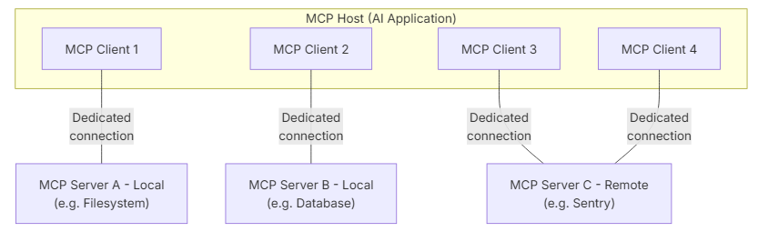
MCP Client 与 MCP Server之间有两种通信协议：
- stdio
- streamable_http
stdio就是标准输入输出，MCP Client运行时，分两种情况：
- 外部服务：Client会把这个MCP服务的脚本下载到本地，然后作为一个子进程运行。
- 本地服务：Client会把本地脚本直接加载，作为一个子进程运行
也就是说，stdio模式中，MCP Client 和 MCP Server之间的通信就是进程通信，没有网络延迟。
streamable_http其实就是可以用event stream来发送数据的http模式，本质还是Server Event Stream，也就是SSE。也就是说MCP client通过发送http请求与MCP server交互。因此存在一定的网络延迟。
详细的MCP说明可以参考Anthropic公司的MCP官方文档：
https://modelcontextprotocol.io/docs/getting-started/intro
有关通信协议可以查看：
https://modelcontextprotocol.io/specification/2025-11-25/basic/transports
LangChain本身实现了对MCP的支持，本节我们就来学习如何在LangChain中使用MCP

## 6.2 连接外部MCP服务
很多提供云服务的公司都提供了MCP服务，例如：
- Amap Maps : 高德地图提供的MCP
- Filesystem : 可以操作文件系统的MCP
- Time : 查询当前时间的MCP服务
- Kiwi : 查询航班、预定航班的MCP服务
- ...
大家可以在
🔗 [ModelScope - MCP 广场](https://modelscope.cn/mcp)
搜索各种MCP服务：
https://modelscope.cn/mcp
找好自己想要使用的MCP服务后，就可以用LangChain来对接了。
首先，我们需要安装LangChain的MCP依赖库:

```plain
uv add langchain-mcp-adapters
```
接下来，就可以用LangChain对接MCP服务，获取其提供的工具，创建Agent了。
接下来，我们以两个MCP服务为例来介绍LangChain对接MCP服务的方��：
- Time MCP ：基于stdio通信
- 12306 MCP : 基于http通信

### 6.2.1 Time MCP服务
Time是一个提供时间和时区转换功能的MCP服务。此服务使LLM能够获取当前时间信息，并使用 IANA 时区名称执行时区转换，同时具备自动检测系统时区的功能。
查看Time MCP的介绍页面，可以看到其介绍，以及集成方式：
🔗 [ModelScope 魔搭社区](https://modelscope.cn/mcp/servers/zac2ma/Time-MCP)
需要注意的是，Time MCP是基于**stdio**的通信方式，也就是把这个MCP服务的脚本下载到本地，然后作为一个子进程运行。
其中，MCP脚本下载的方式取决于配置中的command，常见的有两种：
- npx : 基于node.js的包管理工具
- uvx : 基于uv(python的uv工具)的包管理工具
因此，你的本地环境必须支持npx、uvx命令
另外，在LangChain中除了基本的服务器配置，还必须设置一个transport参数，指定MCP服务的通信方式，有两个可选值：
- stdio
- http或者streamable_http
与标准的mcp参数相比，LangChain的配置存在一些差异：

```json
{
  "mcpServers": {
    "time-mcp": {
      "args": [
        "-y",
        "time-mcp"
      ],
      "command": "npx"
    }
  }
}

```

```json
client = MultiServerMCPClient(
    {
        "time-mcp": {
            "transport": "stdio",
            "args": [
                "-y",
                "time-mcp"
            ],
            "command": "npx"
        }
    }
)
```
**注意**：如果是在**Notebook**运行，可能出现事件循环错误，需要加一段判断逻辑：

```python
import sys
import asyncio

# Fix for Windows issues in Jupyter notebooks
if sys.platform == "win32":
    # 1. Use ProactorEventLoop for subprocess support
    if not isinstance(asyncio.get_event_loop_policy(), asyncio.WindowsProactorEventLoopPolicy):
        asyncio.set_event_loop_policy(asyncio.WindowsProactorEventLoopPolicy())

    # 2. Redirect stderr to avoid fileno() error when launching MCP servers
    if "ipykernel" in sys.modules:
        sys.stderr = sys.__stderr__
```
示例代码（**以下代码必须在Notebook中运行**）：

```python
# 1.加载环境变量
from dotenv import load_dotenv
from langchain.agents import create_agent
from langchain.chat_models import init_chat_model
from langchain.messages import HumanMessage
from langchain_mcp_adapters.client import MultiServerMCPClient

load_dotenv()

# 2.初始化模型
model = init_chat_model(
    model="deepseek-v4-flash",
    extra_body={"thinking": {"type": "disabled"}}
)

# 3.定义工具，用MCP获取工具

# 3.1.定义mcp client
client = MultiServerMCPClient(
    {
        "time-mcp": {
            "transport": "stdio",
            "args": [
                "-y",
                "time-mcp"
            ],
            "command": "npx"
        }
    }
)
# 3.2.用client拉取tool
tools = await client.get_tools()

# 4.创建Agent，绑定模型和工具
agent = create_agent(
    model=model,
    tools=tools
)

# 5.由于MCP的Tool是异步的，所以必须用ainvoke调用Agent，是异步调用
response = await agent.ainvoke(
    {"messages": [HumanMessage("现在是什么时间")]}
)
print(response)
```

### 6.2.2 12306 MCP服务
12306MCP，顾名思义，就是12306火车票的MCP服务，提供了简单的API接口，允许大模型利用接口搜索12306购票信息。
魔塔提供了12306 MCP免费的试用机会：
🔗 [ModelScope 魔搭社区](https://modelscope.cn/mcp/servers/@Joooook/12306-mcp)
魔塔提供的12306MCP支持两种接入方式：stdio和http

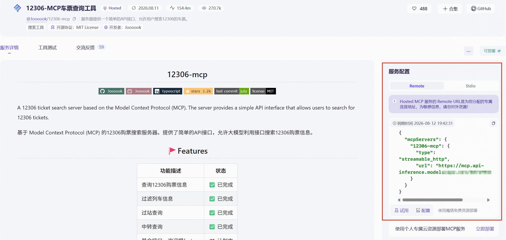
我们以http为例，示例代码：

```python
# 1.加载环境变量
from dotenv import load_dotenv
from langchain.agents import create_agent
from langchain.chat_models import init_chat_model
from langchain.messages import HumanMessage
from langchain_mcp_adapters.client import MultiServerMCPClient

load_dotenv()

# 2.初始化模型
model = init_chat_model(
    model="deepseek-v4-flash",
    extra_body={"thinking": {"type": "disabled"}}
)

# 3.定义工具，用MCP获取工具

# 3.1.定义mcp client
client = MultiServerMCPClient(
    {
        "time-mcp": {
            "transport": "stdio",
            "args": [
                "-y",
                "time-mcp"
            ],
            "command": "npx"
        },
        "12306-mcp": {
          "transport": "streamable_http",
          "url": "https://mcp.api-inference.modelscope.net/50719920b4f24d/mcp"
        }
    }
)
# 3.2.用client拉取tool
tools = await client.get_tools()

# 4.创建Agent，绑定模型和工具
agent = create_agent(
    model=model,
    tools=tools
)

# 5.invoke调用Agent， 传入的Dict，里面有messages
response = await agent.ainvoke(
    {"messages": [HumanMessage("帮我查一下下周四从北京到杭州的高铁")]}
)
print(response)
```

## 6.3 总结
1. **MCP是什么**
   - 开放协议，标准化LLM应用获取工具、调用工具的方式
   - 客户端-服务器架构
1. **连接方式**
   - STDIO: 本地MCP服务器
   - HTTP: 远程MCP服务器
1. **使用流程**
   - 配置MultiServerMCPClient
   - 调用get_tools()获取工具
   - 创建Agent并调用

# 7. 记忆

## 7.1 记忆的分类
对于智能体而言，记忆分为了两类：
- 短期记忆（short-term memory）
- 长期记忆（long-term memory)
注意，大家不要被字面上的意思误导了，很多人看到名字就误以为：*短期记忆就是临时记忆，断电就没了；长期记忆就是永久记忆，持久保存*。
对于智能体而言，这是完全错误的理解！！！
简单用一句话概括的话：
- **短期记忆**：当前任务或会话的上下文（Working Memory 或 Session Memory）
- **长期记忆**：跨任务或会话的**经验与知识**（Persistent Memory）

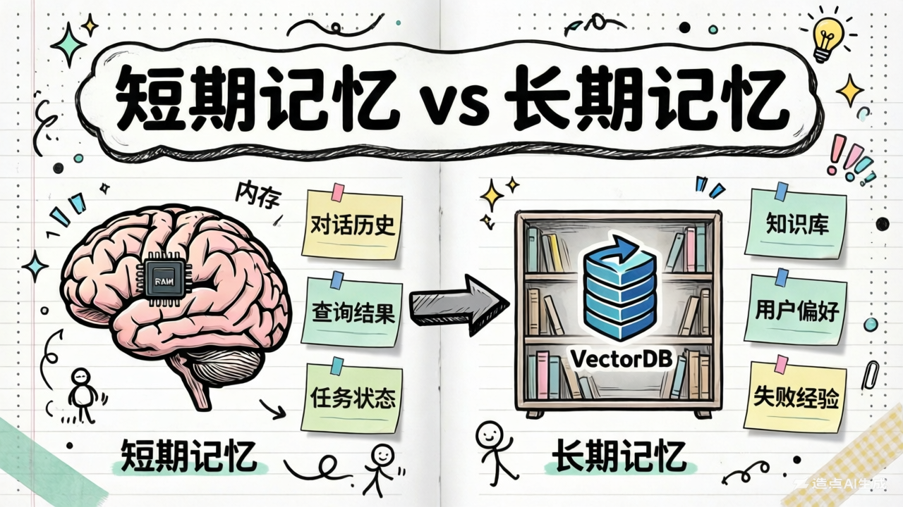
比如，一个公司数据分析的Agent。
用户提出需求：
> “帮我写Q1的销售分析报告”
Agent：

---
短期记忆：
- 对话历史
- 查询到Q1的销售数据
- 任务目标及执行状态

---
长期记忆：
- 公司的KPI算法
- 用户偏好的报告形式
总结：

|  | **短期记忆** | **长期记忆** |
| --- | --- | --- |
| 生命周期 | 当前会话（短暂） | 跨任务、跨会话（永久） |
| 内容 | 当前任务状态、会话历史 | 知识、经验、用户偏好 |
| 是否跨任务 | ❌ | ✅ |
| 存储 | Redis/内存/DB | DB/Vector DB |
接下来，我们先学习LangChain中的短期记忆管理。

## 7.2 短期记忆
由于**短期记忆**通常生命周期是当前会话，所以我们也可以称为**会话记忆**。Agent的会话记忆通常包含三部分：
- 对话历史
- 查询结果
- 任务状态
对于简单的Agent来说，只用考虑**会话历史**就可以了。后续我们会学习如何自定义更复杂的Agent会话记忆。
LangChain提供了自动化的记忆管理方案：
- 首先，LangChain把会话记忆（也就是Messages列表）记录在**AgentState**中：

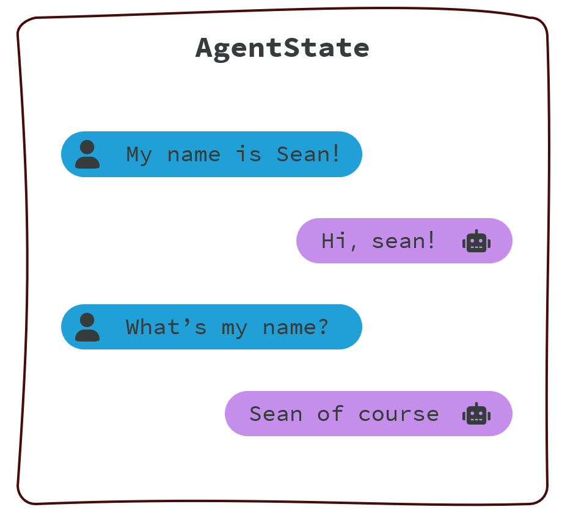
- 每一次与AI的交互都会生成一个快照，记录为一个AgentStateSnapshot，记录当前会话的状态。把同一会话的所有AgentStateSnapshot组合在一起，就是完整的会话历史了。


- 为了区分不同的会话记忆，不同会话需要设定各自的thread_id，相同会话则使用相同thread_id
- 向Agent发起会话时必须指定自己的thread_id以唤起对应的会话记忆

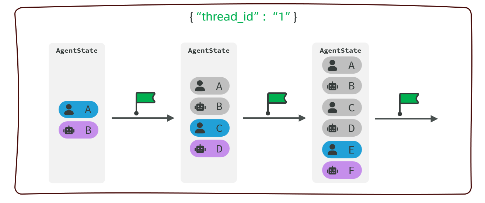
在LangChain中，所有的AgentStateSnapshot都是通过**Checkpointer**对象来保存的，Checkpointer有很多不同的实现：
- InMemorySaver：基于内存存储
- SqliteSaver：基于sqlite数据库存储
- PostgreSaver：基于PostgreSql数据存储
接下来，我们以LangChain提供的基于内存的InMemorySaver为例来演示会话记忆。
具体步骤是这样的：
1. 导入CheckPointer的内存版实现：

```python
# langchain提供的checkpointer的默认实现，基于内存存储
from langgraph.checkpoint.memory import InMemorySaver
```
1. 创建智能体，设置checkpointer：

```python
from langchain.agents import create_agent

# 创建智能体时指定checkpointer，LangChain会自动帮我们管理历史会话记忆
agent = create_agent(
    model = "deepseek-v4-flash",
    checkpointer=InMemorySaver()
)
```
1. 发起调用时，指定thread_id
   1. 第一次调用，告知AI一些信息

```python
from langchain.messages import HumanMessage

# 设定thread_id，作为会话标识
config = {"configurable": {"thread_id": "thread_1"}}

# 第一次调用，告知AI我的信息
response = agent.invoke(
    {"messages": [HumanMessage(content="你好，我叫虎哥，我最喜欢猫猫。")]},
    config # 调用时添加thread_id，区分不同会话
)

print(response)
```
   1. 第二次调用，询问AI

```python
# 第二次调用，询问我的信息，这次带上thread_id，唤起记忆
response = agent.invoke(
    {"messages": [HumanMessage(content="我最喜欢的动物是什么？")]},
    config # 调用时添加thread_id
)

print(response)
```
由于两次调用使用了相同的thread_id，被认定为是同一次对话，所以LangChain会在请求模型时携带历史对话的Messages，模型就能根据历史消息来正确回答了：

```python
{'messages': [HumanMessage(content='你好，我叫虎哥，我最喜欢猫猫。', additional_kwargs={}, response_metadata={}, id='986d4740-b0dd-4888-ae6a-3eb32454c272'), AIMessage(content='虎哥你好！很高兴认识你！🐯✨  \n喜欢猫猫的人一定都有颗温柔的心呢～你家里有养猫吗？还是喜欢云吸猫？如果聊起猫咪的话题，我可以陪你聊很久哦！😸', additional_kwargs={'refusal': None}, response_metadata={'token_usage': {'completion_tokens': 50, 'prompt_tokens': 15, 'total_tokens': 65, 'completion_tokens_details': None, 'prompt_tokens_details': {'audio_tokens': None, 'cached_tokens': 0}, 'prompt_cache_hit_tokens': 0, 'prompt_cache_miss_tokens': 15}, 'model_provider': 'deepseek', 'model_name': 'deepseek-chat', 'system_fingerprint': 'fp_eaab8d114b_prod0820_fp8_kvcache', 'id': '55e64e65-82dc-4698-9a58-76bad566e953', 'finish_reason': 'stop', 'logprobs': None}, id='lc_run--019ca8cf-ee63-7c81-b5d0-69fdc73b1ae3-0', tool_calls=[], invalid_tool_calls=[], usage_metadata={'input_tokens': 15, 'output_tokens': 50, 'total_tokens': 65, 'input_token_details': {'cache_read': 0}, 'output_token_details': {}}), HumanMessage(content='我最喜欢的动物是什么？', additional_kwargs={}, response_metadata={}, id='c8e7382d-3fa3-44b8-afc6-0ed965ad2abb'), AIMessage(content='根据我们之前的对话，你提到自己“最喜欢猫猫”，所以毫无疑问——你最喜欢的动物是**猫猫**！🐱❤️  \n\n需要聊聊猫咪的品种、趣事，或者分享猫片吗？我随时待命～（笑）', additional_kwargs={'refusal': None}, response_metadata={'token_usage': {'completion_tokens': 53, 'prompt_tokens': 74, 'total_tokens': 127, 'completion_tokens_details': None, 'prompt_tokens_details': {'audio_tokens': None, 'cached_tokens': 64}, 'prompt_cache_hit_tokens': 64, 'prompt_cache_miss_tokens': 10}, 'model_provider': 'deepseek', 'model_name': 'deepseek-chat', 'system_fingerprint': 'fp_eaab8d114b_prod0820_fp8_kvcache', 'id': '10f6fec4-764c-49a7-bb9d-2fa45c08fbfb', 'finish_reason': 'stop', 'logprobs': None}, id='lc_run--019ca8d0-dfe3-7e43-8be2-bcf669aa95e1-0', tool_calls=[], invalid_tool_calls=[], usage_metadata={'input_tokens': 74, 'output_tokens': 53, 'total_tokens': 127, 'input_token_details': {'cache_read': 64}, 'output_token_details': {}})]}
```
完整代码：

```python
from langchain.messages import HumanMessage
from dotenv import load_dotenv
from langchain.agents import create_agent
from langchain.chat_models import init_chat_model
from langgraph.checkpoint.memory import InMemorySaver

# 1.准备和加载环境变量
load_dotenv()

# 2.初始化模型
model = init_chat_model(
        "deepseek-v4-flash",
        extra_body={"thinking": {"type": "disabled"}}
    )

# 3.准备tools
tools = []

# 4.创建Agent，绑定model、tools、checkpointer
agent = create_agent(
    model=model,
    tools=tools, # 可省略
    checkpointer=InMemorySaver(),
)

# 5.调用
config = {"configurable": {"thread_id": "t1"}}

# 第一次调用，告知AI我的信息
response = agent.invoke(
    {"messages": [HumanMessage(content="你好，我叫虎哥，我最喜欢猫猫。")]},
    config # 调用时添加thread_id，区分不同会话
)

# 第二次调用，询问我的信息，这次带上thread_id，唤起记忆
response = agent.invoke(
    {"messages": [HumanMessage(content="我最喜欢的动物是什么？")]},
    config # 调用时添加thread_id
)

print(response)
```
> **注意**：
> 目前我们使用的checkpointer是基于内存的InMemorySaver，LangChain也提供了很多持久化存储的checkpointer，例如：
> - SqlLiteSaver ：基于sqlite存储
> - PostgresSaver ：基于Postgres存储
> - CosmosDBSaver ：使用Azure Cosmos DB的实现
> 具体可以查看文档：
> https://docs.langchain.com/oss/python/langgraph/persistence#checkpointer-libraries

# 8. 拓展知识（了解）

## 8.1 自定义MCP服务
在公司内部，不同团队之间也可以把自己团队的服务开发成MCP Server，供其它团队使用。
接下来，我们就学习如何自定义MCP服务。

### 8.1.1 创建简单的MCP服务器
自定义MCP最简单的方式就是使用FastMCP了。
首先，需要安装依赖：

```plain
uv add fastmcp
```
接着，只需要定义几个方法，然后利用FastMCP提供的装饰器即可：
- @mcp.tool : 作为MCP中的工具
- @mcp.resources : 返回MCP需要的resources，类似拓展知识库
- @mcp.prompt : 返回MCP预定义的Prompt，预设的提示词
> **说明**：MCP server端不仅可以提供tool，还可以提供resource、prompt，但通常不太常用，一般只需要提供tool即可。
通常我们只需要定义带有tool的MCP Server就可以了。
例如，我们定义一个数学运算的MCP服务，这个需要写到单独的py文件中，比如math_mcp_server.py：

```python
from fastmcp import FastMCP

# 初始化mcp
mcp = FastMCP("Math")

# mcp tools
@mcp.tool()
def add(a: float, b: float) -> float:
    """Add two numbers"""
    return a + b

@mcp.tool()
def multiply(a: float, b: float) -> float:
    """Multiply two numbers"""
    return a * b

@mcp.tool
def square_root(x: float) -> float:
    """Calculate the square root of a number"""
    return x ** 0.5

# 启动mcp服务，通信方式设置为stdio
if __name__ == "__main__":
    mcp.run(transport="stdio")
```
一个自定义MCP server就准备好了。
注意，由于我们是采用stdio方式，因此这个文件写好放在那里，不需要启动，将来MCP Client会自己启动并加载为子进程。

### 8.1.2 连接接自定义MCP服务
由于我们自定义的MCP是本地py文件，所以启动的Command直接就是python，而不是npx或uvx

```python
import asyncio

from dotenv import load_dotenv
from langchain.chat_models import init_chat_model
from langchain.agents import create_agent
from langchain_core.messages import HumanMessage

# 1.准备和加载环境变量
load_dotenv()

# 2.定义工具
from langchain_mcp_adapters.client import MultiServerMCPClient

# 连接Time MCP服务器
client = MultiServerMCPClient(
    {
        "math": {
            "transport": "stdio",
            "command": "python",
            "args": ["math_mcp_server.py"]
        }
    }
)

async def run():
    # 注意MultiServerMCPClient是异步的，结果都是协程对象，需要await
    tools = await client.get_tools()

    # 3.创建Agent，绑定model和tools
    agent = create_agent(
        model=init_chat_model(
            "deepseek-v4-flash",
            extra_body={"thinking": {"type": "disabled"}}
        ),
        tools=tools
    )

    # 4.调用agent
    response = await agent.ainvoke({
        "messages": [HumanMessage("429和327的平方根的和是多少")]
    })

    for m in response['messages']:
        m.pretty_print()

asyncio.run(run())
```

## 8.2 记忆管理策略
由于会话记忆要保存会话的历史，并且在调用LLM时携带历史消息列表。而当会话越来越长时，历史消息就可能超过LLM的上下文限制。例如，DeepSeek的上下文不能超过128K.
一旦会话历史超过上下文窗口，就会出现上下文丢失的情况，从而导致丢失记忆。而且即便不丢失，太长的上下文容易让模型出现“注意力分散”问题，模型的响应速度、回答质量会大大降低。
未来解决这一问题，通常有以下几种手段：

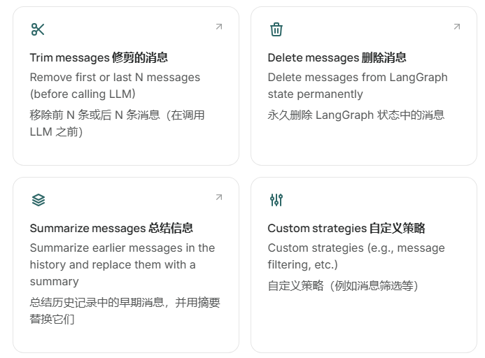
具体可参考官网：
🔗 [Short-term memory - Docs by LangChain](https://docs.langchain.com/oss/python/langchain/short-term-memory#common-patterns)

### 8.2.1 修剪消息
修剪消息并不是真正的删除消息，在AgentState中的消息列表依然是完整的，只不过发送给LLM之前会进行修剪，只保留一部分消息。

> [画板内容，请在原文查看]
具体示例参考：
🔗 [Short-term memory - Docs by LangChain](https://docs.langchain.com/oss/python/langchain/short-term-memory#trim-messages)

### 8.2.2 删除消息
删除消息与修剪不同：
- 修剪消息：只是从State中选取一部分消息发送给模型
- 删除消息：直接删除State中保存的消息，也就是说消息历史中不再存在！
所以一定要谨慎使用。
具体参考：
🔗 [Short-term memory - Docs by LangChain](https://docs.langchain.com/oss/python/langchain/short-term-memory#delete-messages)

### 8.2.3 总结消息
不管是修剪还是删除，都会导致一部分消息丢失，从而丢失记忆。所以就有了第三种策略：**总结消息（Summarize Messages）**
它的思路很简单：
- 首先，把历史的消息利用大模型总结出摘要

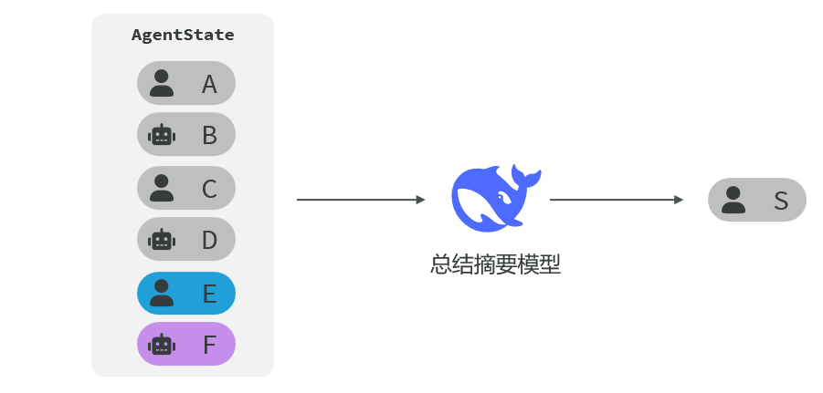
- 然后用摘要替换state中的消息：

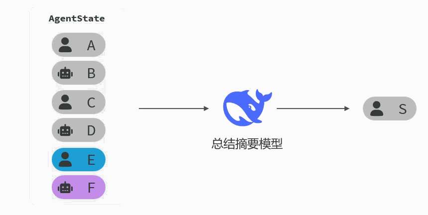
- 把压缩后的消息与最新的消息拼接在一起作为新的消息列表发送给大模型：

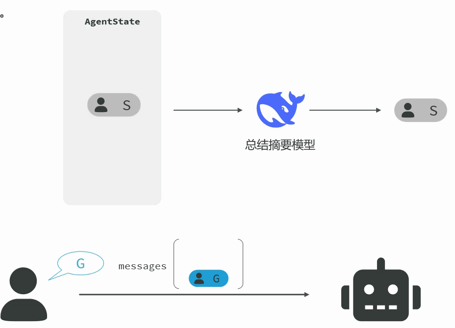
这样既不会超出模型的上下文窗口限制，还能尽量保留所有的记忆。
LangChain提供了总结消息的默认实现：**SummarizationMiddleware**
用法很简单：
1. 初始化SummarizationMiddleware

```python
# 初始化中间件
middleware = SummarizationMiddleware(
    model="deepseek-v4-flash",
    trigger=("messages", 3), #  触发时机，当消息数超过3时，进行总结
    keep=("messages", 1) #  保留的会话数，超过2条
)
```
注意这里SummarizationMiddleware的参数（详细内容参考官网链接：[summarization](https%3A%2F%2Fdocs.langchain.com%2Foss%2Fpython%2Flangchain%2Fmiddleware%2Fbuilt-in%23summarization)）：
   - model：会话摘要时要使用的模型
   - trigger：会话摘要的触发时机，有三种设置：
     - fraction (float): 模型上下文大小的比例（0-1）
     - tokens (int): 令牌数量
     - messages (int): 消息数量
   - keep：是指触发摘要后要保留的消息
     - fraction (float): 要保留的消息占模型上下文大小的比例（0-1）
     - tokens (int): 要保留的消息的令牌数量
     - messages (int): 要保留的消息数量
1. 创建Agent，设置middleware

```python
# 创建agent
agent = create_agent(
    model = "deepseek-v4-flash"
    middleware=[middleware],
)
```
完整代码：

```python
from dotenv import load_dotenv
from langchain.agents import create_agent
from langchain.chat_models import init_chat_model
from langgraph.checkpoint.memory import InMemorySaver
from langchain.agents.middleware import SummarizationMiddleware

# 1.准备和加载环境变量
load_dotenv()

# 2.初始化模型
model = init_chat_model(
        "deepseek-v4-flash",
        extra_body={"thinking": {"type": "disabled"}}
    )

# 3.准备tools
tools = []

# 4.初始化消息摘要中间件
middleware = SummarizationMiddleware(
    model=model,
    trigger=("messages", 6), #  触发时机，当消息数超过6时，进行总结
    keep=("messages", 1) #  保留的会话数
)

# 5.创建Agent，绑定model、tools、checkpointer、Middleware
agent = create_agent(
    model=model,
    tools=tools, # 可省略
    checkpointer=InMemorySaver(),
    middleware=[middleware]
)

config = {"configurable": {"thread_id": "t1"}}

# 6.调用Agent
# 制造长会话历史
agent.invoke({"messages": "你好，我是虎哥."}, config)
agent.invoke({"messages": "我最喜欢的运动是乒乓"}, config)
agent.invoke({"messages": "我最喜欢的动物是猫猫"}, config)

# 测试效果
final_response = agent.invoke({"messages": "你还记得我吗？"}, config)

for message in final_response["messages"]:
    message.pretty_print()
```

---
**更多资源**:
- [LangChain官方文档 - Runtime](https%3A%2F%2Fdocs.langchain.com%2Foss%2Fpython%2Flangchain%2Fruntime)
- [LangChain官方文档 - Long-term Memory](https%3A%2F%2Fdocs.langchain.com%2Foss%2Fpython%2Flangchain%2Flong-term-memory)
- [LangGraph Store文档](https%3A%2F%2Flangchain-ai.github.io%2Flanggraph%2Fconcepts%2Fstore%2F)
