# Day09.保险顾问RAG

> 原文链接：https://my.feishu.cn/wiki/VI0WwmjBiikWqvkvyHBcksaInre

智能保险顾问要回答用户与保险条款有关的问题，就必须有专业的保险条款作为支持，这就需要用到RAG技术了。本章我们就学习如何构建复杂的保险条款知识库，实现基于RAG的检索问答。

# 1. 思路分析
先来回顾下RAG实现的整体流程，如图：

> [画板内容，请在原文查看]
构建知识库，也就是离线阶段，主要分成四步：
- 解析保险条款PDF文档，转为Markdown
- 切分文档，得到条款片段
- 将条款片段向量化
- 存入向量库
检索回答，也就是在线阶段，分为三步：
- 用户问题向量化
- 根据问题向量检索知识片段
- 根据片段生成答案
不过，由于保险条款本身的特殊性，实际上知识库的构建和检索会复杂很多。我们一步步来分析。

## 1.1 文档加载
保险条款都是复杂的PDF格式，在课前资料中的【**资料\08.保险条款\data\raw\kb**】中能看到这些条款：

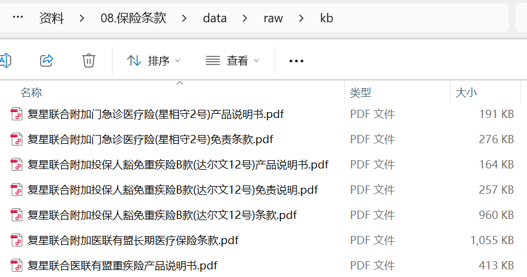
内容格式多以复杂表格形式出现：


针对这些内容，我们必须使用像**MinerU**这样的高级PDF处理工具。把PDF处理为纯文本格式的Markdown，然后再做进一步切分。

## 1.2 切分策略
保险条款结构复杂，切分策略也很特殊。

### 1.2.1 文档结构切分
由于保险条款的标题本身就是条款的条例，属于专业词汇，而且具备重要意义，而标题下的内容通常就是条款内容。

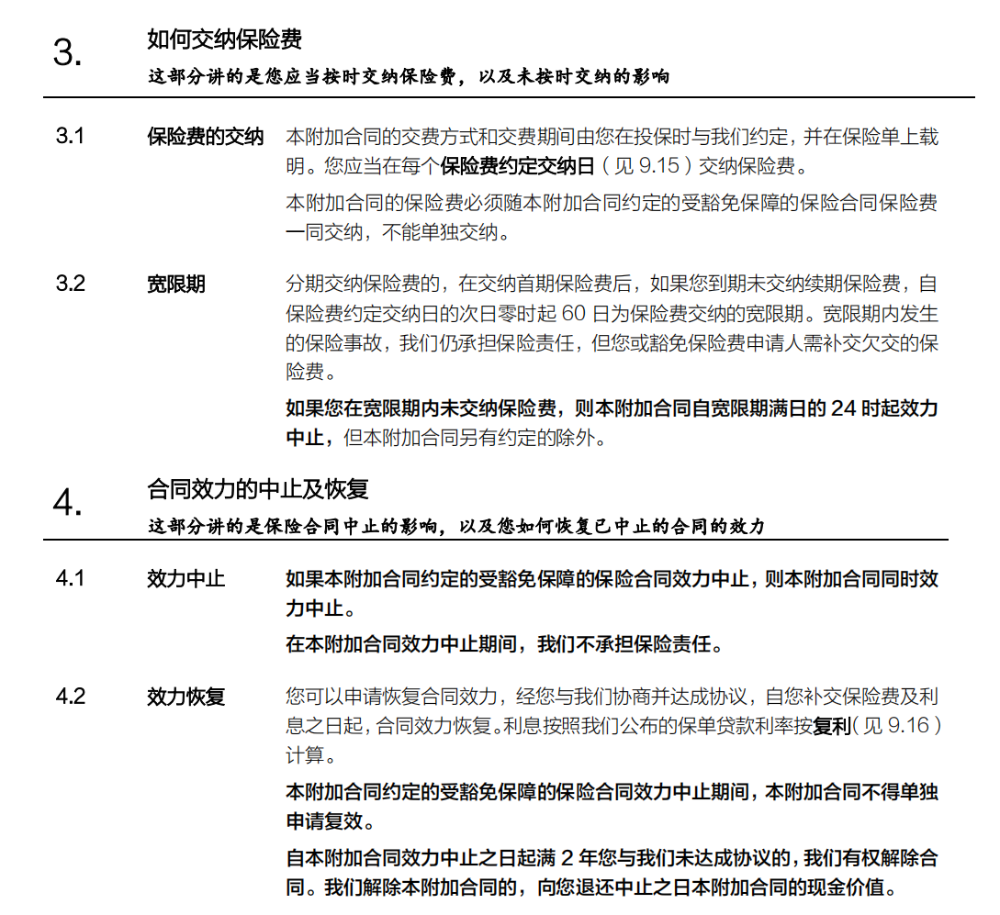
所以，我们最好按照**标题结构**来切分。这样的话每一块就是一个条款，语义完整性能够得到保证。

### 1.2.2 父子块切分
在【 】这一章，我们讲过文档切分的矛盾性：
> 切块到底该切多大呢？这可不能随意，因为我们要考虑两点：
> - **检索精准度**：能精准找到与问题最相关的chunk
> - **语义完整度**：检索到的chunk必须能覆盖回答用户问题的所有信息
> 而这两点是矛盾的，RAG是根据**整个chunk的语义生成一个向量**，
> - chunk越大，噪音越多，语义越不精准，检索精度就低；但同时语义完整度就越高
> - chunk越小，噪音越少，语义越精准，检索精度就高；但同时语义完整度就越低
但需要注意的是，部分条款内容会很长：

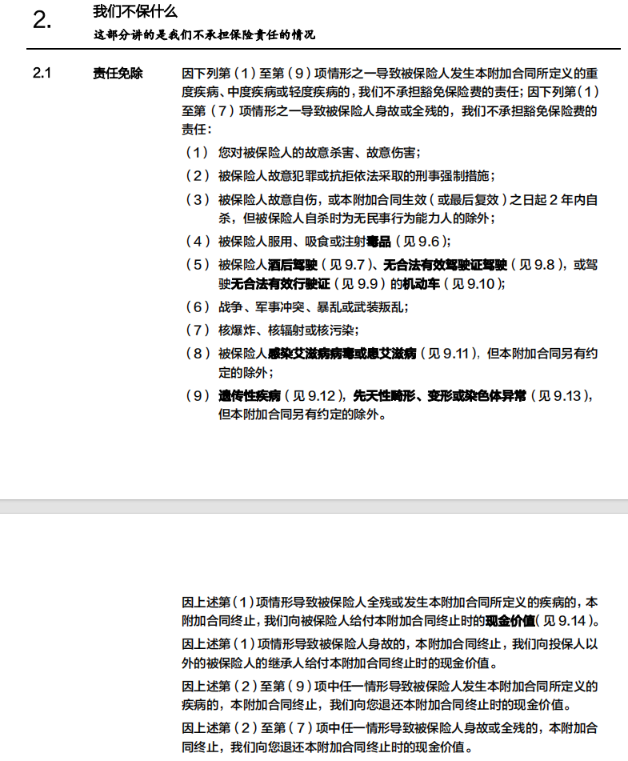
如果把整个小节作为一个chunk，语义完整度够高，但噪音太大，会导致检索精度下降。
针对这种情况，我们还需要进一步利用**递归切分**策略来处理，把大块切成小块，不过这些块之间还要共享同一个标题，确保子块不丢失自己所属的条款信息。像这样：

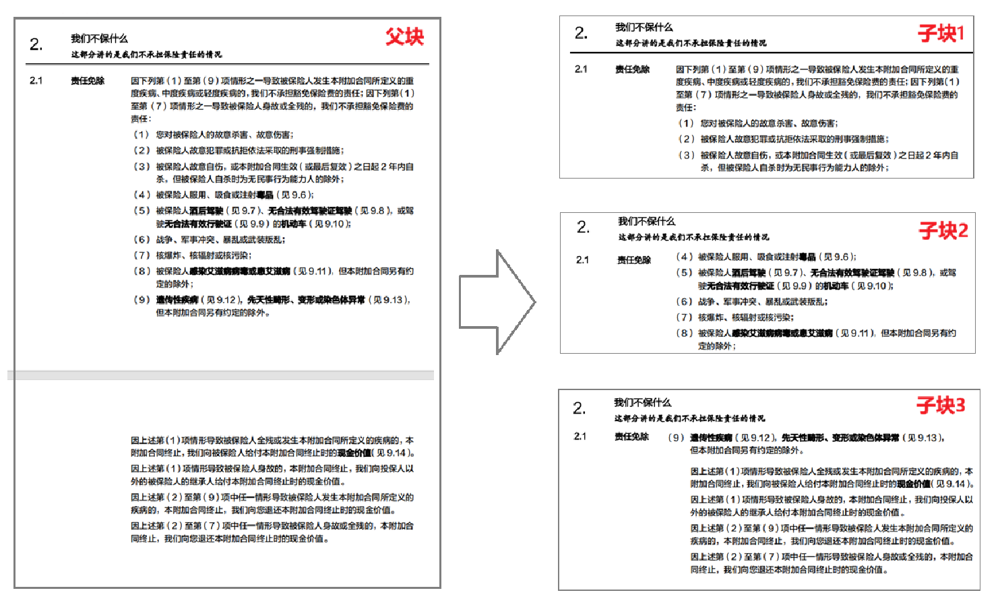
此时，原本的完整条款大块，我们称为**父块**；切分得来的小块，我们称为**子块**。为了确保检索精度，避免块过大，真正存入向量库的是**子块**。
不过，这样就可能会出现检索条款时只检索到部分片段的情况，条款的语义不完整，就可能使最终答案产生巨大偏差。
> 怎么办呢？要不要把父块也存入向量库呢？
显然不行，这样会导致向量库出现大量重复数据，影响检索精度，同时也增加了向量库的存储压力。
其实解决思路并不复杂：
- 父块不存入向量库，而是存入普通数据库，比如PostgreSql
- 向量库中只保存子块数据，用于相似度检索，确保检索精度。但同时要记录子块的parent_id
- 当从向量库检索出子块后，根据子块的parent_id去数据库查询其父块即可
- 最后，把查询到的父块作为检索到的文档片段，交给LLM，生成最终答案

> [画板内容，请在原文查看]
总结一下：
为了保证保险条款检索的精准度和完整性，我们把条款按节切，作为父块，存入数据库。再把父块切成更小的子块，存入向量库。检索时去向量库检索出子块，再根据子块去数据库查询出父块：
- **子块**：小片段，存入向量库，保证检索精度
- **父块**：大片段，存入数据库，保证知识完整度

## 1.3 数据结构
根据前面的分析，我们需要把父块、子块分别入库，所以必须先弄清楚父块与子块的数据结构是怎样的。
首先，我们需要理清父块和子块的作用：
- **父块**：存数据库，作用是保存完整的条款内容，用来返回给模型作为生成回答的上下文
- **子块**：存向量库，作用是向量检索，找出与问题相关的片段、父块id

### 1.3.1 子块结构
先说子块，用于向量检索，所以字段非常简单：
- id：子块的唯一标识
- parent_id：子块所属的父块id
- content：子块内容，用来生成稀疏和稠密向量的
不过，需要注意的是，我们的保险商城包含的保险产品很多，每个产品都会有条款：

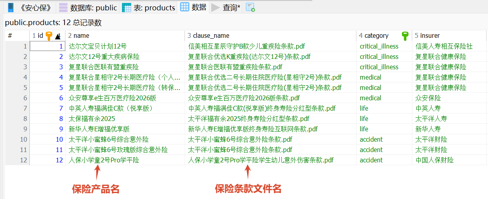
而同类型产品，其保险条款会有很多相似内容。比如，重疾险都有等待期条款、免责条款等。全都存在一个向量库中。很可能存在用户询问A产品但检索出B产品条款的情况。
例如：用户询问产品A的等待期条款，实际检索出了多个不同产品的等待期条款，那回答就不可能准确。
所以，我们必须保证用户询问产品A，那检索的范围就必须是产品A的条款，这就要靠过滤查询实现（filter）。因此，我们必须给子块添加一个字段：product_id，当用户询问某个产品时，以产品的product_id作为过滤条件，避免检索到其它条款。

> [画板内容，请在原文查看]
所以，最终子块的结构为：
- id：子块的唯一标识
- parent_id：子块所属的父块id
- content：子块内容，用来生成稀疏和稠密向量的
- product_id：条款片段所属的产品id
我们将来使用LangChain的Document来保存子块信息，像这样：

```python
# 子块 chunk 转 Document
Document(
    id=str(chunk.id),
    page_content=chunk.content,
    metadata={
        "parent_id": str(chunk.parent_id),
        "product_id": chunk.product_id,
    },
)
```

```json
{
    "pk": "id",
    "text": "page_content",
    "parent_id": "",
    "product_id": "",
    "dense": [],
    "sparse": []
}
```
稠密和稀疏向量由LangChain自动生成，无需我们操心。

### 1.3.2 父块结构
父块保存在数据库，需要有完整的内容，作用有两个：
- 一方面是把文档片段内容给LLM，让它生成答案。
- 另一方面是保留文档片段所属的保险条款信息，用于展示RAG的检索来源，让结果更可信。
就像这样：

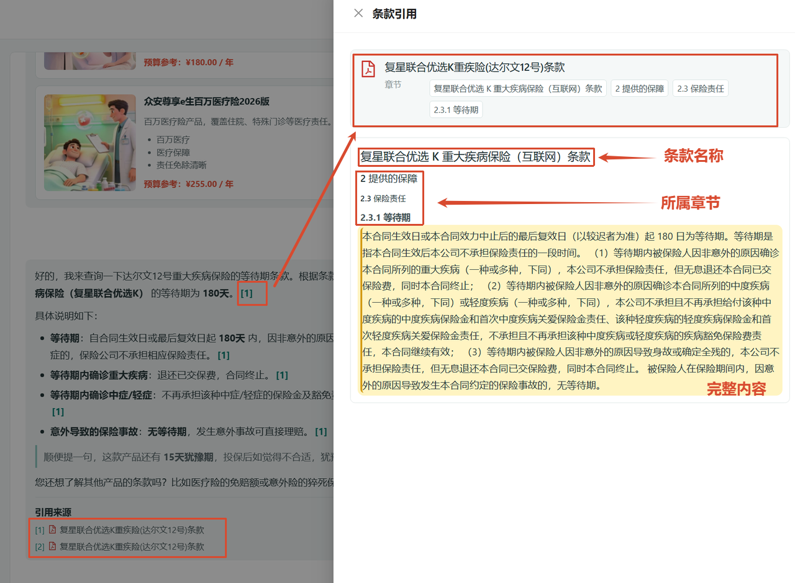
- id：父块的唯一标识
- content：父块内容，是完整的条款章节信息
- product_id：条款片段所属的产品id
- clause_name：条款名称
- section_path：章节路径
对应的数据库表已经创建好：

```sql
CREATE TABLE "parent_chunks" (
        "id" UUID NOT NULL,
        "product_id" BIGINT NOT NULL,
        "section_path" TEXT[] NOT NULL DEFAULT ARRAY[]::TEXT[],
        "content" TEXT NOT NULL,
        "created_at" TIMESTAMPTZ NOT NULL DEFAULT CURRENT_TIMESTAMP,
        "clause_name" VARCHAR(300) NOT NULL,
        PRIMARY KEY ("id")
)
```
我们直接把这个model创建出来。
所有的rag代码我们统一放到app.rag包，我们新建这个包，然后新建一个models.py文件：

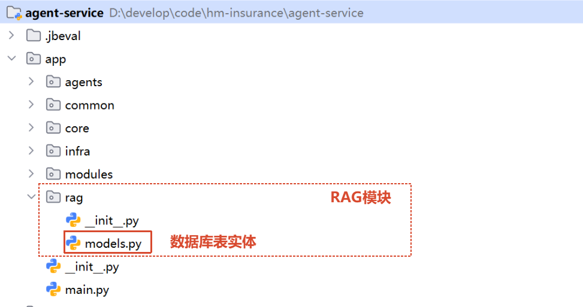
内容如下：

```python
from uuid import UUID

from sqlalchemy import ARRAY, BigInteger, String, Text
from sqlalchemy.dialects.postgresql import UUID as PG_UUID
from sqlalchemy.orm import Mapped, mapped_column

from app.common.models import Base, CreateAtMixin

class ParentChunk(Base, CreateAtMixin):
    """父知识块"""

    __tablename__ = "parent_chunks"

    id: Mapped[UUID] = mapped_column(
        PG_UUID(as_uuid=True),
        primary_key=True,
    )
    product_id: Mapped[int] = mapped_column(BigInteger)
    clause_name: Mapped[str] = mapped_column(String(300))
    section_path: Mapped[list[str]] = mapped_column(
        ARRAY(Text),
        default=list,
    )
    content: Mapped[str] = mapped_column(Text)
```

## 1.4 完整RAG流程
根据前面的分析，保险知识库的完整的RAG流程是这样的：

> [画板内容，请在原文查看]
当然，知识检索的流程还有进一步优化的空间，我们暂时先这样，后续继续优化。
接下来，我们就分别完成知识库构建、检索增强回答两个流程。

# 2. 构建知识库
知识库构建的流程是固定的，就像是一条**流水线**，也就是**Pipeline，**如图：

> [画板内容，请在原文查看]
当然，由于我们使用了langchain-milvus提供的VectorStore，上述过程可以被简化为：

> [画板内容，请在原文查看]
接下来，我们就先在Notebook中模拟这一过程，看看效果以及是否需要优化。
在notebooks/day09目录新建一个01.rag_pipeline.ipynb文件：

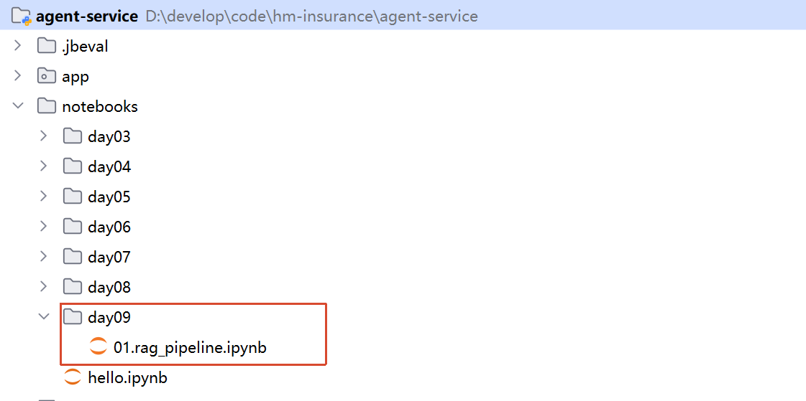

## 2.1 条款查询
要解析保险条款，必须先拿到保险条款文件。我们必须查询products，拿到每个保险产品，以及对应的条款。
在Notebook的第一个Cell中，编写查询逻辑：

```python
# 一、查询产品及条款
from app.infra.database import AsyncSessionFactory
from app.modules.product.service import ProductService

async with AsyncSessionFactory() as session:
    service = ProductService(session)
    # 查询20条
    products= await service.list_products()

# 取一个测试
product = products[0]
print(product)
```
结果：

```json
{
  "id": 1,
  "name": "达尔文宝贝计划12号",
  "clause_name": "信美相互星辰守护B款少儿重疾险条款.pdf",
  "category": "critical_illness",
  "insurer": "信美人寿相互保险社",
  "image_url": "https://files.huizecdn.com/file3/M00/91/12/rBYA3Gi1gZ2AXaFJxRhbPg411.png",
  "description": "117种重疾+28种中症+45种轻症，少儿重疾保障灵活。",
  "min_premium": "285.30",
  "max_premium": "2501.83",
  "target_group": "0-17周岁",
  "highlights": [
    "117种重疾",
    "少儿保障",
    "可选投保人豁免"
  ],
  "status": "active"
}
```
其中的clause_name属性就是保险条款的名称。
在课前资料中的【**资料\08.保险条款】**有一个data目录，其中就是所有的保险条款文件：

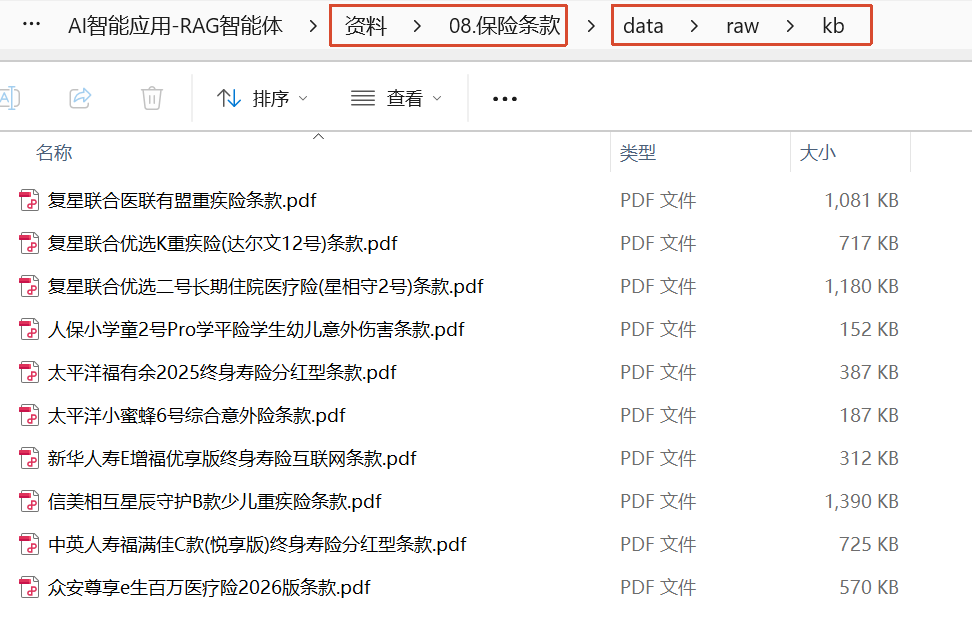
将其复制到你的项目根目录中：

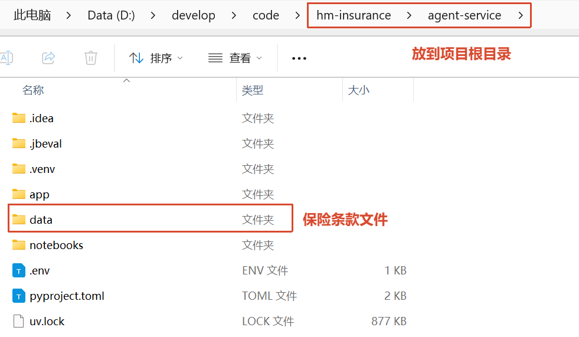
后续代码中我们就这个目录加载保险条款文件，不过，需要在clause_name前面拼接上路径，得到【./data/raw/kb/{clause_name}】这样的路径。

## 2.2 文档加载和解析
保险条款结构复杂，解析起来并不是简单的用MinerU处理就行了。我们一起分析下。

### 2.2.1 文档解析
PDF文档解析依然使用前面学习过的mineru，我们先在Notebook中试试看：

```python
# 二、文档解析
from mineru import MinerU
from app.core.config import settings

# 创建客户端，Precision 模式，需要Token
client = MinerU(settings.rag.mineru_token)
# 解析文件
result = client.extract(f"../../data/raw/kb/{product.clause_name}")
```
解析结果如下：

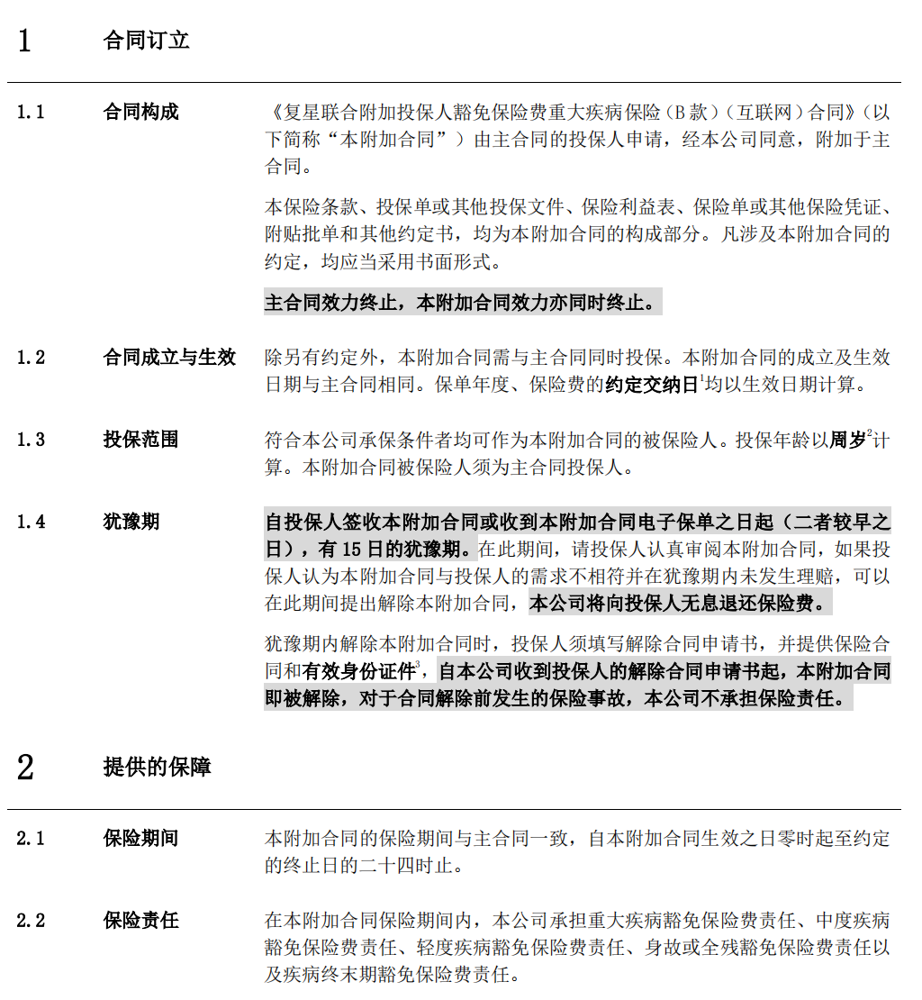
**原始PDF**

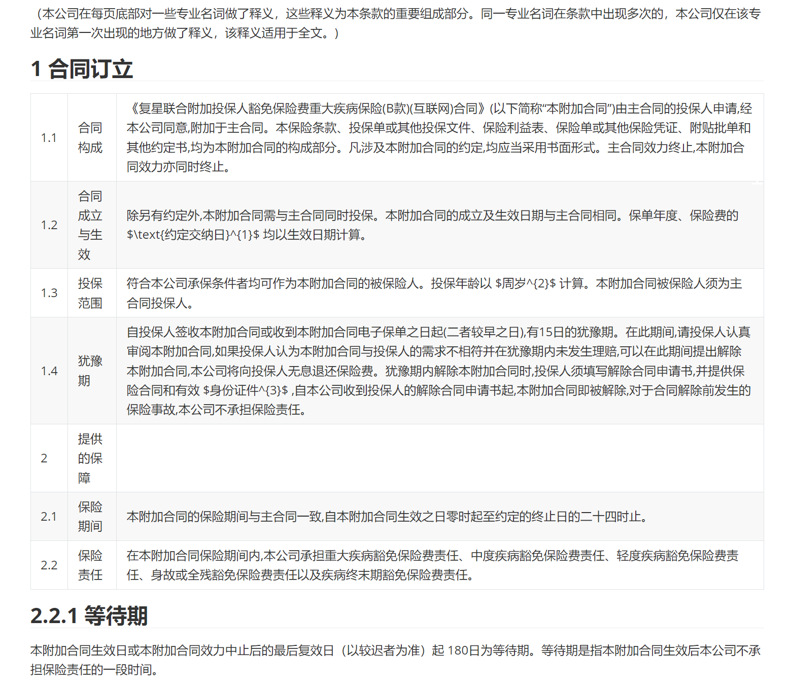
**解析的Markdown**
虽然解析成功了，但可以看出由于保险条款的结构是一个超大表格，跨越了数十页文档，而且所有标题隐藏在表格中第二列，导致解析过程中丢失了标题结构。这样将来做文档结构切分肯定会出问题。
为了解决这个问题，我们必须对MinerU生成的文档做进一步优化。

### 2.2.2 文档优化
由于每个公司的保险条款都不一样，格式差异较大，因此解析出来的文档差异非常大，处理起来很困难。常见的解决方案有：

| 方案 | 处理方式 | 优点 | 问题 |
| --- | --- | --- | --- |
| **人工修正** | 逐份检查并手动调整标题、编号和表格 | 结果最可控，适合少量文档 | 耗时较长；条款增加或更新后需要重新处理 |
| **规则清洗** | 使用正则表达式或程序规则识别标题编号、删除噪声并修正格式 | 执行速度快、成本低，处理结果稳定 | 只能处理预先考虑到的格式；规则容易随着特殊情况不断增加 |
| **模板化处理** | 针对不同保险公司或条款模板分别编写转换逻辑 | 同一模板下效果稳定，也便于精确控制 | 每出现一种新模板都要重新开发和维护，通用性较差 |
| **模型优化** | 让大模型理解文档语义，重新整理标题层级、编号和段落结构 | 能够适应不同版式，对复杂和不规则结构的兼容性更好 | 会增加调用时间和成本，还要防止模型改写原始条款内容 |
综合比较后，我们选择使用大模型优化文档。保险条款的来源和版式并不统一，很多问题无法只根据固定字符判断，还需要结合上下文理解某一行究竟是标题、正文还是表格内容。相比持续增加清洗规则，让模型根据语义整理文档结构，代码更少，对不同条款的适应能力也更强。
需要注意的是，这里的目标不是让模型重新编写保险条款，而是只修正 Markdown 的标题层级、编号和段落结构。因此，提示词中必须明确要求模型保留原始条款内容。
接下来，我们在 Notebook 中写一个测试。

```python
# 三、文档优化
from langchain.chat_models import init_chat_model

MARKDOWN_OPTIMIZATION_PROMPT = """
下面这份Markdown文档是从保险条款PDF解析得来，由于PDF中的各个小节是以表格形式存在，所以解析时出现错乱。你分析内容，帮我转为格式正确的Markdown，特别是标题编号要正确。
- 标题等级要从1级标题开始，逐层增加，目录和文档名不计入标题等级。
- 输出结果中不要包含正文开始之前的部分。
- 输出结果只包含Markdown正文，不要解释或代码围栏。
- 不要修改保险条款。
""".strip()

llm = init_chat_model(
    "deepseek-v4-flash",
    api_key=settings.llm.api_key,
    extra_body={'thinking': {'type': 'disabled'}},
    max_tokens=10000
)

response = llm.invoke([
    {"role": "system", "content": MARKDOWN_OPTIMIZATION_PROMPT},
    {"role": "user", "content": result.markdown},
])
markdown = response.content
```
试过后可以发现文档结构比之前好了很多：

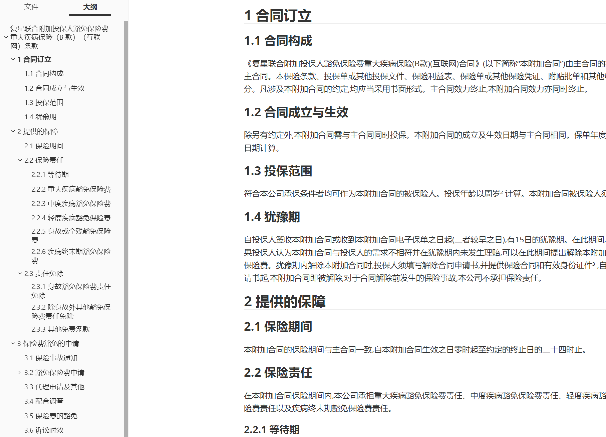

## 2.3 文档切分
有了格式正确的Markdown文档，接下来就是切分文档了。按照之前的分析，我们需要做几件事：
- 优先采用Markdown结构感知切分，得到**父块（parent_chunk）**
- 接下来使用递归切分，处理父块，得到子块，每个父块至少要有1个子块（因为向量库只需要子块）
  - 如果发现父块太大（超过chunk_size），会被递归切分，得到**子块（child_chunk）**
  - 如果发现父块大小合适，则直接冗余一份父块，作为**子块（child_chunk）**
我们还是在Notebook中，基于上一节得到的markdown来测试：

```python
# 四、文档切分
from uuid import uuid4
from langchain_core.documents import Document
from langchain_text_splitters import MarkdownHeaderTextSplitter, RecursiveCharacterTextSplitter
from app.rag.models import ParentChunk

# 1.准备TextSpliter
# 1.1.markdown切分器，切父块
markdown_splitter = MarkdownHeaderTextSplitter(
            headers_to_split_on=[
                ("#", "h1"),
                ("##", "h2"),
                ("###", "h3"),
                ("####", "h4"),
            ],
            strip_headers=True,
        )
# 1.2.递归切分器，切子块
child_splitter = RecursiveCharacterTextSplitter(
            chunk_size=500,
            chunk_overlap=50,
            separators=["\n\n", "\n", "。", "；", ";", "，", ","],
            keep_separator="end",
        )

# 2.先用markdown切分，得到父块小节信息
sections = markdown_splitter.split_text(markdown)
# 3.处理父子块
parent_chunks: list[ParentChunk] = []
child_chunks: list[Document] = []

# 3.1.遍历父块小节
for section in sections:
    # 3.1.生成章节路径，section.metadata就是每一级标题的字典，values刚好得到标题列表
    section_path = list(section.metadata.values())
    # 3.2.组织 parent_chunk
    parent = ParentChunk(
        id=uuid4(),
        product_id=product.id,
        content=section.page_content,
        section_path=section_path,
        clause_name=product.clause_name
    )
    parent_chunks.append(parent)

    # 3.3.重新组织section的metadata，会作为所有子块的metadata
    section.metadata = {
        "product_id": product.id,
        "parent_id": str(parent.id)
    }
    # 3.4.切分section，生成child的Document列表，并且沿用section的metadata
    children = child_splitter.split_documents([section])
    # 3.5.把父的section_path拼接到子content中，使信息完整
    section_path_header = "\n".join(section_path) + "\n"
    for c in children:
        c.page_content = section_path_header + c.page_content
    child_chunks.extend(children)
```

## 2.4 子块入向量库
我们直接使用langchain-milvus创建VectorStore，然后用VectorStore自动创建Collection，自动导入数据。
依然是先用Notebook测试：

```python
# 五、存入向量库
from langchain_ollama import OllamaEmbeddings
from langchain_milvus import Milvus, BM25BuiltInFunction
from app.core.config import settings

# 1.初始化向量模型
embeddings = OllamaEmbeddings(
    model="qwen3-embedding:0.6b",  # 性价比高的模型
    dimensions=1024  # 可选：减少维度以节省存储
)

# 2、初始化 VectorStore，会自动创建Collection
vector_store = Milvus(
    embedding_function=embeddings,
    collection_name="insurance_collection",
    builtin_function=BM25BuiltInFunction(analyzer_params={"type": "chinese"}),
    vector_field=["dense", "sparse"],
    connection_args={"uri": settings.rag.milvus_url},
    auto_id=True,
)

# 3.删除旧文档
vector_store.delete(expr=f"product_id=={product.id}")
# 4.添加新文档
vector_store.add_documents(child_chunks)
```
运行代码后，访问 http://192.168.150.101:3000，应该能看到新创建的Collection：

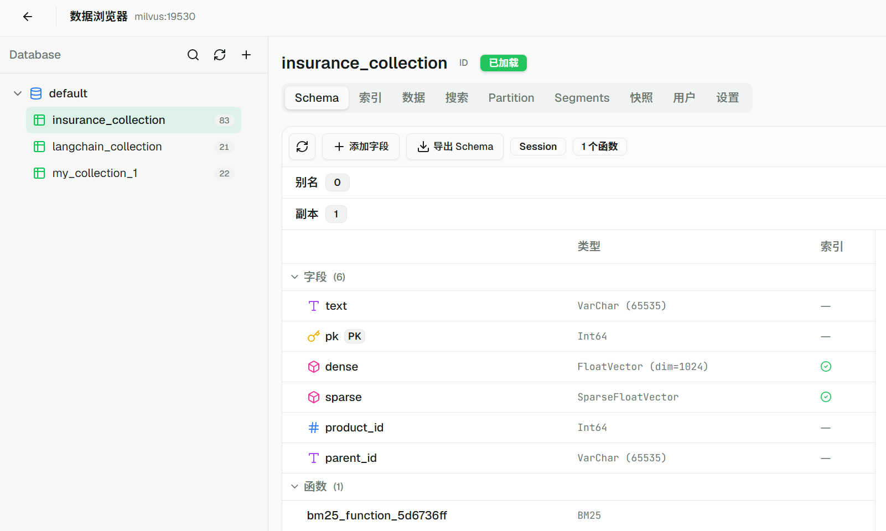
并且已经有数据了：

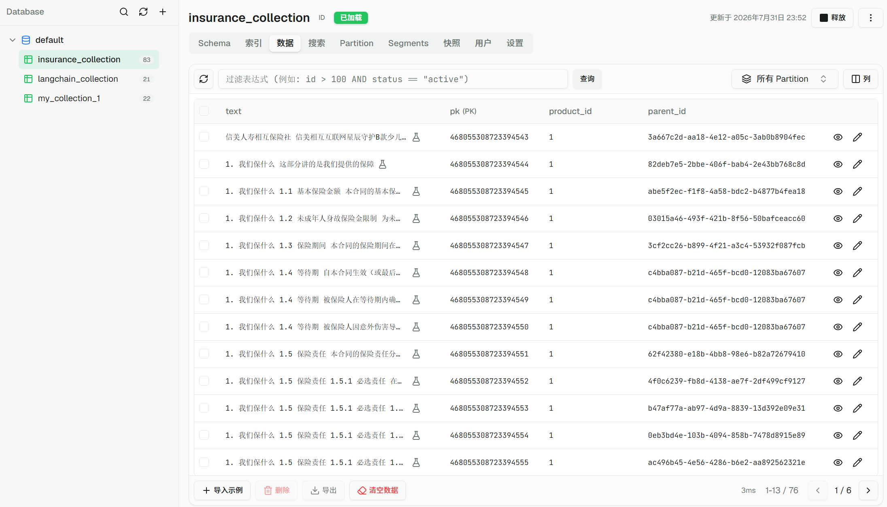
在控制台也可以做搜索，比如我们用稀疏检索（全文检索）：

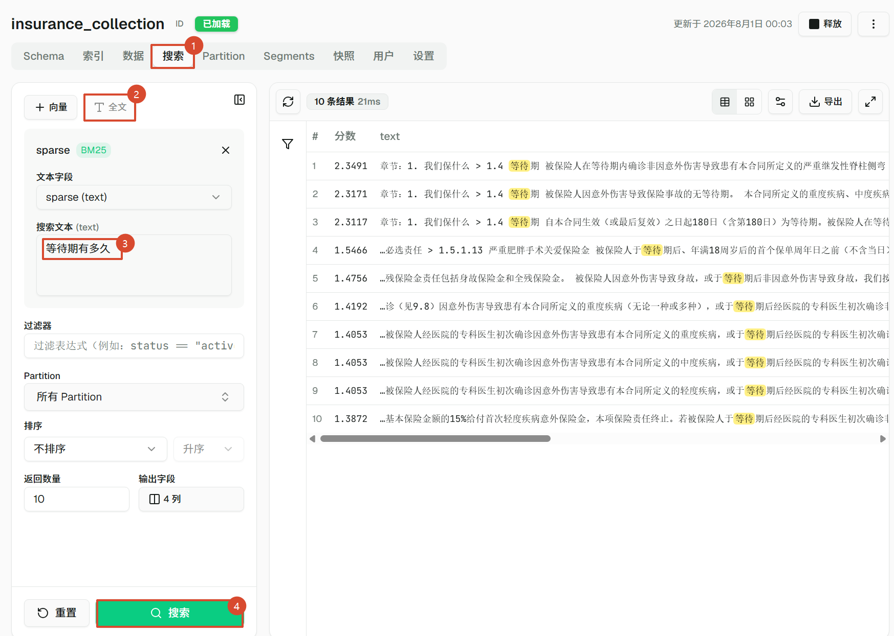

## 2.5 父块入数据库
子块已经存入 Milvus，用来进行向量检索。而且每个子块的 metadata 中都记录了 parent_id。后续检索到子块后，就可以根据 parent_id 查询对应的父块，将上下文更完整的条款内容交给大模型。但前提是我们要存储父块到数据库。
父块保存了更完整的条款内容，不需要参与向量检索，因此我们将它存入 PostgreSQL。与之前业务类型，我们同样封装一个数据库操作的repository。
我们在 app.rag 包下新建 repository.py，专门负责父块的数据库操作。

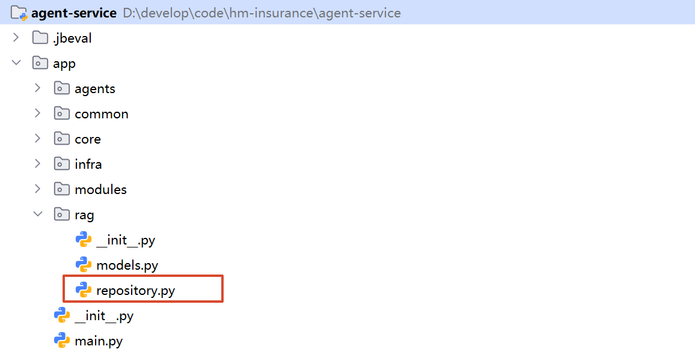
在 app.rag.repository.py 中定义 ParentChunkRepository：

```python
from sqlalchemy import delete
from sqlalchemy.ext.asyncio import AsyncSession

from app.rag.models import ParentChunk

class ParentChunkRepository:

    def __init__(self, session: AsyncSession):
        self.session = session

    async def delete_by_product_id(self, product_id: int) -> None:
        await self.session.execute(
            delete(ParentChunk).where(
                ParentChunk.product_id == product_id
            )
        )

    def add_all(self, parent_chunks: list[ParentChunk]) -> None:
        self.session.add_all(parent_chunks)
```
> **代码说明**：
> - 构建知识库时，同一个产品可能会被重复处理。如果直接新增父块，数据库中就会出现重复数据。
> - 因此，保存之前先根据 product_id 删除旧父块，再批量新增本次切分得到的父块。
我们还是在Notebook中测试一下：

```python
# 六、父块入数据库
from app.infra.database import AsyncSessionFactory
from app.rag.repository import ParentChunkRepository

async with AsyncSessionFactory() as session:
    async with session.begin():
        repository = ParentChunkRepository(session)
        # 先删除旧数据
        await repository.delete_by_product_id(product.id)
        # 再添加新数据
        repository.add_all(parent_chunks)
```
删除和新增操作使用同一个 Session，最后统一提交事务。这样既能清理旧数据，也能保证当前产品的父块被完整替换。
运行代码后，查询 parent_chunks 表，可以看到父块已经保存到数据库中：

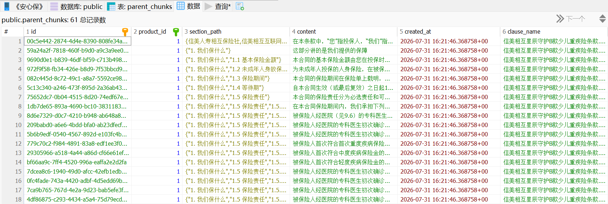
至此，子块和父块已经分别保存完成：子块存入 Milvus，负责检索；父块存入 PostgreSQL，负责补充完整上下文。二者通过 parent_id 建立关联。

## 2.6 Pipeline
知识库构建的流程是固定的，就像是一条**流水线**，也就是**Pipeline，**如图：

> [画板内容，请在原文查看]
刚才我们已经测试了流水线的每一个环节，接下来我们就将这些环节组装，形成一个Pipeline：

### 2.6.1 定义Pipeline
我们在app.rag包新建一个pipeline.py文件：

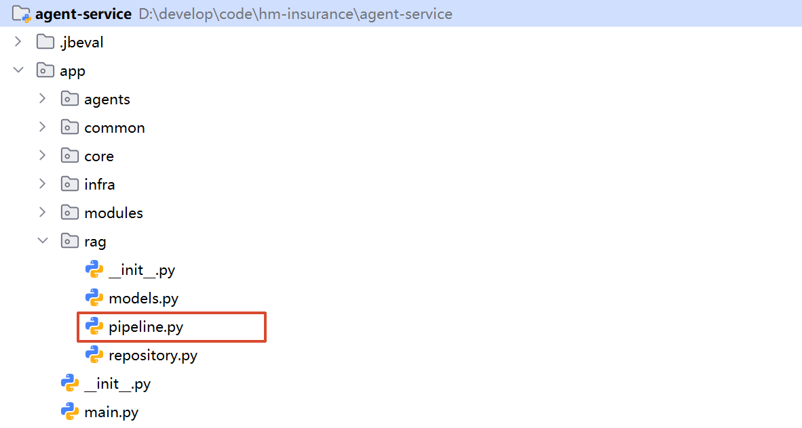
内容如下：

```python
from pathlib import Path
from uuid import uuid4

from langchain.chat_models import init_chat_model
from langchain_core.documents import Document
from langchain_milvus import Milvus
from langchain_text_splitters import (
    MarkdownHeaderTextSplitter,
    RecursiveCharacterTextSplitter,
)
from mineru import MinerU

from app.core.config import APP_ROOT, settings
from app.infra.database import AsyncSessionFactory
from app.modules.product.models import Product
from app.rag.models import ParentChunk
from app.rag.repository import ParentChunkRepository
from app.core.logging import get_logger
logger = get_logger(__name__)

MARKDOWN_OPTIMIZATION_PROMPT = """
下面这份 Markdown 文档是从保险条款 PDF 解析得来，由于 PDF 中的各个小节是以表格形式存在，所以解析时出现错乱。你分析内容，帮我转为格式正确的 Markdown，特别是标题编号要正确。
- 标题等级要从 1 级标题开始，逐层增加，目录和文档名不计入标题等级。
- 输出结果中不要包含正文开始之前的部分。
- 输出结果只包含 Markdown 正文，不要解释或代码围栏。
- 不要修改保险条款。
""".strip()

class RAGPipeline:

    def __init__(self, vector_store: Milvus) -> None:
        self._vector_store = vector_store

        # 1.初始化文档解析工具
        self._mineru = MinerU(settings.rag.mineru_token)

        self._model = init_chat_model(
            settings.llm.chat_model,
            api_key=settings.llm.api_key,
            extra_body={"thinking": {"type": "disabled"}},
            max_tokens=10000,
        )

        # 2.初始化文档切分工具
        self._markdown_splitter = MarkdownHeaderTextSplitter(
            headers_to_split_on=[
                ("#", "h1"),
                ("##", "h2"),
                ("###", "h3"),
                ("####", "h4"),
            ],
            strip_headers=True,
        )
        self._child_splitter = RecursiveCharacterTextSplitter(
            chunk_size=500,
            chunk_overlap=50,
            separators=["\n\n", "\n", "。", "；", ";", "，", ","],
            keep_separator="end",
        )
        logger.info("RAG Pipeline 初始化完成✅️")

    async def ingest(self, product: Product) -> None:
        # 1.解析并优化保险条款
        markdown = self._parse_and_optimize(product.clause_name)

        # 2.切分父块和子块
        parent_chunks, child_chunks = self._chunk(markdown, product)

        # 3.子块存入Milvus
        self._save_child_chunks(product.id, child_chunks)

        # 4.父块存入PostgreSQL
        await self._save_parent_chunks(product.id, parent_chunks)

    def _parse_and_optimize(self, clause_name: str) -> str:
        # 1.使用MinerU解析PDF
        file_path = Path(APP_ROOT / "data" / "raw" / "kb" / clause_name)
        result = self._mineru.extract(str(file_path))

        # 2.使用大模型优化Markdown
        response = self._model.invoke(
            [
                {"role": "system", "content": MARKDOWN_OPTIMIZATION_PROMPT},
                {"role": "user", "content": result.markdown},
            ]
        )
        return response.content

    def _chunk(
        self,
        markdown: str,
        product: Product,
    ) -> tuple[list[ParentChunk], list[Document]]:
        # 1.按照Markdown标题切分父块
        sections = self._markdown_splitter.split_text(markdown)
        parent_chunks: list[ParentChunk] = []
        child_chunks: list[Document] = []

        # 2.遍历父块，继续切分子块
        for section in sections:
            section_path = list(section.metadata.values())
            parent = ParentChunk(
                id=uuid4(),
                product_id=product.id,
                clause_name=product.clause_name,
                section_path=section_path,
                content=section.page_content,
            )
            parent_chunks.append(parent)

            # 子块通过parent_id关联父块
            section.metadata = {
                "product_id": product.id,
                "parent_id": str(parent.id),
            }
            children = self._child_splitter.split_documents([section])

            # 把章节路径拼接到子块正文中，补充语义上下文
            section_header = "\n".join(section_path) + "\n"
            for child in children:
                child.page_content = section_header + child.page_content
            child_chunks.extend(children)

        return parent_chunks, child_chunks

    def _save_child_chunks(
        self,
        product_id: int,
        child_chunks: list[Document],
    ) -> None:
        # Collection存在时，先删除该产品的旧子块
        if self._vector_store.client.has_collection(
            self._vector_store.collection_name
        ):
            self._vector_store.delete(expr=f"product_id == {product_id}")
        # 再新增子块
        self._vector_store.add_documents(child_chunks)

    async def _save_parent_chunks(
        self,
        product_id: int,
        parent_chunks: list[ParentChunk],
    ) -> None:
        async with AsyncSessionFactory() as session:
            async with session.begin():
                repository = ParentChunkRepository(session)
                # 删除旧父块
                await repository.delete_by_product_id(product_id)
                # 添加新父块
                repository.add_all(parent_chunks)

    def close(self):
        """关闭mineru连接"""

        self._mineru.close()
```
Pipeline 直接组织文档解析和切分逻辑，但不再负责创建 VectorStore，而是通过构造函数接收外部传入的 Milvus 实例。
这样 Pipeline 只关注知识库构建流程，VectorStore 的初始化和生命周期由调用方管理。

### 2.6.2 定义脚本
Pipeline已经写好，其作用有两个：
- **初始化脚本**：项目上线前，把所有保险条款经过Pipeline处理，初始化知识库。（一次性任务）
- **增量更新**：以后新增保险产品、更新保险产品时，再次调用Pipeline，更新知识库。（不定期任务）
**增量更新**属于保险产品新增、修改时触发的不定期任务，目前我们没有实现相关业务，所以暂时跳过。目前阶段我们先定义**初始化脚本**，完成知识库的构建。
初始化脚本要做的事情包括：
- 初始化EmbeddingModel
- 初始化VectorStore
- 初始化Pipeline
- 查询保险条款信息
- 调用Pipeline，生成RAG知识库
这个可以让AI帮我们写，打开claude控制台，这样说：

```plain
我已经在app.rag包写好了rag的pipeline了，你在scripts下写一个脚本ingest_rag.py，参考notebooks/day09/01.rag_pipeline.ipynb，初始化EmbeddingModel、Milvus VectorStore，然后初始化Pipeline，接着调用app.modules.product包下的service.py中的list_products方法，查询所有products，然后调用Pipeline，实现rag知识库构建。
```
最终我得到的脚本在项目的scripts文件夹（注意，不是包）:

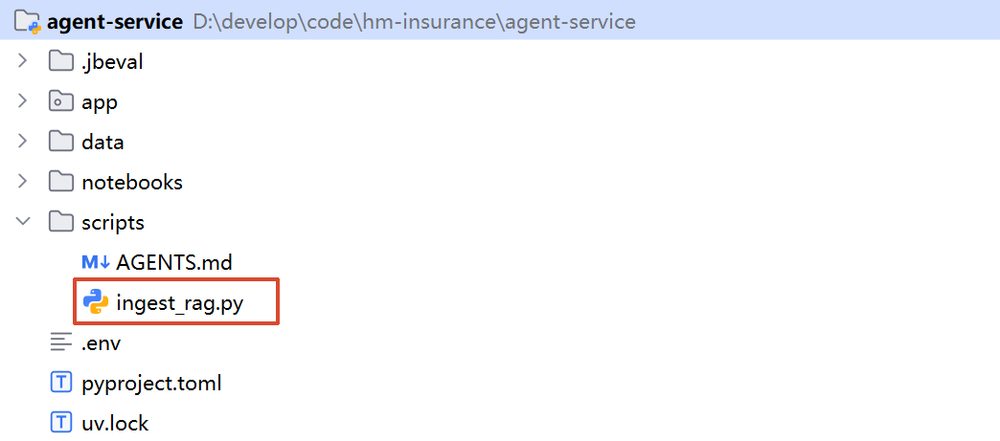
内容如下：

```python
import asyncio
import sys
from pathlib import Path

PROJECT_ROOT = Path(__file__).resolve().parents[1]
sys.path.insert(0, str(PROJECT_ROOT))

from langchain_milvus import BM25BuiltInFunction, Milvus
from langchain_ollama import OllamaEmbeddings

from app.core.config import settings
from app.core.logging import get_logger
from app.infra.database import close_database, AsyncSessionFactory
from app.modules.product.models import Product
from app.modules.product.repository import ProductRepository
from app.rag.pipeline import RAGPipeline

logger = get_logger(__name__)

def create_vector_store() -> Milvus:
    embeddings = OllamaEmbeddings(
        model="qwen3-embedding:0.6b",
        dimensions=1024,
    )
    return Milvus(
        embedding_function=embeddings,
        collection_name="insurance_collection",
        builtin_function=BM25BuiltInFunction(
            analyzer_params={"type": "chinese"}
        ),
        vector_field=["dense", "sparse"],
        connection_args={"uri": settings.rag.milvus_url},
        auto_id=True,
    )

async def find_all_products() -> list[Product]:
    async with AsyncSessionFactory() as session:
        repository = ProductRepository(session)
        return await repository.query_by_category()

async def main() -> None:
    vector_store = create_vector_store()
    pipeline = RAGPipeline(vector_store)

    try:
        products = await find_all_products()
        logger.info("开始构建RAG知识库", product_count=len(products))

        for index, product in enumerate(products, start=1):
            logger.info(
                "开始处理保险产品",
                progress=f"{index}/{len(products)}",
                product_id=product.id,
                product_name=product.name,
            )
            await pipeline.ingest(product)

        logger.info("RAG知识库构建完成", product_count=len(products))
    finally:
        pipeline.close()
        vector_store.client.close()
        await close_database()

if __name__ == "__main__":
    asyncio.run(main())

```
脚本包含main，所以可以直接运行，执行效果如图：

```yaml
 01:30:53 [info] 开始构建RAG知识库   product_count=12
 01:30:53 [info] 开始处理保险产品    product_id=1 product_name=达尔文宝贝计划12号 progress=1/12
 01:31:57 [info] 开始处理保险产品    product_id=2 product_name=达尔文12号重大疾病保险 progress=2/12
 01:33:27 [info] 开始处理保险产品    product_id=3 product_name=复星联合医联有盟重疾险 progress=3/12
 01:35:29 [info] 开始处理保险产品    product_id=4 product_name=复星联合星相守2号长期医疗险（个人版） progress=4/12
 01:37:00 [info] 开始处理保险产品    product_id=5 product_name=复星联合星相守2号长期医疗险（转保版） progress=5/12
 01:38:01 [info] 开始处理保险产品    product_id=6 product_name=众安尊享e生百万医疗险2026版 progress=6/12
 01:39:34 [info] 开始处理保险产品    product_id=7 product_name=中英人寿福满佳C款（悦享版） progress=7/12
 01:40:41 [info] 开始处理保险产品    product_id=8 product_name=太保福有余2025 progress=8/12
 01:41:52 [info] 开始处理保险产品    product_id=9 product_name=新华人寿E增福优享版 progress=9/12
 01:42:38 [info] 开始处理保险产品    product_id=10 product_name=太平洋小蜜蜂6号综合意外险 progress=10/12
 01:43:17 [info] 开始处理保险产品    product_id=11 product_name=太平洋小蜜蜂6号玫瑰版综合意外险 progress=11/12
 01:43:43 [info] 开始处理保险产品    product_id=12 product_name=人保小学童2号Pro学平险 progress=12/12
 01:44:40 [info] RAG知识库构建完成   product_count=12
 01:44:40 [info] 数据库连接池已关闭~
```

# 3. 检索
好了，知识库构建完成，接下来就是知识检索了。

## 3.1 思路分析
知识检索（RAG）的模式我们之前讨论过，有两种：
- 2-Step模式：不管问什么都去检索知识库
- Agentic模式：把RAG检索封装为工具，交给模型去判断是否需要检索，如何检索
这里我们肯定选择第二种模式，Agentic模式，把RAG检索封装为工具，简单而且智能。
所以接下来我们就把注意力集中在RAG检索工具的封装。RAG流程如图：

> [画板内容，请在原文查看]
在RAG检索流程中，milvus已经帮我们实现了，混合检索、重排的部分，我们需要完成：
- 调用VectorStore的混合检索，获得子块
- 调用repository查询数据库，根据子块查询父块

## 3.2 根据id查询父块
我们先在repository定义一个查询父块的方法。
子块的parent_id就是父块的id，所以根据子块的parent_id查询父块，就是根据id批量查询父块，逻辑很简单。
直接修改app.rag.repository.py文件，添加一个根据id批量查询ParentChunk的方法：

```python
from collections.abc import Sequence

from sqlalchemy import select

async def list_by_ids(self, ids: list[str]) -> list[ParentChunk]:
    result = await self.session.scalars(
        select(ParentChunk).where(ParentChunk.id.in_(ids))
    )
    return result.all()
```
然后再Notebook中测试一下：

```python
from app.infra.database import AsyncSessionFactory
from app.rag.repository import ParentChunkRepository

async with AsyncSessionFactory() as session:
    async with session.begin():
        repository = ParentChunkRepository(session)
        chunks = await repository.list_by_ids(["deb1e7d6-7ed0-4a7d-a549-bfd50fffc5ad"])

for c in chunks:
    print(c)
```

## 3.3 定义Retriever
我们在 app.rag 包新建一个 retriever.py 文件：

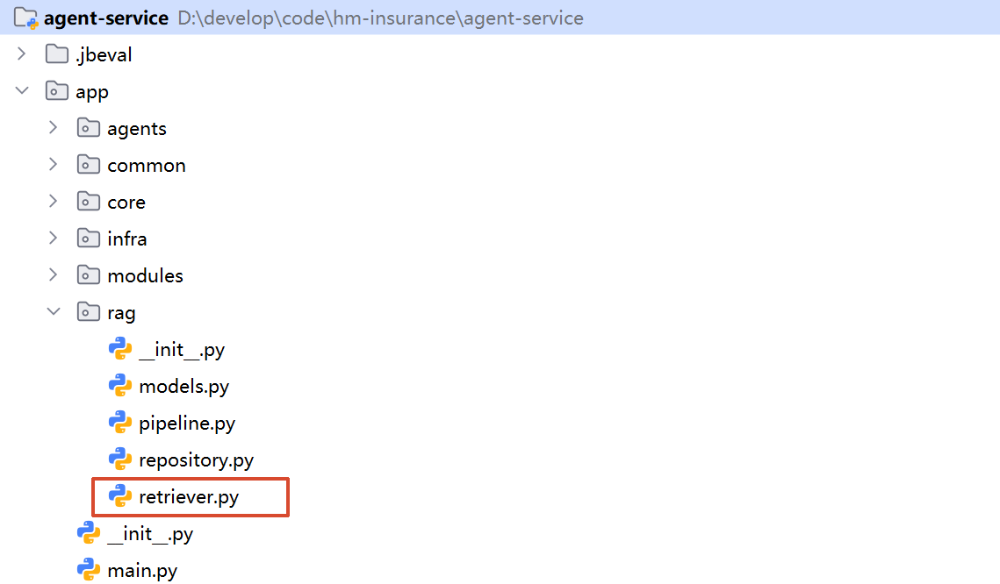
内容如下：

```python
from langchain_milvus import Milvus
from pymilvus import Function, FunctionType

from app.infra.database import AsyncSessionFactory
from app.rag.models import ParentChunk
from app.rag.repository import ParentChunkRepository
from app.core.logging import get_logger
logger = get_logger(__name__)

def create_reranker(query: str) -> Function:
    """milvus的reranker function，这里采用ali的重排模型"""
    return Function(
        name="dashscope_semantic_ranker",
        input_field_names=["text"],
        function_type=FunctionType.RERANK,
        params={
            "reranker": "model",
            "provider": "ali",
            "model_name": "gte-rerank-v2",
            "queries": [query],
            "max_client_batch_size": 5,
        },
    )

class ParentChunkRetriever:

    def __init__(self, vector_store: Milvus):
        self.vector_store = vector_store
        logger.info("RAG Retriever 初始化完成✅️")

    async def retrieve(self, query: str, k: int, product_id: int) -> list[ParentChunk]:
        # 1.在指定产品内混合检索并重排，得到子块
        child_chunks = await self.vector_store.asimilarity_search(
            query=query,
            k=k,
            fetch_k=10,
            expr=f"product_id == {product_id}",
            reranker=create_reranker(query),
        )

        # 2.提取parent_id，并按照召回顺序去重
        parent_ids = list(
            dict.fromkeys(  # 用dict.fromkeys对parent_id滤重
                child.metadata["parent_id"] for child in child_chunks
            )
        )
        if not parent_ids:
            return []

        # 3.根据parent_id批量查询父块
        async with AsyncSessionFactory() as session:
            repository = ParentChunkRepository(session)
            parent_chunks = await repository.list_by_ids(parent_ids)

        # 4.按照子块召回顺序组装父文档

        # 4.1.先组装dict[parent_id, parent_chunk]
        parent_chunk_map = {
            str(parent.id): parent
            for parent in parent_chunks
        }
        # 4.2.按照召回的parent_ids顺序遍历，再到dict中拿到parent
        return [
            parent_chunk_map[parent_id]  # 推导式的结果
            for parent_id in parent_ids  # 推导式数据来源
        ]
```
> **说明：**
> - 检索时必须通过expr在Milvus中限定product_id，让Top K结果只来自当前产品。
> - 随后从子块中提取parent_id并去重，再到PostgreSQL中批量查询父块。
> - 数据库查询结果不保证顺序，因此最后需要按照parent_ids重新排列，保留向量检索与重排后的相关性顺序。
回到 Notebook，创建 Retriever 并测试检索：

```python
# 八、检索
from app.rag.retriever import ParentChunkRetriever

retriever = ParentChunkRetriever(vector_store)

parent_chunks = await retriever.retrieve(
    query="保险合同的等待期是多久？",
    k=5,
    product_id=product.id,
)

for parent_chunk in parent_chunks:
    print("="*80)
    print("product_id =", parent_chunk.product_id)
    print("clause_name =", parent_chunk.clause_name)
    print("section_path =", parent_chunk.section_path)
    print("content =", parent_chunk.content)
```

## 3.4 生命周期管理
RAG组件已经开发完成，核心要对外提供的就是Pipeline和Retriever：
- Pipeline在每次新增或更新产品条款时都需要调用
- Retriever则在Agent回答用户问题时可能要调用
这两个工具依赖很多连接资源，比如MinerU、VectorStore，它不能在每次请求到来时重复创建。而是应该随项目启动创建一次，并在项目关闭时销毁，需要由FastAPI管理其生命周期。
由于Pipeline和Retriever有共享资源：embedding、VectorStore，而且两者都属于RAG模块，我们可以把初始化代码放到app.rag.__init__.py中创建模块级Pipeline和Retriever，其他模块按需导入使用；将来在FastAPI生命周期结束时关闭用到的资源即可。

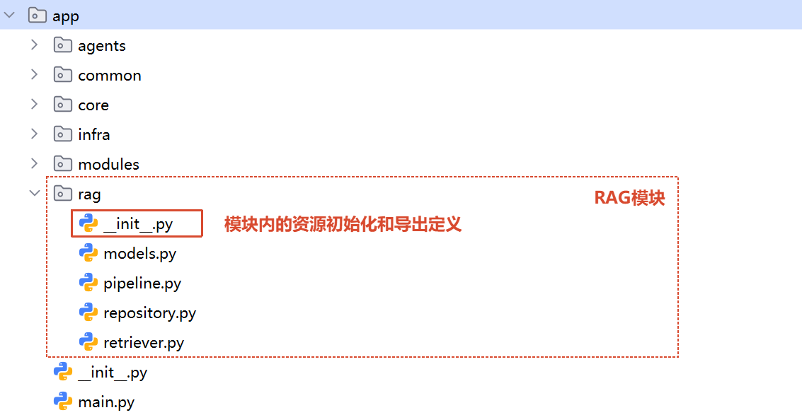

### 3.4.1 __init__.py
我们先修改app.rag.__init__.py文件，在其中封装初始化的函数：

```python
from langchain_milvus import BM25BuiltInFunction, Milvus
from langchain_ollama import OllamaEmbeddings

from app.core.config import settings
from app.rag.pipeline import RAGPipeline
from app.rag.retriever import ParentChunkRetriever

# 1.初始化向量模型
_embeddings = OllamaEmbeddings(
    model="qwen3-embedding:0.6b",
    dimensions=1024,
)

# 2.初始化VectorStore
_vector_store = Milvus(
    embedding_function=_embeddings,
    collection_name="insurance_collection",
    builtin_function=BM25BuiltInFunction(
        analyzer_params={"type": "chinese"}
    ),
    vector_field=["dense", "sparse"],
    connection_args={"uri": settings.rag.milvus_url},
    auto_id=True,
)

# 3.创建模块级Pipeline和Retriever
pipeline = RAGPipeline(_vector_store)
retriever = ParentChunkRetriever(_vector_store)

def close_rag() -> None:
    """关闭RAG组件"""
    pipeline.close()
    _vector_store.client.close()

__all__ = ['pipeline', 'retriever', 'close_rag']
```
app.rag模块第一次被导入时，Embedding、VectorStore、Pipeline和Retriever就会创建一次。Python会缓存已经加载的模块，所以后续无论导入多少次，拿到的都是同一个Retriever。应用关闭时，只需要调用close_rag()释放连接。

### 3.4.2 生命周期钩子
修改app.main.py文件的lifespan函数，管理rag组件的生命周期：

```python
# 生命周期管理（预留）
@asynccontextmanager
async def lifespan(app: FastAPI):
    logger.info(f"【{settings.app.name}】应用启动中...")
    from app.infra.database import check_database, close_database
    from app.rag import close_rag # 导入模块就会初始化
    try:
        # 1.检查业务数据库连接
        await check_database()
        # 2.初始化Checkpointer
        checkpointer = await init_checkpointer()
        # 3.初始化保险顾问Agent
        app.state.agent = init_insurance_agent(checkpointer)
        yield
    finally:
        logger.info("应用关闭中... ")
        # 4.关闭RAG资源
        close_rag()
        # 5.关闭Checkpointer连接池
        await close_checkpointer()
        # 6.关闭SQLAlchemy连接池
        await close_database()
```

## 3.5 RAG Tool
有了Retriever，下一步就是把它封装成工具，交给保险顾问Agent使用了。我们把Retriever封装成Tool，让模型可以根据用户问题自主决定是否检索。
在app.agents.tools.py文件中添加一个工具：

```python
@tool
async def query_product_clause(
    query: str,
    k: int,
    product_id: int,
) -> str:
    """查询指定保险产品的条款内容。

    Args:
        query: 需要从保险条款中查询的问题。
        product_id: 保险产品ID。
    """
    from app.rag import retriever

    chunks = await retriever.retrieve(query, k, product_id)
    if not chunks:
        return "没有查询到相关保险条款。"

    return "\n\n".join(
        f"章节：{' > '.join(chunk.section_path)}\n"
        f"内容：{chunk.content}"
        for chunk in chunks
    )
```

## 3.6 实现RAG Agent并测试
RAG Tool已经准备完成，接下来把它注册到保险顾问Agent中。Agent拿到Tool后，遇到保障责任、等待期、免责条款等问题，就可以先查询条款再组织答案。

### 3.6.1 注册RAG Tool
修改app.agents.insurance_advisor.py文件：

```python
from langchain.agents import create_agent
from langchain.chat_models import init_chat_model
from langgraph.checkpoint.postgres.aio import AsyncPostgresSaver

from app.agents.schemas import InsuranceAgentContext
from app.agents.tools import (
    query_candidate_products,
    query_product_clause
)
from app.core.config import settings
from app.core.logging import get_logger

logger = get_logger(__name__)

SYSTEM_PROMPT = """
你是“安心保”的智能保险顾问。
- 你需要使用专业、准确、容易理解的语言回答用户的保险问题。
- 当信息不足时，应先向用户追问，形成用户画像。
- 给用户推荐保险方案时，必须先查询候选产品，根据用户画像，推荐合适的保险组合，再调用工具保存方案。
- 回答保险产品的条款问题时，必须先调用query_product_clause查询对应产品的保险条款，再根据检索结果回答。
- 你的回答必须是基于检索到的保险条款，不要编造保险条款中没有的信息。如果没有相关条款，如实告知用户。
- 回答要简短、精确，不要长篇大论。
"""

def init_insurance_agent(checkpointer: AsyncPostgresSaver):
    """初始化保险顾问Agent"""
    # 1.初始化模型
    model = init_chat_model(
        model=settings.llm.chat_model,
        model_provider="deepseek",
        api_key=settings.llm.api_key,
        extra_body={"thinking": {"type": "disabled"}},
    )

    # 2.创建Agent
    agent = create_agent(
        model=model,
        tools=[
            query_candidate_products,
            query_product_clause,
        ],
        system_prompt=SYSTEM_PROMPT,
        checkpointer=checkpointer,
    )
    logger.info("保险顾问Agent初始化成功~✅️")
    return agent
```
> **注意：**系统提示词需要明确哪些问题必须查询保险条款，避免模型凭自身知识直接回答。

### 3.6.2 测试RAG Agent
重新启动服务后，访问http://127.0.0.1:5173，与客服对话时针对某个保险产品的条款提问，例如：

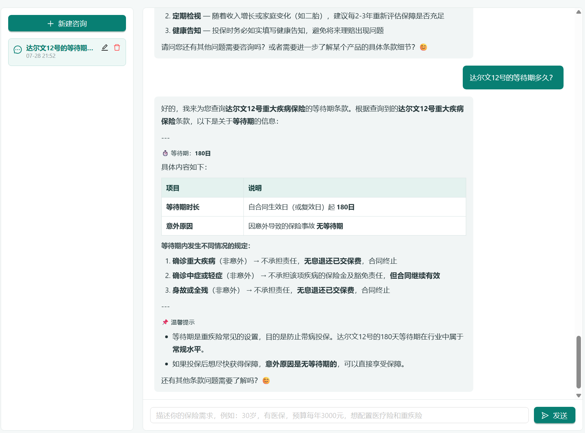
从日志中应该能看到Agent调用query_product_clause，并根据召回的条款内容生成回答。

## 3.7 RAG的引用溯源（了解）
现在Agent已经可以根据保险条款回答问题，仅仅生成答案，没有具体的条款原文，可信度不够。
回答保险条款问题时，如果能带上详细的条款来源信息，会让客服的回答更有说服力。如图：

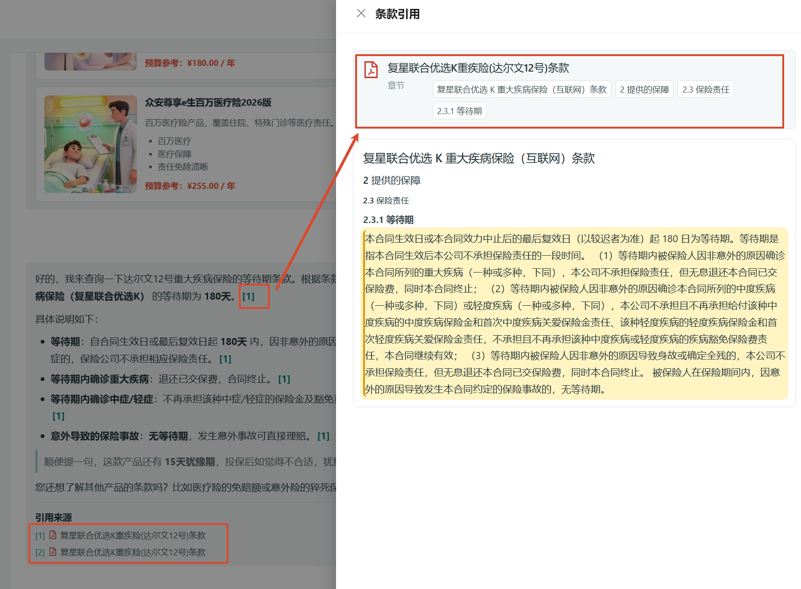

### 3.7.1 思路分析
要实现这个功能，需要前后端配合才行。
- 后端：
  - 知识检索时，给每一个召回的文档片段设置一个唯一编号
  - LLM回答时，需要给文档事实添加引用编号
  - Agent除了返回AI的回复，还应该把每个引用编号以及对应的文档片段一起返回
- 前端：
  - 接收到Agent消息、引用编号以及引用文档
  - 给引用编号设置高亮和点击事件，点击时展示文档

> [画板内容，请在原文查看]

### 3.7.2 给召回文档编号
回到app.agents.tools.py，改造query_product_clause。这一次给每个父块生成source_id，形成一个字典格式：

```python
{
    "ref-001": {
        "section_path": "",
        "content": ""
    },
    "ref-002": {
        "section_path": "",
        "content": ""
    }
}
```
代码：

```python

@tool
async def query_product_clause(
    query: str,
    k: int,
    product_id: int,
) -> str:
    """查询指定保险产品的条款内容。

    Args:
        query: 需要从保险条款中查询的问题。
        k: 返回的文档数量。
        product_id: 保险产品ID。
    """
    from app.rag import retriever

    chunks = await retriever.retrieve(query, k, product_id)
    if not chunks:
        return "没有查询到相关保险条款。"

    # 把model转换字典数据
    sources = {
        # 给文档编号，最终格式 {"ref-001": {"content": ""}}
        f"ref-{i:03d}": {
            "product_id": chunk.product_id,
            "clause_name": chunk.clause_name,
            "section_path": chunk.section_path,
            "content": chunk.content,
        }
        for i, chunk in enumerate(chunks, start=1)
    }
    # 以JSON格式返回
    return json.dumps(sources, ensure_ascii=False)
```

### 3.7.3 答案引用编号
Tool已经给召回片段添加了编号，但Agent生成的回答也必须引用编号才行，这个就需要靠提示词来约束了。
修改app.agents.insurance_advisor.py中的系统提示词，要求模型在使用条款事实时标注对应编号：

```python
SYSTEM_PROMPT = """
你是“安心保”的智能保险顾问。
- 你需要使用专业、准确、容易理解的语言回答用户的保险问题。
- 当信息不足时，应先向用户追问，形成用户画像。
- 给用户推荐保险方案时，必须先查询候选产品，根据用户画像，推荐合适的保险组合，再调用工具保存方案。
- 回答保险产品的条款问题时，必须先调用query_product_clause查询对应产品的保险条款，再根据检索结果回答。
- 你的回答必须是基于检索到的保险条款，不要编造保险条款中没有的信息。如果没有相关条款，如实告知用户。
- 回答中的每个事实陈述必须紧跟[source_id]的引用标记。例如：这款产品的等待期为180天。[ref-001]
- 回答要简短、精确，不要长篇大论。
"""
```
例如模型使用了ref-001中的等待期规定，就应该在相关答案后标注[ref-001]。将来前端可以根据这个编号找到对应来源。
重启测试，可以看到前端确实能看到这些引用标记：

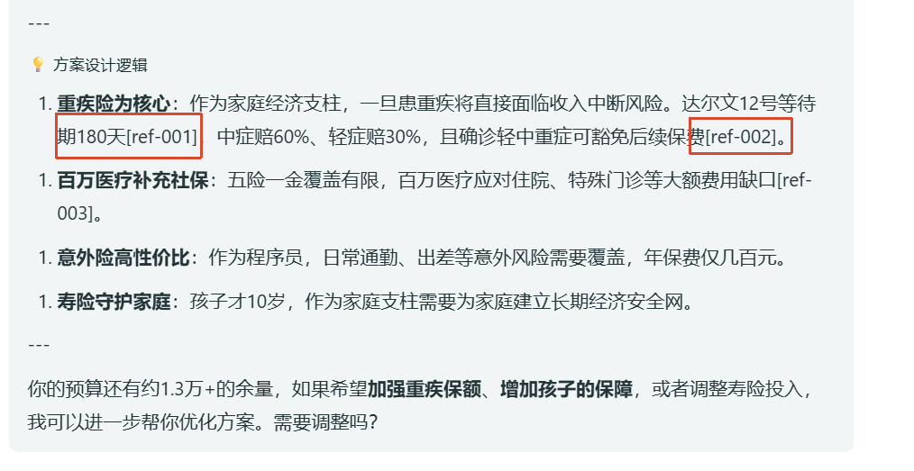

### 3.7.4 引用片段传递
现在，AI生成的回答中已经包含了引用信息，像这样：

```json
关于**达尔文12号（复星联合优选K重大疾病保险）** 的等待期，条款明确如下：

**⏳ 等待期为180天**[ref-001]

详细说明：
- **180天内**，因非意外原因确诊重疾 → 退还已交保费，合同终止[ref-001]
- **180天内**，因非意外原因确诊中症/轻症 → 不再承担该项中/轻症责任，但**合同继续有效**[ref-001]
- **因意外导致**的保险事故 → **无等待期**[ref-001]

简单理解就是：投保后前180天，非意外导致的疾病不赔，但意外导致的直接赔，没有等待期限制。这个等待期在重疾险中属于**正常水平**，大部分重疾险都是90~180天。

您还想了解其他产品的细节吗？比如保障责任、免责条款等？😊
```
但最终我们需要把这些引用[ref-001]在前端转成可点击的超链接，点击后还要弹窗展示完整信息。然而现在前端根本不知道[ref-001]代表什么。
这就需要我们把工具生成的引用片段作为sse事件发给前端，结构像这样：

```json
{
    "ref-001": {"content": "xxx", "section_path": ["2.2.xx", "2.2.1.xx"]},
    "ref-002": {"content": "xxx", "section_path": ["2.2.xx", "2.2.1.xx"]},
}
```
前端才能根据source_id找到引用的完整信息，渲染出来。
但问题来了：
> 这段信息如何返回给前端呢？
要知道Tool返回的信息是给LLM的，而LLM已经生成自然语言回复结果给前端了，不会把引用原文发过去。而且这些信息也不适合放到历史消息中，会影响记忆。
怎么办？
LangChain的Agent支持自定义stream事件，把数据写到事件流中，这样我们就能在处理event_stream时，拿到信息，返回给前端。
具体可参考文档：https://docs.langchain.com/oss/python/langchain/streaming#custom-updates

#### 3.7.4.1 发送custom事件
在Tool中，通过调用get_stream_writer()获取一个writer，然后就可以写数据到event_stream，生成一个custom事件。
我们修改app.agents.tools.py文件，修改query_product_clause工具：

```python
from langgraph.config import get_stream_writer

@tool
async def query_product_clause(
    query: str,
    k: int,
    product_id: int,
) -> str:
    """查询指定保险产品的条款内容。

    Args:
        query: 需要从保险条款中查询的问题。
        product_id: 保险产品ID。
    """
    from app.rag import retriever

    chunks = await retriever.retrieve(query, k, product_id)
    if not chunks:
        return "没有查询到相关保险条款。"

    # 把model转换字典数据
    sources = {
        # 给文档编号，最终格式 {"ref-001": {"content": ""}}
        f"ref-{i:03d}": {
            "product_id": chunk.product_id,
            "clause_name": chunk.clause_name,
            "section_path": chunk.section_path,
            "content": chunk.content,
        }
        for i, chunk in enumerate(chunks, start=1)
    }

    # 把sources写到自定义事件中
    writer = get_stream_writer()
    writer({"type": "additional_info", "data": sources})

    # 以JSON格式返回
    return json.dumps(sources, ensure_ascii=False)
```

#### 3.7.4.2 捕获custom事件
接下来就是在调用agent时捕获custom事件流了，然后遍历v3事件流，按事件类型分别处理：
- messages事件继续返回回答文本
- custom事件则转换为additional_info事件返回前端
不过，需要注意的是，在异步的astream_events事件处理不能分开写两个async for，必须在一个事件循环中处理。
所以我们需要用一个库来合并异步事件流：

```python
uv add aiostream
```
然后分别定义message和custom处理函数，再用aiostream合并为一个stream，示例：

```python
# 2.3.只读取消息中的文本增量
async def stream_messages():
    async for message in stream.messages:
        ...

# 2.4.判断是否有custom事件
async def stream_custom():
    async for event in stream.extensions['custom']:
        ...

# 2.5.合并Message处理和custom事件处理
merged = astream.merge(stream_messages(), stream_custom())
async with merged.stream() as streamer:
    async for event in streamer:
        ...
```
完整代码如下：
修改app.modules.chat.service.py：

```python
from collections.abc import AsyncIterator
from aiostream import stream as astream
from fastapi.sse import ServerSentEvent
from langchain_core.messages import HumanMessage
from langgraph.graph.state import CompiledStateGraph
from langgraph.stream import CustomTransformer
from sqlalchemy.ext.asyncio import AsyncSession

from app.agents.schemas import InsuranceAgentContext
from app.modules.chat.schemas import ChatRequest
from app.modules.chat_thread.exceptions import ChatThreadNotFoundError
from app.modules.chat_thread.repository import ChatThreadRepository
from app.core.logging import get_logger
logger = get_logger(__name__)

class ChatService:
    def __init__(self, session: AsyncSession, agent: CompiledStateGraph):
        self.repository = ChatThreadRepository(session)
        self.agent = agent

    async def stream_chat(
        self,
        user_id: int,
        request: ChatRequest,
    ) -> AsyncIterator[ServerSentEvent]:
        # 1.校验会话是否属于当前用户
        thread = await self.repository.find_owned(
            request.thread_id,
            user_id,
        )
        if thread is None:
            raise ChatThreadNotFoundError

        # 2.校验通过后，调用Agent

        # 2.1.准备Agent输入
        _input = {"messages": [HumanMessage(content=request.message)]}
        config = {"configurable": {"thread_id": str(request.thread_id)}}
        context = InsuranceAgentContext(user_id=user_id)

        # 2.2.使用v3协议获取异步事件流
        stream = await self.agent.astream_events(
            _input,
            config,
            context=context,
            version="v3",
            transformers=[CustomTransformer],
        )

        # 2.3.只读取消息中的文本增量
        async def stream_messages():
            async for message in stream.messages:
                async for text in message.text:
                    yield ServerSentEvent(data=text, event="message")

        # 2.4.判断是否有custom事件
        async def stream_custom():
            async for event in stream.extensions['custom']:
                if event.get('type') == 'additional_info':
                    yield ServerSentEvent(data=event.get('data'), event="additional_info")

        # 2.5.合并Message处理和custom事件处理
        merged = astream.merge(stream_messages(), stream_custom())
        async with merged.stream() as streamer:
            async for event in streamer:
                yield event

        # 2.6.返回结束标识
        yield ServerSentEvent(data="[DONE]", event="done")
```
这样，前端既能收到模型的流式回答，也能收到引用编号与条款来源的映射，从而把答案中的引用编号渲染成可点击的引用标记。

### 3.7.5 测试引用溯源
重新发起一次条款问答。SSE中则应该收到对应的additional_info事件：

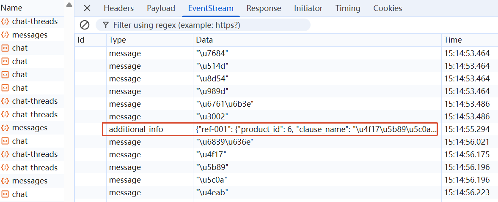
而且，前端也能正确渲染引用条款了：

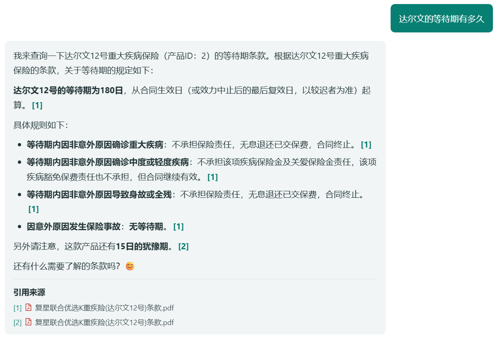
点击任意引用索引，会弹出详细条款：

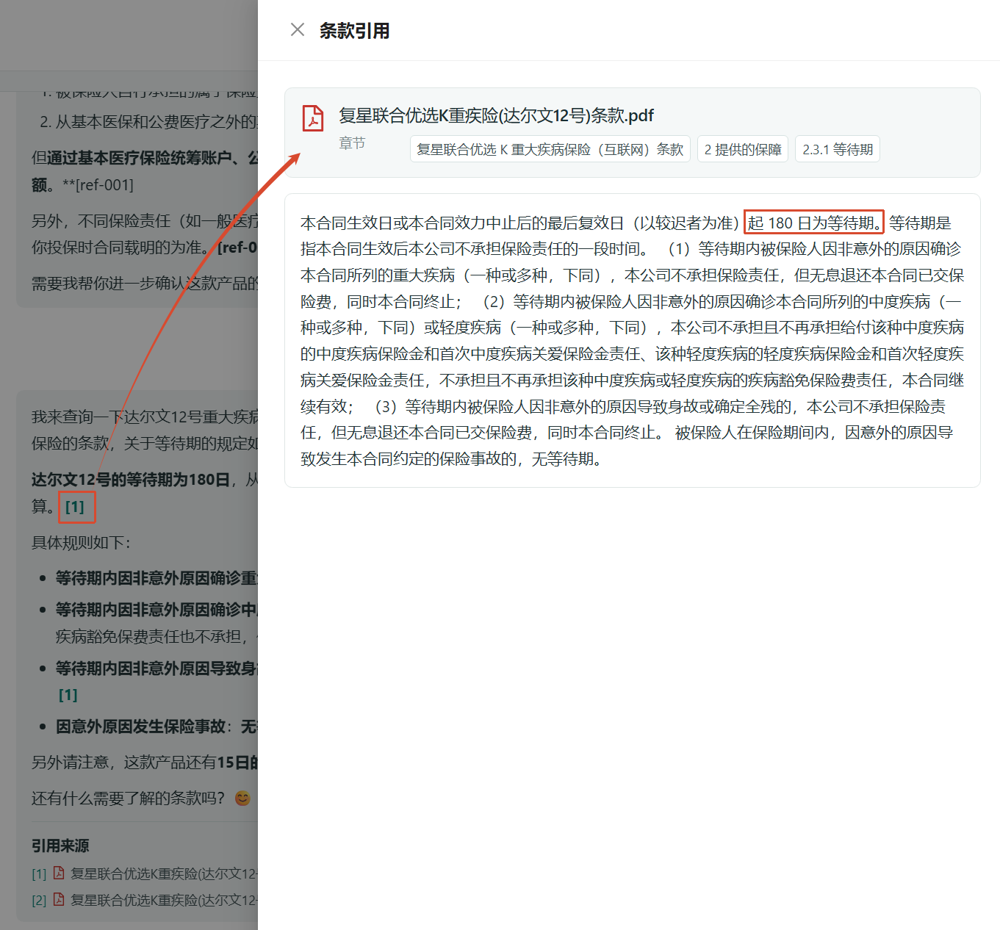
此时如果刷新页面，通过会话历史接口重新加载消息，引用信息会消失。原因是custom事件只负责实时传输，并没有进入Agent的会话状态。
等后面学习LangGraph后，我们再通过自定义State把引用信息与AI消息关联起来，解决历史引用恢复问题。
