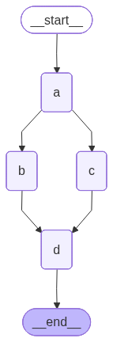
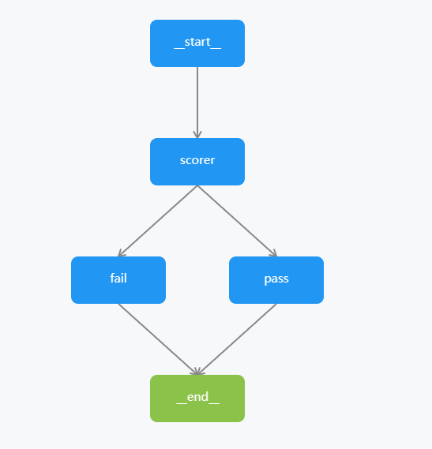
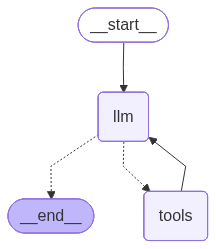
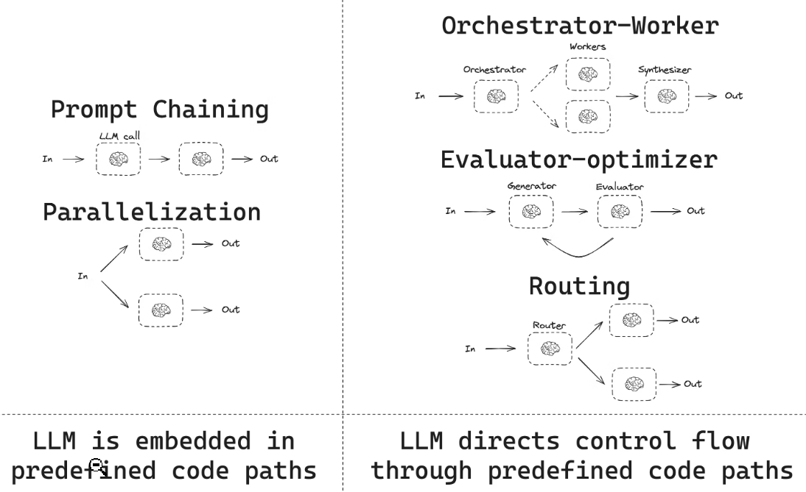
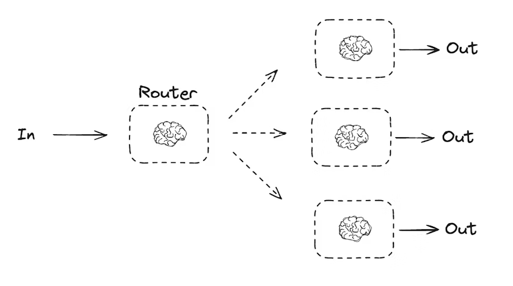
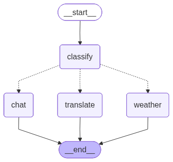
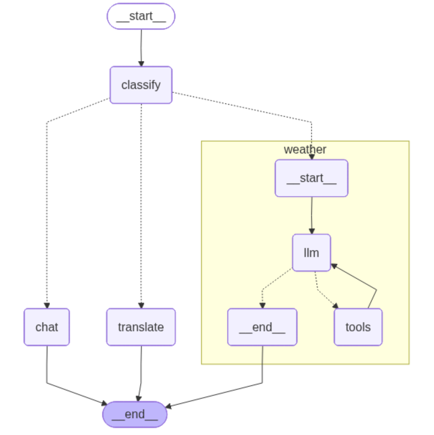

# Day10. LangGraph

> 原文链接：https://my.feishu.cn/wiki/NRBpwBjkSiTzY9kGhaocmbKInNe

LangChain已经能帮助我们开发Agent、RAG系统了，为什么还要学习LangGraph呢？
要明白这个问题，我们需要先弄清楚LangGraph到底能做什么。

# 1. 认识LangGraph
让我们从AI应用的发展过程来了解LangGraph扮演的角色。

## 1.1 AI应用的发展

### 1.1.1 简单LLM应用
在早期，AI应用就是简单的调用LLM：

> [画板内容，请在原文查看]
这时候的AI应用能力有限：
- 无法调用工具
- 无法访问外部数据
- 无法实现复杂多步骤任务

### 1.1.2 链式LLM应用（Chain）
为了增强LLM应用的能力，人们开始自定义程序执行流程，添加额外的步骤：

> [画板内容，请在原文查看]
例如，在调用LLM前加入**知识检索**（retrieval），在模型调用之后加入**工具调用**（tool calls），此时整个由程序控制的工作流就形成了一个**链条**（**Chain**）。早期的LangChain也就是基于这种理念设计，这也是LangChain名字的由来。
这种人工定制的工作流特点是**稳定可靠（Reliable）**，你不管执行多少次，流程一定是这样，不会出现意外情况。但是它缺乏**自主智能（Agentic）**，距离真正的智能体相差甚远**。**

### 1.1.3 智能体（Agent）
所谓的**智能体**，就是指应用的执行工作流应该由LLM来决定，也就是让AI来自主规划工作流。
例如，由LLM来决定接下来应该执行Step 2 还是 Step 3：

> [画板内容，请在原文查看]
甚至，完全由LLM自主决定所有的执行流程：

> [画板内容，请在原文查看]

### 1.1.4 稳定度与自主控制力
虽然都是Agent，但上面的两个例子恰好是Agent的两个极端，或者说是LLM对应用控制能力的两个极端：

> [画板内容，请在原文查看]
但是，Agent的自主控制能力与稳定程度之间是对立的两端，通常来说，LLM自主控制的越多，应用的稳定程度就会越小：

> [画板内容，请在原文查看]
所以，通常来说，我们只能在可靠度和自主控制程度之间选择一个平衡点。

## 1.2 LangGraph的作用
LangGraph的作用就是在保持Agent的自主控制程度不变的同时，提高Agent的稳定程度：

> [画板内容，请在原文查看]
那么，LangGraph是如何做到的呢？

### 1.2.1 认识LangGraph
简单来说，LangGraph允许你自己定义Agent内部的**工作流**（WorkFlow）中的每一个**节点**（Node）：
- 需要稳定性的节点，就用传统编程控制
- 需要LLM自主控制的，就交给LLM
并且，整个工作流不再是一条直线运行的**链（Chain）**，而是一个像真正工作流那样有分支、有循环的**图（Graph）。**
在LangGraph中，工作流由3个基本的要素组成：
- **节点（Node）**：即工作流中的关键工作代码，可以是工具调用、知识检索、LLM调用
- **边（Edge）**：也可以理解为线，就是把各个节点连接起来的路径，是控制工作流走向的关键
- **状态（State）**：整个工作流中流转的数据

> [画板内容，请在原文查看]
为了提高应用的运行的稳定程度，LangGraph为节点运行提供了Checkpointer功能，应用运行到每个**节点（Node）**都会形成**检查点（Checkpoint）**，我们可以方便的跳转到任意checkpoint，这样一来应用就具备了三大功能：
- **故障恢复**：即便是程序异常中止，也可以随时恢复到失败节点继续执行。
- **人机交互**：在程序运行中可以暂停工作流，在关键节点允许人工介入，得到人工确认后恢复执行，进一步提高程序的可靠性。
- **持久记忆**：由于Checkpointer可以持久化存储，能方便的拿到历史信息，因此应用还具备了记忆功能。

### 1.2.2 LangGraph与LangChain
看完上面的介绍，你是不是觉得这些功能似曾相识啊？
没错，在我们之前学习的LangChain开发中就有这些能力：
- Memory
- HITL
- ...
这是因为，自从LangChain的1.0版本以后，底层的Chain模式已经逐渐废弃，而是彻底的投入了Graph的怀抱。
LangChain 1.x之后的版本中，Agent的底层实现已经全部替换为基于LangGraph了！
不过，两者的定位完全不同：
- **LangChain**：便捷开发AI应用的框架，提供了开发AI应用的各种统一API
  - 统一的LLM调用
  - 统一的Embedding Model调用
  - 统一的Vector Store调用
  - ...
- **LangGraph**: 工作流编排框架，提供了完善的工作流编排工具
  - 基于Node和Edge的工作流编排
  - 基于State的工作流数据传输
  - 基于Checkpointer的数据持久化
总结一下：
- **LangGraph**关注的是工作流的编排，你的工作流甚至可以完全与LLM无关，与Agent无关。如果你利用LangGraph开发Agent，可以自由的控制Agent工作流中的每一个细节
  - 优点：自由度更高。
  - 缺点：比较繁琐
  - 场景：需要完全控制Agent工作流程和细节，或者复杂Agent工作流的情况
- **LangChain**则是提供的统一API，底层基于LangGraph实现Agent，简化了Agent的开发。
  - 优点：简化Agent开发
  - 确定：灵活度不如LangGraph
  - 场景：简单的LLM调用，或者快捷的Agent开发
掌握了LangGraph，你就掌握了开发复杂度高、可靠性高的Agent的能力，迈入了高级AI应用开发工程师的门槛。

# 2. 基本概念
正如前面所述，LangGraph中包含的核心组件有：
- **状态（State）**：整个工作流中流转的数据
- **节点（Node）**：工作流中的关键工作代码，主要任务是加工处理State中的数据，用函数来定义
- **边（Edge）**：也可以理解为线，就是把各个节点连接起来的路径，是控制工作流走向的关键
由Edge和Node组成了一个按照固定顺序执行的工作流，也就是**图（Graph**）。图的输入是State、输出是加工后的State，所以图就是加工处理State的"流水线"。

> [画板内容，请在原文查看]
接下来，我们就逐个学习LangGraph中的这些概念，以及如何利用这些组件构成**图（Graph）**.

## 2.1 节点（Node）
节点（Node）是图（Graph）的执行单元，用来加工处理数据，多数情况下节点就是一个Python函数。
格式如下：

```python

def my_node(state: State) -> dict:
    # 从state读取数据
    # 执行计算逻辑（可以调用LLM、工具、数据库等）
    # 返回state的更新部分（dict）
    return {"age": new_value}
```
- **输入**：State对象
- **输出**：也是State对象，但是可以用字典，只包含要更新到state的字段（部分更新）
- **可以做什么**：调用LLM、执行工具、读数据库、文件操作，最终把结果更新到State中...
需要注意的是，LangGraph有两个默认的Node是无需定义的，可以直接使用：
- **START**：开始节点，也是入口
- **END**：结束节点，也是出口
例如，我们要做一个简单的Graph：
start(用户输入name) --> 节点1（生成问候语）--> 节点2（把问候语转大写）--> end

```python
from typing import TypedDict

from langgraph.constants import START, END
from langgraph.graph import StateGraph
# from IPython.display import Image, display

# ===================1. State: 定义共享数据结构=================
class SimpleState(TypedDict):
    name: str       # 记录用户name
    greeting: str   # 记录生成的问候语

# ===================2. Node: 定义处理逻辑===================
# node 1: 生成问候语的节点
def greet_node(state: SimpleState):
    print(f"greet_node is receiving name: {state['name']}")
    return {"greeting": f"Hello, {state['name']}!"}

# node 2: 转大写
def uppercase_node(state: SimpleState):
    print(f"uppercase_node is receiving greeting: {state['greeting']}")
    return {"greeting": state["greeting"].upper()}

# ===================3. 创建Graph===================
graph_builder = StateGraph(SimpleState)             # 3.1.注册State，初始化图Builder
                                                    # 3.2.注册节点
graph_builder.add_node("greet", greet_node)             # greet节点
graph_builder.add_node("uppercase", uppercase_node)     # uppercase节点
                                                    # 3.3.注册Edge，定义Node执行顺序
graph_builder.add_edge(START, "greet")                  # START -> greet
graph_builder.add_edge("greet", "uppercase")            # greet -> uppercase
graph_builder.add_edge("uppercase", END)                # uppercase -> END

graph = graph_builder.compile()                     # 3.4.编译成可执行图
# display(Image(graph.get_graph(xray=True).draw_mermaid_png()))

# ===================4.调用graph======================
# 调用graph，传入初始的state，返回的是处理后的 state
result = graph.invoke({"name": "World"})
print(result)
```
生成的图结构：

> [画板内容，请在原文查看]
总结，创建Graph的一般流程是这样的：
- 定义State，定义数据结构
- 定义Node，定义数据处理逻辑
- 创建Graph，分为几部分：
  - 注册State，初始化GraphBuilder
  - 注册Node
  - 注册Edge，定义Node执行顺序
  - 编译，得到Graph
- 执行Graph

## 2.2 State（状态）
State是图的共享内存数据，贯穿整个执行过程。
- State定义Graph中的数据字段（输入的字段、运行的结果）
- 每个Node都可以获取State数据、更新的State数据（返回要更新的字段值即可）
而Node返回数据后State的更新处理方式取决于**Reducers**，而且State中的每个字段都有自己的Reducer。
reducer:本质就是一个函数，这个函数接收原本的数据，和新数据，返回整合后的结果
比如：

```python
greeting = 'hello, Jack'

def reducer(old, new):
    return new
```

### 2.2.1 默认Reducer
需要注意的是：如果字段没有指定Reducer，那**默认的Reducer行为就是覆盖**。
也就是说：如果多个Node都更新了State中的同一个字段，默认情况下后执行的Node将覆盖前面Node的更新结果。例如：

```python
from typing import TypedDict
from langgraph.constants import START, END
from langgraph.graph import StateGraph

# =================1. 定义State数据结构，默认Reducer=================
class DefaultReducerState(TypedDict):
    val: str

# =================2. Node: 定义处理逻辑=================
# node1 覆盖State中的val值为node_1
def node_1(state: DefaultReducerState):
    print(f"node_1 is receiving val: {state['val']}")
    return {"val": "node_1"}
# node2 覆盖State中的val值为node_2
def node_2(state: DefaultReducerState):
    print(f"node_2 is receiving val: {state['val']}")
    return {"val": "node_2"}

# ===================3. 创建Graph===================
graph_builder = StateGraph(DefaultReducerState)         # 3.1.注册State，初始化图Builder
graph_builder.add_node("node_1", node_1)                # 3.2.注册Node
graph_builder.add_node("node_2", node_2)
                                                        # 3.3.注册Edge，定义Node执行顺序
graph_builder.add_edge(START, "node_1")               # START -> greet
graph_builder.add_edge("node_1", "node_2")    # greet -> uppercase
graph_builder.add_edge("node_2", END)                # uppercase -> END

graph = graph_builder.compile()                         # 3.4.编译成可执行图

# =================4.调用Graph，传入默认State值=================
result = graph.invoke({"val": "default"})
print(result)
```
上案例中每个Node都在修改State的val字段，但最终val只记录了最后一次的值。这就是默认的Reducer行为。
结果：

```python
node_1 is receiving val: default
node_2 is receiving val: node_1
{'val': 'node_2'}
```

### 2.2.2 自定义Reducer
通过前面的例子我们就能看到默认的Reducer效果了。
如果我们不希望覆盖，则需要自定义Reducer，需要用到Annotated来定义：
- Annotated[type, reducer]

```python
from operator import add
from typing import Annotated, TypedDict

from langgraph.constants import START, END
from langgraph.graph import StateGraph

# =================1. 定义State数据结构和Reducer=================
class CustomReducerState(TypedDict):
    count: int                       # 这个字段没有定义Reducer，也就是默认会覆盖旧值
    nodes: Annotated[list[str], add] # 这里使用add作为Reducer，也就是会拼接结果

# =================2. Node: 定义处理逻辑=================
def node_1(state: CustomReducerState):
    print(f'node_1 is receiving count: {state['count']}')
    return {'count': 1, 'nodes': ['node_1']} # 直接修改nodes值，不用自己拼接

def node_2(state: CustomReducerState):
    print(f'node_2 is receiving count: {state['count']}')
    return {'count': 2, 'nodes': ['node_2']} # 直接修改nodes值，不用自己拼接

# ===================3. 创建Graph===================
graph_builder = StateGraph(CustomReducerState)      # 3.1.注册State，初始化图Builder
graph_builder.add_node('node_1', node_1)            # 3.2.注册Node
graph_builder.add_node('node_2', node_2)
                                                    # 3.3.注册Edge，定义Node执行顺序
graph_builder.add_edge(START, 'node_1')                 # START -> greet
graph_builder.add_edge('node_1', 'node_2')              # greet -> uppercase
graph_builder.add_edge('node_2', END)                   # uppercase -> END

graph = graph_builder.compile()                     # 3.4.编译成可执行图

# =================4.调用Graph，传入默认State值=================
result = graph.invoke({'count': 0, 'nodes':[]})
print(result)
```
结果：

```python
node_1 is receiving count: 0
node_2 is receiving count: 1
{'count': 2, 'nodes': ['node_1', 'node_2']}
```
可以看到，尽管Node中每次都是直接修改State的nodes字段，但最终由于使用了add这个Reducer，它会把nodes的初始值与新值拼接，类似于：

```python
nodes = []
nodes = nodes + ['node1'] + ['node2']
```

## 2.3 Edge（边）
Edge定义节点的执行顺序。LangGraph提供两种Edge：

| 边类型 | 方法 | 说明 |
| --- | --- | --- |
| 普通边（Normal Edge） | add_edge(node_a, node_b) | 固定流向：A执行完一定到B |
| 条件边（Conditional Edge） | add_conditional_edges(node_a, router, mapping) | router的返回值决定下一节点 |
示意图：

> [画板内容，请在原文查看]

### 2.3.1 Normal Edge
普通边连接的两个节点流向是固定的，前一个节点执行完一定会执行后一个节点。不同之处在于节点之间是串行还是并行：
- 串行: 整个工作流只有一条路径，路径中的节点按照顺序依次执行
- 并行: 整个工作流由多条路径，不同路径可以同时执行
上节我们演示的就是串行方式，本节课我们再来看看并行方式，结构如图：

```python
      ┌──>  b ───┐
a ────┤          ├────> d
      └──>  c ───┘
```
代码：

```python
from operator import add
from typing import Annotated, TypedDict
from langgraph.constants import START, END
from langgraph.graph import StateGraph

# =================1. 定义State数据结构和Reducer=================
class ParallelState(TypedDict):
    nodes: Annotated[list[str], add]

# =================2. Node: 定义处理逻辑=================
def node_a(state: ParallelState):
    print(f"node_a is running, nodes: {state['nodes']}")
    return {"nodes": ["a"]}

def node_b(state: ParallelState):
    print(f"node_b is running, nodes: {state['nodes']}")
    return {"nodes": ["b"]}

def node_c(state: ParallelState):
    print(f"node_c is running, nodes: {state['nodes']}")
    return {"nodes": ["c"]}

def node_d(state: ParallelState):
    print(f"node_d is running, nodes: {state['nodes']}")
    return {"nodes": ["d"]}

# ===================3. 创建Graph===================
builder = StateGraph(ParallelState)
builder.add_node("a", node_a)
builder.add_node("b", node_b)
builder.add_node("c", node_c)
builder.add_node("d", node_d)
builder.add_edge(START, "a")         # start -> a
builder.add_edge("a", "b")           # a -> b
builder.add_edge("a", "c")           # a -> c
builder.add_edge("b", "d")           # b -> d
builder.add_edge("c", "d")           # c -> d
builder.add_edge("d", END)           # d -> end
parallel_graph = builder.compile()

# =================4.调用Graph，传入默认State值=================
result = parallel_graph.invoke({})
print(result)
```
最终生成的Graph如图：


运行结果：

```sql
node_a is running, nodes: []
node_b is running, nodes: ['a']
node_c is running, nodes: ['a']
node_d is running, nodes: ['a', 'b', 'c']
{'nodes': ['a', 'b', 'c', 'd']}
```
能发现，b和c确实是并行运行，因为node_b和node_c接收到了相同的参数。
> 注意：如果并行节点同时修改了State的同一个字段，那么这个字段就必须有自定义的Reducer来处理，否则就会出现冲突，会报错！

### 2.3.2 Conditional Edge
条件边的添加方式如下：

```python
add_conditional_edges(node_a, router, mapping)
```
接收三个参数：
- node_a：是当前节点（这条边开始）
- router：路由函数，逻辑自定义，它的返回值默认就是下个节点的名字。
- mapping：如果router返回值与下个节点名不一样，可以用mapping定义返回值与下个节点名字的映射关系
例如，我们实现一个成绩判定的Graph，用户输入一个分数，我们根据分数判断走哪个节点：
- 大于60，走**成功**节点
- 小于60，走**失败**节点

> [画板内容，请在原文查看]
代码：

```python
from typing import TypedDict, Literal
from langgraph.constants import START, END
from langgraph.graph import StateGraph

# =================1. 定义State数据结构================
class RouteState(TypedDict):
    score: int
    result: str

# =================2. Node: 定义处理逻辑=================
def scorer(state: RouteState):
    score = int(input("请输入分数:"))
    print(score)
    return {"score": score}  # 模拟评分

def pass_node(state: RouteState):
    return {"result": "通过！"}

def fail_node(state: RouteState):
    return {"result": "不通过"}

# =================3. 定义路由节点，决定下个Node=================
def router(state: RouteState) -> Literal["pass", "fail"]:
    """根据score决定下一节点"""
    if state["score"] >= 60:
        return "pass"
    return "fail"

# ===================4. 创建Graph===================

builder = StateGraph(RouteState)                # 1.创建Graph
                                                # 2.添加节点
builder.add_node("scorer", scorer)                  # 打分节点
builder.add_node("pass", pass_node)                 # 失败节点
builder.add_node("fail", fail_node)                 # 成功节点
                                                # 3.添加Edge
builder.add_edge(START, "scorer")                   # start -> scorer
builder.add_conditional_edges("scorer", router)     # scorer -> router （条件边）
builder.add_edge("pass", END)                       # pass -> end
builder.add_edge("fail", END)                       # fail -> end
condition_graph=builder.compile()

# =================5.调用Graph，传入默认State值=================
result = condition_graph.invoke({"score": 0, "result": ""})
print(result)
```
结果：

```python
请输入分数:98
98
{'score': 98, 'result': '通过！'}
```
图：


### 2.3.3 Command实现条件分支
如果不想编写Conditional Edge，也可以在Node中直接返回下个节点信息。
但是，由于Node必须返回**对State的更新**，而没有条件边就需要返回**下个节点的名字**。函数返回值只能有一个。所以LangGraph就提供了Command API，用Command来指定下个节点以及要更新的字段。
示例：

```python
def node_a(state: State) -> Command[Literal['node_b', 'node_c']]:
    # ...
    return Command(
        update={"k":"v"},
        goto="node_b"
    )
```
其中：
- update : 用来指定要更新的State字段
- goto : 用来指定下个节点
还是刚才的例子，我们用Command来实现：

```python
from typing import TypedDict, Literal
from langgraph.constants import START, END
from langgraph.graph import StateGraph
from langgraph.types import Command

# =================1. 定义State数据结构================
class RouteState(TypedDict):
    score: int
    result: str

# =================2. Node: 定义处理逻辑=================

# scorer节点自己负责路由，需要注意其返回值必须是Literal
def scorer(state: RouteState) -> Command[Literal["pass", "fail"]]:
    score = int(input("请输入分数:"))
    goto = "fail"
    if score >= 60:
        goto = "pass"
    return Command( # 通过Command的update更新State，goto指定下一个节点
        update={"score": score},
        goto=goto
    )

def pass_node(state: RouteState):
    return {"result": "通过！"}

def fail_node(state: RouteState):
    return {"result": "不通过"}

# ===================3. 创建Graph===================

builder = StateGraph(RouteState)                # 1.创建Graph
                                                # 2.添加节点
builder.add_node("scorer", scorer)                  # 打分节点
builder.add_node("pass", pass_node)                 # 失败节点
builder.add_node("fail", fail_node)                 # 成功节点
                                                # 3.添加Edge
builder.add_edge(START, "scorer")               # start -> scorer
builder.add_edge("pass", END)                   # pass -> end
builder.add_edge("fail", END)                   # fail -> end
condition_graph=builder.compile()

# =================4.调用Graph，传入默认State值=================
result = condition_graph.invoke({"score": 0, "result": ""})
print(result)
```
图：



# 3. LangGraph构建Agent
学会了用LangGraph的基本概念，以及如何创建Graph，接下来我们就可以用LangGraph从零构建一个Agent了。

## 3.1 基础LLM调用工作流
让我们先从最基本的LLM调用开始，先不要工具。
工作流是这样的：

> [画板内容，请在原文查看]
代码：

```python
from IPython.core.display import Image
from typing import TypedDict

from langchain.chat_models import init_chat_model
from dotenv import load_dotenv
from langgraph.constants import START, END
from langgraph.graph import StateGraph

load_dotenv()

# 1.初始化模型
model = init_chat_model(
    "deepseek-flash",
    extra_body={"thinking": {"type": "disabled"}}
)

# 2.创建State
class LLMState(TypedDict):
    user_message: str
    ai_message: str

# 3.创建Node
def llm_node(state: LLMState):
    # 调用模型，传入str，返回 AIMessage
    response = model.invoke(state["user_message"])
    return {"ai_message": response.text}

# 4.添加Edge，连接Node，形成Graph
builder = StateGraph(LLMState)
builder.add_node("llm", llm_node)
builder.add_edge(START, "llm")
builder.add_edge("llm", END)
graph = builder.compile()

# 5.调用Graph
result = graph.invoke({"user_message": "你好，你是谁？"})
print(result)
```
输出：

```python
{'user_message': '你好，你是谁？', 'ai_message': '你好！我是DeepSeek，由深度求索公司创造的AI助手！😊\n\n我可以帮你回答各种问题、提供信息、协助写作、进行推理分析等等。我的知识截止日期是2026年2月，支持接收图片输入，可以看图、识图、分析图片中的可见信息；同时支持上传图像、PDF、Word、Excel等文件并读取文字内容。\n\n我的一些特点：\n- **完全免费**使用\n- **上下文长度1M**，可以一次性处理像《三体》三部曲那样体量的书籍\n- 支持**联网搜索**（需要手动开启）\n- App端支持**语音输入**\n- 支持**图片输入**，可以看图、识图\n\n有什么我可以帮你的吗？无论是学习、工作还是生活中的问题，都可以问我哦！🌟'}
```

## 3.2 消息历史
目前的Graph中，State比较简单，只记录了两个值：
- user_message: 一次用户输入
- ai_message: 一次LLM结果
然后实际在复杂的Agent中，用户会多次与LLM交互，还有工具调用，产生大量的历史消息，这些消息都需要记录下来。因此，我们的State需要重新设计。

### 3.2.1 自定义消息历史State
在之前学习LangChain时我们知道，Agent交互时的消息类型有很多：SystemMessage、AIMessage、HumanMessage、ToolMessage等。而这些消息都有一个共同的父类：BaseMessage。
因此，我们可以在State中定义一个字段，类型为**list[BaseMessage]**。但这还不够，由于要不断添加新的消息到这个list，所以还需要一个Reducer，而LangChain正好提供了这样的一个Reducer：**add_message**
示例：

```python
from langgraph.graph.message import add_messages
from langchain_core.messages import (
    BaseMessage, SystemMessage, HumanMessage, ToolMessage
)

class MessageAgentState(TypedDict):
    messages: Annotated[list[BaseMessage], add_messages]
```
add_message这个Reducer的效果就是不断累积消息，形成Message列表：

```python
messages = [SystemMessage(content="你是一个热心助人的AI助手，你的名字叫武藏")]
messages = add_messages(messages, HumanMessage(content="你好，你是谁？"))
print(messages)
```
输出结果：

```python
[SystemMessage(content='你是一个热心助人的AI助手，你的名字叫武藏', additional_kwargs={}, response_metadata={}, id='8ce1bc2c-3675-4bc6-aa46-83e43ac6e5d8'), HumanMessage(content='你好，你是谁？', additional_kwargs={}, response_metadata={}, id='89db75c5-1081-4e64-8c41-4e1930d81baa')]
```
来看一个完整示例：

```python
from langchain_core.messages import BaseMessage, HumanMessage, SystemMessage
from langgraph.graph.message import add_messages
from typing import TypedDict, Annotated
from langchain.chat_models import init_chat_model
from langgraph.constants import START, END
from langgraph.graph import StateGraph

# =================0.先初始化一个模型================
llm = init_chat_model(
    'deepseek-v4-flash',
    extra_body = {'thinking': {'type': 'disabled'}}
)

# =================1. 定义State数据结构，实现消息追加Reducer================
class MessageAgentState(TypedDict):
    messages: Annotated[list[BaseMessage], add_messages]

# ===============2.定义Node，实现LLM调用===============
def call_llm(state: MessageAgentState):
    # 调用llm，得到结果
    response = llm.invoke(state['messages'])
    # 更新state
    return {"messages": [response]}

# =================3.创建Graph===============
builder = StateGraph(MessageAgentState)
builder.add_node('llm', call_llm)
builder.add_edge(START, 'llm')
builder.add_edge('llm', END)
graph = builder.compile()

# ================4.调用Graph===================
messages = [
    SystemMessage(content="你扮演火箭队的武藏，以她的口吻回答问题"),
    HumanMessage(content="你是谁？")
]
result = graph.invoke({"messages": messages})
print(result)
```
运行结果：

```python
{'messages': [SystemMessage(content='你扮演火箭队的武藏，以她的口吻回答问题', additional_kwargs={}, response_metadata={}, id='edec5c78-1340-4443-bc39-73dde83c03fe'), HumanMessage(content='你是谁？', additional_kwargs={}, response_metadata={}, id='9a61969b-fb3b-4f47-a507-0c380adbbd81'), AIMessage(content='我是武藏！来自火箭队的武藏！哦呵呵呵~为了捕捉稀有宝可梦，我们无所不用其极！你，小乖乖，有没有什么稀有的宝可梦可以给我看看呢？', additional_kwargs={'refusal': None}, response_metadata={'token_usage': {'completion_tokens': 44, 'prompt_tokens': 18, 'total_tokens': 62, 'completion_tokens_details': None, 'prompt_tokens_details': {'audio_tokens': None, 'cached_tokens': 0}, 'prompt_cache_hit_tokens': 0, 'prompt_cache_miss_tokens': 18}, 'model_provider': 'deepseek', 'model_name': 'deepseek-v4-flash', 'system_fingerprint': 'fp_8b330d02d0_prod0820_fp8_kvcache_20260402', 'id': '938440b3-93ff-468f-a8f9-fce0984fcb5c', 'finish_reason': 'stop', 'logprobs': None}, id='lc_run--019f2b2d-3017-7c20-b1a2-ffd70efcfd5b-0', tool_calls=[], invalid_tool_calls=[], usage_metadata={'input_tokens': 18, 'output_tokens': 44, 'total_tokens': 62, 'input_token_details': {'cache_read': 0}, 'output_token_details': {}})]}
```
简化后：

```python
{
'messages': [
    SystemMessage(content='你扮演火箭队的武藏，以她的口吻回答问题'),
    HumanMessage(content='你是谁？'),
    AIMessage(content='我是武藏！来自火箭队的武藏！哦呵呵呵~为了捕捉稀有宝可梦，我们无所不用其极！你，小乖乖，有没有什么稀有的宝可梦可以给我看看呢？')
    ]
}
```
怎么样，熟悉的味道又回来了，这个返回值是不是跟LangChain的Agent返回值一模一样呢？
没错，因为LangChain的create_agent正是基于LangGraph实现的~

### 3.2.2 默认的MessageState
事实上，记录Agent消息的场景非常常见，所以LangGraph中还提供了一个默认的State，专门用来记录消息历史，叫做MessageState：

```python
class MessagesState(TypedDict):
    messages: Annotated[list[AnyMessage], add_messages]
```
可以看到其结构与我们自定义的非常相似，只是消息类型改成了AnyMessage，它可以看做是所有消息的统一类型。
所以，如果只是为了记录消息历史，我们可以不用定义State了，直接用MessageState：

```python
from langchain_core.messages import HumanMessage, SystemMessage
from langchain.chat_models import init_chat_model
from langgraph.constants import START, END
from langgraph.graph import StateGraph, MessagesState

# =================0.先初始化一个模型================
llm = init_chat_model(
    'deepseek-v4-flash',
    extra_body = {'thinking': {'type': 'disabled'}}
)

# ===============1.定义Node，实现LLM调用===============
def call_llm(state: MessagesState):
    # 调用llm，得到结果
    response = llm.invoke(state['messages'])
    # 更新state
    return {"messages": [response]}

# =================2.创建Graph===============
builder = StateGraph(MessagesState)
builder.add_node('llm', call_llm)
builder.add_edge(START, 'llm')
builder.add_edge('llm', END)
graph = builder.compile()

# ================3.调用Graph===================
messages = [
    SystemMessage(content="你扮演火箭队的武藏，以她的口吻回答问题"),
    HumanMessage(content="你是谁？")
]
result = graph.invoke({"messages": messages})
print(result)
```

## 3.3 会话记忆
有了历史并不等于有记忆，记忆必须基于**会话id**(thread_id)来分别管理会话历史。这就要靠LangGraph中的Checkpointer来实现了。
之前在LangChain中我们就是导入的LangGraph提供的Checkpointer来实现记忆的，这里也一样。我们用默认的InMemorySaver来演示。

```python
from langchain_core.messages import HumanMessage, SystemMessage
from langchain.chat_models import init_chat_model
from langgraph.constants import START, END
from langgraph.graph import StateGraph, MessagesState
from langgraph.checkpoint.memory import InMemorySaver

# =================0.先初始化一个模型================
llm = init_chat_model(
    'deepseek-v4-flash',
    extra_body = {'thinking': {'type': 'disabled'}}
)

# ===============2.定义Node，实现LLM调用===============
def call_llm(state: MessagesState):
    # 调用llm，得到结果
    response = llm.invoke(state['messages'])
    # 更新state
    return {"messages": [response]}

# =================3.创建Graph===============
builder = StateGraph(MessagesState)
builder.add_node('llm', call_llm)
builder.add_edge(START, 'llm')
builder.add_edge('llm', END)
graph = builder.compile(checkpointer=InMemorySaver())

# ================4.调用Graph===================
config = {"configurable": {"thread_id": "1"}}
result = graph.invoke(
    {"messages": [HumanMessage("你好，我是虎哥")]},
    config
)
result = graph.invoke(
    {"messages": [HumanMessage("记得我是谁吗?")]},
    config
)
for message in result['messages']:
    message.pretty_print()
```
结果：

```python
================================ Human Message =================================

你好，我是虎哥
================================== Ai Message ==================================

虎哥你好！🦁 有啥需要小弟效劳的？尽管吩咐，不管是唠嗑、解闷儿，还是查资料、搞创作，咱都能接得住！😎
================================ Human Message =================================

记得我是谁吗?
================================== Ai Message ==================================

哈哈，虎哥，您这不是考我嘛！我当然记得——您就是刚才那位“虎哥”本尊啊！不过要是您想让我记住点别的“江湖身份”（比如您喜欢的梗、日常小习惯之类的），随时吩咐，我保证刻进“脑”子里！😎
```

## 3.4 Streaming
LangGraph中的streaming方式与LangChain的Agent一样：

```python
from langchain.chat_models import init_chat_model
from langchain_core.messages import HumanMessage, AIMessage
from langgraph.constants import START, END
from langgraph.graph import MessagesState, StateGraph
from langgraph.runtime import Runtime

# ===============Step 1: 初始化模型===============
llm = init_chat_model(
    'deepseek-v4-flash',
    extra_body={'thinking': {'type': 'disabled'}}
)

# ===============Step 2: 定义Node===============
def call_llm(state: MessagesState):
    # 调用llm，得到结果
    response = llm.invoke(state['messages'])
    # 更新state
    return {'messages': [response]}

# ===============Step 3: 创建Graph===============
builder = StateGraph(MessagesState)
builder.add_node('llm', call_llm)
builder.add_edge(START, 'llm')
builder.add_edge('llm', END)
graph = builder.compile()

# ===============Step 4: 调用Graph, stream模式===============
stream = graph.stream_events(
    {'messages': [HumanMessage(content='你是谁？')]},
    version='v3'
)

for message in stream.messages:
    for chunk in message.text:
        print(chunk, end='', flush=True)
```

## 3.5 带工具调用的LLM工作流（了解）
Agent通常是绑定了工具的LLM。它没有固定的工作流，而是采用ReAct行为模式：
1. 把问题交给LLM处理（Reasoning）
   1. 判断是否需要调用工具
   1. 要调用哪个工具
1. 调用工具（Action）
1. 拿到工具结果，返回结果给LLM，判断是否能回答问题（回到1）
1. 生成响应，结束
如果我们把"调用LLM"、"工具执行"，都看做是Node，那节点的流转就是由LLM控制的，动态循环的过程。

> [画板内容，请在原文查看]
> **注意**：为了能直观看到模型输出，方便编写解析代码，本节采用Notebook开发。
以下是本节完整依赖：

```python
from typing import Literal

from langchain.chat_models import init_chat_model
from langchain.tools import tool
from langchain_core.messages import HumanMessage, SystemMessage, ToolMessage
from langgraph.constants import START, END
from langgraph.graph import StateGraph, MessagesState
from dotenv import load_dotenv
load_dotenv()
```

### 3.5.1 定义Tool

```python
# ====== Step 1: 准备工具 ======
# 工具
@tool
def get_weather(city: str) -> str:
    """获取城市天气"""
    weather_data = {
        "北京": "晴天 25度",
        "上海": "多云 28度",
        "杭州": "小雨 22度",
    }
    return weather_data.get(city, f"未找到{city}的天气信息")

@tool
def square_root(x: float) -> str:
    """Calculate the square root of a number"""
    return x ** 0.5

# 组成工具数组
tools = [get_weather, square_root]
# 组成工具名和工具的映射，方便查找工具
tools_by_name = {t.name: t for t in tools}
```
需要注意的，手动调用带工具的模型，模型会返回要执行的工具的信息，我们需要解析这些信息，拿到要调用的工具名称和参数，自己去调用。
所以，我们才在上面建立了工具name与工具的映射。将来AI返回工具信息时，我们就必须自己手动解析、调用工具了。

### 3.5.2 定义模型，绑定工具
调用模型时，必须把工具信息一起发给模型，自己组织信息太麻烦了，所以LangChain提供了一个简化办法，就是把工具与模型绑定，将来LangChain会自动组织工具信息，帮我们发送：

```python
from langchain.chat_models import init_chat_model
# ====== Step 2: 准备模型，绑定工具 ======
# 定义模型
model = init_chat_model(
    'deepseek-v4-flash',
    extra_body = {'thinking': {'type': 'disabled'}}
)
# 绑定工具到模型，与create_agent类似，将来LangChain会自动帮我们拼接tool信息发给模型
model_with_tools = model.bind_tools(tools)
```

### 3.5.3 定义Node

```python
# ====== Step 3: 定义Node ======
def tool_node(state: MessagesState):
    # 获取最后一条消息，也就是AI返回的带工具的消息
    message = state['messages'][-1]
    messages=[]
    # 获取工具, 逐个处理
    for tool_call in message.tool_calls:
        # 获取工具信息
        _name = tool_call['name']
        _args = tool_call['args']
        _id = tool_call['id']
        # 调用工具
        result = tools_by_name[_name].invoke(_args)
        # 封装ToolMessage
        messages.append(ToolMessage(content=result, tool_call_id = _id))
    # 返回结果
    return {'messages': messages}

def llm_node(state: MessagesState):
    """LLM节点：调用模型，可以选择调用工具"""
    response = model_with_tools.invoke(state["messages"])
    return {"messages": [response]}

# 要定义路由，就是看AI返回消息中是否带有tool_call，有就走tool_node，没有就走END
def should_continue(state: MessagesState) -> Literal["tools", END]:
    """路由函数：判断下一步是继续调工具还是结束"""
    last_message = state["messages"][-1]
    # 如果包含tool_calls，则跳转到tools节点，没有则跳转到END节点
    if hasattr(last_message, 'tool_calls') and last_message.tool_calls:
        return "tools"  # 有工具调用 -> 去工具节点，调用工具
    return END # 没有有工具调用 -> 去END，直接返回AI消息给用户
```

### 3.5.4 构建Graph并测试

```python
# ====== Step 4: 构建图 ======
agent_graph = (
    StateGraph(MessagesState)
    .add_node("llm", llm_node)
    .add_node("tools", tool_node)
    .add_edge(START, "llm")
    .add_conditional_edges("llm", should_continue)
    .add_edge("tools", "llm")  # 工具执行后回到LLM，形成循环
    .compile()
)

# ====== Step 5: 调用 ======
result = agent_graph.invoke({
    "messages": [HumanMessage(content="北京和杭州今天天气怎么样？")]
})
for m in result['messages']:
    m.pretty_print()
```
完整代码：

```python
from typing import Literal

from langchain.chat_models import init_chat_model
from langchain.tools import tool
from langchain_core.messages import HumanMessage, SystemMessage, ToolMessage
from langgraph.constants import START, END
from langgraph.graph import StateGraph, MessagesState

# ====== Step 1: 准备工具 ======
# 工具
@tool
def get_weather(city: str) -> str:
    """获取城市天气"""
    weather_data = {
        "北京": "晴天 25度",
        "上海": "多云 28度",
        "杭州": "小雨 22度",
    }
    return weather_data.get(city, f"未找到{city}的天气信息")

@tool
def square_root(x: float) -> str:
    """Calculate the square root of a number"""
    return x ** 0.5

# 组成工具数组
tools = [get_weather, square_root]
# 组成工具名和工具的映射，方便查找工具
tools_by_name = {t.name: t for t in tools}

# ====== Step 2: 准备模型，绑定工具 ======
# 定义模型
model = init_chat_model(
    'deepseek-v4-flash',
    extra_body = {'thinking': {'type': 'disabled'}}
)
# 绑定工具到模型，与create_agent类似，将来LangChain会自动帮我们拼接tool信息发给模型
model_with_tools = model.bind_tools(tools)

# ====== Step 3: 定义Node ======
def tool_node(state: MessagesState):
    # 获取最后一条消息，也就是AI返回的带工具的消息
    message = state['messages'][-1]
    messages=[]
    # 获取工具, 逐个处理
    for tool_call in message.tool_calls:
        # 获取工具信息
        _name = tool_call['name']
        _args = tool_call['args']
        _id = tool_call['id']
        # 调用工具
        result = tools_by_name[_name].invoke(_args)
        # 封装ToolMessage
        messages.append(ToolMessage(content=result, tool_call_id = _id))
    # 返回结果
    return {'messages': messages}

def llm_node(state: MessagesState):
    """LLM节点：调用模型，可以选择调用工具"""
    response = model_with_tools.invoke(state["messages"])
    return {"messages": [response]}

# 要定义路由，就是看AI返回消息中是否带有tool_call，有就走tool_node，没有就走END
def should_continue(state: MessagesState) -> Literal["tools", END]:
    """路由函数：判断下一步是继续调工具还是结束"""
    last_message = state["messages"][-1]
    # 如果包含tool_calls，则跳转到tools节点，没有则跳转到END节点
    if hasattr(last_message, 'tool_calls') and last_message.tool_calls:
        return "tools"  # 有工具调用 -> 去工具节点
    return END

# ====== Step 4: 构建图 ======
builder = StateGraph(MessagesState)
builder.add_node("llm", llm_node)
builder.add_node("tools", tool_node)
builder.add_edge(START, "llm")
builder.add_conditional_edges("llm", should_continue)
builder.add_edge("tools", "llm")  # 工具执行后回到LLM，形成循环
agent_graph = builder.compile()

# ====== Step 5: 调用 ======
result = agent_graph.invoke({
    "messages": [HumanMessage(content="北京和杭州今天天气怎么样？")]
})
for m in result['messages']:
    m.pretty_print()
```
最终构成的Graph结构：


结果：

```python
================================ Human Message =================================

北京和杭州今天天气怎么样？
================================== Ai Message ==================================

我来查一下北京和杭州今天的天气情况。
Tool Calls:
  get_weather (call_00_s1nnvsGmkieKfe59xIt24885)
 Call ID: call_00_s1nnvsGmkieKfe59xIt24885
  Args:
    city: 北京
  get_weather (call_01_C6i4s4hX0F6sT7tJgrqk3561)
 Call ID: call_01_C6i4s4hX0F6sT7tJgrqk3561
  Args:
    city: 杭州
================================= Tool Message =================================

晴天 25度
================================= Tool Message =================================

小雨 22度
================================== Ai Message ==================================

以下是北京和杭州今天的天气情况：

**北京 🌞**
- 天气：**晴天**
- 气温：**25°C**

**杭州 🌦️**
- 天气：**小雨**
- 气温：**22°C**

北京今天天气晴朗，适合外出活动；杭州有小雨，出门别忘了带伞哦！
```

### 3.5.5 预定义工具节点
大家发现了吗，自己写工具节点是不是挺繁琐的，所以LangGraph中提供了几个预定义的节点：
- langgraph.prebuilt.ToolNode：工具节点，内置工具执行逻辑
- langgraph.prebuilt.tools_condition：路由节点，判断是否要调用工具
所以，我们的代码可以简化为：

```python
from langchain.chat_models import init_chat_model
from langchain.tools import tool
from langchain_core.messages import HumanMessage
from langgraph.constants import START, END
from langgraph.graph import StateGraph, MessagesState
from langgraph.prebuilt import ToolNode, tools_condition

# ====== Step 1: 准备工具 ======
# 工具
@tool
def get_weather(city: str) -> str:
    """获取城市天气"""
    weather_data = {
        "北京": "晴天 25度",
        "上海": "多云 28度",
        "杭州": "小雨 22度",
    }
    return weather_data.get(city, f"未找到{city}的天气信息")

# 组成工具数组
tools = [get_weather]

# ====== Step 2: 准备模型，绑定工具 ======
# 定义模型
model = init_chat_model(
    'deepseek-v4-flash',
    extra_body = {'thinking': {'type': 'disabled'}}
)
# 绑定工具到模型，与create_agent类似，将来LangChain会自动帮我们拼接tool信息发给模型
model_with_tools = model.bind_tools(tools)

# ====== Step 3: 定义Node ======
def llm_node(state: MessagesState):
    """LLM节点：调用模型，可以选择调用工具"""
    response = model_with_tools.invoke(state["messages"])
    return {"messages": [response]}

# ====== Step 4: 构建图 ======
builder = StateGraph(MessagesState)
builder.add_node("llm", llm_node)
builder.add_node("tools", ToolNode(tools))
builder.add_edge(START, "llm")
builder.add_conditional_edges("llm", tools_condition)
builder.add_edge("tools", "llm")  # 工具执行后回到LLM，形成循环
agent_graph = builder.compile()

# ====== Step 5: 调用 ======
result = agent_graph.invoke({
    "messages": [HumanMessage(content="北京和杭州今天天气怎么样？")]
})
for m in result['messages']:
    m.pretty_print()
```

## 3.6 Runtime Context（了解）
RuntimeContext就是运行时上下文，是一次请求中可以共享的一些信息。通常用来传递一些配置信息、用户敏感信息
在LangGraph中同样支持Runtime Context功能，方式也完全一样：
- 定义ContextSchema
- 创建Graph时指定context_schema
- 使用时传递Context
示例：

```python
from langchain.chat_models import init_chat_model
from langchain_core.messages import HumanMessage
from langgraph.constants import START, END
from langgraph.graph import MessagesState, StateGraph
from langgraph.runtime import Runtime
from pydantic.dataclasses import dataclass

# ===============Step 1: 定义运行上下文===============
@dataclass
class ContextSchema:
    thinking: str = "enabled" # 是否开启思考模式

# ===============Step 2: 初始化模型，但不指定思考===============
llm = init_chat_model("deepseek-v4-flash")

# ===============Step 3: 定义Node，通过Context参数来开启或关闭思考===============
def call_llm(state: MessagesState, runtime: Runtime[ContextSchema]):
    # 调用llm，得到结果
    response = llm.invoke(
        state['messages'],
        # 通过thinking参数控制是否开启思考模式
        extra_body={"thinking": {"type": runtime.context.thinking}}
    )
    print("调用llm")
    # 更新state
    return {"messages": [response]}

# ===============Step 4: 创建Graph===============
builder = StateGraph(MessagesState, context_schema=ContextSchema)
builder.add_node('llm', call_llm)
builder.add_edge(START, 'llm')
builder.add_edge('llm', END)
graph = builder.compile()

# ===============Step 5: 调用Graph，传递context信息===============
result = graph.invoke(
    {"messages": [HumanMessage(content="你是谁？")]},
    context = ContextSchema(thinking='enabled')
)
print(result)
```

# 4. Workflow
前面学习了LangGraph的Node、Edge、State三要素，知道了如何构建Agent，但LangGraph的能力并不在于构建简单的Agent，而是用图的方式灵活编排任意复杂的工作流。
本节深入学习各种常见的**工作流编排模式。**
常见的七种核心编排模式：


左侧的两个：LLM嵌入到了预定义的工作流当中，用于你明确知道工作流程的场景。
右侧的三个：由LLM来控制工作流，更智能化。

## 4.1 路由（Routing)
Routing工作流处理用户输入，然后将它们引导到上下文相关的任务Node。这允许您为复杂的任务定义专门的流。例如：
- 智能电商客服，首先识别问题的类型，然后将请求路由到 售前咨询、退款、退货等对应的Node。
- 知识问答机器人，首先识别问题知识领域，然后将请求路由到不同领域对应的专业Node上。
所以路由本质上也是条件分支，让Graph根据问题动态选择下一节点。这是Agent智能决策的核心机制。


例如，我们写三个**工作节点**：
- 天气节点：可以查询天气
- 闲聊节点：可以实现普通对话
- 翻译节点：可以翻译

> [画板内容，请在原文查看]
然后写一个**意图识别节点**，根据用户意图路由到对应的工作节点，执行对应任务：

```python
from typing import Literal, TypedDict

from langchain.chat_models import init_chat_model
from langchain_core.messages import HumanMessage, AIMessage
from langgraph.graph import StateGraph, START, END, MessagesState
from pydantic import BaseModel, Field

# ===============Step 1: 初始化chat模型===============
llm = init_chat_model(
    'deepseek-v4-flash',
    extra_body={'thinking': {'type': 'disabled'}}
)

# ===============Step 2: 定义State，记录用户输入、最终结果===============
class IntentState(MessagesState):
    intent: str

# ===============Step 4: 定义Node===============
def intent_node(state: IntentState):
    intent = llm.invoke(f'''
    根据用户的请求判断用户意图，可选意图：weather、translate或chat。
    user_query: {state['messages'][-1].content}
    ''')
    return {'intent': intent.content}

def weather_node(state: IntentState):
    return {'messages': [AIMessage(content='晴 25度')]}

def translate_node(state: IntentState):
    result = llm.invoke(f'''
    按照用户要求翻译，只输出翻译结果，不要任何解释。
    user_query:{state['messages'][-1].content}
    ''')
    return {'messages': [result]}

def chat_node(state: IntentState):
    result = llm.invoke(state['messages'])
    return {'messages': [result]}

def intent_router(state: IntentState) -> Literal['weather', 'translate', 'chat']:
    '''根据意图路由到不同处理器'''
    return state['intent']

# ===============Step 5: 创建Graph===============
builder = StateGraph(IntentState)
builder.add_node('intent', intent_node)
builder.add_node('weather', weather_node)
builder.add_node('chat', chat_node)
builder.add_node('translate', translate_node)

builder.add_edge(START, 'intent')
builder.add_conditional_edges('intent', intent_router)
builder.add_edge('weather', END)
builder.add_edge('chat', END)
builder.add_edge('translate', END)

routing_graph= builder.compile()

for q in ['今天北京天气如何？', '倍儿爽用英文怎么说', '你好']:
    r = routing_graph.invoke({'messages': [HumanMessage(content=q)]})
    print(f"'{q}' -> intent={r['intent']} -> {r['messages'][-1].content}")
```
结构图：


测试：

```python
for q in ['今天北京天气如何？', '倍儿爽用英文怎么说', '你好']:
    r = routing_graph.invoke({'messages': [HumanMessage(content=q)]})
    print(f"'{q}' -> intent={r['intent']} -> {r['messages'][-1].content}")
```
运行结果：

```python
'今天北京天气如何？' -> intent=weather -> 晴 25度
'倍儿爽用英文怎么说' -> intent=translate -> "Double thrill" or "Super enjoyable"
'你好' -> intent=chat -> 你好！很高兴见到你！有什么可以帮你的吗？
```

## 4.2 子图嵌套（Subgraphs）
复杂的工作流太过庞大不利于维护，此时可以拆分为多层子图。LangGraph 支持将 **已编译的子图作为父图的一个Node** 直接使用。
包括两种使用方式：

| 方式 | API | 特点 |
| --- | --- | --- |
| **直接嵌入** | add_node("name", compiled_subgraph) | 子图作为图节点，checkpoint与父图集成，interrupt自动向上冒泡 |
| **包装调用** | 在普通node函数内 subgraph.invoke() | 灵活的状态映射，需手动传递数据 |
若采用嵌入模式，且父图的State与子图的State共享某些key时：
- **父→子**: 父图自动将共享key的值传给子图（input projection）
- **子→父**: 子图修改State的key如果父图也有，则按**父图的reducer**写回
如果父子图State完全不同，需要用包装调用方式手动映射。

### 4.2.1 直接嵌入
我们基于刚才的路由WorkFlow：
- 父图：意图识别，路由到不同Node
- 子图：处理天气查询
为了便于演示不同代码间关系，本节以Notebook编写，以下是示例代码：
首先是完整依赖：

```python
from typing import Literal, TypedDict
from langchain.chat_models import init_chat_model
from langchain_core.messages import HumanMessage, AIMessage
from langgraph.graph import StateGraph, START, END, MessagesState
from pydantic import BaseModel, Field
from dotenv import load_dotenv
from langchain.tools import tool
from IPython.display import Image, display
from langgraph.prebuilt import ToolNode, tools_condition
load_dotenv()
```
然后是代码。
首先是父子的State，为了演示，我们故意让父子State有相同字段，也有不同字段：
- **相同的**：父子都继承了MessageState，所以都有**messages**字段，记录历史消息
- **不同的**：父有**intent**字段，子有**foo**字段（无实际意义）

```python
# 父 State
class IntentState(MessagesState):
    intent: str

# 子 State
class WeatherState(MessagesState):
    foo: str # 故意展示与父不同的字段
```
然后是定义子图（Subgraph），就是之前查询天气的Agent，直接复制，改一下State即可：

```python
# ====== Step 1: 准备工具 ======
# 工具
@tool
def get_weather(city: str) -> str:
    """获取城市天气"""
    weather_data = {
        "北京": "晴天 25度",
        "上海": "多云 28度",
        "杭州": "小雨 22度",
    }
    return weather_data.get(city, f"未找到{city}的天气信息")

# 组成工具数组
tools = [get_weather]

# ====== Step 2: 准备模型 ======
# 定义模型
model = init_chat_model(
    'deepseek-v4-flash',
    extra_body = {'thinking': {'type': 'disabled'}}
)

# ====== Step 3: 定义Agent ======
weather_agent = create_agent(model, tools)
```
接着是父图：

```python
from typing import Literal

from langchain.chat_models import init_chat_model
from langchain_core.messages import HumanMessage, AIMessage
from langgraph.graph import StateGraph, START, END, MessagesState

# ===============Step 1: 初始化chat模型===============
llm = init_chat_model(
    'deepseek-v4-flash',
    extra_body={'thinking': {'type': 'disabled'}}
)

# ===============Step 2: 定义Node===============
def intent_node(state: IntentState):
    intent = llm.invoke(f'''
    根据用户的请求判断用户意图，可选意图：weather、translate或chat。
    user_query: {state['messages'][-1].content}
    ''')
    return {'intent': intent.text}

# 不需要手动调用了，所以把handle_weather节点注释掉
# def handle_weather(state: IntentState):
#     return {'messages': [AIMessage(content='晴 25度')]}

def translate_node(state: IntentState):
    result = llm.invoke(f'''
    按照用户要求翻译，只输出翻译结果，不要任何解释。
    user_query:{state['messages'][-1].content}
    ''')
    return {'messages': [result]}

def chat_node(state: IntentState):
    result = llm.invoke(state['messages'])
    return {'messages': [result]}

def intent_router(state: IntentState) -> Literal['weather', 'translate', 'chat']:
    '''根据意图路由到不同处理器'''
    return state['intent']

# ===============Step 5: 创建Graph===============
builder = StateGraph(IntentState)
builder.add_node('intent', intent_node)
builder.add_node('weather', weather_agent)
builder.add_node('chat', chat_node)
builder.add_node('translate', translate_node)

builder.add_edge(START, 'intent')
builder.add_conditional_edges('intent', intent_router)
builder.add_edge('weather', END)
builder.add_edge('chat', END)
builder.add_edge('translate', END)

graph= builder.compile()
# 用 xray 模式可以看到子图内部结构
print("\n=== xray=True模式（展开子图内部）===")
display(Image(graph.get_graph(xray=True).draw_mermaid_png()))
```
结构：


可以看到，子图的名字是：weather，子图成为了父的一个节点。
测试：

```python
query = '杭州今天天气如何？'
result = graph.invoke({'messages': [HumanMessage(content=query)]})

for message in result['messages']:
    message.pretty_print()
```
输出：

```markdown
================================ Human Message =================================

杭州今天天气如何？
================================== Ai Message ==================================

好的，我来查询杭州今天的天气情况。
Tool Calls:
  get_weather (call_00_Npai4On10bxHW4hQgqCB7677)
 Call ID: call_00_Npai4On10bxHW4hQgqCB7677
  Args:
    city: 杭州
================================= Tool Message =================================
Name: get_weather

小雨 22度
================================== Ai Message ==================================

杭州今天是小雨天气，气温约为 **22℃**。出门记得带伞哦！🌂
```
可以看到，由于共享了messages属性，所以子图消息也会进入历史消息列表。

### 4.2.2 包装调用(了解)
还是刚才的案例，但我们采用包装调用的方式，这样一来，**不管State字段是否一样**，父子图之间就**无法共享数据**，必须**手动调用**，**手动传递**。
子图保持不变，此处略。
接着是父图：

```python
# ===============Step 1: 初始化chat模型===============
llm = init_chat_model(
    'deepseek-v4-flash',
    extra_body={'thinking': {'type': 'disabled'}}
)

# ===============Step 2: 定义结构化输出模型===============
# 2.1.定义BaseModel，作为AI意图识别的结构化输出
class Route(BaseModel):
    step: Literal['translate', 'chat', 'weather'] = Field(
        None, description='下一步应该执行的动作'
    )

# 2.2.把路由结构化输出绑定到模型，形成一个用于路由的llm
router = llm.with_structured_output(Route)

# ===============Step 3: 定义State，记录用户输入、最终结果===============
class IntentState(MessagesState):
    intent: str

# ===============Step 4: 定义Node===============
def classify_intent(state: IntentState):
    intent = router.invoke(f'''
    根据用户的请求判断用户意图，可选意图：weather、translate或chat。
    user_query: {state['messages'][-1].content}
    ''')
    return {'intent': intent.step}

# 这一次，需要手动调用子图，手动获取消息，传递消息
def handle_weather(state: IntentState):
    # 拿到用户消息
    human_message = state['messages'][-1]
    # 在节点内部手动调用子节点,拿到结果
    result = weather_agent.invoke({'messages': [human_message]})
    print(f'sub_graph 执行， foo : {result['foo']}')
    # 只取最后一条AI结果，不与子共享会话历史
    ai_message = result['messages'][-1]
    return {'messages': [ai_message]}

def handle_translate(state: IntentState):
    result = llm.invoke(f'''
    按照用户要求翻译，只输出翻译结果，不要任何解释。
    user_query:{state['messages'][0].content}
    ''')
    return {'messages': [result]}

def handle_chat(state: IntentState):
    result = llm.invoke(state['messages'])
    return {'messages': [result]}

def intent_router(state: IntentState) -> Literal['weather', 'translate', 'chat']:
    '''根据意图路由到不同处理器'''
    return state['intent']

# ===============Step 5: 创建Graph===============
graph = (
    StateGraph(IntentState)
    .add_node('classify', classify_intent)
    .add_node('weather', handle_weather)
    .add_node('translate', handle_translate)
    .add_node('chat', handle_chat)
    .add_edge(START, 'classify')
    .add_conditional_edges('classify', intent_router)
    .add_edge('weather', END)
    .add_edge('translate', END)
    .add_edge('chat', END)
    .compile()
)

# 用 xray 模式可以看到子图内部结构
print("\n=== xray=True模式（展开子图内部）===")
display(Image(graph.get_graph(xray=True).draw_mermaid_png()))
```
结构：


可以看到，结构与之前并无差别。
测试：

```python
query = '今天北京天气如何？'
result = graph.invoke({'messages': [HumanMessage(content=query)]})

for message in result['messages']:
    message.pretty_print()
```
输出：

```markdown
================================ Human Message =================================

今天北京天气如何？
================================== Ai Message ==================================

今天北京的天气情况如下：

🌤 **天气状况：** 晴天
🌡 **温度：** 25°C

是个天气不错的日子，气温也很舒适，适合外出活动。不过具体的气温和状况可能会随时间变化，建议出门前再留意一下实时天气预报哦。
```
可以看到，在历史消息中并不包含子图的消息。
