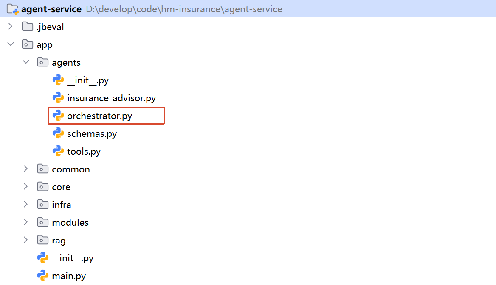
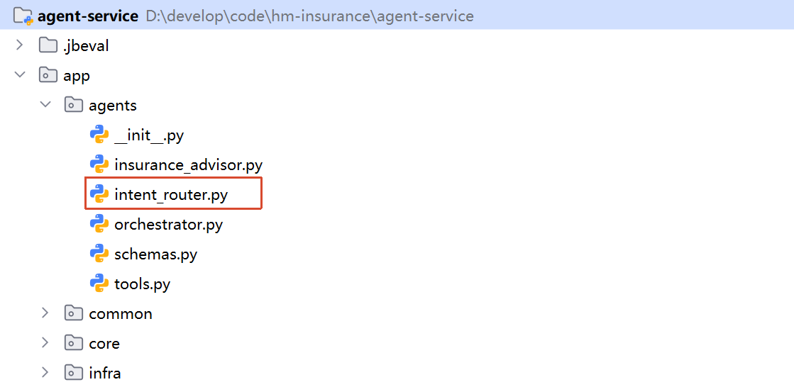
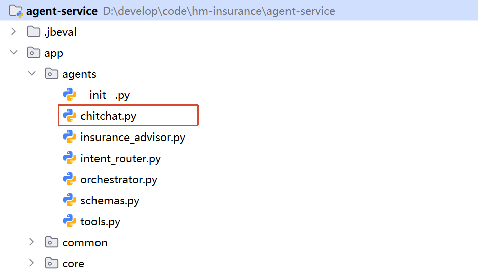
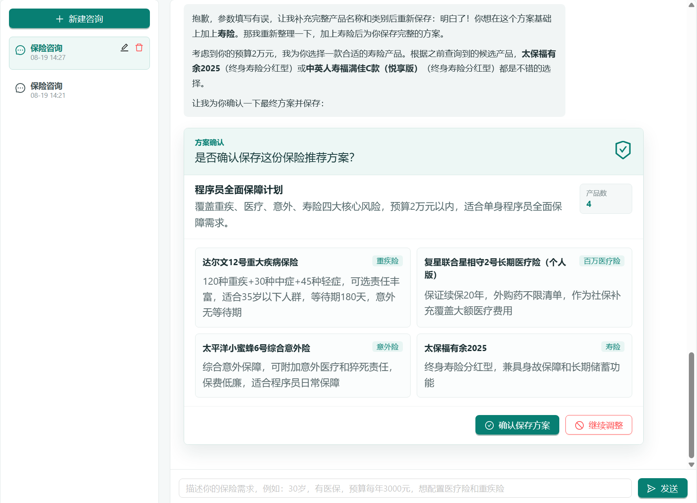

# Day11.优化保险顾问Agent

> 原文链接：https://my.feishu.cn/wiki/MR1RwOekQiAwbbk6n2Cc6jM1nCe

目前为止，我们的保险顾问Agent仅仅实现了基本的聊天、保险咨询和推荐，功能并不完整。今天我们就用LangGraph来完善和优化保险顾问Agent

# 1. Thinking In LangGraph
开发一个LangGraph的Agent必须以LangGraph的思维来思考、分析业务。LangGraph的组成包括：
- Node：节点
- Edge：边，连接节点
- State：数据
Node和Edge取决于业务流程，我们需要梳理业务流程，按照业务边界来划分职责，形成一个个Node，然后按业务流程顺序来定义节点执行顺序，这就是Edge。所以只要分析清楚了业务流程，Node和Edge就确定了。
我们就按照这样的顺序来思考、分析需求。

## 1.1 业务流程分析
保险智能客服的职责很多，包括：

| 能力 | 说明 |
| --- | --- |
| 闲聊 | 用户与 AI 顾问聊天，但最终要引导到保险产品上 |
| 产品咨询 | 用户与 AI 顾问对话，询问保险产品信息，了解产品 |
| 保险组合推荐 | AI 根据用户年龄、预算、职业和需求，不断与用户沟通，最终确定保险组合方案 |
| 产品投保 | 用户从方案中的某个产品进入传统投保流程，逐步完成投保演示。 |
| 理赔咨询 | AI 查询用户保单、解释条款、说明理赔流程、查询理赔进度。 |
| 人工 | 一些复杂问题最终还是要由人工来解决 |
以上每一种功能对应的工作流都不同，例如：
- 保险组合推荐，基本流程为：

> [画板内容，请在原文查看]
- 投保，流程为：

> [画板内容，请在原文查看]
可以看到，每个流程都很复杂，理论上都应该由独立的智能体来完成。因此，当用户请求进入agent-service，我们需要判断用户意图，交给不同的工作流去处理。
最终工作流如下：

> [画板内容，请在原文查看]

## 1.2 Graph结构
由于保险客服的职责比较多，把所有功能全都写入一个Agent不太现实，所以我们需要把职责划分清楚，再由一个统一的编排者（**Orchestrator**）来分配工作给不同的工作流。
为了降低复杂度，我们可以把职责简化为五类：
- 闲聊
- 保险方案咨询和推荐
- 理赔咨询
- 人工
- fallback
整体个Graph的工作流结构如图：

> [画板内容，请在原文查看]
由图可知，主Graph的节点包括：
- Route：意图识别路由节点
- RecommendationPlan：保险方案推荐节点
- Claim：理赔咨询节点
- ChitChat：闲聊节点
- human_handoff：转人工
- fallback：意图无法识别的节点
这些业务节点既可以是普通函数，也可以是LangChain Agent或LangGraph子图。本项目会先接入闲聊和保险顾问两个子Agent，理赔Agent留作本章作业。

## 1.3 State
State包含的内容通常是Agent工作过程中的任务状态。
对于父Graph来说，记录整个Graph的**历史消息**是必须的，然后其核心任务是**意图识别**，而意图识别还需要知道**上一轮激活的工作流**是哪一个。因此，父Graph至少需要这些信息：
- messages：跨工作流共享的会话消息
- previous_workflow：上一轮对话的工作流
而要记录上一轮会话工作流就必须记录**本轮对话工作流**，否则无法得知上一轮会话的工作流。（因为本轮对话的工作流到了下一次会话就是上一次会话的工作流）
- active_workflow：本轮对话的工作流

# 2. 主Graph
接下来按照前面的分析，在现有app.agents包中定义主Graph。主Graph只负责意图识别和工作流编排，具体业务由不同的子Agent或子Graph完成。

## 2.1 State
在app.agents.schemas.py，补充意图类型、路由结果和主Graph的State：

```python
from dataclasses import dataclass
from typing import Literal

from langgraph.graph import MessagesState
from pydantic import BaseModel, Field

# 路由意图常量
Intent = Literal[
    "chitchat",
    "recommendation_plan",
    "claim",
    "human_handoff",
    "fallback",
]

class RouteResult(BaseModel):
    """意图识别结果"""

    intent: Intent = Field(description="本轮消息应该进入的工作流")
    reason: str = Field(description="判断该意图的理由")

class InsuranceAgentState(MessagesState):
    """保险顾问主Graph状态"""

    previous_workflow: Intent
    active_workflow: Intent
```

## 2.2 Graph
按照之前的分析，主Graph结构如图：

> [画板内容，请在原文查看]
其中包含节点：
- route
- recommendation
- claim
- chitchat
- handoff
- fallback
在app.agents包中新建orchestrator.py：


先搭建主Graph骨架：

```python
from typing import Literal

from langchain_core.messages import AIMessage
from langgraph.checkpoint.postgres.aio import AsyncPostgresSaver
from langgraph.graph import END, START, StateGraph
from langgraph.types import Command

from app.agents.schemas import (
    InsuranceAgentState,
    RouteResult,
    Intent
)

# 一、定义节点

# 1.路由节点
async def route_node(
    state: InsuranceAgentState,
) -> Command[Intent]:
    """意图识别节点，后续再完善"""

    # 1.获取active_workflow，也就是上一轮会话的工作流
    previous_workflow = state.get("active_workflow", "")

    # 2.记录上轮工作流、本轮工作流
    intent = "chitchat"
    return Command(
        update={
            "previous_workflow": previous_workflow,
            "active_workflow": intent
        },
        goto=intent,
    )

# 2.闲聊节点
async def chitchat_node(state: InsuranceAgentState) -> dict:
    return {"messages": [AIMessage("你好，今天想聊点什么？")]}

# 3.保险推荐节点
async def recommendation_node(state: InsuranceAgentState) -> dict:
    return {"messages": [AIMessage("保险推荐工作流暂未接入。")]}

# 4.理赔节点
async def claim_node(state: InsuranceAgentState) -> dict:
    return {"messages": [AIMessage("理赔工作流暂未接入。")]}

# 5.人工节点
def human_handoff_node(state: InsuranceAgentState) -> dict:
    return {"messages": [AIMessage("已记录转人工请求，后续可接入人工客服系统。")]}

# 6.fallback节点
def fallback_node(state: InsuranceAgentState) -> dict:
    return {"messages": [AIMessage("我还不能确定你的需求，请说明是想咨询保险、推荐方案还是办理理赔。")]}

# 二、定义主Graph
def init_insurance_orchestrator(
    checkpointer: AsyncPostgresSaver,
):
    """初始化保险顾问主Graph"""

    builder = StateGraph(InsuranceAgentState, )
    builder.add_node("route", route_node)
    builder.add_node("chitchat", chitchat_node)
    builder.add_node("recommendation_plan", recommendation_node)
    builder.add_node("claim", claim_node)
    builder.add_node("human_handoff", human_handoff_node)
    builder.add_node("fallback", fallback_node)

    builder.add_edge(START, "route")
    builder.add_edge("chitchat", END)
    builder.add_edge("recommendation_plan", END)
    builder.add_edge("claim", END)
    builder.add_edge("human_handoff", END)
    builder.add_edge("fallback", END)

    return builder.compile(checkpointer=checkpointer)
```
好了，主图的工作流已经搭好了，接下来就是完善其中的细节了。

## 2.3 生命周期管理
之前保险顾问对接的是insurance_advisor，但现在又了主Graph了，就必须对接主Graph，insurance_advisor只是其中一个子Agent.
我们需要把主Graph交给FastAPI管理，注入app.state中，这样对话接口就会以主Graph作为Agent入口。
修改app.main.py中的生命周期函数：

```python
from app.agents.orchestrator import init_insurance_orchestrator

# 生命周期管理（预留）
@asynccontextmanager
async def lifespan(app: FastAPI):
    logger.info(f"【{settings.app.name}】应用启动中...")
    from app.infra.database import check_database, close_database
    from app.rag import close_rag
    try:
        # 1.检查业务数据库连接
        await check_database()
        # 2.初始化Checkpointer
        checkpointer = await init_checkpointer()
        # 3.初始化保险顾问Agent
        app.state.agent = init_insurance_orchestrator(checkpointer)
        yield
    finally:
        logger.info("应用关闭中... ")
        # 3.关闭RAG资源
        close_rag()
        # 4.关闭Checkpointer连接池
        await close_checkpointer()
        # 5.关闭SQLAlchemy连接池
        await close_database()
```
app.modules.chat.router.py和依赖注入逻辑不需要修改。它们只依赖request.app.state.agent是一个可运行的Graph，并不关心内部节点如何实现。
现在重启服务，已经可以实现基本的对话调用了，虽然回复消息都是假的。

# 3. 意图识别
意图识别就是让模型根据之前的聊天信息和用户这一次的提问来判断接下来应该做什么。不过，万一模型识别出错了，比如网络故障，我们还要做好兜底方案。
常见的意图识别方案有：
- **寒暄识别**：匹配到寒暄类对话，直接返回固定的结果
- **本地小模型**：交给本地小模型去做意图识别
- **兜底方案**：如果意图识别模型故障，改用备用模型或传统规则识别
流程如图：

> [画板内容，请在原文查看]
> **说明**：在企业中，为了降低成本，意图识别会使用微调过的本地小模型，不过咱们项目中暂时都用DeepSeek代替。

## 3.1 意图识别工具
在app.agents包中新建intent_router.py文件：


内容如下：

```python
import re
from typing import Literal

from langchain.chat_models import init_chat_model
from langchain.messages import HumanMessage, SystemMessage

from app.agents.schemas import RouteResult
from app.core.config import settings
from app.core.logging import get_logger

logger = get_logger(__name__)

SYSTEM_PROMPT = """
你是保险商城智能客服的意图识别节点，请判断用户消息应该交给哪个工作流。

intent只能从以下选项中选择：
- recommendation_plan：保险产品咨询、产品条款、保险推荐、方案管理和投保咨询
- claim：报案、理赔责任、理赔材料、理赔流程和理赔进度
- human_handoff：投诉、高风险问题或用户明确要求人工服务
- chitchat：与保险业务无关的普通聊天
- fallback：无法判断用户意图
""".strip()

class IntentRouter:

    def __init__(self) -> None:
        model = init_chat_model(
            model=settings.llm.chat_model,
            model_provider="deepseek",
            api_key=settings.llm.api_key,
            extra_body={"thinking": {"type": "disabled"}},
        )
        self.model = model.with_structured_output(RouteResult)

    async def route(
        self,
        message: str,
        context: str
    ) -> RouteResult | str:
        # 1.简单寒暄优先使用规则处理
        social_intent = match_social_intent(message)
        if social_intent:
            return response_by_social_intent(social_intent)

        # 2.非寒暄消息，交给模型识别
        try:
            result = await self.model.ainvoke(
                [
                    SystemMessage(content=SYSTEM_PROMPT),
                    HumanMessage(f"历史对话信息：{context}\n用户本轮消息：{message}\n"),
                ]
            )
            logger.info("模型意图识别完成", route_result=result)
            return result
        except Exception:
            logger.exception("模型意图识别失败")
            return RouteResult(
                intent="fallback",
                reason="模型意图识别失败",
            )

# 基于规则的识别是否为寒暄

# 寒暄类型枚举
SocialIntent = Literal["greeting", "thanks", "goodbye"]
# 寒暄的匹配规则
SOCIAL_PATTERNS = {
    "greeting": (
        r"(你|您)?好(呀|啊|哦)?",
        r"嗨",
        r"哈喽",
        r"hello",
        r"hi",
        r"在吗",
    ),
    "thanks": (
        r"谢谢(你|您)?",
        r"多谢(你|您)?",
        r"感谢(你|您)?",
        r"辛苦了",
    ),
    "goodbye": (
        r"再见",
        r"拜拜",
        r"先这样",
        r"没事了",
    ),
}
# 寒暄的固定回复
SOCIAL_RESPONSES = {
    "greeting": "您好，我是您的保险顾问，可以帮您咨询产品、推荐方案或办理理赔。",
    "thanks": "不客气，后续有保险问题可以随时问我。",
    "goodbye": "好的，后续需要帮助时随时联系我。",
}

def normalize_message(message: str) -> str:
    """格式化消息，去掉无效字符"""

    return re.sub(r"[\s，。！？、,.!?~～]", "", message).lower()

def match_social_intent(message: str) -> SocialIntent | None:
    """基于规则匹配的路由"""

    normalized = normalize_message(message)
    for intent, patterns in SOCIAL_PATTERNS.items():
        if any(re.fullmatch(pattern, normalized) for pattern in patterns):
            return intent
    return None

def response_by_social_intent(intent: SocialIntent):
    """根据规则识别出的意图返回固定回复"""

    return SOCIAL_RESPONSES.get(intent)

intent_router = IntentRouter()
```

## 3.2 修改主Graph
意图识别工具准备完成后，修改app.agents.orchestrator.py中的route_node()，把识别结果写入主Graph的State，并跳转到对应工作流：

```python
from langchain_core.messages import AIMessage, BaseMessage
from langgraph.checkpoint.postgres.aio import AsyncPostgresSaver
from langgraph.graph import END, START, StateGraph
from langgraph.types import Command

from app.agents.schemas import InsuranceAgentState, Intent
from .intent_router import intent_router

# 一、定义节点

# 1.路由节点
async def route_node(
    state: InsuranceAgentState,
) -> Command[Intent]:
    """意图识别节点，后续再完善"""
    # 1.获取active_workflow，也就是上一轮会话的工作流
    previous_workflow = state.get("active_workflow", "")
    # 2.获取上轮AI消息
    previous_ai_message = find_previous_ai_message(state['messages'])
    # 3.拼接上下文
    context = f"上轮对话工作流:{previous_workflow}\n上轮对话AI回复:{previous_ai_message}"
    # 4.意图识别
    result = await intent_router.route(state['messages'][-1].content, context)

    # 4.1.返回str，说明是寒暄，直接返回固定回复，跳至END
    if isinstance(result, str):
        return Command(
            update={
                "messages": [AIMessage(content=result)],
                "previous_workflow": previous_workflow,
                "active_workflow": "chitchat",
            },
            goto=END,
        )

    # 4.2.返回RouteResult，记录上轮工作流、本轮工作流
    return Command(
        update={
            "previous_workflow": previous_workflow,
            "active_workflow": result.intent
        },
        goto=result.intent,
    )

def find_previous_ai_message(messages: list[BaseMessage]) -> str:
    """查找本轮用户消息之前最近一条可展示的AI回复"""

    for message in reversed(messages[:-1]):
        # 跳过非AIMessage
        if not isinstance(message, AIMessage):
            continue
        # 跳过工具消息
        if message.tool_calls:
            continue
        # 如果是正常AIMessage，直接返回
        if message.text:
            return message.text
    # 如果是空消息
    return ""

# 2.闲聊节点
async def chitchat_node(state: InsuranceAgentState) -> dict:
    return {"messages": [AIMessage("你好，今天想聊点什么？")]}

# 3.保险推荐节点
async def recommendation_node(state: InsuranceAgentState) -> dict:
    return {"messages": [AIMessage("保险推荐工作流暂未接入。")]}

# 4.理赔节点
async def claim_node(state: InsuranceAgentState) -> dict:
    return {"messages": [AIMessage("理赔工作流暂未接入。")]}

# 5.人工节点
def human_handoff_node(state: InsuranceAgentState) -> dict:
    return {"messages": [AIMessage("已记录转人工请求，后续可接入人工客服系统。")]}

# 6.fallback节点
def fallback_node(state: InsuranceAgentState) -> dict:
    return {"messages": [AIMessage("我还不能确定你的需求，请说明是想咨询保险、推荐方案还是办理理赔。")]}

# 二、定义主Graph
def init_insurance_orchestrator(
    checkpointer: AsyncPostgresSaver,
):
    """初始化保险顾问主Graph"""

    builder = StateGraph(InsuranceAgentState, )
    builder.add_node("route", route_node)
    builder.add_node("chitchat", chitchat_node)
    builder.add_node("recommendation_plan", recommendation_node)
    builder.add_node("claim", claim_node)
    builder.add_node("human_handoff", human_handoff_node)
    builder.add_node("fallback", fallback_node)

    builder.add_edge(START, "route")
    builder.add_edge("chitchat", END)
    builder.add_edge("recommendation_plan", END)
    builder.add_edge("claim", END)
    builder.add_edge("human_handoff", END)
    builder.add_edge("fallback", END)

    return builder.compile(checkpointer=checkpointer)

```

# 4. 闲聊
当识别出用户意图是与业务无关的开放式闲聊时，不能浪费宝贵的Agent资源，所以通常都是给一些礼貌性的回复即可。比较常见的做法是：
- **开放式闲聊**：交给模型回复，但在 Prompt 中限定身份、长度和服务边界，并要求自然地引导回业务。
- **闲聊中出现业务意图**：不要继续闲聊，路由到产品咨询、理赔、投保等对应工作流。
- **轮次统计**：统计闲聊轮次，超过一定轮次后回复固定模版，不再模型回复。如果上一轮不是闲聊，则重置次数

> [画板内容，请在原文查看]

## 4.1 State
由于闲聊工作流需要记录闲聊轮次，还需要根据上一轮工作流判断是否要重置闲聊次数，因此需要信息包括：
- chitchat_count：闲聊次数
- previous_workflow：上一轮工作流
chitchat_count只属于闲聊子Agent，因此保存在子图自己的State中。previous_workflow在主Graph的State中已经记录，子Agent的State只要继承父Graph的State即可。

## 4.2 Chitchat工作流
在app.agents包中新建chitchat.py：


Chitchat是一个独立的子Graph，因此拥有自己的State和Graph。它与主Graph共享消息和工作流字段，同时维护私有的闲聊次数。
内容如下：

```python
from typing import NotRequired

from langchain.chat_models import init_chat_model
from langchain_core.messages import AIMessage, SystemMessage
from langgraph.graph import StateGraph

from app.agents.schemas import InsuranceAgentState
from app.core.config import settings
from app.core.logging import get_logger

logger = get_logger(__name__)

SYSTEM_MESSAGE = """
你是保险智能客服，负责处理与保险业务无关的普通聊天。

要求：
1. 回复友好、自然，最多两句话。
2. 不假装有个人经历、情感、实时信息或外部能力。
3. 不回答医疗、法律、投资等高风险专业建议。
4. 每次回复都自然引导用户回到保险产品、投保或理赔业务。
5. 超出能力范围时，如实说明无法提供。
""".strip()

MAX_CHITCHAT_COUNT = 3

class ChitchatState(InsuranceAgentState):
    """闲聊子Agent状态"""

    chitchat_count: NotRequired[int]

class ChitchatAgent:

    def __init__(self) -> None:
        self.model = init_chat_model(
            model=settings.llm.chat_model,
            model_provider="deepseek",
            api_key=settings.llm.api_key,
            extra_body={"thinking": {"type": "disabled"}},
        )

    async def handle_chitchat(
        self,
        state: ChitchatState,
    ) -> dict:
        count = state.get("chitchat_count", 0)

        # 上一轮不是闲聊，重新开始计数
        if state.get("previous_workflow") != "chitchat":
            count = 0

        logger.info("处理闲聊消息", chitchat_count=count)

        if count >= MAX_CHITCHAT_COUNT:
            return {
                "messages": [
                    AIMessage("我主要协助处理保险产品、投保和理赔咨询，请告诉我想办理或了解的事项。")
                ]
            }

        response = await self.model.ainvoke(
            [SystemMessage(content=SYSTEM_MESSAGE), *state["messages"]]
        )
        return {
            "messages": [response],
            "chitchat_count": count + 1,
        }

    def build(self):
        builder = StateGraph(ChitchatState)
        builder.add_node("handle_chitchat", self.handle_chitchat)
        builder.set_entry_point("handle_chitchat")
        builder.set_finish_point("handle_chitchat")

        # 使用父Graph提供的Checkpointer，保存子图私有状态
        return builder.compile(checkpointer=True)

def init_chitchat_agent():
    return ChitchatAgent().build()
```

## 4.3 嵌入主Graph
最后修改app.agents.orchestrator.py：初始化闲聊子Agent，并用它替换原来的临时闲聊节点。
- 意图识别完了要更新主Graph的state，记录当前workflow和上一次的workflow
- Graph中的chitchat节点现在改为子图，而不是一个函数。

```python
from app.agents.chitchat import init_chitchat_agent

def init_insurance_orchestrator(
    checkpointer: AsyncPostgresSaver,
):
    """初始化保险顾问主Graph"""

    builder = StateGraph(
        InsuranceAgentState,
        context_schema=InsuranceAgentContext,
    )
    builder.add_node("route", route_node)
    builder.add_node("chitchat", init_chitchat_agent())
    builder.add_node("recommendation_plan", recommendation_node)
    builder.add_node("claim", claim_node)
    builder.add_node("human_handoff", human_handoff_node)
    builder.add_node("fallback", fallback_node)

    builder.add_edge(START, "route")
    builder.add_edge("chitchat", END)
    builder.add_edge("recommendation_plan", END)
    builder.add_edge("claim", END)
    builder.add_edge("human_handoff", END)
    builder.add_edge("fallback", END)

    return builder.compile(checkpointer=checkpointer)
```

## 4.4 stream处理subgraph消息
需要注意的是，astream_events的v3模式中，stream.messages只能处理父Graph的消息流，无法处理子Graph的消息流。
有两种解决方案：
- 使用stream.subgraphs
- 自定义stream处理逻辑

### 4.4.1 方案一（了解）
要处理子Graph的消息流必须用stream.subgraphs来获取。
也就是说，我们需要分别从stream中获取不同类型的事件，按事件类型分别async for处理：
- messages：父Graph消息流
- subgraphs：子Graph消息流
不过，需要注意的是，分开写两个async for会导致产生两个事件循环，当第一个事件循环执行完事，所有事件都没了，第二个事件循环拿不到任何数据。所以我们必须想办法让两个async for在一个事件循环中处理。
我们需要用一个库来合并异步事件流：

```python
uv add aiostream
```
然后分别定义message和subgraph处理函数，再用aiostream合并为一个stream，示例：

```python
# 2.3.只读取消息中的文本增量
async def stream_messages():
    async for message in stream.messages:
        ...

# 2.4.判断是否有custom事件
async def stream_subgraphs():
    async for event in stream.subgraphs:
        ...

# 2.5.合并Message处理和custom事件处理
merged = astream.merge(stream_messages(), stream_subgraphs())
async with merged.stream() as streamer:
    async for event in streamer:
        ...
```
修改app.modules.chat.service.py，完整代码如下：

```python
from collections.abc import AsyncIterator
from aiostream import stream as astream
from fastapi.sse import ServerSentEvent
from langchain_core.messages import HumanMessage
from langgraph.graph.state import CompiledStateGraph
from sqlalchemy.ext.asyncio import AsyncSession

from app.modules.chat.schemas import ChatRequest
from app.modules.chat_thread.exceptions import ChatThreadNotFoundError
from app.modules.chat_thread.repository import ChatThreadRepository
from app.core.logging import get_logger
logger = get_logger(__name__)

class ChatService:
    def __init__(self, session: AsyncSession, agent: CompiledStateGraph):
        self.repository = ChatThreadRepository(session)
        self.agent = agent

    async def stream_chat(
        self,
        user_id: int,
        request: ChatRequest,
    ) -> AsyncIterator[ServerSentEvent]:
        # 1.校验会话是否属于当前用户
        thread = await self.repository.find_owned(
            request.thread_id,
            user_id,
        )
        if thread is None:
            raise ChatThreadNotFoundError

        # 2.校验通过后，调用Agent

        # 2.1.准备Agent输入
        _input = {"messages": [HumanMessage(content=request.message)]}
        config = {"configurable": {"thread_id": str(request.thread_id)}}

        # 2.2.使用v3协议获取异步事件流
        stream = await self.agent.astream_events(
            _input,
            config,
            version="v3",
        )

        # 2.3.只读取消息中的文本增量
        async def stream_messages():
            async for message in stream.messages:
                async for text in message.text:
                    yield ServerSentEvent(data=text, event="message")

        # 2.4.判断是否有subgraphs事件
        async def stream_subgraphs():
            async for sub_stream in stream.subgraphs:
                async for message in sub_stream.messages:
                    async for text in message.text:
                        yield ServerSentEvent(data=text, event="message")

        # 2.5.合并Message处理和subgraphs事件处理
        merged = astream.merge(stream_messages(), stream_subgraphs())
        async with merged.stream() as streamer:
            async for event in streamer:
                yield event

        # 2.6.返回结束标识
        yield ServerSentEvent(data="[DONE]", event="done")
```

### 4.4.2 方案二（推荐）
如果觉得这个方案麻烦，还有第二种方案，就是不使用官方的stream.messages，而是自定义stream的处理逻辑。
不过，stream的数据格式比较复杂，核心信息有：

```python
# messages类型event
{
    "method": "messages",
    "params": {
        "namespace":"chitchat",
        "timestamp": 1787117130112,
        "data": ( # message类型事件，data是tuple格式
            # tuple的第一个位置可能是dict，也可能是AIMessage（手动返回AIMessage的情况）
            {"event": "content-block-delta", "delta": {"type": "text-delta", "text": "你好"}},
            {"thread_id": "973773a6-4e67-48f1-973a-6592bbff464b", ...}
        ),
    },
    "seq": 416,
    "type": "event"
}

# custom类型event
{
    "method": "custom",
    "params": {
        "namespace":"chitchat",
        "timestamp": 1787117130112,
        "data": {}, # custom类型事件，data格式由事件发起者决定，不确定类型
    },
    "seq": 416,
    "type": "event"
}
```
自定义stream处理就需要手动解析event信息，判断event的method类型，根据类型处理不同类型数据。这种做法的好处是不管是主Graph还是子Graph的event都可以统一处理。
例如，我们要统一处理主Graph和子Graph的消息，就可以修改app.modules.chat.service.py，完整代码如下：

```python
from collections.abc import AsyncIterator
from fastapi.sse import ServerSentEvent
from langchain_core.messages import HumanMessage
from langgraph.graph.state import CompiledStateGraph
from langgraph.stream import CustomTransformer
from sqlalchemy.ext.asyncio import AsyncSession

from app.modules.chat.schemas import ChatRequest
from app.modules.chat_thread.exceptions import ChatThreadNotFoundError
from app.modules.chat_thread.repository import ChatThreadRepository
from app.core.logging import get_logger
logger = get_logger(__name__)

class ChatService:
    def __init__(self, session: AsyncSession, agent: CompiledStateGraph):
        self.repository = ChatThreadRepository(session)
        self.agent = agent

    async def stream_chat(
        self,
        user_id: int,
        request: ChatRequest,
    ) -> AsyncIterator[ServerSentEvent]:
        # 1.校验会话是否属于当前用户
        thread = await self.repository.find_owned(
            request.thread_id,
            user_id,
        )
        if thread is None:
            raise ChatThreadNotFoundError

        # 2.校验通过后，调用Agent

        # 2.1.准备Agent输入
        _input = {"messages": [HumanMessage(content=request.message)]}
        config = {"configurable": {"thread_id": str(request.thread_id)}}

        # 2.2.使用v3协议获取异步事件流
        stream = await self.agent.astream_events(
            _input,
            config,
            version="v3",
        )

        async for event in stream:
            method = event['method']
            # 判断事件类型，可以是messages、interrupts等等
            if method == 'messages':
                data = event['params']['data'][0]
                if isinstance(data, AIMessage):
                    yield ServerSentEvent(data=data.text, event="message")
                elif data.get('delta') and data['delta'].get('text'):
                    yield ServerSentEvent(data=data['delta'].get('text'), event="message")

        # 2.6.返回结束标识
        yield ServerSentEvent(data="[DONE]", event="done")
```

# 5. 接入保险推荐Agent
保险产品咨询、条款问答和方案推荐都由现有app.agents.insurance_advisor.py负责。它本身就是create_agent()生成的Graph，可以直接作为主Graph的子节点。
先修改app.agents.insurance_advisor.py。子Agent不再接收主Checkpointer实例，而是声明checkpointer=True，使用父Graph提供的Checkpointer保存自己的状态：

```python
from langchain.agents import create_agent
from langchain.chat_models import init_chat_model

from app.agents.tools import (
    query_candidate_products,
    query_product_clause,
)
from app.core.config import settings
from app.core.logging import get_logger

logger = get_logger(__name__)

SYSTEM_PROMPT = """
你是“安心保”的智能保险顾问。你可以帮助用户推荐保险，回答用户保险条款问题。
- 当信息不足时，应先询问用户基本信息，形成用户画像。
- 然后查询候选产品，根据用户画像，推荐合适的保险组合，与用户确认后，调用工具保存方案。

- 用户询问保险产品的条款问题时，调用query_product_clause查询对应产品的保险条款，再根据检索结果回答。
- 你的回答必须是基于检索到的保险条款，不要编造保险条款中没有的信息。如果没有相关条款，如实告知用户。
- 回答中的每个事实陈述必须紧跟[source_id]的引用标记。例如：这款产品的等待期为180天。[ref-001]
- 回答要简短、精确，不要长篇大论。
"""

def init_insurance_advisor():
    """初始化保险咨询与推荐子Agent"""

    model = init_chat_model(
        model=settings.llm.chat_model,
        model_provider="deepseek",
        api_key=settings.llm.api_key,
        extra_body={"thinking": {"type": "disabled"}},
    )
    return create_agent(
        model=model,
        tools=[
            query_candidate_products,
            query_product_clause,
            save_insurance_plan,
        ],
        system_prompt=SYSTEM_PROMPT,
        checkpointer=True,
    )
```
然后修改app.agents.orchestrator.py，用保险顾问子Agent替换临时的recommendation_node：

```python
from app.agents.insurance_advisor import init_insurance_advisor

def init_insurance_orchestrator(
    checkpointer: AsyncPostgresSaver,
):
    builder = StateGraph(
        InsuranceAgentState,
        context_schema=InsuranceAgentContext,
    )
    builder.add_node("route", route_node)
    builder.add_node("chitchat", init_chitchat_agent())
    builder.add_node("recommendation_plan", init_insurance_advisor())
    builder.add_node("claim", claim_node)
    builder.add_node("human_handoff", human_handoff_node)
    builder.add_node("fallback", fallback_node)

    builder.add_edge(START, "route")
    builder.add_edge("chitchat", END)
    builder.add_edge("recommendation_plan", END)
    builder.add_edge("claim", END)
    builder.add_edge("human_handoff", END)
    builder.add_edge("fallback", END)

    return builder.compile(checkpointer=checkpointer)
```

# 6. 完善保险推荐Agent（了解）
主Graph和闲聊子Agent已经完成，接下来把前面实现的保险顾问Agent作为recommendation_plan工作流接入，并解决两个遗留问题：
- 查询消息历史时看不到引用信息
- 保险推荐方案没有人工确认

## 6.1 保存引用信息(了解）
Day09中实现了引用溯源功能，其中会把查询的法律条款通过custom事件以additional_info把引用片段实时发送给前端。
但custom事件不会自动进入Graph的State，也就无法持久保存。因此在查询消息历史时，无法从StateSnapshot中查询additional_info，导致刷新页面后无法在页面展示条款引用来源。
因此，我们必须手动把additional_info保存到State中。

### 6.1.1 扩展主Graph State
由于additional_info是在主Graph的stream调用中获取，所以additional_info**必须记录在主Graph中**。
而且，在一个会话中可能会有多次条款问题，每一次AI回答条款问题时都会查询并产生additional_info，为了区分不同AIMessage的additional_info，我们需要以dict形式存储，字典的key是AI消息id，value是该消息使用的additional_info：
修改app.agents.schemas.py，定义字典合并Reducer。外层字典的key是AI消息id，value是该消息使用的引用信息：

```python
from typing import Annotated, Any

AdditionalInfo = dict[str, Any]

def merge_additional_info(
    left: dict[str, AdditionalInfo],
    right: dict[str, AdditionalInfo],
) -> dict[str, AdditionalInfo]:
    """按照AI消息id合并引用信息"""
    if not left:
        return right
    return left.update(right)

class InsuranceAgentState(MessagesState):
    """保险顾问主Graph状态"""

    active_workflow: Intent     # 本轮对话激活的工作流
    previous_workflow: Intent   # 上一轮对话激活的工作流
    additional_info: Annotated[ # 记录AI回答中的引用来源信息
        dict[str, AdditionalInfo],
        merge_additional_info
    ]
```

### 6.1.2 适配子Graph自定义事件流
引入子Agent后，模型消息和Tool的custom事件位于子Graph中。根Graph的messages和custom只能读取根层事件。所以，这里推荐自己处理stream的event事件，而不是调用stream.messages和stream.subgraphs
修改app.modules.chat.service.py。处理流式事件时同时记录最终AI消息id和引用信息，流结束后再调用aupdate_state()写入State：

```python
from collections.abc import AsyncIterator
from fastapi.sse import ServerSentEvent
from langchain_core.messages import HumanMessage, AIMessage
from langgraph.graph.state import CompiledStateGraph
from langgraph.stream import CustomTransformer
from sqlalchemy.ext.asyncio import AsyncSession

from app.agents.schemas import AdditionalInfo
from app.modules.chat.schemas import ChatRequest
from app.modules.chat_thread.exceptions import ChatThreadNotFoundError
from app.modules.chat_thread.repository import ChatThreadRepository
from app.core.logging import get_logger
logger = get_logger(__name__)

class ChatService:
    def __init__(self, session: AsyncSession, agent: CompiledStateGraph):
        self.repository = ChatThreadRepository(session)
        self.agent = agent

    async def stream_chat(
        self,
        user_id: int,
        request: ChatRequest,
    ) -> AsyncIterator[ServerSentEvent]:
        # 1.校验会话是否属于当前用户
        thread = await self.repository.find_owned(
            request.thread_id,
            user_id,
        )
        if thread is None:
            raise ChatThreadNotFoundError

        # 2.校验通过后，调用Agent

        # 2.1.准备Agent输入
        _input = {"messages": [HumanMessage(content=request.message)]}
        config = {"configurable": {"thread_id": str(request.thread_id)}}

        # 2.2.使用v3协议获取异步事件流
        stream = await self.agent.astream_events(
            _input,
            config,
            version="v3",
            transformers=[CustomTransformer],
        )

        # 2.2.1.记录AIMessage的ID和引用信息
        final_message_id: str | None = None
        additional_info: AdditionalInfo = {}

        async for event in stream:
            logger.info(event)
            method = event['method']
            # 判断事件类型，可以是messages、interrupts等等
            if method == 'messages':
                data = event['params']['data'][0]
                if isinstance(data, AIMessage):
                    yield ServerSentEvent(data=data.content, event="message")
                elif data.get('delta') and data['delta'].get('text'):
                    yield ServerSentEvent(data=data['delta'].get('text'), event="message")
                elif data.get('event') == 'message-start' and data.get('id'):
                    # 第一个消息片段会传递Message的id
                    final_message_id = data.get('id')

            if method == 'custom':
                data = event["params"]["data"]
                if isinstance(data, dict) and data.get("type") == "additional_info":
                    additional_info = data.get("data", {})
                    yield ServerSentEvent(data=additional_info, event="additional_info")

        if final_message_id and additional_info:
            # 将additional_info更新到state中
            await self.agent.aupdate_state(
                config,
                {"additional_info": {final_message_id: additional_info}}
            )
        # 2.6.返回结束标识
        yield ServerSentEvent(data="[DONE]", event="done")
```
> 根Graph自己生成的fallback、转人工等回复从stream.messages读取；保险顾问和闲聊子Agent的回复从subgraph.messages读取。这样才能继续保持真正的逐字流式输出。

### 6.1.3 恢复历史引用
查询历史消息时，从State中取出additional_info，再根据每条AI消息的id找到对应引用。修改app.modules.chat_thread.service.py中的get_history()：

```python
async def get_history(
    self,
    thread_id: UUID,
    user_id: int,
) -> ChatHistoryResponse:
    thread = await self.repository.find_owned(thread_id, user_id)
    if thread is None:
        raise ChatThreadNotFoundError

    config = {"configurable": {"thread_id": str(thread_id)}}
    snapshot = await self.agent.aget_state(config)
    additional_infos = snapshot.values.get("additional_info", {})

    messages = []
    for message in snapshot.values.get("messages", []):
        if isinstance(message, HumanMessage):
            role = "user"
        elif isinstance(message, AIMessage):
            role = "assistant"
        else:
            continue

        if message.text:
            messages.append(
                ChatMessageResponse(
                    role=role,
                    content=message.text,
                    additional_info=additional_infos.get(message.id),
                )
            )

    return ChatHistoryResponse(
        thread_id=thread_id,
        messages=messages,
    )
```

## 6.2 人工确认保险方案（了解）
保险推荐方案会写入数据库，属于有业务影响的操作，不能仅凭模型判断直接保存。这里使用LangGraph的interrupt()暂停Agent，把方案交给用户确认。

### 6.2.1 在Tool中发起中断
修改app.agents.tools.py中的save_insurance_plan()：

```python
from langgraph.types import interrupt

@tool
async def save_insurance_plan(
    plan: InsurancePlanCreate,
    runtime: ToolRuntime[InsuranceAgentContext],
) -> dict[str, str]:
    """请用户确认后，保存当前保险推荐方案。"""

    decision = interrupt(  # 中断执行，把方案发给用户看看
        {
            "plan": plan.model_dump(mode="json"),
            "confirm_info": "是否确认保存这份保险推荐方案？",
            "action": ["approve", "reject"],
        }
    )
    # 如果用户拒绝，则拒绝向下执行
    if decision.get("action") != "approve":
        return {"message": f"用户取消保存保险方案, 原因:{decision.get('reject_reason')}"}

    async with session_scope() as session:
        service = InsurancePlanService(session)
        plan_id = await service.create_plan(
            user_id=runtime.context.user_id,
            data=plan,
        )

    return {
        "plan_id": str(plan_id),
        "message": "保险方案保存成功",
    }
```

### 6.2.2 接收确认结果
对话接口既可能接收新的用户消息，也可能接收对上一次中断的确认结果。修改app.modules.chat.schemas.py：

```python
from typing import Any
from uuid import UUID

from pydantic import BaseModel, Field

class ChatRequest(BaseModel):
    """基础对话请求"""

    thread_id: UUID
    message: str | None = Field(default=None, min_length=1)
    decision: dict[str, Any] | None = None
```
然后修改app.modules.chat.service.py中准备Graph输入的部分：

```python
from collections.abc import AsyncIterator
from fastapi.sse import ServerSentEvent
from langchain_core.messages import HumanMessage, AIMessage
from langgraph.graph.state import CompiledStateGraph
from langgraph.stream import CustomTransformer
from langgraph.types import Command
from sqlalchemy.ext.asyncio import AsyncSession

from app.agents.schemas import AdditionalInfo
from app.modules.chat.schemas import ChatRequest
from app.modules.chat_thread.exceptions import ChatThreadNotFoundError
from app.modules.chat_thread.repository import ChatThreadRepository
from app.core.logging import get_logger
logger = get_logger(__name__)

class ChatService:
    def __init__(self, session: AsyncSession, agent: CompiledStateGraph):
        self.repository = ChatThreadRepository(session)
        self.agent = agent

    async def stream_chat(
        self,
        user_id: int,
        request: ChatRequest,
    ) -> AsyncIterator[ServerSentEvent]:
        # 1.校验会话是否属于当前用户
        thread = await self.repository.find_owned(
            request.thread_id,
            user_id,
        )
        if thread is None:
            raise ChatThreadNotFoundError

        # 2.校验通过后，调用Agent

        # 2.1.准备Agent输入
        if request.decision:
            _input = Command(resume=request.decision)
        else:
            _input = {"messages": [HumanMessage(content=request.message)]}

        config = {"configurable": {"thread_id": str(request.thread_id)}}

        # 2.2.使用v3协议获取异步事件流
        stream = await self.agent.astream_events(
            _input,
            config,
            version="v3",
            transformers=[CustomTransformer],
            context = {"user_id": user_id}
        )

        # 2.2.1.记录AIMessage的ID和引用信息
        final_message_id: str | None = None
        additional_info: AdditionalInfo = {}

        async for event in stream:
            method = event['method']
            # 判断事件类型，可以是messages、interrupts等等
            if method == 'messages':
                data = event['params']['data'][0]
                if isinstance(data, AIMessage):
                    yield ServerSentEvent(data=data.content, event="message")
                elif data.get('delta') and data['delta'].get('text'):
                    yield ServerSentEvent(data=data['delta'].get('text'), event="message")
                elif data.get('event') == 'message-start' and data.get('id'):
                    # 第一个消息片段会传递Message的id
                    final_message_id = data.get('id')

            if method == 'custom':
                data = event["params"]["data"]
                if isinstance(data, dict) and data.get("type") == "additional_info":
                    additional_info = data.get("data", {})
                    yield ServerSentEvent(data=additional_info, event="additional_info")

        interrupts = await stream.interrupts()
        for item in interrupts:
            yield ServerSentEvent(data=item.value, event="interrupt")

        if final_message_id and additional_info:
            await self.agent.aupdate_state(
                config,
                {"additional_info": {final_message_id: additional_info}}
            )
        # 2.6.返回结束标识
        yield ServerSentEvent(data="[DONE]", event="done")
```

### 6.2.3 查询会话历史的interrupt
查询会话历史时也需要把interrupt查出来，以防用户未处理完成interrupt就意外终止了对话。
我们修改app.modules.chat_thread.service.py中的get_history()：

```python

class ChatThreadService:

    # ...略

    async def get_history(
        self,
        thread_id: UUID,
        user_id: int,
    ) -> ChatHistoryResponse:
        # 1.校验会话归属
        thread = await self.repository.find_owned(thread_id, user_id)
        if thread is None:
            raise ChatThreadNotFoundError

        # 2.读取Agent最新状态
        config = {"configurable": {"thread_id": str(thread_id)}}
        snapshot = await self.agent.aget_state(config)

        # 3.读取additional_info
        additional_infos = snapshot.values.get("additional_info", {})

        # 4.处理消息历史
        messages = []
        for message in snapshot.values.get("messages", []):
            # 4.1.只保留用户消息和AI消息
            if isinstance(message, HumanMessage):
                role = "user"
            elif isinstance(message, AIMessage):
                role = "assistant"
            else:
                continue

            # 4.2.组装信息
            if message.text:
                messages.append(
                    ChatMessageResponse(
                        role=role,
                        content=message.text,
                        additional_info=additional_infos.get(message.id),
                    )
                )

        # 5.处理interrupt
        interrupts = None
        if hasattr(snapshot, 'interrupts') and snapshot.interrupts:
            interrupts = snapshot.interrupts
        elif hasattr(snapshot, 'tasks') and snapshot.tasks:
            for task in snapshot.tasks:
                if hasattr(task, 'interrupts') and task.interrupts:
                    interrupts = task.interrupts
                    break

        return ChatHistoryResponse(
            thread_id=thread_id,
            messages=messages,
            interrupt = interrupts[0].value if interrupts else None
        )
```

## 6.3 测试
启动服务后，与客服对话，当确认方案后，会看到AI的方案确认框：


